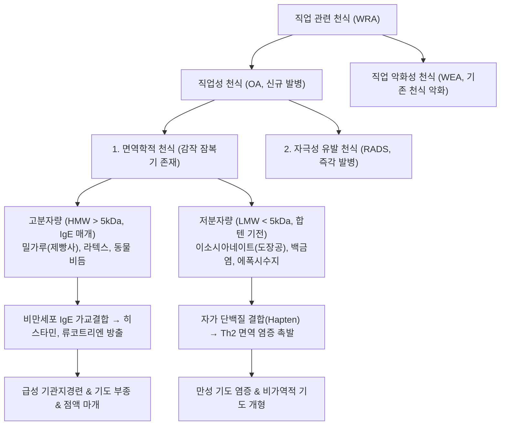
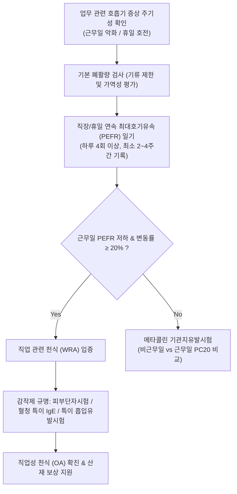

# 🩺 직업 관련 천식 (Work-Related Asthma)

> **핵심 3줄 요약 (Key Summary)**:
> - 📍 병소 부위 & 해부·병태생리: 직장 환경 내 특정 공기 중 노출 물질(알레르기 감작제 또는 자극성 에어로졸/먼지)에 의해 유발되는 기관지 평활근 수축, 기도 점막 부종, 점액 과다분비 및 가역적 기류 제한.
> - 🚩 전형적 임상 양상: 근무일 또는 교대 근무 중 악화되고 주말, 휴가, 비근무일에 뚜렷하게 호전되는 기침, 호흡곤란, 천명(wheezing), 흉부 압박감의 시간적 주기성.
> - 🛠️ 핵심 검사 & 치료 전략: 직장 근무일과 휴일의 연속 최대호기유속(PEFR) 일기 작성(20% 이상 일중/근무 주기 변동 확인), 메타콜린 유발시험 및 특이 항원 유발시험; 치료의 핵심은 원인 노출의 완전 차단/직종 전환 및 흡입 스테로이드(ICS)/지속성 베타2-작용제(LABA) 병용.
> - <font color="#fa7e7e">⚠️ 응급 의뢰 레드플래그: 속효성 흡입제(SABA)에 반응하지 않는 급성 중증 천식 발작, 맥박 > 120회/분, 기좌호흡, 말하기 곤란, 침묵 폐(silent chest) 발견 즉시 119 구급대를 통한 응급실 이송.</font>

---

## 📌 목차
1. [질환 개요 & 해부학적 병태생리](#1-질환-개요--해부학적-병태생리)
2. [병태생리 메커니즘 & 원인 물질 분류](#2-병태생리-메커니즘--원인-물질-분류)
3. [임상 증상 & 이학적 검사 알고리즘](#3-임상-증상--이학적-검사-알고리즘)
4. [감별 진단 매트릭스 (Differential Diagnosis)](#4-감별-진단-매트릭스-differential-diagnosis)
5. [한의학적 변증 & 체질별 한약 프로토콜](#5-한의학적-변증--체질별-한약-프로토콜)
6. [양방 치료 & 직업 관리 기준 (Conventional Treatment & Referral)](#6-양방-치료--직업-관리-기준-conventional-treatment--referral)
7. [환자 관리 & 생활습관 티칭 가이드](#7-환자-관리--생활습관-티칭-가이드)
8. [💡 진료실 핵심 필기 & 임상 노하우 (Melt-In 심화 집약)](#8--진료실-핵심-필기--임상-노하우-melt-in-심화-집약)
9. [출처 및 학술 참고 문헌 (References)](#9-출처-및-학술-참고-문헌-references)

---

## 1. 질환 개요 & 해부학적 병태생리

### 1) 정의 및 분류 (Work-Related Asthma vs. Occupational Asthma)
**직업 관련 천식(Work-Related Asthma, WRA)** 은 성인 천식의 15~25%를 차지하는 광범위한 임상 범주로, 직장 환경과의 연관성에 따라 크게 두 가지로 분류된다:

1. **직업성 천식 (Occupational Asthma, OA)**:
   * 직장 내 특정 유해 물질에 직접적으로 노출됨으로써 **새롭게 발생(de novo)** 한 천식.
   * **면역학적 천식 (Immunologic OA)**: 수주~수개월의 잠복기(감작 기간)를 거쳐 IgE 매개 또는 비IgE 매개 면역 반응으로 발병.
   * **비면역학적 / 자극성 천식 (Non-immunologic / Irritant-induced OA)**: 잠복기 없이 고농도 자극 가스/에어로졸에 1회 이상 노출되어 발생하는 반응성 기도 기능장애 증후군([[자극성 가스 흡입 손상|RADS]]) 포함.
2. **직업 악화성 천식 (Work-Exacerbated Asthma, WEA)**:
   * 기존에 이미 앓고 있던 천식이 직장의 비특이적 자극 물질(먼지, 온도 변화, 화학 증기, 신체적 과로)에 노출되어 일시적으로 증상이 심해지는 경우.

### 2) 해부학적 병소 및 기도 개형
* **병소 부위**: 기관지 및 세기관지 점막 상피, 점막하 고유층, 기관지 평활근.
* **병리적 변화**: 호산구 및 림프구 중심의 기도 점막 염증, 비만세포 탈과립, 기저막 비후, 평활근 비대 및 배상세포 과형성으로 인한 기도 개형(airway remodeling). 노출 차단이 지연될 경우 영구적 비가역적 폐기능 저하로 진행함.

---

## 2. 병태생리 메커니즘 & 원인 물질 분류



### 1) 고분자량 감작제 (High Molecular Weight, HMW)
* 단백질 또는 다당류 기원의 분자량 > 5 kDa 물질.
* 전형적인 제I형 즉시형 과민반응(IgE 매개)을 유발함.
* **대표 원인**:
  * 제빵사 천식(Baker's asthma): 밀가루, 호밀, 곡물 분진, 효소(아밀라아제).
  * 실험실 작업자/수의사: 쥐, 토끼 등 실험동물 비듬 및 뇨단백.
  * 의료인: 라텍스 고무장갑.
  * 농부: 저장 진드기, 버섯 포자.

### 2) 저분자량 감작제 (Low Molecular Weight, LMW)
* 분자량 < 5 kDa의 화학물질.
* 그 자체로는 항원성이 없으나 체내 알부민 등 단백질과 결합하여 **완전 항원(Hapten-carrier complex)** 을 형성, 세포 매개 또는 변형된 면역 반응을 촉발함.
* **대표 원인**:
  * 디이소시아네이트(TDI, MDI): 자동차 도장, 폴리우레탄 폼 제조, 스프레이 페인트 작업. (가장 흔한 직업성 천식 원인)
  * 금속염: 백금염, 니켈, 크롬(도금공, 용접공).
  * 플라스틱 및 접착제: 에폭시 수지, 무수프탈산.
  * 목재 분진: 붉은 삼나무(Western red cedar의 plicatic acid).

---

## 3. 임상 증상 & 이학적 검사 알고리즘

### 1) 전형적 임상 증상 패턴
* **주기적 악화 양상**:
  * 근무 시작 수시간 후 또는 퇴근 후 저녁/야간에 기침, 쌕쌕거림(천명), 호흡곤란, 흉부 압박감 악화.
  * 주말, 휴가, 연차 기간 동안 증상이 현저히 완화되거나 완전 소실됨.
  * 월요일 출근 시 또는 휴가 복귀 첫날 증상이 가장 극심하게 재발("월요병 호흡곤란").
* **동반 증상**: 눈물, 콧물, 재채기(직업성 비결막염이 천식 발생 수개월 전에 선행하는 경우가 흔함).

### 2) 진단 검사 알고리즘 (Diagnostic Workflow)



* **연속 PEFR 일기 (Peak Expiratory Flow Rate Monitoring)**:
  * 직업성 천식 진단의 가장 실용적인 1차 객관적 도구.
  * 기상 시, 출근 직후, 퇴근 직후, 취침 전 등 하루 4회 이상, 직장 근무 주간과 휴가 주간을 포함해 최소 2~4주간 기록하여 근무 시 명백한 PEFR 하강($\ge 20\%$)을 증명.

---

## 4. 감별 진단 매트릭스 (Differential Diagnosis)

| 감별 질환 | 발병 기전 | 증상 발생 시기 및 양상 | 결정적 감별 포인트 |
| :--- | :--- | :--- | :--- |
| **[[직업 관련 천식]] (OA/WEA)** | 면역 감작 또는 직장 자극제 | **근무일 악화, 휴일 호전의 뚜렷한 주기성** | 직장/휴일 PEFR 변동률 $\ge 20\%$, 특이 IgE (+) |
| **일반 성인 천식 (Non-occupational)** | 집먼지진드기, 꽃가루, 반려동물 | 계절성, 야간/새벽 악화, 직장과 무관 | 주말이나 휴가에도 증상 지속, 가정 내 알레르겐 |
| **반응성 기도 기능장애 증후군 ([[자극성 가스 흡입 손상\|RADS]])** | 고농도 유독 가스 1회 대량 흡입 | 노출 후 24시간 이내 즉각 발병, 영구적 기도과민 | **잠복기(감작 기간) 없음**, 유독 가스 사고 병력 |
| **과민성 폐렴 (HP)** | 유기 분진(곰팡이, 조류) 침윤 | 발열, 오한, 마른기침, 양측 폐 수포음 | **제한성 환기장애**, HRCT상 간유리음영, 천명음 없음 |
| **성대 기능장애 (VCD / ILO)** | 흡기 시 성대 기형적 폐쇄 | 운동 중 급격한 흡기성 천명, 목 조임 | 호기성이 아닌 **흡기성 협착**, 후두경 검사상 성대 역설적 내전 |

---

## 5. 한의학적 변증 & 체질별 한약 프로토콜

> 🎯 **치료 접근 원칙**: 직업 관련 천식은 외인성 사기(화학 분진, 한열풍사)가 폐락(肺絡)을 침범하여 폐기(肺氣)의 선발숙강(宣發肅降) 기능이 실조되고, 담탁(痰濁)이 기도를 막아 천명이 발생하는 '효천(哮喘)' 및 '해수(咳嗽)'의 범주에 속한다. 서양의학적 약물과 병용하여 기도 평활근 경련을 완화하고 점막 면역력을 강화하여 기도 개형을 억제한다.

### 1) 한의학적 변증 분류
* **풍한구폐증 (風寒束肺證 / 냉성 천식)**:
  * 주증: 찬 공기나 화학 분진 흡입 시 발작하는 기침과 천명, 맑고 묽은 거품 가래, 오한, 설담태백미니, 맥부현.
  * 치법: 온폐산한(溫肺散寒), 화담평천(化痰平喘).
  * 대표 처방: [[소청룡탕]](小靑龍湯) 또는 [[사간마황탕]](射干麻黃湯) 가감.
* **담열옹폐증 (痰熱壅肺證 / 열성 천식)**:
  * 주증: 가슴이 답답하고 끓어오르는 숨소리, 끈적하고 누런 배출 곤란한 가래, 갈증, 설홍태황니, 맥활삭.
  * 치법: 청폐화담(淸肺化痰), 강기평천(降氣平喘).
  * 대표 처방: [[정천탕]](定喘湯) 또는 [[마행감석탕]](麻杏甘石湯) 가감.
* **폐비기허증 (肺脾氣虛證 / 만성 관해기)**:
  * 주증: 만성적인 잦은 기침, 조금만 과로하거나 분진에 닿아도 쉽게 재발, 안색 창백, 무기력, 식욕 부진, 설담태백, 맥세약.
  * 치법: 건비익폐(健脾益肺), 보토생금(培土生金).
  * 대표 처방: [[옥병풍산]](玉屛風散) 합 [[육군자탕]](六君子湯) 가감.

### 2) 침구 치료
* **혈위**: [[정천]](EX-B1, 제7경추 극돌기 하 양옆 0.5촌 - 천식 발작 완화 특효혈), [[폐수]](BL13), [[단중]](CV17), [[척택]](LU5, 합혈), [[열결]](LU7, 낙혈), [[풍륭]](ST40, 화담), [[족삼리]](ST36).
* **치법**: 급성 발작기에는 정천과 척택혈에 강자극 사법, 만성 완해기에는 폐수와 족삼리에 평보평사 및 뜸 요법 적용.

---

## 6. 양방 치료 & 직업 관리 기준 (Conventional Treatment & Referral)

### 1) 가장 핵심적인 치료: 노출 완전 회피 (Complete Avoidance)
* **직업성 천식(OA) 환자**:
  * 원인 감작 물질로부터의 **완전한 격리(직무 전환, 부서 이동, 퇴직)** 가 유일한 근본 치료이다.
  * 마스크나 보호구 착용만으로는 미량의 분자 노출을 막기 어려워 비가역적 폐기능 손실로 이어질 수 있음. 조기 진단 및 조기 격리할수록 완치율이 높음.
* **직업 악화성 천식(WEA) 환자**:
  * 작업장 내 환기 시설 개선, 국소 배기장치 설치, 방진/방독 마스크 착용, 환경 개선으로 직업 유지 가능.

### 2) 약물 요법 (GINA 가이드라인 준용)
* **1차 컨트롤러**: 흡입 코르티코스테로이드(ICS) + 포르모테롤(Formoterol) 복합제 (SMART 요법).
* **증상 지속 시**: ICS/LABA 고용량 증량, 류코트리엔 조절제(Montelukast) 추가.
* **중증 지속성 천식**: 항IgE 항체(Omalizumab) 또는 항IL-5 생물학적 제제 고려.

### 3) 🚨 전문과 전원 및 응급 의뢰 기준 (Referral Criteria)

```
[🚨 급성 중증 천식 발작 레드플래그 체크리스트]
1. 흡입형 벤토린(SABA) 2~4회 흡입 후에도 호흡곤란 및 천명음이 전혀 호전되지 않음
2. 환자가 문장으로 말하지 못하고 단어로만 끊어서 간신히 말함 (Speech dyspnea)
3. 흉쇄유돌근, 늑간근의 심한 함몰(보조호흡근 사용) 및 기좌호흡
4. 청진 시 호흡음이 거의 들리지 않는 "침묵 폐(Silent chest)"
   => 기도 폐쇄가 너무 심해 기류 자체가 통과하지 못하는 극도로 위험한 상태
5. 청색증, 의식 혼미, 기면, 맥박 > 120회/분, SpO2 < 90% 저하

=> 상기 소견 관찰 시 즉시 산소 공급 및 119 구급대를 통해 응급의료센터로 후송한다.
```

---

## 7. 환자 관리 & 생활습관 티칭 가이드

### 1) 직업 환경 관리 및 산업보건 연계
* 작업장 내 안전보건관리책임자에게 질환 사실을 알리고 **국소 배기장치 가동 및 공정 격리** 요청.
* 정기적인 최고호기유속(PEFR) 측정 기록을 습관화하여 증상 악화 패턴 객관화.
* 산재보상보험법에 따른 직업병 인정 신청(근로복지공단 업무상 질병 판정위원회) 안내.

### 2) 일상생활 악화 인자 관리
* 금연(간접흡연 포함 필수 차단).
* 급격한 온도 변화(겨울철 차가운 공기 흡입 시 마스크 필수 착용).
* 감기 및 상기도 바이러스 감염 예방(독감 백신 접종).

---

## 8. 💡 진료실 핵심 필기 & 임상 노하우 (Melt-In 심화 집약)

### 1) 성인 후기 발병 천식 환자를 볼 때의 제1 질문
* 성인이 되어 30~50대에 처음으로 천식 진단을 받았거나 기침이 멈추지 않는 환자가 내원하면, **"어떤 직업에 종사하시며, 주말이나 쉬는 날에는 숨이 덜 차십니까?"** 를 반드시 물어야 한다.
* 페인트 도장공, 제빵사, 미용실 헤어디자이너(염색약 과황산염), 치과기공사, 용접공, 청소 근로자에서 직업성 천식을 놓치면 수년간 엉뚱한 감기 치료만 반복하게 된다.

### 2) 진단서 발급 시의 주의점
* 직업성 천식은 근로자의 생계(이직, 퇴직, 산재 보상)와 직결된 민감한 법적·사회적 질환이다. 1차 진료 한의원 단독으로 추정 진단서에 직업병으로 단정하기보다는, 정확한 직업환경의학과 및 호흡기내과 정밀 검사(PEFR 일기, 메타콜린 유발시험, 특이 유발시험)를 거치도록 상급병원에 의뢰서를 발급하는 것이 안전하다.

---

## 9. 출처 및 학술 참고 문헌 (References)

1. A Novel Questionnaire and Algorithm for Work-Related Asthma Screening and Surveillance: An EAACI Task Force Report. (2025). *Allergy*, 80(12):3260-3273. PMID: 40682334.

2. How Allergists Can Perform an Occupational History in Every Patient. (2024). *J Allergy Clin Immunol Pract*, 12(8):1951-1958. PMID: 38761860.

3. Airway Diseases Related to the Use of Cleaning Agents in Occupational Settings. (2024). *J Allergy Clin Immunol Pract*, 12(8):1974-1986. PMID: 38432401.

---

## 관련 노트

- [[자극성 가스 흡입 손상]]
- [[공기 오염 관련 질병]]
- [[건물 관련 질병]]
- [[규폐증]]
- [[석면증]]
