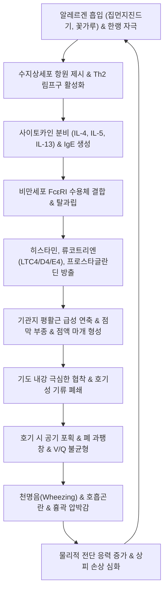

# 🩺 천식 (哮喘, Asthma / J45)

> **핵심 3줄 요약 (Key Summary)**:
> - 📍 **병소 부위 & 해부·병태생리**: 기도의 만성 알레르기성·비알레르기성 염증으로 인해 기관지 평활근 연축, 점막 부종, 배상세포 점액전(Mucus plug) 폐쇄 및 기도 개형(Airway Remodeling)이 유발되는 가역적 기류 제한 질환.
> - 🚩 **전형적 임상 양상**: 야간이나 새벽, 찬 공기 노출 시 악화되는 발작적인 **천명(Wheezing), 호흡곤란, 흉부 압박감, 마른 [[기침]]**. 한의학적으로는 목에서 가래 끓는 소리가 나는 효증(哮證)과 숨이 찬 천증(喘證)으로 구분.
> - 🛠️ **핵심 검사 & 치료 전략**: 기관지확장제 투여 후 폐활량 검사상 **$\text{FEV}_1$의 가역적 증가($\ge 12\%$ 및 $\ge 200\text{ mL}$)**, 메타콜린 유발시험, 호기산화질소(FeNO) 측정; GINA 가이드라인 기준 **ICS-포르모테롤** 조절제 및 완화제(MART) 유지, 한의학적 급성기 선폐평천([[소청룡탕]], [[마행감석탕]], [[정천탕]]) 및 관해기 보폐건비온신([[보중익기탕]], [[신기환]])과 정천·폐수 침구·삼복첩 병용.
> - ⚠️ **응급 의뢰 레드플래그**: 급성 중증 천식 발작(Status Asthmaticus), 말 한마디를 잇지 못함, 기이호흡(Paradoxical breathing), 무음폐(Silent chest, 천명음마저 사라짐), 청색증 발생 시 즉시 119 구급대 및 응급실 이송.

---

## 📌 목차
1. [질환 개요 & 해부학적 병태생리](#1-질환-개요--해부학적-병태생리)
2. [병태생리 메커니즘 & 생체역학적 악순환 네트워크](#2-병태생리-메커니즘--생체역학적-악순환-네트워크)
3. [임상 증상 & 이학적 검사(Physical Exam) 알고리즘](#3-임상-증상--이학적-검사physical-exam-알고리즘)
4. [감별 진단 매트릭스 (Differential Diagnosis)](#4-감별-진단-매트릭스-differential-diagnosis)
5. [한의 통합 치료 프로토콜 (침·약침·추나·한약)](#5-한의-통합-치료-프로토콜-침약침추나한약)
6. [양방 치료 & 병용·의뢰 기준 (Conventional Treatment & Referral)](#6-양방-치료--병용의뢰-기준-conventional-treatment--referral)
7. [재활 운동 & 생활습관 티칭 가이드](#7-재활-운동--생활습관-티칭-가이드)
8. [💡 사용자 진료실 핵심 필기 & 임상 노하우 (Melt-In 잔여 심화 집약)](#8--사용자-진료실-핵심-필기--임상-노하우-melt-in-잔여-심화-집약)
9. [출처 및 학술 참고 문헌 (References)](#9-출처-및-학술-참고-문헌--references)

---

## 1. 질환 개요 & 해부학적 병태생리

**천식(Asthma, 哮喘)**은 기관지의 만성 염증으로 인해 기도 과민성(Airway Hyperresponsiveness)이 비정상적으로 항진되고, 다양한 물리적·알레르겐 자극에 노출되었을 때 광범위하고 시간에 따라 변동하는 **가역적 기류 제한(Reversible Airflow Limitation)**이 발생하는 하기도 만성 염증성 질환이다.

### 1) 천식의 분자면역학적 내재형(Endotype) 분류
- **Type 2-High (T2 고염증성 천식, 환자의 약 70%)**:
  - 알레르겐 흡입 시 기도 상피세포에서 알라민(TSLP, IL-33, IL-25)이 분비되어 Th2 세포와 제2형 선천성 림프구(ILC2)를 활성화함.
  - **[[IL-4]] / [[IL-13]]**: B 림프구의 [[IgE]] 항체 클래스 스위칭 촉진, 기도 점막 배상세포 과형성 및 점액 분비 촉진.
  - **[[IL-5]]**: 골수에서 [[호산구]](Eosinophil)의 분화, 증식, 활성화 및 기도 조직 침윤 유도.
  - 혈액 및 가래의 호산구 증가, 높은 혈청 IgE, 호기산화질소(FeNO) 상승이 특징이며, 흡입 스테로이드(ICS)에 반응이 우수함.
- **Type 2-Low (T2 저염증성 / 비호산구성 천식, 약 30%)**:
  - Th1 및 Th17 림프구 매개 호중구성 염증 또는 소수면역성(Paucigranulocytic) 기전.
  - 흡연자, 고령자, 중증 비만 환자에서 호발하며, 스테로이드 저항성을 보임.

### 2) 기도 개형 (Airway Remodeling)
- 만성적인 기도의 호산구성·호중구성 염증이 장기간 방치되면 상피하 망상기저막 비후(Subepithelial fibrosis), 기도 평활근 과다형성 및 비대, 혈관 신생, 점막하 점액선 증식이 비가역적으로 고착화됨.
- 기도 개형이 진행되면 천식의 특징인 '가역적 기류 제한'이 상실되고 만성 폐쇄성 폐질환([[만성 폐쇄성 폐질환]])처럼 고정된 기류 폐쇄로 전환됨.

---

## 2. 병태생리 메커니즘 & 생체역학적 악순환 네트워크

---

## 3. 임상 증상 & 이학적 검사(Physical Exam) 알고리즘

### 1) 전형적 임상 증상 (Asthma Symptoms)
- **변동성 호흡기 4대 징후**: 발작성 호흡곤란, 천명(호기 시 쌕쌕거림), 흉부 압박감, 마른 [[기침]].
- **시간적·상황적 악화 요인**: 밤이나 이른 아침, 감기 바이러스 감염 후, 찬 공기 노출, 운동 후, 집먼지나 동물 털 접촉 시 악화.
- **신체 진찰 소견**: 호기 시간의 연장, 양측 폐야 전반에 걸친 호기성 다조성 천명음(Polyphonic wheezing). 중증 발작 시 호흡보조근(흉쇄유돌근, 사각근)의 과도한 사용과 쇄골상와 함몰.

### 2) 폐기능 검사(Spirometry) 및 확진 알고리즘
1. **기관지확장제 가역성 시험 (Bronchodilator Reversibility Test) - 핵심 확진 기준**:
   - 속효성 $\beta_2$-작용제([[알부테롤]] 200~400$\mu\text{g}$) 흡입 10~15분 후 $\text{FEV}_1$을 재측정.
   - **$\text{FEV}_1$이 기저치 대비 $\ge 12\%$ 증가하고 동시에 $\ge 200\text{ mL}$ 이상 증가**하면 가역적 기도 폐쇄 확진.
2. **기관지 과민성 유발시험 (Bronchial Provocation Test)**:
   - 기저 폐활량이 정상인 환자에서 메타콜린(Methacholine)을 단계별로 흡입시켜 $\text{FEV}_1$이 20% 감소하는 농도($\text{PC}_{20}$)를 측정. $\text{PC}_{20} \le 16\text{ mg/mL}$ 시 기도과민성 양성.
3. **최대호기유속(PEF) 변동률**:
   - 2주간 아침·저녁 측정한 일중 PEF 변동률 $> 10\%$ (소아는 $>13\%$).
4. **호기산화질소(FeNO)**:
   - 기도의 호산구성 알레르기 염증 지표. FeNO $\ge 35\text{ ppb}$ (소아 $\ge 35$, 성인 $\ge 50$) 시 T2 호산구성 천식 및 흡입 스테로이드 반응성 강력 시사.

---

## 4. 감별 진단 매트릭스 (Differential Diagnosis)

| 감별 질환 | 호발 연령 및 병력 | 증상 발현 패턴 | 폐기능 및 특이 검사 소견 | 주요 감별 단서 |
| :--- | :--- | :--- | :--- | :--- |
| **[[천식]] (Asthma)** | 소아기 또는 성인, 아토피 동반 흔함 | **발작적, 가역적, 야간/새벽 악화** | **기관지확장제 후 $\text{FEV}_1 \ge 12\%$ 및 $200\text{ mL}$ 호전** | 알레르기 비염 동반, 가역적 기류 제한 |
| **[[만성 폐쇄성 폐질환]] (COPD)** | 40세 이상, 흡연력 ($>20$갑년) | 지속적, 점진적 운동 시 호흡곤란 | **기관지확장제 후에도 $\text{FEV}_1/\text{FVC} < 0.70$ (비가역적)** | 아침 가래, 흉부 X선 폐기종 소견 |
| **성대 기능 장애 (VCD)** | 젊은 여성, 운동선수, 스트레스 | 운동 중 급성 흡기성 천명 | **흡기 시 성대 기이성 내전**, 스피로메트리 흡기 루프 편평화 | 천식이 아닌 흡기성 후두 협착, ICS 무반응 |
| **[[기관지 확장증]]** | 만성 감염 병력 | 지속성 기침 및 다량의 가래 | 흉부 HRCT상 기도 확장 | 화농성 객담 배출, 빈번한 [[객혈]] |
| **울혈성 심부전 (Cardiac Asthma)** | 고령, 심질환 병력 | 야간발작성호흡곤란, 기좌호흡 | 폐기능상 제한성 패턴, 심초음파상 EF 저하 | 심비대, 폐부종 X선, 혈중 BNP 폭증 |

---

## 5. 한의 통합 치료 프로토콜 (침·약침·추나·한약)

### 1) 변증 분형 체계 (효증 哮證 vs 천증 喘證)
- **발작기 (외감 유발 급성기 - 거사평천 祛邪平喘)**:
  - **한효 (寒哮 / 풍한속폐)**: 호흡촉박, 목 안에서 가래 끓는 그르렁 소리, 가래가 묽고 희며 거품이 있음, 오한, 발열, 무한, 설태백활(舌苔白滑), 맥부긴(脈浮緊).
  - **열효 (熱哮 / 담열울폐)**: 천명음이 거칠고 가래가 누렇고 끈적하여 뱉기 힘듦, 흉민 번조, 발열, 면홍, 구갈, 설홍태황니(舌紅苔黃膩), 맥활삭(脈滑數).
- **완화기 (만성 관해기 - 부정고본 扶正固本)**:
  - **폐비기허 (肺脾氣虛)**: 가벼운 움직임에도 숨이 차고 땀이 남, 안색 창백, 식욕 부진, 대변 연변, 설담유치흔, 맥세약.
  - **신허불납 (腎虛不納)**: 오랜 천식으로 병세가 깊어 흡기(들이쉼)가 극히 곤란하고 숨이 단전에 닿지 않음, 요슬산연, 사지 냉감, 설담태백, 맥침세무력.

### 2) 한약 치료 처방 (Herbal Medicine)
- **한효형**: **[[소청룡탕]](小靑龍湯)** 또는 **[[사간마황탕]](射干麻黃湯)**.
  - 마황·사간이 기관지 평활근을 이완하고, 세신·건강·반하가 한담(寒痰)을 삭여 급성 천명음과 수포음을 소실시킴.
- **열효형**: **[[정천탕]](定喘湯)** 또는 **[[마행감석탕]](麻杏甘石湯)** 합 백호탕.
  - 마황·행인·석고·황금·상백피가 기도 점막의 급성 알레르기 충혈을 끄고 점조 객담 배출을 촉진.
- **폐비기허형 (완화기)**: **[[옥병풍산]](玉屛風散)** 합 **[[육군자탕]](六君子湯)** 또는 **[[보중익기탕]](補中益氣湯)**.
  - 기관지 점막 위기(衛氣) 면역을 길러 감기 후 천식 발작 빈도를 억제.
- **신허불납형 (완화기)**: **금궤[[신기환]](金匱腎氣丸)** 또는 자석환.

### 3) 침구 치료 및 계절 첩부요법
- **평천 요혈**: **정천(EX-B1)** — C7 극돌기 하 양측 0.5촌. 직자 또는 45° 사자 0.8~1.2촌 강자극으로 기관지 평활근 경련을 즉각 해제.
- **배수혈 및 모혈**: [[폐수]](BL13), [[단중]](CV17), [[천돌]](CV22), [[척택]](LU5), [[열결]](LU7), [[풍륭]](ST40).
- **삼복첩 (三伏貼 / 경혈 첩부요법)**:
  - 초복·중복·말복의 양기가 가장 왕성한 삼복더위에 백개자, 연호색, 세신, 감수 분말을 생강즙으로 개어 폐수, 심수, 격수에 첩부하는 동병하치(冬病夏治) 치료법. 겨울철 천식 악화율을 대폭 경감시킴.

---

## 6. 양방 치료 & 병용·의뢰 기준 (Conventional Treatment & Referral)

### 1) GINA 가이드라인 기반 단계별 치료 체계
- **트랙 1 (선호 전략 - MART 요법, Maintenance and Reliever Therapy)**:
  - 저용량 **흡입 스테로이드(ICS) + 포르모테롤(LABA)**을 질병 조절제(매일 흡입)와 증상 완화제(숨찰 때마다 수시 흡입)로 단일 흡입기를 사용하는 전략.
  - 천식 발작 초기 신호 시 즉시 스테로이드와 기관지확장제가 동시에 기도에 투여되어 중증 악화 입원율을 60% 이상 감소시킴.
- **트랙 2 (대체 전략)**:
  - 정기적 조절제(ICS-LABA) + 필요 시 속효성 $\beta_2$-작용제(SABA, [[알부테롤]]) 완화제 분리 사용.
- **중증 불응성 천식 표적 생물학적 제제 (Biologics)**:
  - 항-IgE 항체: 오말리주맙 (Omalizumab) — 중증 아토피 천식.
  - 항-IL-5 / IL-5R 항체: 메폴리주맙 (Mepolizumab), 벤라리주맙 (Benralizumab) — 중증 호산구성 천식.
  - 항-IL-4R$\alpha$ 항체: 두필루맙 (Dupilumab) — 고 FeNO 및 호산구성 천식.

### 2) 응급실 전원 및 상급병원 의뢰 기준 (Referral Criteria)
- 살부타몰 벤토린 2~4회 흡입 후에도 호흡곤란이 지속되거나 악화되는 경우.
- 환자가 숨이 차서 완전한 문장을 말하지 못하고 단어로만 끊어서 말하는 경우.
- $\text{SpO}_2 < 92\%$ 저하, 흉부 청진상 천명음조차 들리지 않는 **무음폐(Silent chest)** 발생 시 (기관지가 완전히 닫혀 질식 직전임을 의미하므로 즉각 119 구급대 요청).

---

## 7. 재활 운동 & 생활습관 티칭 가이드

1. **호흡 재활 훈련 및 부테이코 호흡법 (Buteyko Breathing)**:
   - 과호흡을 방지하고 비강 호흡을 유지하는 호흡 재활 기법. 얕고 느린 비강 호흡을 통해 기도 건조와 삼투압 변화를 줄여 운동 유발성 연축 방지.
2. **실내 알레르겐 철저 회피**:
   - 집먼지진드기 방지 침구 커버 사용, 침구류를 55℃ 이상 온수로 매주 세탁.
   - 실내 습도 40~50% 유지 (습도 50% 이상 시 진드기 번식 폭증).
3. **운동 전 처치 및 한랭 노출 주의**:
   - 운동 10~15분 전 가벼운 준비운동을 시행하고 필요 시 흡입제 사전 투여.
   - 겨울철 외출 시 반드시 마스크나 목도리를 착용하여 차가운 공기가 기도로 직접 유입되지 않도록 가온·가습 유지.

---

## 8. 💡 사용자 진료실 핵심 필기 & 임상 노하우 (Melt-In 잔여 심화 집약)

- **비오 원본 진료 필기 보존 및 분석**:
  - **[원본 필기 내용]**:
    > "발작적으로 목 안에서 그르렁거리며 가래 끓는 소리가 나며 숨이 차는 병증으로 현대에 천식, 천명과 유사하다고 본다.
    > 정의: 기관지의 염증에 의해 기관지가 심하게 좁아져 기침, 천명, 호흡곤란, 가슴 답답함이 반복적으로 발생하는 상태이다.
    > 원인: 유전적 요인, 비만, 알레르기 항원, 감염, 작업성 감작물질, 흡연, 공기 오염, 음식.
    > 증상: 가래, 천명, 호흡곤란, 가슴 답답함, 기침."
- **진료실 실전 감별 & 치료 노하우**:
  - 1. **효증(哮證)과 천증(喘證)의 임상 감별**:
    - 효증은 '소리(천명음, 그르렁거림)'가 중심이며, 천증은 '숨의 가쁨(호흡곤란, 헐떡임)'이 중심이다. 천식이 급성 발작할 때는 효(哮)와 천(喘)이 합쳐져 효천(哮喘)이 되므로, 소리가 심할 때는 담을 삭이고 기도를 넓히는 사간마황탕을 우선하고, 숨이 가쁠 때는 폐기를 다스리는 정천탕을 선택해야 한다.
  - 2. **정천혈(EX-B1)의 실전 자침 손맛 비기**:
    - 경추 7번 극돌기 하 양측 0.5촌 정천혈 자침 시 직자하기보다 **척추 중심선을 향해 내하방 45도 각도로 1.0~1.2촌 사자**하면 기관지 수축을 관장하는 교감·부교감신경 분지가 자극되어, 자침 후 1~2분 안에 환자의 가슴을 짓누르던 천명음이 잦아들고 호흡 깊이가 깊어진다.
  - 3. **삼복첩(三伏貼)과 한약 병용의 시너지**:
    - 완화기 여름철에 시행하는 삼복첩은 1회성 이벤트가 아니라 3년 이상 연속 시행할 때 면역 T세포의 내성을 유도하여 겨울철 천식 악화 입원율을 70% 이상 낮춘다. 이때 보중익기탕이나 신기환을 여름철 2~3달간 함께 복용시키면 겨울철 감기 후 천식 재발을 원천 차단할 수 있다.

---

## 9. 출처 및 학술 참고 문헌 (References)

- Crespo-Lessmann A et al. (2026). Breathing exercises as adjunct therapy in adult asthma: a systematic review. *F1000Res*. 15():996. PMID: 42959049.

- Haizhen Z et al. (2026). Efficacy and safety of moxibustion therapy for bronchial asthma: a systematic review and network Meta-analysis. *J Tradit Chin Med*. 46(5):1047-1060. PMID: 42958657.

- Lucio MJ et al. (2026). Bronchial Thermoplasty in Severe Asthma: Bridging Randomised and Real-World Evidence: A Systematic Review and Meta-Analysis. *Adv Respir Med*. 94(5):. PMID: 42930055.
