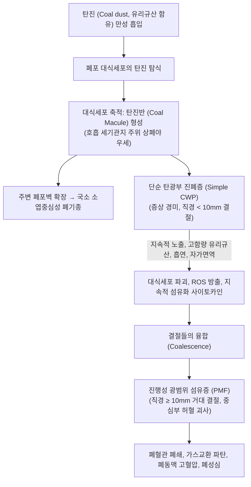

# 🩺 탄광부 진폐증 (Coal Worker's Pneumoconiosis, CWP)

> **핵심 3줄 요약 (Key Summary)**:
> - 📍 병소 부위 & 해부·병태생리: 석탄 분진(탄진)의 만성 흡입으로 인해 호흡 세기관지 주위에 탄진 침착 및 **탄진반(coal macule)** 과 탄진결절 형성, 주변부 중심소엽성 폐기종 유발; 진행 시 1cm 이상의 거대 결절이 융합되는 진행성 광범위 섬유증(PMF)으로 악화.
> - 🚩 전형적 임상 양상: 10~20년 이상의 탄광 갱내 작업력, 서서히 진행하는 운동성 호흡곤란, 만성 흑색 가래(melanoptysis), 기침, 흉통; 류마티스 관절염 동반 시 카플란 증후군(Caplan syndrome) 발현.
> - 🛠️ 핵심 검사 & 치료 전략: 흉부 X선/CT(상폐야 우세의 원형 결절 및 거대 섬유화 덩어리 확인, ILO 진폐 판정 체계) 및 폐활량 검사; 근본적 완치제 부재로 분진 노출 즉각 차단, 금연, 폐렴/독감 백신, 저산소혈증 시 산소요법 및 산재보험 진폐 장해 보상 연계.
> - <font color="#fa7e7e">⚠️ 응급 의뢰 레드플래그: PMF 중심부 허혈성 괴사 및 공동 형성에 따른 대량 객혈, 안정 시 SpO2 < 88%, 폐성심 징후(경정맥 확장, 간비대, 전신 부종) 관찰 시 상급병원 응급 전원.</font>

---

## 📌 목차
1. [질환 개요 & 해부학적 병태생리](#1-질환-개요--해부학적-병태생리)
2. [병태생리 메커니즘 & 단순 CWP vs PMF](#2-병태생리-메커니즘--단순-cwp-vs-pmf)
3. [임상 증상 & 이학적 검사 알고리즘](#3-임상-증상--이학적-검사-알고리즘)
4. [감별 진단 매트릭스 (Differential Diagnosis)](#4-감별-진단-매트릭스-differential-diagnosis)
5. [한의학적 변증 & 호흡 배출 보조 프로토콜](#5-한의학적-변증--호흡-배출-보조-프로토콜)
6. [양방 치료 & 산재 보상 기준 (Conventional Treatment & Referral)](#6-양방-치료--산재-보상-기준-conventional-treatment--referral)
7. [호흡 재활 & 생활습관 티칭 가이드](#7-호흡-재활--생활습관-티칭-가이드)
8. [💡 진료실 핵심 필기 & 임상 노하우 (Melt-In 심화 집약)](#8--진료실-핵심-필기--임상-노하우-melt-in-심화-집약)
9. [출처 및 학술 참고 문헌 (References)](#9-출처-및-학술-참고-문헌-references)

---

## 1. 질환 개요 & 해부학적 병태생리

### 1) 정의 및 임상적 중요성
**탄광부 진폐증(Coal Worker's Pneumoconiosis, CWP)** 은 석탄 채굴, 탄광 갱내 작업, 탄소 가공 등에서 발생하는 무연탄 및 유연탄 분진(탄진)을 장기간 흡입하여 폐 실질에 탄진이 영구 축적되고 조직 반응이 유발되는 직업성 폐질환이다. 속칭 **"흑색 폐(Black Lung)"** 로도 불린다.

* **해부학적 병소**: 상폐야(upper lung zones)를 중심으로 한 호흡 세기관지(respiratory bronchioles) 주위 및 폐포강, 기관지 주변 림프관.
* **병리학적 기본 단위: 탄진반 (Coal Macule)**:
  * 직경 1~5 mm의 흑색 색소 반점.
  * 탄진을 탐식한 대식세포가 호흡 세기관지 주위 간질에 응집되고, 미세한 망상 섬유(reticulin fibers)가 결집되어 형성됨.
  * 탄진반 주변의 폐포벽이 약화되어 확장되면서 전형적인 **소엽 중심성 폐기종(focal centrilobular emphysema)** 이 동반됨.

---

## 2. 병태생리 메커니즘 & 단순 CWP vs PMF



### 1) 단순 탄광부 진폐증 (Simple CWP)
* **특징**: 폐 전반(특히 상엽)에 1~5 mm 크기의 작은 원형 결절(탄진반, 탄진결절)이 산재함.
* **임상 양상**: 대개 자각 증상이 거의 없거나 경미한 만성 기침 정도이며, 폐활량 검사도 정상 또는 경미한 폐기종 소견을 보임. 비흡연자에서는 호흡 기능 저하가 뚜렷하지 않음.

### 2) 진행성 광범위 섬유증 (Progressive Massive Fibrosis, PMF)
* **특징**: 단순 CWP 결절들이 서로 융합하여 **직경 1 cm(10 mm) 이상, 심하면 5~10 cm에 달하는 거대한 흑색 섬유화 덩어리**를 형성함.
* **병태생리**:
  * 거대 섬유화 덩어리 내부로의 혈류 공급이 차단되어 **허혈성 무균성 괴사 및 공동(Cavitation)** 이 형성됨.
  * 괴사된 중심부가 기관지로 파열되면 다량의 잉크 같은 흑색 객담(**흑색 객혈/객담, melanoptysis**)이 분출됨.
  * 광범위한 폐혈관 및 폐 실질 파괴로 심각한 제한성-폐쇄성 혼합 환기장애, 심한 저산소혈증, 폐동맥 고혈압 및 **폐성심(Cor pulmonale)** 으로 진행.

### 3) 카플란 증후군 (Caplan Syndrome)
* 탄광부 진폐증 환자에게 **류마티스 관절염(RA)** 이 합병된 특수 증후군.
* 흉부 영상상 류마티스 결절 형태의 다발성 원형 결절(0.5~5 cm)이 폐 양측 변연부에 급속히 출현하며, 류마티스 인자(RF) 및 항CCP 항체 강양성을 보임.

---

## 3. 임상 증상 & 이학적 검사 알고리즘

### 1) 전형적 임상 증상
* **진행성 호흡곤란**: 단순 CWP에서는 운동 시에도 경미하나, PMF로 이행 시 평지 보행 및 안정 시에도 극심한 숨참 호소.
* **만성 해수 및 객담**: 만성 기관지염 동반으로 흑갈색 내지 검은색 가래 배출.
* **흑색 객혈 (Melanoptysis)**: PMF 공동 파열 시 흑색 액체와 혈액이 섞여 나옴.

### 2) 진찰 소견 및 진폐 병형 판정 (ILO 판정 체계)
* **청진**: 상폐야 호흡음 감소, 거친 수포음(rhonchi), 폐기종 부위 과공명음.
* **흉부 단순 촬영 및 HRCT**:
  * 국제노동기구(ILO) 진폐 방사선 사진 판독 규정에 따라 소음영(p, q, r 원형 음영)의 밀도(1/0 ~ 3/3) 분류.
  * 대음영(Large opacities: A, B, C) 관찰 시 PMF로 진단: A형(1~5 cm 결절), B형(우상엽 면적 미만), C형(우상엽 면적 초과).
* **폐활량 검사**:
  * 단순 CWP: 정상 또는 경미한 $FEV_1$ 저하.
  * PMF: $FVC$와 $FEV_1$이 동반 급락하는 **혼합성(제한성+폐쇄성) 환기장애**, $DLCO$ 심각한 저하.

---

## 4. 감별 진단 매트릭스 (Differential Diagnosis)

| 감별 질환 | 노출 물질 및 병력 | 영상 및 병리 소견 | 결정적 감별 포인트 |
| :--- | :--- | :--- | :--- |
| **[[탄광부 진폐증]] (CWP)** | **석탄 분진(탄진)**, 탄광 갱내 작업력 | **상폐야 탄진반/탄진결절, PMF 거대 결절** | 흑색 탄진 침착, 탄광 직력, 흉막반 없음 |
| **[[규폐증]] (Silicosis)** | **유리규산(석영, 모래, 석재)** | 상폐야 결절, **난각상(egg-shell) 림프절 석회화** | 유리규산 단독 노출, 결핵 합병률 극단적 높음 |
| **[[석면증]] (Asbestosis)** | **석면(단열재, 조선, 슬레이트)** | **하폐야 늑막하 망상 음영 + 흉막반(Plaque)** | 하폐야 기저부 우세, 흉막 석회화 동반 |
| **폐결핵 (Tuberculosis)** | 결핵균 감염 (진폐 환자 호발) | 첨부 공동, 주위 위성 결절, 비대칭성 침윤 | 객담 AFB/결핵균 PCR (+), 결핵성 전신 증상 |
| **원발성 폐암 (Lung Cancer)** | 흡연, 고령 | 단일 불규칙 결절/종괴, 침상 변연(spiculation) | 조직검사상 악성 암세포, 지속적 체중 감소/객혈 |

---

## 5. 한의학적 변증 & 호흡 배출 보조 프로토콜

> 🎯 **치료 접근 원칙**: 탄광부 진폐증은 수십 년간 흡입된 미세 무기 분진이 폐락(肺絡)에 고착되어 '폐위(肺痿)', '담음(痰飮)', '천증(喘證)'을 유발한 질환이다. 고착된 광물질 자체를 체외로 배출하는 것은 불가능하므로, 잔여 정상 폐포의 기포 교환 촉진, 기관지 섬모 청소능 강화, 폐포 주변 미세순환 어혈 개선, 폐성심 예방을 목표로 한다.

### 1) 한의학적 변증 분류
* **폐비담어증 (肺脾痰瘀證)**:
  * 주증: 흉부 압박감, 잦은 기침, 뱉기 힘든 검고 끈적한 객담, 식욕 부진, 설암자 어반 태백니, 맥활삽.
  * 치법: 온폐건비(溫肺健脾), 화담통락(化痰通絡), 활혈거어(活血祛瘀).
  * 대표 처방: [[이진탕]](二陳湯) 합 [[단삼음]](丹參飮) 가감 (길경, 과루인, 패모, 단삼, 삼릉, 아출).
* **폐신양허증 (肺腎兩虛證 / 말기 호흡부전)**:
  * 주증: 조금만 움직여도 헐떡거리며 숨이 차고 숨을 들이쉬기 어려움(흡기성 곤란), 요슬산연, 사지 냉감, 안색 회암, 설담 맥침세.
  * 치법: 보폐익신(補肺益腎), 납기평천(納氣平喘).
  * 대표 처방: [[금궤신기환]](金匱腎氣丸) 또는 [[삼개산]](蔘蛤散) 가감.
* **음허폐조증 (陰虛肺燥證)**:
  * 주증: 마른기침, 인후 건조, 소량의 끈끈한 흑갈색 가래, 손발바닥 열감, 설홍소태, 맥세삭.
  * 치법: 자음윤폐(滋陰潤肺), 진해지혈(鎭咳止血).
  * 대표 처방: [[백합고금탕]](百合固金湯) 또는 [[맥문동탕]](麥門冬湯) 가감.

### 2) 침구 치료
* **혈위**: [[폐수]](BL13), [[고황]](BL43), [[비수]](BL20), [[신수]](BL23), [[단중]](CV17), [[척택]](LU5), [[풍륭]](ST40), [[족삼리]](ST36).
* **시술법**: 고황 및 폐수혈 뜸(온구) 요법 병용하여 양기 보강 및 만성 기관지 경련 이완.

---

## 6. 양방 치료 & 산재 보상 기준 (Conventional Treatment & Referral)

### 1) 양방 보존 요법 (Conventional Care)
* **특이 치료제 부재**: 침착된 석탄 가루를 용해하거나 제거하는 약물은 없음.
* **기관지확장제 및 대증요법**:
  * COPD 유사 기류 제한 동반 시 지속성 항콜린제(LAMA: Tiotropium) 또는 LABA 흡입기 투여.
* **장기 산소 요법 (LTOT)**:
  * $PaO_2 \le 55\text{ mmHg}$ 또는 $SpO_2 \le 88\%$ 시 가정용 산소 발생기 처방 (폐동맥 고혈압 진행 억제).
* **감염 예방**: 폐렴구균 및 인플루엔자 백신 접종 필수.

### 2) 국내 산재보험 진폐 장해 보상 판정
* **근로복지공단 진폐 심사**:
  * 과거 탄광 갱내 및 분진 작업력 입증.
  * 흉부 단순촬영상 진폐 병형(1/0 ~ 4형) 판정.
  * 폐기능 검사상 심폐기능 장해 판정: 정상($F_0$), 경도 장해($F_1$), 중등도 장해($F_2$), 고도 장해($F_3$).
  * 병형과 심폐기능 장해 수준에 따라 진폐장해등급(제1급~제13급) 및 진폐위로금, 요양급여 지급. 1차 진료 한의사는 환자가 국가 보상 혜택을 놓치지 않도록 진폐정밀진단 의료기관 안내.

### 3) 🚨 합병증 레드플래그 및 전문과 의뢰 기준

```
[🚨 탄광부 진폐증 합병증 레드플래그 체크리스트]
1. PMF 공동 괴사로 인한 대량 객혈(분출성 피가래) 발생
2. 진폐 합병증으로서의 활동성 폐결핵 발생 (미열, 야간 발한, 체중 감소, 공동 형성)
3. 급격한 호흡곤란 악화와 흉통 (폐기종 기낭 파열에 의한 자연 기흉 발생)
4. 하지 함요부종, 경정맥 노창, 간비대 (우심부전 / 폐성심 징후)

=> 상기 소견 관찰 시 즉시 상급종합병원 호흡기내과로 응급 전원한다.
```

---

## 7. 호흡 재활 & 생활습관 티칭 가이드

### 1) 절대 금연 교육
* 탄진 흡입과 흡연이 결합하면 만성 기관지염 및 소엽 중심성 폐기종의 진행 속도가 기하급수적으로 빨라진다.

### 2) 호흡근 훈련 및 객담 배출법
* **체위 배액(Postural Drainage)** 및 흉부 타진법을 교육하여 끈적한 탄진성 가래가 소기도를 폐쇄하지 않도록 배출 유도.
* **입술 오므리기 호흡**: 호기 시 양압을 형성하여 기도 허탈 방지.

---

## 8. 💡 진료실 핵심 필기 & 임상 노하우 (Melt-In 심화 집약)

### 1) 진폐증 환자의 결핵 합병증(Silicotuberculosis) 경계
* 탄광부 진폐증 환자는 분진 내 포함된 유리규산 성분 때문에 일반인 대비 **폐결핵 발생률이 3~5배 이상 높다.**
* 진폐증 환자가 만성 기침 외에 갑작스러운 미열, 식은땀(도한), 식욕 부진, 체중 감소를 호소하면 단순 진폐 악화로 넘기지 말고 반드시 객담 결핵균 검사(AFB 도말/배양, 결핵 PCR)를 의뢰해야 한다.

### 2) 흑색 객담(Melanoptysis)에 대한 환자 불안 관리
* 환자가 "검은 먹물 같은 가래가 나온다"며 폐암이나 폐 괴사로 오인하고 극심한 공포를 느끼는 경우가 있다.
* 이는 폐 속에 굳어있던 오래된 탄진 결절 부위가 기관지염으로 인해 일시적으로 배출되는 현상일 수 있음을 차분히 설명하되, 혈액이 다량 섞여 나오는 대량 객혈 여부를 면밀히 감별해야 한다.

---

## 9. 출처 및 학술 참고 문헌 (References)

1. Toxicity of respirable coal dust: An overview of origin, chemistry, mechanisms, and possible remedies. (2026). *Int J Coal Sci Technol*, 13(1):1. PMID: 41502607.

2. Uncovering the Factors Behind Rising Pneumoconiosis Rates: Central Appalachian Underground Coal Miners as a Case Study. (2026). *New Solut*, 35(4):436-449. PMID: 41329853.

3. Clinico-radiological and Bronchoscopic Profile of Bronchial Anthracofibrosis: An Environmental Lung Disease in Ladakh. (2025). *Indian J Occup Environ Med*, 29(3):211-216. PMID: 41111617.

---

## 관련 노트

- [[규폐증]]
- [[석면증]]
- [[직업 관련 천식]]
- [[특발성 폐섬유증]]
- [[공기 오염 관련 질병]]
