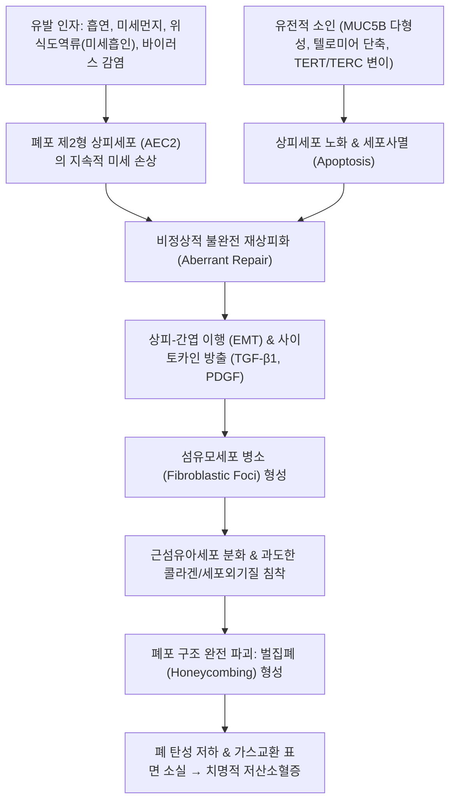

# 🩺 특발성 폐섬유증 (Idiopathic Pulmonary Fibrosis, IPF)

> **핵심 3줄 요약 (Key Summary)**:
> - 📍 병소 부위 & 해부·병태생리: 원인 불명의 만성 진행성 섬유화 간질성 폐렴; 폐포 상피세포의 반복적 미세 손상 및 비정상적 수복 과정으로 인해 **통상성 간질성 폐렴(UIP)** 조직 패턴(늑막하/하폐야 기저부 벌집폐 및 섬유모세포 병소) 형성.
> - 🚩 전형적 임상 양상: 60세 이상 고령 남성에서 6개월 이상 서서히 진행하는 운동성 호흡곤란, 마른기침, 양측 하폐야 벨크로형 건성 수포음(Velcro crackles), 곤봉지(clubbing).
> - 🛠️ 핵심 검사 & 치료 전략: 흉부 고해상도 CT(HRCT)상 하폐야 늑막하 벌집폐(honeycombing) 및 견인성 기관지확장증 확인으로 침습적 조직검사 없이 확진 가능; 피르페니돈(Pirfenidone) 및 닌테다닙(Nintedanib) 항섬유화제 투여, 최종 폐이식(Lung transplantation) 고려.
> - <font color="#fa7e7e">⚠️ 응급 의뢰 레드플래그: 1개월 이내 급격한 호흡곤란 악화, 새로운 양측성 간유리음영(GGO) 출현, 급성 호흡부전(IPF 급성 악화, 사망률 > 50%) 발견 즉시 상급병원 중환자실 응급 전원.</font>

---

## 📌 목차
1. [질환 개요 & 해부학적 병태생리](#1-질환-개요--해부학적-병태생리)
2. [병태생리 메커니즘 & 섬유화 악순환 네트워크](#2-병태생리-메커니즘--섬유화-악순환-네트워크)
3. [임상 증상 & 이학적 검사 알고리즘](#3-임상-증상--이학적-검사-알고리즘)
4. [감별 진단 매트릭스 (Differential Diagnosis)](#4-감별-진단-매트릭스-differential-diagnosis)
5. [한의학적 변증 & 완화 보조 프로토콜](#5-한의학적-변증--완화-보조-프로토콜)
6. [양방 치료 & 이식·의뢰 기준 (Conventional Treatment & Referral)](#6-양방-치료--이식의뢰-기준-conventional-treatment--referral)
7. [호흡 재활 & 생활습관 티칭 가이드](#7-호흡-재활--생활습관-티칭-가이드)
8. [💡 진료실 핵심 필기 & 임상 노하우 (Melt-In 심화 집약)](#8--진료실-핵심-필기--임상-노하우-melt-in-심화-집약)
9. [출처 및 학술 참고 문헌 (References)](#9-출처-및-학술-참고-문헌-references)

---

## 1. 질환 개요 & 해부학적 병태생리

![[특발성 폐섬유증_01_HRCT하엽.png|450]]
> [그림 1: 특발성 폐섬유증의 고해상도 CT — 하엽 늑막하 우세의 벌집폐(honeycombing)와 견인성 기관지확장 — 출처: Wikimedia Commons — File:HR tomography of the chest of an IPF patient 1.jpg (CC BY-SA 3.0)]

![[특발성 폐섬유증_01_HRCT축상.png|450]]
> [그림 2: 같은 환자의 다른 단면 — 늑막하 병변 분포와 정상 폐야의 경계가 뚜렷하다 — 출처: Wikimedia Commons — File:HR tomography of the chest of an IPF patient 2.jpg (CC BY-SA 3.0)]

![[특발성 폐섬유증_01_폐섬유화CT.png|450]]
> [그림 3: 폐섬유화 CT — 벌집상 낭성 변화와 구조 왜곡으로 폐 용적이 줄어 있다 — 출처: Wikimedia Commons — File:Pulmon fibrosis.PNG (CC BY-SA 3.0)]


### 1) 정의 및 예후
**특발성 폐섬유증(Idiopathic Pulmonary Fibrosis, IPF)** 은 원인이 규명되지 않은 채 폐포벽이 점진적으로 두꺼워지고 굳어져 폐기능이 상실되는 만성, 진행성, 비가역적 간질성 폐질환(ILD)으로, 특발성 간질성 폐렴(IIP) 중 가장 흔하고 치명적이다.

* **예후**: 진단 후 중앙 생존 기간이 약 **3~5년**으로 일부 진행성 폐암보다 불량함.
* **해부학적 병소 및 조직학적 표준**:
  * 병리학적 형태: **통상성 간질성 폐렴(Usual Interstitial Pneumonia, UIP)** 패턴.
  * **시간적/공간적 불균일성 (Spatial and Temporal Heterogeneity)**: 정상 폐 실질, 활동성 섬유모세포 증식 병소, 완전히 파괴된 섬유화 흉터(벌집폐)가 한 조직 내에 혼재함.
  * **병소 국소화**: 양측 하폐야(lower lobes) 및 늑막하(subpleural), 소엽 변연부(paraseptal)에 압도적으로 호발.

---

## 2. 병태생리 메커니즘 & 섬유화 악순환 네트워크

![[특발성 폐섬유증_02_벌집폐육안.png|450]]
> [그림 4: 벌집폐(honeycomb lung) 육안 소견 — 늑막 직하에 다발성 낭이 밀집해 스펀지처럼 보인다 — 출처: Wikimedia Commons — File:Honeycomb lung (13436105903).jpg (CC BY-SA 2.0)]


과거에는 만성 만성 염증 질환으로 여겨졌으나, 현대 의학에서는 **유전적 감수성을 가진 노화된 폐포 상피세포의 미세 손상과 비정상적 수복 장애(Epithelial-driven fibrosis)** 로 패러다임이 확립되었다.



### 1) 폐포 제2형 상피세포(AEC2)의 기능 파탄
* 정상 상태에서는 AEC2 세포가 줄기세포 역할을 하여 폐포 제1형 상피세포로 분화·수복되어야 함.
* IPF에서는 세포 노화, 소포체 스트레스(ER stress), 텔로미어 손상으로 인해 AEC2가 정상 분화하지 못하고 강력한 전섬유화 매개체인 **TGF-$\beta 1$** 을 과분비함.

### 2) 섬유모세포 병소 (Fibroblastic Foci)
* 점액성 기질 내에 방추형 섬유아세포와 근섬유아세포(myofibroblasts)가 돔 형태로 결집된 병변.
* 근섬유아세포가 세포외기질(제1형/제3형 콜라겐)을 무제한 분비하고, 세포사멸에 저항성을 획득하여 폐 구조를 단단하게 섬유화시킴.

---

## 3. 임상 증상 & 이학적 검사 알고리즘

### 1) 전형적 임상 증상
* **운동성 호흡곤란 (Exertional Dyspnea)**: 초기에는 경사지나 계단 보행 시 숨참으로 시작하여 수개월~수년에 걸쳐 평지 보행 및 안정 시 호흡곤란으로 점진적 악화.
* **지속적인 만성 건성 해수**: 환자의 80% 이상에서 호소하며, 기존 진해제에 전혀 반응하지 않는 마른기침.

### 2) 이학적 검사 소견
* **청진**: 양측 등 하부(하폐야 기저부)에서 흡기 말기에 들리는 미세하고 바스락거리는 **벨크로형 수포음 (Velcro crackles)** (초기 무증상 시기부터 85% 이상 청진).
* **시진**: 손가락 말단의 **곤봉지(Clubbing)** (환자의 25~50%에서 관찰).
* **말기 소견**: 청색증, 흉곽 보조근 사용, 폐동맥 고혈압 합병에 따른 하지 부종 및 우심실 분마음.

### 3) 흉부 HRCT 진단 기준 (2022 ATS/ERS/JRS/ALAT 가이드라인)
* **확정적 UIP (Definite UIP)** 패턴:
  1. 하폐야 기저부 및 늑막하(subpleural) 우세 분포.
  2. 망상형 음영(reticular pattern).
  3. **벌집폐 (Honeycombing)**: 직경 3~10 mm의 두꺼운 벽을 가진 낭종들이 흉막 아래 층층이 적층된 소견.
  4. 견인성 기관지확장증(traction bronchiectasis).
  5. UIP와 불일치하는 소견(광범위 간유리음영, 미만성 결절, 공기 포획)의 부재.
  * => 상기 소견 충족 시 **외과적 폐 생검(Surgical lung biopsy) 없이도 IPF로 확진** 가능.

---

## 4. 감별 진단 매트릭스 (Differential Diagnosis)

| 감별 질환 | 호발 연령 및 병력 | HRCT 및 임상 특징 | 결정적 감별 포인트 |
| :--- | :--- | :--- | :--- |
| [[특발성 폐섬유증]] (IPF) | 60대 이상 고령, 흡연자, 원인 미상 | **하폐야 늑막하 벌집폐(UIP)**, 흉막 비후 없음 | **원인 불명**, 흉막반 없음, 전신 자가면역 음성 |
| [[석면증]] (Asbestosis) | 20년 이상의 석면 노출 직력 | 하폐야 늑막하 망상 음영 + **석회화된 흉막반(Plaque)** | **흉막반 동반**, 석면 소체 확인, 직업력 명확 |
| **만성 과민성 폐렴 (Chronic HP)** | 조류 깃털, 곰팡이, 가습기 노출 | **중-상폐야 우세**, 모자이크 관류, 소엽중심 결절 | 원인 항원 노출력, 기관지폐포세척 림프구 증가 |
| **결합조직질환 연관 ILD (CTD-ILD)** | 30~50대 여성 호발, 류마티스/경피증 | 주로 NSIP 패턴(간유리음영 우세), 하폐야 기저부 침범 | 레이노 현상, 관절염, **ANA/RF/Anti-Scl-70 양성** |
| **비특이성 간질성 폐렴 (NSIP)** | 특발성 또는 결합조직질환 동반 | **양측 대칭성 간유리음영(GGO)** 우세, 늑막하 보존(subpleural sparing) | 벌집폐 드묾, 스테로이드 치료 반응 우수 |

---

## 5. 한의학적 변증 & 완화 보조 프로토콜

> 🎯 **치료 접근 원칙**: 특발성 폐섬유증은 한의학에서 폐엽이 위축되고 말라비틀어지는 **'폐위(肺痿)'** 및 기혈이 막혀 통하지 않는 **'폐비(肺痺)'** 의 대표적 난치성 질환이다. 불가역적인 벌집폐 섬유화를 재생시킬 수는 없으나, 질환의 진행 속도를 늦추고, 남아있는 정상 폐포의 허탈을 방지하며, 난치성 마른기침과 만성 호흡근 피로를 완화하여 환자의 삶의 질을 보존하는 완화 통합의료(Integrative Palliative Care)를 지향한다.

### 1) 한의학적 변증 분류
* **폐음휴손증 (肺陰虧損證 / 허열성 폐위)**:
  * 원인: 진액과 음혈이 마르고 허열이 폐를 태워 폐포가 쪼그라듦.
  * 증상: 발작성 건성 해수, 뱉기 힘든 소량의 점조한 객담, 구갈, 오후 조열, 설홍 소태 건조, 맥세삭.
  * 치법: 자음윤폐(滋陰潤肺), 생진양음(生津養陰).
  * 대표 처방: [[맥문동탕]](麥門冬湯) 합 [[백합고금탕]](百合固金湯) 가감.
* **폐신양허증 (肺腎兩虛證 / 허한성 폐위 - 말기 호흡부전)**:
  * 원인: 폐기의 모손이 신장에 미쳐 신불납기(腎不納氣)를 초래함.
  * 증상: 말하기조차 힘든 극심한 운동성 호흡곤란, 요슬산연, 사지 무력, 오한, 설담태백, 맥침세무력.
  * 치법: 보폐익신(補肺益腎), 납기평천(納氣平喘).
  * 대표 처방: [[삼개산]](蔘蛤散) 또는 [[인삼호도탕]](人蔘胡桃湯) 합 [[금궤신기환]](金匱腎氣丸).
* **폐락어조증 (肺絡瘀阻證 / 섬유화 진행기)**:
  * 주증: 흉부 답답함과 결림, 청자색 입술과 손톱, 혀의 흑자색 어반, 맥삽.
  * 치법: 활혈통락(活血通絡), 화담산결(化痰散結).
  * 대표 처방: [[단삼음]](丹參飮) 가감 (단삼, 당귀, 지룡, 울금, 삼칠).

### 2) 침구 치료
* **혈위**: [[폐수]](BL13), [[고황]](BL43, 만성 소모성 폐질환 특효혈), [[신수]](BL23), [[단중]](CV17), [[기해]](CV6), [[족삼리]](ST36), [[태연]](LU9, 맥회).
* **시술법**: 고황 및 폐수혈 온구(뜸) 요법, 자하거(태반) 약침을 통한 보신익정 및 폐기능 감퇴 완화.

---

## 6. 양방 치료 & 이식·의뢰 기준 (Conventional Treatment & Referral)

### 1) 양방 표적 약물 요법 (Antifibrotic Therapy)
* **피르페니돈 (Pirfenidone)**:
  * TGF-$\beta$ 및 염증성 사이토카인 합성 억제제.
  * 효과: 노력성 폐활량(FVC) 감소 속도를 연간 약 50% 지연시킴.
  * 부작용: 광과민증(피부 발진), 식욕 부진, 오심, 간기능 이상.
* **닌테다닙 (Nintedanib)**:
  * 세포내 티로신 키나아제 수용체(PDGFR, FGFR, VEGFR) 삼중 억제제.
  * 효과: FVC 감소 지연 및 급성 악화(acute exacerbation) 빈도 유의미 감소.
  * 부작용: 설사(환자의 60% 이상), 오심, 간수치 상승.
* **주의**: 과거에 쓰이던 경구 스테로이드와 면역억제제(아자티오프린) 병용 요법은 **사망률을 증가시켜 현재 절대 금기(PANTHER 임상시험)** 로 지정됨.

### 2) 폐이식 (Lung Transplantation)
* 중앙 생존 기간이 짧고 급격히 진행하므로, 진단 즉시 **폐이식 등록 및 대기 평가(Lung Transplant Evaluation)** 를 상급병원에서 조기에 시작해야 함.

### 3) 🚨 급성 악화(Acute Exacerbation) 응급 의뢰 기준

```
[🚨 IPF 급성 악화(AE-IPF) 초응급 레드플래그]
1. 1개월 이내에 원인 불명으로 급격히 숨참이 악화되고 안정 시에도 호흡곤란 호소
2. 기침 및 객담 증가와 함께 SpO2가 85% 미만으로 곤두박질침
3. 흉부 영상상 기존의 벌집폐 병변 위에 광범위한 새로운 간유리음영(GGO) 양측 출현
4. 감염, 폐색전증, 심부전 등 명확한 유발 인자가 배제됨

=> AE-IPF는 중환자실 입원 및 사망률이 50%를 상회하는 초응급 상황이므로,
   발견 즉시 고농도 산소 투여 하에 3차 대학병원 응급의료센터로 직송해야 한다.
```

---

## 7. 호흡 재활 & 생활습관 티칭 가이드

### 1) 엄격한 일상 관리 수칙
* **철저한 금연**: 잔여 폐포 파괴 속도를 늦추기 위한 절대 조건.
* **가정용 산소 요법 (LTOT)**: 운동 중 또는 수면 중 산소포화도가 88% 미만으로 떨어지면 적극적으로 산소를 흡입하여 폐동맥 고혈압 합병 방지.
* **위식도역류증(GERD) 관리**: 야간 산 역류로 인한 미세 흡인은 IPF 진행의 주요 촉발 인자이므로 취침 전 금식 및 상체 거상 유지.

### 2) 호흡 재활 운동
* 유산소 보행 운동 및 입술 오므리기 호흡(Pursed-lip breathing)을 일상화하여 호흡근 피로 완화.

---

## 8. 💡 진료실 핵심 필기 & 임상 노하우 (Melt-In 심화 집약)

### 1) 벨크로 수포음(Velcro Crackles) 청진의 임상적 결정력
* 60세 이상 흡연 경력 환자가 가벼운 기침으로 내원했을 때, 양측 등 아래쪽(하폐야)에 청진기를 대고 숨을 깊이 들이쉬게 했을 때 **"찍- 찍-" 하며 옷의 찍찍이(벨크로)를 뜯는 듯한 건성 수포음**이 들린다면 주저 없이 HRCT를 권고해야 한다.
* 벨크로 수포음은 흉부 X선에 이상이 나타나기 수개월~수년 전부터 청진되는 IPF의 가장 강력한 조기 진단 신호이다.

### 2) "스테로이드를 쓰면 안 되는 폐질환"
* 사르코이도증이나 호산구성 폐렴 등 대다수 간질성 폐질환은 스테로이드가 주 치료제이나, **IPF에서 전신 스테로이드 단독/병용 투여는 오히려 폐 감염과 사망률을 증가시킨다.**
* 따라서 원인 모를 폐섬유화 환자에게 무분별하게 스테로이드나 면역억제제를 복용 중인지 확인하고, 정식 항섬유화제(피르페니돈, 닌테다닙) 처방을 받고 있는지 모니터링해야 한다.

---

## 9. 출처 및 학술 참고 문헌 (References)

1. Lung microbiome alterations in idiopathic pulmonary fibrosis and hypersensitivity pneumonitis: A systematic review with insights into microbiome-host interactions and the gut-lung axis. (2026). *Respir Investig*, 64(6):101515. PMID: 42743786.

2. Diaphragmatic Ultrasound in Fibrosing Interstitial Lung Disease: A Systematic Review of Current Evidence. (2026). *Diagnostics (Basel)*, 16(17):e. PMID: 42739189.

3. Quality of life instruments in idiopathic pulmonary fibrosis: a COSMIN-based systematic review. (2026). *BMC Pulm Med*, 26(1):e. PMID: 42693433.

---

## 관련 노트

- [[석면증]]
- [[규폐증]]
- [[탄광부 진폐증]]
- [[직업 관련 천식]]
- [[급성 호흡 곤란 증후군]]
