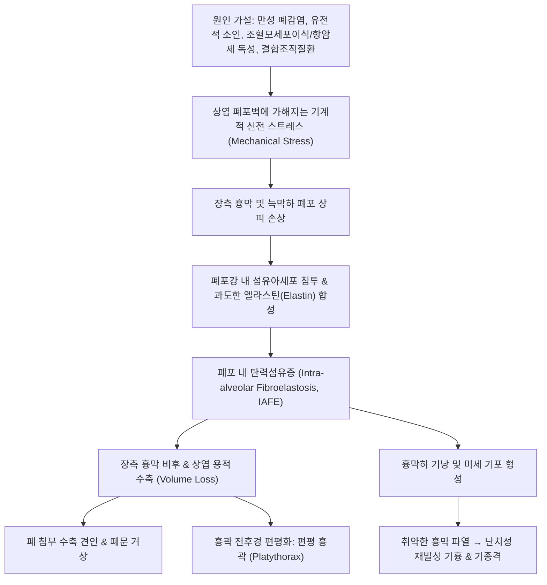

# 🩺 특발성 폐실질 탄력섬유증 (Idiopathic Pleuroparenchymal Fibroelastosis, IPPFE)

> **핵심 3줄 요약 (Key Summary)**:
> - 📍 병소 부위 & 해부·병태생리: 원인 불명의 희귀 만성 진행성 간질성 폐렴으로, **상폐야(Upper lobes) 우세의 장측 흉막 비후 및 늑막하 폐포 내 탄력섬유증(intra-alveolar fibroelastosis, ELASTOSIS)** 을 주병변으로 함.
> - 🚩 전형적 임상 양상: 마른 체형(낮은 BMI)의 환자에서 흉곽 전후경이 편평해지는 **편평 흉곽(Platythorax)**, 진행성 호흡곤란, 마른기침, **재발성 기흉(Pneumothorax) 및 기종격(Pneumomediastinum)** 의 빈발.
> - 🛠️ 핵심 검사 & 치료 전략: 흉부 HRCT상 양측 상엽의 흉막 비후 및 늑막하 쐐기형 망상/경화 음영 확인, 폐기능검사상 $RV/TLC$ 비율 증가 및 극심한 $FVC$ 감소; 입증된 항섬유화 약제가 없어 지지 요법 및 폐이식(Lung transplantation)이 유일한 근본 치료.
> - <font color="#fa7e7e">⚠️ 응급 의뢰 레드플래그: 갑작스러운 편측성 흉통 및 호흡곤란 악화(긴장성 기흉 합병), 피하기종 및 심한 저산소혈증 발생 시 즉시 응급실 흉관 삽관 의뢰.</font>

---

## 📌 목차
1. [질환 개요 & 해부학적 병태생리](#1-질환-개요--해부학적-병태생리)
2. [병태생리 메커니즘 & 상엽 섬유탄력화 네트워크](#2-병태생리-메커니즘--상엽-섬유탄력화-네트워크)
3. [임상 증상 & 이학적 검사 알고리즘](#3-임상-증상--이학적-검사-알고리즘)
4. [감별 진단 매트릭스 (Differential Diagnosis)](#4-감별-진단-매트릭스-differential-diagnosis)
5. [한의학적 변증 & 완화 보조 프로토콜](#5-한의학적-변증--완화-보조-프로토콜)
6. [양방 치료 & 이식·의뢰 기준 (Conventional Treatment & Referral)](#6-양방-치료--이식의뢰-기준-conventional-treatment--referral)
7. [환자 관리 & 생활습관 티칭 가이드](#7-환자-관리--생활습관-티칭-가이드)
8. [💡 진료실 핵심 필기 & 임상 노하우 (Melt-In 심화 집약)](#8--진료실-핵심-필기--임상-노하우-melt-in-심화-집약)
9. [출처 및 학술 참고 문헌 (References)](#9-출처-및-학술-참고-문헌-references)

---

## 1. 질환 개요 & 해부학적 병태생리

![[특발성 폐실질 탄력섬유증_01_상엽흉막비후CT.png|450]]
> [그림 1: 관상면 CT — 양측 상엽에 흉막비후와 늑막하 경화가 띠 모양으로 나타나고 하엽은 상대적으로 보존되어 있다 — 출처: Europe PMC — Journal of thoracic disease (2026) Prevalence and outcomes of pleuroparenchymal fibroelastosis in patients with non-tuberculous mycobacterial pulmonary dis, PMCID PMC13559321 (Open access (Europe PMC))]


### 1) 정의 및 질환 독립성
**특발성 폐실질 탄력섬유증(Idiopathic Pleuroparenchymal Fibroelastosis, IPPFE)** 은 2013년 미국흉부학회/유럽호흡기학회(ATS/ERS) 간질성 폐렴 합의 가이드라인에서 **'희귀 특발성 간질성 폐렴(Rare Idiopathic Interstitial Pneumonia)'** 으로 새롭게 정립된 독립 질환이다.

* **해부학적 병소**:
  * 일반적인 [[특발성 폐섬유증]](IPF)이 양측 하폐야 기저부를 침범하는 것과 정반대로, **양측 상폐야(Upper lobes)의 장측 흉막(Visceral pleura) 및 늑막하 폐 실질**에 병변이 집중된다.
* **조직학적 특징: 폐포 내 탄력섬유증 (Intra-alveolar Fibroelastosis, IAFE)**:
  * 장측 흉막의 광범위한 섬유성 비후.
  * 폐포강 내부가 치밀한 교원질 섬유(collagen)뿐 아니라 다량의 **탄력 섬유(Elastic fibers)** 로 가득 채워지는 독특한 탄력섬유증(Elastosis) 소견을 보임 (Elastica van Gieson 염색상 흑청색 탄력 섬유의 치밀한 증식 확인).
  * 병변 부위와 정상 폐 실질 사이의 경계가 매우 예리하고 급격하게 단절됨.

---

## 2. 병태생리 메커니즘 & 상엽 섬유탄력화 네트워크



### 1) 역학 및 2차성 PPFE 원인
* 남녀 비가 유사하며, 30~40대 젊은 성인부터 60~70대 고령까지 광범위하게 발생.
* 특발성(Idiopathic) 외에도 **조혈모세포이식(HSCT) 후 만성 이식편대숙주병(GVHD)**, 폐이식 후 만성 거부반응, 항암화학요법(알킬화제), 전신경화증 등 결합조직질환에 속발하여 나타나기도 함.

### 2) 편평 흉곽(Platythorax)과 기계역학적 파탄
* 상엽의 치밀한 섬유화 수축으로 인해 흉곽의 전후 직경이 좌우 직경에 비해 극단적으로 좁아지는 편평 흉곽이 형성됨.
* 흉막 탄성 감소로 흉강 내 음압이 불균등하게 전달되어 사소한 기침이나 긴장에도 흉막이 파열되어 **난치성 기흉(Pneumothorax)** 이 반복적으로 발생함.

---

## 3. 임상 증상 & 이학적 검사 알고리즘

### 1) 전형적 임상 증상
* **마른 체형 및 체중 감소**: 대부분의 환자가 현저히 마른 체형(극단적으로 낮은 BMI, 종종 18 이하)을 보이며 악액질(cachexia) 동반.
* **진행성 호흡곤란 및 마른기침**: 상엽 수축에 따른 폐용적 급감으로 운동성 호흡곤란이 서서히 악화.
* **반복되는 흉통**: 기흉 발생 시 편측성 흉벽 통증 호소.

### 2) 이학적 검사 소견
* **시진**: 쇄골 상와(supraclavicular fossa)의 깊은 함몰, 편평 흉곽(Platythorax), 마른 체구.
* **청진**: 벨크로 수포음은 하엽 질환(IPF)에 비해 덜 뚜렷하며, 상폐야 호흡음 감소 및 천명음.
* **촉진**: 피하기종(subcutaneous emphysema) 합병 시 목과 쇄골 부위에서 눈 밟는 소리(crepitus).

### 3) 흉부 영상 및 폐기능 검사
* **흉부 HRCT 소견**:
  * **양측 상엽 흉막 비후** 및 늑막하 경화(subpleural consolidation).
  * 폐 첨부 용적 소실로 인한 양측 **폐문 거상(Hilar elevation)**.
  * 상엽의 견인성 기관지확장증.
* **폐기능 검사(PFT)**:
  * 심각한 노력성 폐활량(FVC) 감소(제한성 장애).
  * 흉곽 편평화와 흉벽 경직으로 인해 총폐용량 대비 잔기량 비율(**$RV/TLC$ 급상승**; 공기 포획 및 흉벽 제한 동반).

---

## 4. 감별 진단 매트릭스 (Differential Diagnosis)

| 감별 질환 | 주 병변 부위 | HRCT 및 병리 소견 | 결정적 감별 포인트 |
| :--- | :--- | :--- | :--- |
| [[특발성 폐실질 탄력섬유증]] (PPFE) | **양측 상폐야 (Upper lobes)** | **흉막 비후 + 늑막하 탄력섬유증(IAFE)** | **상엽 국소화**, 편평 흉곽, 저BMI, 기흉 빈발 |
| [[특발성 폐섬유증]] (IPF) | **양측 하폐야 (Lower lobes)** | 하폐야 늑막하 벌집폐(UIP), 섬유모세포 병소 | **하엽 기저부 우세**, 흉막 비후 없음, 벨크로 수포음 |
| [[탄광부 진폐증]] (CWP - PMF) | 양측 상폐야 | 상폐야 거대 흑색 섬유화 덩어리, 탄진 침착 | **탄광 갱내 작업력**, 흑색 객담, 탄진반 소견 |
| **진균종 동반 결핵성 파괴폐** | 상폐야 공동 | 과거 결핵 반흔, 공동 내 아스페르길루스 구 | 결핵 과거력, 단측성/비대칭성 우세, 공동 내 종괴 |
| **강직성 척추염 폐침범** | 상폐야 첨부 섬유화 | 척추 강직, 천장관절염 동반 섬유낭성 병변 | HLA-B27 양성, 척추 운동 제한 및 만성 요통 |

---

## 5. 한의학적 변증 & 완화 보조 프로토콜

> 🎯 **치료 접근 원칙**: PPFE는 폐의 상초(上焦) 진액이 고갈되고 정기가 극도로 쇠약해져 흉곽과 폐 실질이 수축 위축되는 '폐위(肺痿)'의 극치에 해당한다. 극단적 영양 소모와 마른 체형을 개선하고, 기흉 재발을 방지하기 위해 폐기를 보강(보폐익기)하며 진액을 자양하는 보존적 지지 요법을 제공한다.

### 1) 한의학적 변증 분류
* **폐비양허 및 극심한 기혈양허 (肺脾氣血兩虛證)**:
  * 주증: 극도의 수척(저BMI), 말하기 힘든 호흡곤란, 마른기침, 안색 황백, 식욕 부진, 설담소태, 맥세미약.
  * 치법: 보폐건비(補肺健脾), 대보원기(大補元氣).
  * 대표 처방: [[보중익기탕]](補中益氣湯) 합 [[사물탕]](四物湯) 또는 [[십전대보탕]](十全大補湯) 가감 (인삼, 황기, 백출, 감초, 숙지황, 당귀).
* **폐음휴손증 (肺陰虧損證)**:
  * 주증: 마른기침, 흉통, 인후 건조, 뺨의 홍조, 오후 미열, 설홍 소태 건조, 맥세삭.
  * 치법: 자음윤폐(滋陰潤肺), 생진양혈(生津養血).
  * 대표 처방: [[백합고금탕]](百合固金湯) 또는 [[맥문동탕]](麥門冬湯) 가감.
* **신불납기증 (腎不納氣證)**:
  * 주증: 조금만 걸어도 숨이 턱까지 차오르고 들이쉬기 어려움, 하지 무력, 사지 냉감, 설담 맥침약.
  * 치법: 보신익정(補腎益精), 납기평천(納氣平喘).
  * 대표 처방: [[삼개산]](蔘蛤散) 합 [[인삼호도탕]](人蔘胡桃湯).

### 2) 침구 치료
* **혈위**: [[폐수]](BL13), [[비수]](BL20), [[신수]](BL23), [[고황]](BL43), [[단중]](CV17), [[기해]](CV6), [[족삼리]](ST36), [[태계]](KI3).
* **주의**: 흉곽 상부(견정, 결분, 운문 등 폐 첨부 부위)의 깊은 자침은 **의원성 기흉(Iatrogenic pneumothorax)을 유발할 위험이 극도로 높으므로 절대 금기**이며, 반드시 배부 배수혈 평자(0.3촌) 또는 사지 말단 혈위 위주로 시술한다.

---

## 6. 양방 치료 & 이식·의뢰 기준 (Conventional Treatment & Referral)

### 1) 양방 치료 한계 및 접근
* **항섬유화 약제의 불확실한 효능**:
  * 피르페니돈이나 닌테다닙의 효과가 IPF만큼 입증되지 않았으나, 진행성 섬유화 표현형(PPF)에 준하여 투여가 시도됨.
* **코르티코스테로이드 및 면역억제제**:
  * 활동성 염증 단계가 아니므로 효과가 거의 없으며, 오히려 감염 및 기흉 위험을 높일 수 있어 권장되지 않음.
* **기흉 및 기종격 처치**:
  * 흉막 유착술(포도당 또는 자가혈 흉막유착술) 시도. 외과적 흉막절제술은 취약한 폐 실질 파열 위험으로 극히 신중해야 함.
* **유일한 근본 치료: 폐이식 (Lung Transplantation)**:
  * 진행 속도가 빠르고 합병증이 치명적이므로 진단 즉시 폐이식 등록 필요.

### 2) 🚨 기흉 합병 및 전문과 응급 의뢰 기준 (Referral Criteria)

```
[🚨 PPFE 초응급 기흉 레드플래그 체크리스트]
1. 갑작스러운 날카로운 편측성 흉통과 함께 급격한 호흡곤란 악화
2. 산소포화도가 90% 미만으로 급락하고 빈맥 및 혈압 저하 (긴장성 기흉 의심)
3. 목, 흉벽, 쇄골 상부 부위에서 공기 방울이 만져지는 피하기종(Crepitus) 관찰
4. 흉부 타진 시 병변 측의 북소리 같은 과공명음(Hyperresonance) 및 호흡음 완전 소실

=> 상기 소견 관찰 시 한의 치료를 즉시 중단하고 119 구급대를 호출하여
   응급실에서 즉각적인 흉관 삽관(Chest tube insertion)을 받도록 해야 한다.
```

---

## 7. 환자 관리 & 생활습관 티칭 가이드

### 1) 기흉 예방 생활 수칙
* 무거운 물건 들기, 과도한 발살바(배변 시 힘주기), 격렬한 상체 운동 엄격 제한.
* 비행기 탑승이나 스쿠버 다이빙 등 기압 변화가 심한 활동 절대 금기.
* 기침 발작 시 신속한 진해 요법으로 흉강 내압 급상승 차단.

### 2) 고칼로리 영양 요법
* 현저한 저BMI와 악액질이 질환의 사망 위험을 높이므로, 소화하기 쉬운 고단백·고칼로리 영양 공급 필수.

---

## 8. 💡 진료실 핵심 필기 & 임상 노하우 (Melt-In 심화 집약)

### 1) "마른 체형의 상엽 섬유화"를 보았을 때의 감각
* 진료실에서 60대 이상 고령자뿐 아니라 30~40대 젊은 환자가 극도로 마른 체형(갈비뼈가 드러나고 흉골이 납작함)으로 만성 기침을 호소하며, X-ray상 상폐야에 섬유화 흉터가 관찰될 때 단순 '옛날 결핵 앓고 난 흉터'로 속단해선 안 된다.
* 결핵 치료력 없이 상엽 흉막이 두꺼워지고 폐문이 위로 끌려 올라가 있다면 반드시 PPFE를 의심하고 HRCT를 권고해야 한다.

### 2) 침 시술 시 기흉 유발 절대 경계
* PPFE 환자는 상엽 흉막이 종이장처럼 얇아져 있고 늑막하 기낭이 형성되어 있어, 승모근이나 쇄골 상와 부위(견정, 결분 등)에 일상적인 침 시술만으로도 치명적인 긴장성 기흉이 터질 수 있다. 상체 흉곽 부위 자침을 전면 배제하고 사지 원위취혈로만 치료하는 것이 절대적 안전 수칙이다.

---

## 9. 출처 및 학술 참고 문헌 (References)

1. Recurrent Pneumothorax Complicated by Pleuroparenchymal Fibroelastosis Successfully Treated With Pleurodesis Using 50% Glucose: A Case Report. (2026). *Cureus*, 18(5):e109896. PMID: 42222626.

2. Upper lung asymmetry identifies distinct clinical phenotypes in idiopathic pleuroparenchymal fibroelastosis. (2026). *BMC Pulm Med*, 26(1):e. PMID: 42178527.

3. Pleuroparenchymal Fibroelastosis in Connective Tissue Disease-Related Interstitial Lung Disease. (2026). *J Clin Med*, 15(8):e. PMID: 42074692.

---

## 관련 노트

- [[특발성 폐섬유증]]
- [[석면증]]
- [[규폐증]]
- [[탄광부 진폐증]]
- [[기흉]]
