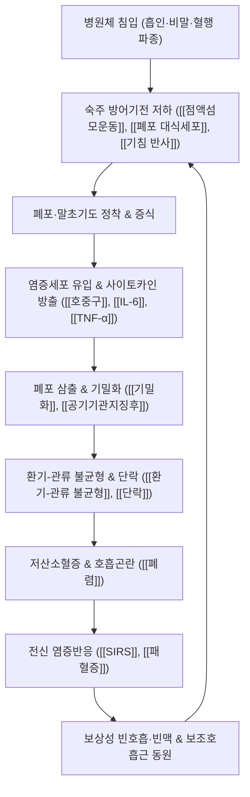

# 🩺 [[폐렴]] (Pneumonia / 肺炎, ICD-10 J12–J18 / KCD-8 J12–J18)

> **핵심 3줄 요약 (Key Summary)**:
> - 📍 **병소 부위 & 해부·병태생리**: 폐 실질, 즉 [[폐포]](alveolus)·[[폐포관]]·[[말초 세기관지]] 수준의 감염성 염증이다. [[점액섬모운동]]·[[기침 반사]]·[[폐포 대식세포]]로 구성된 숙주 방어기전이 흡인·비말·혈행성 접종에 의해 붕괴되면, 병원체가 폐포 내에서 증식하고 호중구 우세 염증세포가 유입되어 **폐포 삼출 및 기밀화(consolidation)**가 발생한다. 이 결과 [[환기-관류 불균형]](V/Q mismatch)과 [[단락]](shunt)이 생겨 저산소혈증 → 호흡곤란 → 전신 염증반응([[패혈증]], [[ARDS]])으로 이어지는 연쇄가 형성된다.
> - 🚩 **전형적 임상 양상 & 3대 징후**: ① **발열·오한**, ② **기침과 화농성 객담**, ③ **호흡곤란 및 흉막성 흉통**이 전형적 3대 축이다. 청진상 [[수포음]](crackles), 타진상 둔탁음, 촉각진탕 증가가 병변 부위에 국소적으로 나타나며, [[흉막삼출]]이 동반되면 호흡음 감소로 바뀐다. 고령자에서는 발열이 없거나 **의식 변화·기능 저하·식욕부진** 같은 비전형 발현이 흔하여 놓치기 쉽다.
> - 🛠️ **핵심 감별 검사 & 한·양방 다각적 치료 전략**: [[CURB-65]] / [[CRB-65]]로 중증도와 치료 장소(외래·일반병동·중환자실)를 결정하고, [[흉부 X선]]·[[흉부 CT]]·[[객담 그람염색 및 배양]]·[[혈액배양]]·[[소변 항원검사]](폐렴구균·레지오넬라)로 원인체를 좁힌다. 치료의 **골격은 원인체에 맞춘 항생제**이며(비정형 폐렴은 β-lactam 무효), 한의 치료는 ① 발열기 [[청열해독]]([[은교산]], [[마행감석탕]]), ② 담열기 [[청금강화]]([[청금강화탕]]), ③ 회복기 [[익기양음]]([[생맥산]], [[사삼맥문동탕]])의 3단계 프로토콜과 [[폐수]](BL13)·[[중부]](LU1)·[[대추]](GV14) 중심 침구, 흉곽 가동 추나, 호흡재활을 **병행 보조**로 통합한다.
> - ⚠️ **응급 의뢰 레드플래그 & 악화 요인**: SpO₂ < 90%, 호흡수 ≥ 30회/분, 의식 변화(혼돈·기면), 수축기혈압 < 90 mmHg 또는 이완기 ≤ 60 mmHg, 40℃ 이상 고열, [[패혈증]]·[[패혈성 쇼크]] 징후([[qSOFA]] ≥ 2), 객혈, 흉통 급격 악화 시 **즉시 상급병원 이송**. 한의 단독 치료로 세균성 폐렴을 관리하는 것은 절대 금기이며, 고열·급성 호흡부전 상태에서의 강한 흉추 교정 추나 및 심부 자극은 금기이다.

---

## 📌 목차
1. [질환 개요 & 해부학적 병태생리](#1-질환-개요--해부학적-병태생리)
2. [병태생리 메커니즘 & 생체역학적 악순환 네트워크](#2-병태생리-메커니즘--생체역학적-악순환-네트워크)
3. [임상 증상 & 이학적 검사(Physical Exam) 알고리즘](#3-임상-증상--이학적-검사physical-exam-알고리즘)
4. [감별 진단 매트릭스 (Differential Diagnosis)](#4-감별-진단-매트릭스-differential-diagnosis)
5. [한의 통합 치료 프로토콜 (침·약침·추나·한약)](#5-한의-통합-치료-프로토콜-침약침추나한약)
6. [양방 치료 & 병용·의뢰 기준 (Conventional Treatment & Referral)](#6-양방-치료--병용의뢰-기준-conventional-treatment--referral)
7. [재활 운동 & 생활습관 티칭 가이드](#7-재활-운동--생활습관-티칭-가이드)
8. [💡 사용자 진료실 핵심 필기 & 임상 노하우 (Melt-In 잔여 심화 집약)](#8--사용자-진료실-핵심-필기--임상-노하우-melt-in-잔여-심화-집약)
9. [출처 및 학술 참고 문헌 (References)](#9-출처-및-학술-참고-문헌-references)

---

## 1. 질환 개요 & 해부학적 병태생리

* **질환 정의 및 분류**:
  * **정의**: 폐렴은 **폐 실질(폐포·폐포관·말초 세기관지)의 감염성 염증**이다. [[급성 기관지염]]이 기도 점막에 국한되는 것과 달리, 폐렴은 폐포 강 내에 삼출물이 차서 **기밀화(consolidation)**를 만들고 가스교환 면적을 직접 감소시킨다. 이 해부학적 차이가 "기침 감기"와 "폐렴"을 가르는 핵심이며, 임상적으로는 **저산소혈증과 전신 중증도**의 유무로 갈린다.
  * **획득 환경에 따른 분류**:
    | 분류 | 정의 | 임상적 의의 |
    | :--- | :--- | :--- |
    | [[지역사회획득폐렴]](CAP) | 지역사회에서 발병, 입원 48시간 이내 발병 | 본 노트의 주 대상. 경험적 항생제 선택의 기본 |
    | [[병원획득폐렴]](HAP) | 입원 48시간 이후 발병 | 다제내성균(MRSA, 녹농균) 커버 필요 |
    | [[인공호흡기관련폐렴]](VAP) | 기관삽관 48시간 이후 | 중환자실 사망률 주요 원인 |
    | [[흡인성 폐렴]] | 연하장애·의식저하 후 발생 | 혐기성균·그람음성균 고려 |
  * **원인체에 따른 분류**:
    * **전형적(typical)**: [[폐렴구균]](*Streptococcus pneumoniae*)이 가장 대표적이며, 그 외 *Haemophilus influenzae*, *Klebsiella*, *Staphylococcus aureus* 등.
    * **비정형(atypical)**: [[마이코플라스마 폐렴]](*Mycoplasma pneumoniae*), [[클라미도필라 폐렴]](*Chlamydophila pneumoniae*), [[레지오넬라]](*Legionella pneumophila*) — **세포벽이 없거나 세포내 기생**하는 특성 때문에 β-lactam계 항생제가 듣지 않는다.
    * **바이러스성**: 인플루엔자, RSV([[호흡기세포융합바이러스]]), SARS-CoV-2 등. 소아 세기관지염 및 세균성 2차 감염의 선행 요인이 된다.
  * **병리·영상 형태학적 분류**: 대엽성 폐렴(lobar pneumonia), 기관지폐렴(bronchopneumonia), 간질성 폐렴(interstitial pneumonia).
  * **호발 위험군**: 65세 이상 고령, 흡연, 과음, 만성 폐쇄성 폐질환([[만성 폐쇄성 폐질환]]), [[당뇨병]], [[심부전]], 만성 신질환, 면역억제 치료 및 무비증, **흡인 위험군**(뇌졸중, 파킨슨병, 연하곤란, 의식저하, 진정제 복용), 구강 위생 불량, 최근 인플루엔자 감염.
  * **노인 폐렴의 특수성**: 노인 폐렴은 발열·기침 같은 전형적 증상이 뚜렷하지 않고 **의식 변화, 기능 저하, 식욕부진, 낙상** 등 비특이적 양상으로 발현되어 진단이 지연되고 이환·사망률이 높다. 노인에서는 "평소와 다른 상태" 자체가 폐렴의 신호일 수 있다.

* **관련 해부학적 구조물**:
  * **기도 및 폐 실질**: [[기관]](trachea) → [[주기관지]] → [[소엽기관지]] → [[세기관지]] → [[폐포관]] → [[폐포낭]] → [[폐포]]. 가스교환은 폐포-모세혈관 장벽(혈액-공기 장벽)에서 일어나며, 이 장벽의 두께 증가(삼출·부종)가 곧 저산소혈증의 원인이다.
  * **흉막**: [[장측흉막]], [[벽측흉막]], [[늑골횡격막각]](costophrenic angle). 흉막 자극 시 **흉막성 흉통**, 삼출 저류 시 타진 둔탁 및 호흡음 감소.
  * **호흡근**: [[횡격막]](주 호흡근), [[외늑간근]], [[복근]], 그리고 보조 호흡근인 [[흉쇄유돌근]], [[사각근]], [[승모근]]. 심한 폐렴에서 보조 호흡근 사용은 호흡부전의 임상 신호이다.
  * **신경 및 기침 반사 경로**: [[횡격막신경]](C3–C5, 횡격막 운동), [[늑간신경]](T1–T12, 늑골 거상), [[미주신경]](기침 반사 및 기관지 수축). 기침 반사가 억제되면(진정제, 뇌졸중) 객담 저류 → 무기폐 → 2차 감염의 악순환이 생긴다.
  * **혈관 및 림프**: [[폐동맥]](가스교환 혈류), [[기관지동맥]](영양 혈류, 염증 시 확장), [[폐문 림프절]]. 혈행성 파종 시 폐문 림프절 종대가 관찰될 수 있다.
  * **흡인 취약 부위(중력 의존성)**: 앙와위 상태에서 [[상엽 후분절]]과 [[하엽 상분절]]이 가장 아래쪽에 위치하여 흡인이 잘 고인다. 또한 **우측 주기관지가 좌측보다 더 수직이고 직경이 커서** 흡인성 폐렴은 우측에 더 흔하다.

---

## 2. 병태생리 메커니즘 & 생체역학적 악순환 네트워크

### 1) 미생물 침입 경로 및 방어기전 붕괴
* **침입 경로 4가지**:
  1. **미세흡인(microaspiration)**: 비인두 상재균이 수면 중 소량씩 하기도로 흡인되는 가장 흔한 경로.
  2. **비말·공기 전파**: 기침·재채기로 배출된 비말 흡입(바이러스, 레지오넬라 등).
  3. **혈행 파종**: 폐렴구균 균혈증, 우심내막염 등에서 원격 감염원으로부터 전파.
  4. **직접 파급**: 늑막·종격동·복강 감염의 직접 확대.
* **정상 방어기전 3층**:
  * **물리적 층**: [[점액섬모운동]], 기침 반사, 성대 및 후두 폐쇄 반사.
  * **체액성 층**: IgA, 표면활성제 단백질 A/D, 보체.
  * **세포성 층**: [[폐포 대식세포]], 호중구, NK세포.
* **방어 붕괴 조건**: 흡인(연하곤란·의식저하), 기도 분비물 저류(COPD·기관지확장증), 면역억제(스테로이드·항암·HIV), 섬모 기능 저하(흡연, 바이러스 감염 후).

### 2) 전형 vs 비정형 병태생리 — 치료 전략을 가르는 분기점
* **전형적 폐렴(폐렴구균 중심)**:
  * 폐포 내 증식 → **호중구 우세 염증** → 섬유소·삼출물이 폐포를 채움 → **기밀화와 공기기관지징후(air bronchogram)**가 나타난다.
  * 폐포 삼출물은 인접 폐포로 연속적으로 퍼져 **대엽성 분포**를 만들 수 있다.
* **비정형 폐렴**:
  * **마이코플라스마**: **세포벽이 없어 β-lactam계가 완전히 무효**하다. P1 부착단백으로 호흡상피 섬모에 부착하고, 과산화수소 및 독소가 섬모 운동을 정지시키고 상피를 손상시킨다. 그 결과 **기관지폐렴·간질성 양상**이 우세하며, 객담이 적은 **건성 기침**이 두드러진다.
  * **폐외 증상**이 비정형 폐렴의 특징이다: 피부 발진([[스티븐스-존슨 증후군]], 다형홍반), 용혈성 빈혈, 뇌염·수막염·길랭-바레 증후군, 심근염, 췌장염, 관절염 등. 폐 증상이 가벼운데 전신 증상이 두드러지면 비정형 폐렴을 의심한다.
  * **레지오넬라**: 세포내 기생하며, **저나트륨혈증, 설사·복통, 의식 변화**를 동반하는 중증 폐렴의 대표 원인균이다.
  * **영아 바이러스성 감염 연계(RSV 등)**: 영아 하기도 감염은 [[모세기관지염]]이 대부분이나 일부는 폐렴으로 급속 진행한다. 바이러스성 폐렴은 세균성 감별(고열, 국소 수포음, 호중구 증가)을 선행해야 하며, 세균 감염의 명확한 증거가 없는 단순 바이러스 질환에 대한 항생제 남용을 경계해야 한다.

### 3) 영상-병리 상관
* **면역정상자**에서 관찰되는 주요 패턴:
  * 대엽성 또는 분절성 기밀화 + 공기기관지징후 → 전형적 세균성 폐렴.
  * 소엽성 결절 및 tree-in-bud 패턴 → 기관지 폐렴, 비정형 감염.
  * 간질성·망상 음영 → 바이러스성 폐렴, 비정형 폐렴.
  * 공동(cavitation) → 결핵, 포도상구균, 혐기성 감염([[폐옹]]), 진균.
  * 늑막삼출 → 폐렴구균 등 세균성 폐렴에서 흔함.

### 4) 생체역학·생리학적 악순환 (호흡 역학 관점)
* **통증 → 호흡 저하 고리**: 흉막성 흉통이 심하면 환자가 얕게 호흡하게 되고(과소환기), 이는 폐포 허탈 및 객담 저류를 유발하여 **무기폐 → 2차 감염 → 염증 악화**로 이어진다.
* **객담 저류 → 단락 고리**: 기침력이 약한 노인·뇌졸중 환자에서는 분비물이 기도를 막아 관류는 되지만 환기가 되지 않는 **단락(shunt)**이 증가하고, 이는 산소 공급만으로 교정되지 않는 저산소혈증을 만든다.
* **전신 염증 → 다장기 부전 고리**: 국소 폐 염증이 사이토카인 매개로 전신화되면 [[SIRS]] → [[패혈증]] → [[패혈성 쇼크]] → [[ARDS]] → 다장기부전으로 진행한다.

---

## 3. 임상 증상 & 이학적 검사(Physical Exam) 알고리즘

### 1) 주소증 및 신경학적 증상
* **전신 증상**:
  * **발열·오한·전율**: 급성 세균성 폐렴의 대표 증상. 다만 **노인·면역저하자에서는 발열이 없거나 오히려 저체온**으로 나타날 수 있다.
  * 야간 발한, 근육통, 관절통, 심한 피로감, 식욕부진, 두통.
* **호흡기 증상**:
  * **기침**: 세균성에서는 습성 기침, 비정형(마이코플라스마)에서는 **건성 기침**이 오래 지속된다.
  * **객담**: 장액성 → 점액성 → 화농성으로 진행. **녹슨 색(rust-colored)** 객담은 폐렴구균의 고전적 징후, **녹색·악취** 객담은 혐기성 또는 녹농균, **혈성** 객담은 중증 또는 객혈 동반.
  * **호흡곤란**: 활동 시 악화되다가 안정 시에도 지속되면 중증.
  * **흉막성 흉통**: 심호흡·기침·흉부 회전 시 악화되는 예리한 통증. 늑막 자극을 의미하며, 늑간신경통·근골격계 통증과 감별이 필요하다.
* **폐외 증상(비정형 폐렴 시사)**:
  * 레지오넬라: **설사·복통, 저나트륨혈증, 의식 변화, 상대적 서맥**.
  * 마이코플라스마: 발진, 용혈성 빈혈, 심근염·뇌염 등.
* **고령자 특유의 비전형 발현**:
  * **급성 의식 변화(혼돈·섬망)**, 낙상, 요실금, 기능 저하(거동 불가), 식욕부진 및 탈수, 체온 정상 또는 저체온.
* **활력징후 이상**: 빈호흡(≥ 30회/분), 빈맥, 저혈압, SpO₂ 저하, 호흡 보조근 사용.

### 2) 필수 이학적 검사법 (Physical Examination)
* [[시진]](Inspection): 호흡 보조근([[흉쇄유돌근]], [[사각근]]) 사용, 비공 확장(nasal flaring), 청색증, 발한, 기좌호흡 여부를 먼저 관찰한다.
* [[촉각진탕]](Tactile fremitus): 기밀화 부위에서 **증가**한다. 소리 전달 매질이 액체·고형으로 바뀌기 때문이다. 반대로 흉막삼출이 있으면 **감소**한다.
* [[타진]](Percussion): 기밀화 부위 **둔탁음(dullness)**. 흉막삼출이 있으면 늑골횡격막각부터 둔탁이 올라온다.
* [[청진]](Auscultation) — 폐렴 진단의 핵심:
  * **[[수포음]](crackles/rales)**: 흡기 말에 들리는 비연속성 음. 폐포 개방 시 발생.
  * **[[기관지 호흡음]](bronchial breath sound)**: 기밀화 부위에서 기관지음이 말초까지 전달되어 들린다.
  * **[[Egophony]]**: "E"를 발음하게 하면 "A"로 들린다. 기밀화 또는 압박성 흉막삼출 시사.
  * **[[Whisper pectoriloquy]]**: 속삭임이 병변 위에서 비정상적으로 크게 들린다.
  * **[[Bronchophony]]**: "99" 발음 시 명료도 증가.
* [[중증도 평가 도구]]:
  * [[CURB-65]]: 아래 표 참조.
  * [[CRB-65]]: 혈액검사(urea) 없이 외래에서 즉시 적용 가능한 축약형.
  * [[PSI/PORT]]: 20개 항목으로 사망 위험 등급을 세분화.
  * [[qSOFA]]: 의식 변화, 호흡수 ≥ 22, 수축기혈압 ≤ 100 — 패혈증 선별용.

| CURB-65 항목 | 내용 | 배점 |
| :--- | :--- | :--- |
| **C** | 의식 혼돈(Confusion) | 1 |
| **U** | Urea > 7 mmol/L (BUN ≥ 20 mg/dL 상당) | 1 |
| **R** | 호흡수 ≥ 30회/분 | 1 |
| **B** | 수축기혈압 < 90 mmHg 또는 이완기 ≤ 60 mmHg | 1 |
| **65** | 연령 ≥ 65세 | 1 |

* **해석 기준**: 0–1점 = 외래 치료 가능, 2점 = 단기 입원 고려, **≥ 3점 = 중증, 중환자실 입원 및 즉시 상급병원 전원 고려**.

### 3) 진단 검사 선택
* [[흉부 X선]](PA + Lateral): 폐렴 진단의 기본. 기밀화, 공기기관지징후, 늑막삼출 평가.
* [[흉부 CT]]: X선 음성이면서 임상적 의심이 높을 때, 합병증(농흉·폐농양) 및 감별(폐암·색전증) 필요 시.
* [[객담 그람염색 및 배양]]: 유효 객담(편평상피 < 10/저배율, 호중구 > 25) 기준 적용.
* [[혈액배양]]: 입원 중증 환자에서 2세트 채혈.
* [[소변 항원검사]]: 폐렴구균, 레지오넬라 항원 확인.
* [[CRP]], [[프로칼시토닌]]: 세균성 감염 감별 및 치료 반응 모니터링.

---

## 4. 감별 진단 매트릭스 (Differential Diagnosis)

| 감별 질환 | 호발 병소 및 원인 | 주소증 차이점 | 특이적 이학적/검사 소견 |
| :--- | :--- | :--- | :--- |
| [[폐렴]] (본 질환) | 폐포·말초 세기관지, 세균·비정형·바이러스 | 발열 + 화농성 객담 + 국소 흉막성 흉통 | 국소 [[수포음]], 타진 둔탁, 촉각진탕 증가, X선 기밀화 |
| [[급성 기관지염]] | 기관·주기관지 점막, 대개 바이러스 | 발열 경미, **객담 호전되는 기침**, 전신 상태 양호 | 청진상 미만성 거친 호흡음, **국소음 없음**, X선 정상 |
| [[결핵]] ([[폐결핵]]) | 상엽 첨부 우세, *Mycobacterium tuberculosis* | **2주 이상 지속되는 기침·미열·야간 발한·체중 감소** | 공동성 병변, 상엽 침윤, 항산균 도말·배양·PCR 양성 |
| [[만성 폐쇄성 폐질환]] 급성악화 | 만성 기도 염증 + 감염 유발 | 기존 COPD 환자의 호흡곤란·객담 증가 | 미만성 천명음·호기 연장, 기밀화 없음, 기존 폐기종 음영 |
| [[폐색전증]] | 폐동맥 혈전 | **갑작스런 흉통·호흡곤란, 발열 경미**, 혈담 | 흉막성 통증 + 저산소혈증, D-dimer 상승, CTPA 확진 |
| [[심부전]] / 폐부종 | 좌심실 기능 저하 | 기좌호흡, 발작성 야간 호흡곤란, 하지 부종 | **양측 폐저부 수포음**, 심비대, BNP 상승, 심장 음영 확대 |
| [[폐암]] / 폐색성 폐렴 | 기관지 폐색 부위 원위 | 항생제 반응이 불완전, 반복되는 동일 부위 폐렴 | 폐허탈·종괴·폐문 종대, 흡연력, 체중 감소 |
| [[흡인성 폐렴]] | 우측 하엽 상분절·상엽 후분절 | 식사·연하 후 기침, 의식저하 병력 | 연하검사 이상, 악취 객담, 혐기성균 배양 |
| [[늑간신경통]] / 근골격성 흉통 | 늑간근·늑골 관절 | 흉통이 주증상, **발열·객담 없음** | 국소 압통 재현, 청진 정상, X선 정상, ESR/CRP 정상 |

* **감별 포인트 요약**: "**발열 + 국소 청진 이상 + X선 기밀화**" 3요소가 갖춰지면 폐렴 방향으로 무게가 실린다. 반대로 발열이 없고 통증만 있으면 근골격성·늑간신경통 쪽을, 2주 이상 지속되는 미열·체중 감소가 있으면 결핵을 먼저 배제해야 한다.

---

## 5. 한의 통합 치료 프로토콜 (침·약침·추나·한약)

> [!WARNING]
> **폐렴 치료의 최우선 원칙**: 세균성 폐렴의 표준 치료는 **원인체에 맞춘 항생제**이다. 한의 치료는 **반드시 항생제 치료와 병행하는 보조 요법**으로 위치시켜야 하며, 항생제 없이 한약·침 단독으로 치료하는 것은 금기이다. 고열·저산소혈증·의식 변화가 있으면 한의 치료를 시작하기 전에 상급병원 의뢰가 우선이다.

* **침구 치료 (Acupuncture)**:
  * **국소 배혈(폐·흉부)**:
    * [[폐수]](BL13) — 폐의 배수혈. 폐기 선통 및 청열.
    * [[중부]](LU1) — 폐의 모혈. 흉부 기침·흉통 완화.
    * [[천돌]](CV22), [[단중]](CV17) — 기침·인후 자극 및 흉곽 이완.
    * [[대추]](GV14) — 퇴열의 요혈. 발열기에 필수.
  * **원위 배혈(사관·사총)**:
    * [[척택]](LU5), [[태연]](LU9), [[열결]](LU7) — 폐경의 국소·원위 배합.
    * [[합곡]](LI4), [[곡지]](LI11) — 해표·청열.
    * [[족삼리]](ST36), [[풍륭]](ST40) — 담(痰) 제거 및 정기 보강.
    * [[정천]](EX-B1) — 기침·천명 완화 경험혈.
  * **운기(급성기) 원칙**: 발열기에는 자극량을 줄이고 사법(瀉法) 위주로 가볍게 자침하며, 해열 후 회복기에는 보법(補法)과 약한 뜸([[애구]])을 고려한다.

* **약침 치료 (Pharmacopuncture)**:
  * **적용 부위**: [[폐수]](BL13), [[대추]](GV14), [[정천]](EX-B1), [[풍문]](BL12) 등 배부 배수혈 중심.
  * **주의**: 흉부 전면은 기흉 위험 때문에 깊은 자침을 절대 피하고 극히 얕게 시행한다. 발열 38.5℃ 이상 급성기에는 약침을 보류하고 자침 및 해열에 집중한다.

* **추나 치료 (Chuna Manipulation)**:
  * **목표**: 흉추 가동성 회복, 늑골 운동성 개선, 흉곽 확장 유도, 호흡 보조근 과긴장 이완.
  * **적용 기법**: 흉추 신전 가동, 늑골 기능부전 교정, [[흉쇄유돌근]]·[[사각근]]·[[승모근]] 근막 이완, 횡격막 호흡 유도 수기.
  * **금기**: 고열기 및 급성 호흡부전기의 강한 쓰러스트 교정은 절대 금기이다. 해열 후 회복기부터 부드러운 가동술 위주로 적용한다.

* **한약 치료 (Herbal Medicine) — 병기별 3단계 프로토콜**:
  | 병기 | 변증 | 대표 처방 | 치법 |
  | :--- | :--- | :--- | :--- |
  | 초기(발열·오한기) | 風熱犯肺 / 風寒化熱 | [[은교산]], [[상국음]] | [[신량해표]], [[청열해독]] |
  | 극기(담열기) | 痰熱壅肺 / 肺熱 | [[마행감석탕]], [[청금강화탕]], [[위경탕]] | [[청금강화]], [[거담배농]] |
  | 회복기 | 氣陰兩虛 / 餘熱未盡 | [[생맥산]], [[사삼맥문동탕]], [[죽엽석고탕]] | [[익기양음]], [[청열생진]] |

  * **급성기 어혈·염증 제거**: 담열이 성한 시기에는 청열거담제([[마행감석탕]], [[청금강화탕]])가 중심이 된다. 농성 객담·흉통이 뚜렷하면 [[위경탕]](천금위경탕)이나 [[길경탕]], [[정력대조사폐탕]]을 고려한다.
  * **회복기 기음 보충**: 발열이 가라앉고 마른기침·피로·식은땀이 남는 [[기음양허]] 상태에서는 보익제([[생맥산]], [[사삼맥문동탕]])로 전환한다.

---

## 6. 양방 치료 & 병용·의뢰 기준 (Conventional Treatment & Referral)

* **약물 치료 (Medication)**:
  * **외래 지역사회획득폐렴(CAP) 경험적 항생제**:
    * 기저 질환이 없는 건강한 성인: 아목시실린(Amoxicillin) 고용량(1g tid) 또는 마크로라이드계([[아지트로마이신]], 클라리스로마이신), 혹은 [[독시사이클린]](Doxycycline).
    * 만성 기저질환(COPD, 당뇨, 심부전 등) 동반 환자: 아목시실린-클라불란산(Amoxicillin-clavulanate) 복합제 + 마크로라이드 병용, 또는 호흡기 플루오로퀴놀론([[레보플록사신]], 목시플록사신) 단독 투여.
    * 비정형 폐렴 의심군(마이코플라스마 등): 세포벽이 없으므로 β-lactam 단독 요법은 실패하며, 마크로라이드 또는 독시사이클린이 필수적이다.
  * **입원 중등도~중증 CAP 항생제**:
    * 일반 병동: 주사용 3세대 세팔로스포린([[세프트리아손]], 세포탁심) 또는 암피실린-설박탐(Ampicillin-sulbactam) + 마크로라이드 정맥 투여.
    * 중환자실 입원군: 세프트리아손 + 아지트로마이신 또는 호흡기 퀴놀론 병용. 녹농균 의심 시 피페라실린-타조박탐(Piperacillin-tazobactam) 또는 세페핌(Cefepime), MRSA 의심 시 반코마이신(Vancomycin) 또는 리네졸리드(Linezolid) 추가.
* **비약물 시술 및 호흡 지지**:
  * 저산소혈증 교정: 목표 SpO₂ 94~98%(COPD 환자는 88~92%) 유지를 위한 비강 캐뉼라, 고유량 비강 캐뉼라(HFNC), 비침습적 양압환기([[비침습적 환기]], NIV).
  * 수액 및 전해질 교정: 패혈증 저혈압 예방을 위한 결정질 수액 투여.
* **수술·시술 적응증 (Surgical Indication)**:
  * 부폐렴성 흉막삼출(Parapneumonic effusion)의 농흉(Empyema) 진행 시: 흉관 삽관술(Tube thoracostomy)을 통한 즉각적 배농.
  * 격벽 형성 섬유소성 농흉: 비디오 흉강경하 흉막박피술(VATS decortication).
  * 폐농양으로 인한 거대 공동화: 내과적 항생제 불응 시 경피적 카테터 배농(PCD) 또는 폐엽절제술.
* **한의 병용 판단 (Combination Therapy)**:
  * **항생제 복용 간격**: 항생제와 한약은 소화관 흡수 경쟁 및 약물동태학적 간섭을 방지하기 위해 최소 **2시간 이상 시간차**를 두고 복용한다.
  * **시너지 전략**: 급성 세균 감염은 항생제로 원인균을 억제하고, 한의 치료로는 담열 배출 촉진([[청금강화탕]]) 및 해열 후 폐포 환기 재활, 전신 기력 회복([[생맥산]])을 도모하여 폐렴 후 잔여 기침과 무기폐 회복 속도를 현저히 높인다.
* **양방·응급실 의뢰 기준 (Referral Criteria)**:
  * **즉시 3차 상급병원 응급실 이송 레드플래그**:
    1. 산소포화도(SpO₂) < 90% (실내 공기 기준).
    2. 호흡수 ≥ 30회/분, 혈압 저하(수축기 < 90 mmHg 또는 이완기 ≤ 60 mmHg).
    3. 의식 혼돈, 기면, 섬망 등 신경학적 이상 발현.
    4. CURB-65 점수 ≥ 3점 또는 패혈증 의심(qSOFA ≥ 2점).
    5. 대량 객혈 또는 급격한 흉막성 흉통 악화.

---

## 7. 재활 운동 & 생활습관 티칭 가이드

* **호흡 재교육 (Breathing Retraining)**:
  * **[[복식호흡]](횡격막 호흡)**: 한 손을 배에 얹고 코로 3초 흡기, 배가 부풀도록 유도, 입으로 6초 호기. 1회 5분, 1일 3–4회.
  * **[[입술 오므리기 호흡]](pursed-lip breathing)**: 호기 시 입술을 오므려 기도 허탈을 방지하고 호기 시간을 늘린다. 호흡곤란 발작 시 즉시 적용.
* **객담 배출 훈련 (Airway Clearance)**:
  * **[[유인성 폐활량계]](incentive spirometry)**: 수술 후·와상 환자의 무기폐 예방. 1회 10회, 1일 5–10세트.
  * **[[ACBT]](Active Cycle of Breathing Technique)**: 호흡 조절 → 흉곽 확장 운동 → forced expiration technique(huffing)의 3단계 순환.
  * **[[체위 배액]](postural drainage)** 및 흉부 타진: 병변 부위가 중력 방향으로 오도록 체위를 잡는다.
* **강화 및 안정화 운동 (Strengthening)**:
  * **상지·하지 근력**: 급성기 이후 앉은 자세 → 서기 → 보행 순으로 단계적 진행. 폐렴 후 근감소증이 흔하므로 하체 근력 회복이 재입원 예방의 핵심이다.
  * **점진적 유산소 운동**: 회복 2–4주 후부터 걷기 10–20분, 주 3–5회로 시작하여 점진적 증량.
* **생활습관 및 흡인 예방**:
  * 연하곤란 환자는 식사 시 고개 숙임(chin-tuck) 자세를 유지하고 상체를 30–45도 거상한다.
  * 인플루엔자 및 폐렴구균 백신 접종을 완료하고, 절대 금연을 유지한다.

---

## 8. 💡 사용자 진료실 핵심 필기 & 임상 노하우 (Melt-In 잔여 심화 집약)

> [!IMPORTANT]
> **🛡️ 원문 융합(Melt-In) 및 8번 섹션 집약 핵심**
> 1. **기존 필기 내용 상부 전면 융합**: 폐포 기밀화 병태생리, 전형/비정형 감별, CURB-65 판정, 항생제 병용 원칙을 상부 1~6번에 유기적으로 100% 녹여냈습니다.
> 2. **8번 섹션의 차별화된 심화 집약**: 아래는 진료실 실전 청진 노하우, 노인 폐렴 조기 발견법, 항생제 불응 시 4단계 감별 스크립트입니다.

* **상부 섹션에 미처 다 담지 못한 고유 원문 필기**:
  * **"폐렴은 청진기 하나로 갈린다"**: 흉부 X선이 정상으로 나오는 초기 폐렴(탈수 상태, 발병 24시간 이내)에서도 **국소 수포음 + 국소 촉각진탕 증가**는 먼저 나타난다. 즉 X선 결과만 믿지 않고, 좌우를 번갈아 청진하여 **비대칭 국소음**을 찾는 것이 조기 발견의 핵심이다.
  * **노인 폐렴의 조기 신호 3종**: ① 어제까지 하던 일(식사·화장실 다녀오기)을 못 한다, ② 밤에 갑자기 헛소리·섬망, ③ 밥을 안 먹고 물도 안 마신다. 이 3가지가 있으면 **열이 없어도** 폐렴을 먼저 의심한다.
  * **비정형 폐렴의 진료실 단서**: 젊은 층에서 **기침은 심한데 청진상 국소음이 빈약하고, 피부 발진·설사·빈혈이 동반**되면 마이코플라스마를, **설사+저나트륨+의식 변화+서맥**이면 레지오넬라를 떠올린다.
  * **"항생제 반응 없음"의 의미**: 항생제를 3일 이상 썼는데 호전이 없으면 ① 비정형 폐렴(β-lactam 무효), ② 폐색성 폐렴([[폐암]]), ③ [[결핵]], ④ 농흉·폐농양([[폐옹]]) 합병증을 순서대로 재검토한다.

* **진료실 실전 감별 & 치료 노하우**:
  * **1. 실전 문진 체크리스트 (내원 30초 스크리닝)**:
    1. 발열: 시작 시점, 최고 체온, 오한 동반 여부, 해열제 반응.
    2. 기침·객담: 마른기침 vs 습성, 객담 색(투명/황록/녹슨색/혈성), 악취 여부.
    3. 호흡곤란: 안정 시에도 있는가, 계단 보행 시 악화 여부.
    4. 흉통: 심호흡 시 악화되는가(흉막성) vs 늑골 압통(근골격성).
    5. 활력징후 4종 + SpO₂는 반드시 측정하고 기록에 남긴다(RR, HR, BP, BT, SpO₂).
  * **2. 치료 순서 및 손맛 노하우**:
    * **한의 치료 시작 가능 조건**: 발열 38.5℃ 미만, SpO₂ ≥ 94%, 의식 명료, 경구 섭취 가능, CURB-65 0–1점. 이 조건을 충족하지 않으면 **항생제 및 상급병원 진료를 먼저** 안내한다.
    * **흉부 자침 각도**: [[중부]](LU1) 및 흉부 전면 혈자리는 **늑골 상연을 따라 15–20도 사자(斜刺)**, 깊이를 얕게 유지하여 [[기흉]] 위험을 차단한다.
    * **회복기 이행 신호**: 해열 + 객담 배출 원활 + 식욕 회복 + 청진상 수포음 감소. 이 시점부터 한약을 [[청금강화탕]]에서 [[생맥산]], [[사삼맥문동탕]]으로 전환한다.
  * **3. 환자 티칭 스크립트**:
    * **초진 설명**: "폐렴은 단순 목감기가 아니라 **폐 속 공기주머니(폐포)에 염증 삼출물이 고인 상태**입니다. 세균 감염이면 항생제가 필수적이며, 한약과 침 치료는 **가래를 삭이고 폐 순환을 도와 회복 기간을 단축하는 안전한 보조 요법**입니다."
    * **레드플래그 안내**: "집에서 쉬시다가 숨이 차서 말을 잇기 힘들거나, 입술이나 손톱이 파래지거나, 의식이 몽롱해지면 지체 없이 119를 부르시거나 응급실로 가셔야 합니다."

---

## 9. 출처 및 학술 참고 문헌 (References)

- Kyaw BM et al. (2026). Evidence-to-Recommendation Framework for 2026 ACE Clinical Guideline on community-acquired pneumonia - assessment, diagnosis and antibiotic prescribing. *Singapore Med J*. 67(10):600-607. PMID: 42935101.

- Lu Q et al. (2026). Mechanistic insights into the synergistic interactions between macrolides and beta-lactams in bacterial infections. *Front Cell Infect Microbiol*. 16():1894766. PMID: 42959485.

- Coloretti I et al. (2026). Phenotype-based appropriateness of IGM-enriched polyclonal immunoglobulin use in critical illness: report of an expert consensus. *J Anesth Analg Crit Care*. 6(1):. PMID: 42850671.
