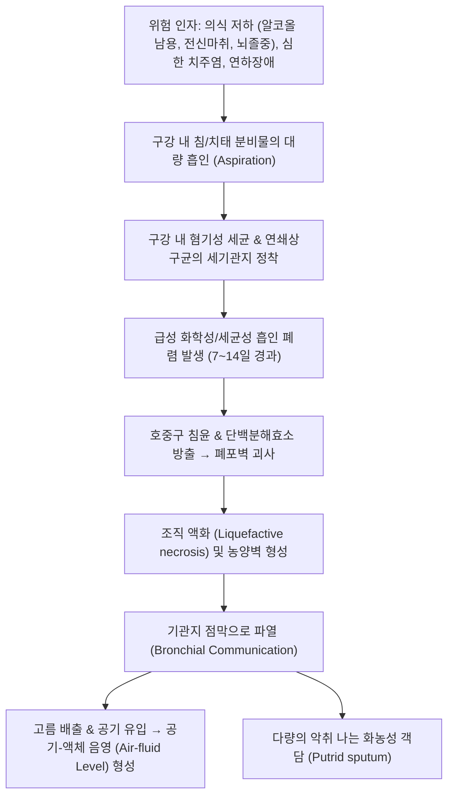

# 🩺 폐의 농양 (Lung Abscess)

> **핵심 3줄 요약 (Key Summary)**:
> - 📍 병소 부위 & 해부·병태생리: 감염성 미생물(주로 구강 내 혐기성 세균의 미세흡인)에 의해 폐 실질의 국소적 괴사 및 화농성 파괴가 발생하여 직경 2cm 이상의 공동(cavity)이 형성되는 질환; 중력 방향에 따라 우하엽 상구(superior segment) 및 후기저구에 호발.
> - 🚩 전형적 임상 양상: 수일~수주에 걸친 지속적인 발열, 야간 발한, 체중 감소, 피로, 악취가 나는 다량의 화농성 객담(putrid sputum) 배출 및 혈담/객혈.
> - 🛠️ 핵심 검사 & 치료 전략: 흉부 X선 및 CT상 두꺼운 벽을 가진 공동 내부의 전형적인 **공기-액체 음영(Air-fluid level)** 확인; 혐기성균을 포함한 광범위 항생제(암피실린/설박탐, 아모시실린/클라불라네이트, 클린다마이신) 4~6주 이상 장기 투여.
> - <font color="#fa7e7e">⚠️ 응급 의뢰 레드플래그: 200mL 이상의 대량 객혈, 농양의 흉막강 파열에 의한 농흉(Empyema) 및 긴장성 기흉, 패혈성 쇼크 발견 즉시 흉부외과/중환자실 응급 전원.</font>

---

## 📌 목차
1. [질환 개요 & 해부학적 병태생리](#1-질환-개요--해부학적-병태생리)
2. [병태생리 메커니즘 & 원인균 스펙트럼](#2-병태생리-메커니즘--원인균-스펙트럼)
3. [임상 증상 & 이학적 검사 알고리즘](#3-임상-증상--이학적-검사-알고리즘)
4. [감별 진단 매트릭스 (Differential Diagnosis)](#4-감별-진단-매트릭스-differential-diagnosis)
5. [한의학적 변증 & 배농 해독 프로토콜](#5-한의학적-변증--배농-해독-프로토콜)
6. [양방 치료 & 외과적 배액 기준 (Conventional Treatment & Referral)](#6-양방-치료--외과적-배액-기준-conventional-treatment--referral)
7. [환자 관리 & 생활습관 티칭 가이드](#7-환자-관리--생활습관-티칭-가이드)
8. [💡 진료실 핵심 필기 & 임상 노하우 (Melt-In 심화 집약)](#8--진료실-핵심-필기--임상-노하우-melt-in-심화-집약)
9. [출처 및 학술 참고 문헌 (References)](#9-출처-및-학술-참고-문헌-references)

---

## 1. 질환 개요 & 해부학적 병태생리

### 1) 정의 및 분류
**폐의 농양(Lung Abscess, 폐농양)** 은 폐 실질에 미생물 감염이 발생하여 폐 조직의 괴사(necrosis)와 화농성 삼출액이 고여 직경 2 cm 이상의 **공동(Cavity)** 을 형성하는 질환이다.

* **원발성 폐농양 (Primary Lung Abscess, 80%)**:
  * 기저 폐질환이 없는 환자에서 구강 분비물이나 음식물의 **[[기도 흡인증후군|미세 흡인(Aspiration)]]** 에 의해 발생.
* **속발성 폐농양 (Secondary Lung Abscess, 20%)**:
  * 기관지 폐쇄(폐암 등 이물질), 기관지확장증, 면역저하자의 기회감염, 또는 다른 장기의 감염원이 혈행성으로 전이(폐색전성 농양, 삼첨판막 감염성 심내막염)되어 발생.

### 2) 호발 해부학적 부위와 체위의 역학
흡인은 중력의 영향을 직접적으로 받으므로 환자의 체위에 따라 병변의 호발 부위가 엄격하게 결정된다:
* **앙와위(Supine position, 누운 자세)** 에서 흡인 시:
  * **우측 하엽의 상구 (Superior segment of right lower lobe, S6)** 및 **우측 상엽의 후구 (Posterior segment of right upper lobe, S2)** 에 압도적으로 호발.
* **좌위(Sitting position, 앉은 자세)** 에서 흡인 시:
  * **우측 하엽의 후기저구 (Posterior basal segment, S10)** 에 호발.
* (우측 주기관지가 좌측보다 굵고 짧으며 수직에 가깝게 분지하므로 우측 폐가 좌측보다 2배 이상 호발함).

---

## 2. 병태생리 메커니즘 & 원인균 스펙트럼



### 1) 미생물학적 원인균
1. **구강 내 혐기성 세균 (Anaerobic bacteria, 가장 흔함)**:
   * *Peptostreptococcus*, *Prevotella*, *Bacteroides fragilis*, *Fusobacterium nucleatum*, *Tannerella forsythia*.
   * 이들 세균은 휘발성 지방산을 생성하여 전형적인 **썩은 냄새(악취, putrid odor)** 를 유발함.
2. **호기성 및 통성 혐기성 세균**:
   * *Streptococcus anginosus* 그룹 (밀러 연쇄상구균).
   * 그람음성 간균: *Klebsiella pneumoniae* (당뇨병 환자, 알코올 중독자에서 벽돌색 가래와 함께 급속 괴사성 폐렴 유발), *Pseudomonas aeruginosa*.
   * 황색포도상구균(*Staphylococcus aureus*): 인플루엔자 바이러스 폐렴 후 속발성 농양, 다발성 공동 유발.

---

## 3. 임상 증상 & 이학적 검사 알고리즘

### 1) 전형적 임상 증상
* **아급성~만성 경과**: 수일에서 수주에 걸쳐 서서히 진행하는 발열, 오한, 야간 식은땀(도한), 전신 쇠약 및 체중 감소(종종 결핵이나 악성 종양으로 오인됨).
* **악취 나는 객담 배출 (Putrid Sputum)**:
  * 초기에는 마른기침으로 시작하다가, 농양이 기관지와 연결되는 순간 **하루 수백 mL에 달하는 누런 악취 나는 고름 가래가 왈칵 쏟아져 나옴**.
* **혈담 및 객혈 (Hemoptysis)**: 농양 주변부 폐 모세혈관 및 기관지 동맥 미란으로 유발.

### 2) 이학적 검사 소견
* **구강 진찰**: 심한 치은염, 치주 농양, 다발성 치아 우식, 불량한 구강 위생.
* **흉부 청진**: 농양 부위 호흡음 감소, 거친 수포음, 공동 형성에 따른 공동성 호흡음(amphoric breath sounds).
* **흉부 타진**: 공동 상부의 타진 시 둔탁음(dullness).

### 3) 흉부 영상 소견
* **흉부 단순 촬영 및 HRCT**:
  * 직경 2~5 cm 크기의 **두꺼운 벽을 가진 고립성 원형 공동**.
  * 공동 내부의 수평선 형태인 **공기-액체 음영(Air-fluid level)** (누운 자세에서는 액체로 차 보이나 선 자세에서 수위 확인).
  * 농양 주변부의 폐렴성 침윤 음영.

---

## 4. 감별 진단 매트릭스 (Differential Diagnosis)

| 감별 질환 | 공동 벽 특징 | 임상 양상 및 원인 | 결정적 감별 포인트 |
| :--- | :--- | :--- | :--- |
| **[[폐의 농양]]** | **비교적 균일한 두꺼운 벽, 매끄러운 내벽, 공기-액체 음영** | 알코올/연하장애 후 발열, **악취 나는 객담** | 구강 혐기성균 감염, 항생제 치료 시 수주 내 소퇴 |
| **공동성 폐암 (Cavitary Lung Cancer)** | **매우 두껍고 불규칙한 결절상 내벽, 편심성(eccentric)** | 고령, 흡연자, 체중 감소, 악취 없음 | 내벽 결절, 악성 세포학적 증명, 항생제 반응 없음 |
| **폐결핵 공동 (TB Cavity)** | 얇거나 중등도 벽, 첨부/상엽 우세 | 만성 기침, 미열, 야간 발한, 체중 감소 | **악취 없음**, 상엽 첨부 호발, 객담 AFB/결핵균 PCR (+) |
| **감염성 폐포낭 (Infected Bulla)** | **매우 얇은 외벽 (< 2 mm)** | 기존 만성 폐쇄성 폐질환(COPD) 병력 | 기존 흉부 영상상 기포(bulla) 존재 확인 |
| **급성 농흉 (Empyema)** | 흉막강 내 삼출액, 흉막 비후 | 심한 흉통, 흡기 시 악화 | **흉막강 내 위치(렌즈형 모양)**, 흉수 천자상 고름 |

---

## 5. 한의학적 변증 & 배농 해독 프로토콜

> 🎯 **치료 접근 원칙**: 폐의 농양은 한의학에서 화농성 폐 질환의 대표격인 **'폐옹(肺癰)'** 에 해당한다. 《금궤요략(金匱要略)》 폐위폐옹해수상기병맥증병치(肺痿肺癰咳嗽上氣病脈證幷治)에 기록된 정통 치법에 따라, 초기에는 청폐해독(淸熱解毒), 성농기에는 배농청폐(排膿淸肺), 회복기에는 익기양음(益氣養陰)의 3단계 치료 원칙을 적용하며, 서양의학적 항생제 요법과 병용 시 객담 배출 촉진 및 체류 고름의 배농을 가속화한다.

### 1) 한의학적 3단계 변증 및 처방
1. **초기 (풍열옹폐증 風熱壅肺證 - 폐렴 침윤기)**:
   * 주증: 오한, 고열, 마른기침 또는 점조한 누런 가래, 흉통, 설홍태황, 맥부삭.
   * 치법: 소풍청열(疏風淸熱), 청폐해독(淸肺解毒).
   * 대표 처방: [[은교산]](銀翹散) 합 [[마행감석탕]](麻杏甘石湯) 가감.
2. **성기 (열독옹성증 熱毒壅盛證 / 혈어육부증 血瘀肉腐證 - 화농 공동기)**:
   * 주증: 지속되는 발열, 흉통, 누르면 아픔, 끈적하고 피가 섞인 비린내/악취 나는 고름 가래 분출, 번갈, 설홍태황니, 맥활삭.
   * 치법: 청열해독(淸熱解毒), 화어배농(化瘀排膿).
   * **대표 처방: [[위경탕]](葦莖湯, 천금위경탕)** 합 [[삼백탕]](三白湯) 또는 [[길경탕]](桔梗湯) 가감.
     * **핵심 본초**: 위경(노근), 동과자, 율무(의이인), 도인, 길경(배농 지표약), 어성초(천연 항균 소염 특효), 패모, 황련.
3. **회복기 (음상기휴증 陰傷氣虧證 - 배농 후 관해기)**:
   * 주증: 열은 내렸으나 마른기침 지속, 소량의 끈끈한 가래, 식은땀, 기력 없음, 안색 창백, 설홍소태, 맥세삭.
   * 치법: 익기양음(益氣養陰), 청폐화담(淸肺化痰).
   * 대표 처방: [[사삼맥문동탕]](沙參麥門冬湯) 합 [[생맥산]](生脈散).

### 2) 침구 치료
* **혈위**: [[척택]](LU5, 청폐열), [[공최]](LU6, 극혈 - 객혈 지혈), [[폐수]](BL13), [[중완]](CV12), [[풍륭]](ST40), [[합곡]](LI4), [[어제]](LU10).
* **치법**: 성기에는 척택, 공최, 어제혈에 강자극 사법을 적용하여 사열을 배출함.

---

## 6. 양방 치료 & 외과적 배액 기준 (Conventional Treatment & Referral)

### 1) 항생제 요법 (표준 보존 치료, 85~90% 완치)
* **1차 표준 처방**:
  * **Ampicillin-Sulbactam (IV 1.5~3g q6h)** 또는 **Amoxicillin-Clavulanate**.
  * 페니실린 알레르기 시: **Clindamycin (IV 600mg q8h)** 또는 Moxifloxacin.
* **치료 기간**:
  * 최소 **4~6주 이상**의 장기 투여 필요.
  * 흉부 X선 또는 CT상 공동이 완전히 소퇴되거나 작은 안정적 섬유화 흉터만 남을 때까지 투약 유지.

### 2) 중재적 시술 및 수술 적응증 (10~15%)
* **경피적 카테터 배액술 (Percutaneous Catheter Drainage, PCD)**:
  * 항생제 투여 7~10일 후에도 열이 지속되고 농양이 축소되지 않거나 직경 > 6 cm 거대 농양인 경우 초음파/CT 유도하 시행.
* **외과적 수술 (폐엽 절제술 Lobectomy)**:
  * 대량 객혈, 기관지 흉막루, 암 동반 의심, 내과적 치료 불응 시 시행.

### 3) 🚨 급성 파열 및 패혈증 레드플래그

```
[🚨 폐농양 초응급 레드플래그 체크리스트]
1. 200 mL 이상의 분출성 대량 객혈 (Massive hemoptysis - 질식 위험)
2. 농양이 흉막강으로 파열되어 발생하는 급성 농흉(Empyema) 및 긴장성 농기흉
   => 극심한 흉통, 혈압 급락, 쇼크, 호흡음 소실
3. 패혈성 쇼크 (SBP < 90 mmHg, 체온 > 39도 또는 저체온, 의식 저하)
4. 급성 호흡곤란증후군(ARDS) 합병

=> 상기 소견 관찰 시 즉시 상급종합병원 호흡기내과/흉부외과로 119 응급 후송한다.
```

---

## 7. 환자 관리 & 생활습관 티칭 가이드

### 1) 구강 위생 관리 철저
* 구강 내 치석과 치주낭은 혐기성균의 온상이므로 스케일링, 칫솔질, 치실 사용 교육.
* 식후 바로 눕지 않도록 교육.

### 2) 체위 배액법 (Postural Drainage)
* 농양이 위치한 폐 부위가 위로 향하도록 체위를 취하고 가벼운 기침을 유도하여 객담 배출 촉진.

---

## 8. 💡 진료실 핵심 필기 & 임상 노하우 (Melt-In 심화 집약)

### 1) "가래에서 하수구 썩는 냄새가 나요"
* 환자가 "기침할 때 입에서 역한 시궁창 냄새가 나고 가래가 쏟아진다"고 호소하면 90% 이상 혐기성균에 의한 폐농양 또는 기관지확장증 감염이다.
* 단순 감기약이나 기침약 처방을 즉시 중단하고 흉부 방사선 촬영을 의뢰하여 공기-액체 음영(Air-fluid level) 공동을 확인해야 한다.

### 2) 천금위경탕(千金葦莖湯)과 어성초의 배농 파워
* 고서에서 폐옹의 성약으로 꼽히는 《위경탕》(위경, 의이인, 동과자, 도인)에 **어성초(魚腥草) 30~40g**과 길경을 다량 가미하면, 양방 항생제 치료 중에도 끈적하게 배출되지 않던 고름 가래가 신속하게 묽어져 배출되며 공동 축소 기간을 현저히 단축시킨다.

---

## 9. 출처 및 학술 참고 문헌 (References)

1. Lung Abscess Resulting From Aspiration Pneumonia Following Orthognathic Surgery With Le Fort I and Sagittal Split Ramus Osteotomies. (2026). *J Craniofac Surg*, epub. PMID: 42523115.

2. Klebsiella pneumoniae Lung Abscess Due to Aspiration of Seawater During Recreational Free Diving. (2025). *Wilderness Environ Med*, 36(2):278-283. PMID: 40007439.

3. Lung Abscess Caused by Tannerella forsythia Infection: A Case Report. (2023). *Infect Drug Resist*, 16:6975-6981. PMID: 37928606.

---

## 관련 노트

- [[기도 흡인증후군]]
- [[급성 호흡 곤란 증후군]]
- [[무기폐]]
- [[미만성 폐포 출혈]]
- [[기흉]]
