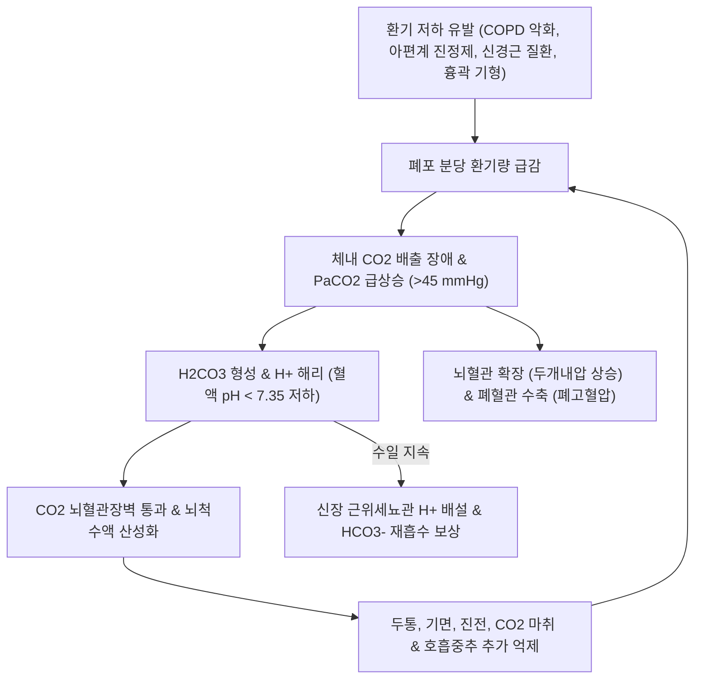

# 🩺 [[호흡성 산증]] (Respiratory Acidosis / 呼吸性酸症, ICD-10 E87.2 / KCD-8 E87.2)

> **핵심 3줄 요약 (Key Summary)**:
> - 📍 **병소 부위 & 해부·병태생리**: 폐포 환기 저하(Alveolar hypoventilation)로 체내 대사로 생성된 이산화탄소($\text{CO}_2$)가 적절히 체외로 배출되지 못해 $\text{PaCO}_2 > 45\text{ mmHg}$로 상승하고 동맥혈 $\text{pH} < 7.35$로 저하되는 산-염기 불균형 병태. [[만성 폐쇄성 폐질환]], [[천식]], 중추신경 억제제(아편계·진정제), 신경근육 질환, 흉곽 기형 등이 핵심 원인이다.
> - 🚩 **전형적 임상 양상 & 3대 징후**: 두통, 기면, 혼돈, 지남력 상실 및 $\text{CO}_2$ 마취(CO2 narcosis), 진전(Asterixis, 자세유지불능증), 결막 충혈 및 시신경유두 부종. 만성 환자에서 급성 감염 등이 겹친 급성-악화(Acute-on-chronic)가 임상에서 가장 빈번하다.
> - 🛠️ **핵심 감별 검사 & 한·양방 다각적 치료 전략**: 동맥혈가스분석(ABGA)으로 $\text{pH}$, $\text{PaCO}_2$, $\text{HCO}_3^-$ 및 전해질 평가. 급성 호흡부전 시 비침습적 양압환기([[비침습적 환기]], NIV)가 삽관율과 사망률을 현저히 낮추는 1차 표준 치료이며, 목표 $\text{SpO}_2$ 88~92% 적정 산소 투여와 원인 질환(기도 확장, 날록손) 치료를 병행한다. 한의 치료는 급성기 안정 후 폐신양허(肺腎兩虛) 변증 관리 및 횡격막 호흡재활로 환기 효율을 지원한다.
> - ⚠️ **응급 의뢰 레드플래그 & 악화 요인**: 의식 저하, 기도 반사 소실, 혈역학적 쇼크, 극심한 산혈증($\text{pH} < 7.20$) 시 즉시 기관삽관 및 기계환기 상급병원 이송. 만성 고탄산혈증 환자에게 고농도 산소를 무분별하게 투여하면 저산소성 호흡 추동이 차단되어 치명적인 $\text{CO}_2$ 저류와 심정지를 유발할 수 있다.

---

## 📌 목차
1. [질환 개요 & 해부학적 병태생리](#1-질환-개요--해부학적-병태생리)
2. [병태생리 메커니즘 & 생체역학적 악순환 네트워크](#2-병태생리-메커니즘--생체역학적-악순환-네트워크)
3. [임상 증상 & 이학적 검사(Physical Exam) 알고리즘](#3-임상-증상--이학적-검사physical-exam-알고리즘)
4. [감별 진단 매트릭스 (Differential Diagnosis)](#4-감별-진단-매트릭스-differential-diagnosis)
5. [한의 통합 치료 프로토콜 (침·약침·추나·한약)](#5-한의-통합-치료-프로토콜-침약침추나한약)
6. [양방 치료 & 병용·의뢰 기준 (Conventional Treatment & Referral)](#6-양방-치료--병용의뢰-기준-conventional-treatment--referral)
7. [재활 운동 & 생활습관 티칭 가이드](#7-재활-운동--생활습관-티칭-가이드)
8. [💡 사용자 진료실 핵심 필기 & 임상 노하우 (Melt-In 잔여 심화 집약)](#8--사용자-진료실-핵심-필기--임상-노하우-melt-in-잔여-심화-집약)
9. [출처 및 학술 참고 문헌 (References)](#9-출처-및-학술-참고-문헌-references)

---

## 1. 질환 개요 & 해부학적 병태생리

* **질환 정의 및 분류**:
  * **정의**: 폐포 환기량(Alveolar ventilation)이 체내 대사 산물인 $\text{CO}_2$ 생성 속도를 따라가지 못하여 동맥혈 이산화탄소 분압($\text{PaCO}_2$)이 $45\text{ mmHg}$를 초과하고, 체액의 수소이온 농도($[\text{H}^+]$)가 상승하여 동맥혈 $\text{pH}$가 $7.35$ 미만으로 떨어지는 산-염기 불균형 상태이다.
  * **시간 경과 및 보상에 따른 분류**:
    * **급성 호흡성 산증 (Acute Respiratory Acidosis)**: 수 분~수 시간 내에 급격한 환기 부전으로 발생. 신장의 보상성 중탄산염($\text{HCO}_3^-$) 재흡수가 작동할 시간이 없어, 세포내 단백질 완충에 의해서만 $\text{PaCO}_2\ 10\text{ mmHg}$ 상승당 $\text{HCO}_3^-$가 약 $1\text{ mEq/L}$ 상승하는 데 그치며 $\text{pH}$가 급격히 하강한다.
    * **만성 호흡성 산증 (Chronic Respiratory Acidosis)**: 수일~수주 이상 지속. 신장 근위세뇨관에서 $\text{H}^+$ 배설과 $\text{HCO}_3^-$ 재흡수가 최대로 항진되어, $\text{PaCO}_2\ 10\text{ mmHg}$ 상승당 $\text{HCO}_3^-$가 약 $3.5\sim4\text{ mEq/L}$ 증가하여 $\text{pH}$ 저하를 완화시킨다.
    * **급성-악화 (Acute-on-chronic Respiratory Acidosis)**: 만성 고탄산혈증 환자([[만성 폐쇄성 폐질환]])가 급성 하기도 감염([[폐렴]]), 진정제 복용, 과도한 산소 투여 등으로 급성 저환기가 중첩된 상태.

* **관련 해부학적 계통**:
  * **호흡 조절 중추**: 연수(Medulla oblongata) 및 교뇌의 호흡 신경원, 뇌간 혈류.
  * **신경근 전달계**: 척수 경추 분절(C3~C5, [[횡격막신경]]), 신경근 접합부, 호흡근([[횡격막]], 외늑간근).
  * **흉곽 및 흉벽**: 흉추 후측만증, 연가양흉, 고도 비만(비만저환기증후군).
  * **기도 및 폐 실질**: 기관지 내강(공기 포획, 내재적 PEEP), 폐포-모세혈관 접촉면.
  * **보상 장기**: 신장(근위세뇨관 및 원위세뇨관 $\text{H}^+$ 펌프).

---

## 2. 병태생리 메커니즘 & 생체역학적 악순환 네트워크

### 1) 폐포 저환기의 주요 기전 및 병인군
1. **기도 및 폐실질 질환**: [[만성 폐쇄성 폐질환]](COPD), 중증 [[천식]] 지속상태, 광범위 [[폐렴]], 중증 폐부종, 폐섬유증 말기. 기도 저항 증가와 폐 탄성도 저하로 인한 공기 포획(Air trapping).
2. **중추성 호흡 억제**: 마약성 진통제(모르핀, 펜타닐), 벤조디아제핀, 바비튜레이트, 알코올 급성 중독, 뇌간 경색/출혈, 중추성 수면무호흡.
3. **신경근육 질환**: 중증근무력증(Myasthenia gravis), 길랭-바레 증후군(GBS), 근위축성 측삭경화증(ALS), 척수 손상, 저칼륨혈증성 근마비.
4. **흉벽 및 호흡 역학 장애**: 흉곽 성형술 후유증, 심한 척추측만증, 연가양흉, 고도 비만저환기증후군(Pickwickian syndrome).

### 2) 산염기 생리학 및 장기 손상 악순환
* **$\text{CO}_2$ 마취와 호흡 억제 고리**: $\text{CO}_2$는 지용성이 높아 혈액뇌장벽(BBB)을 자유롭게 통과하여 뇌척수액의 $\text{pH}$를 즉각 떨어뜨린다. 급격한 고탄산혈증은 뇌혈관을 심하게 확장시켜 두개내압(IICP)을 상승시키고, 뇌간 호흡 중추의 화학수용체를 마비시켜 환기 반사를 더욱 억제하는 치명적 악순환을 형성한다.
* **신장 보상과 급성 신손상(AKI)의 교차 위험**: 만성 고탄산혈증 환자에게 급성 신손상(AKI)이 병발하면 신장의 보상성 $\text{HCO}_3^-$ 생성 능력이 상실되어 급격하고 치명적인 산혈증과 심부전이 초래된다.
* **부정맥 및 심근 수축력 억제**: 혈청 $\text{pH} < 7.10$으로 떨어지면 심근의 카테콜아민 반응성이 억제되어 심박출량이 급감하고 치명적인 심실성 부정맥 위험이 증가한다.

---

## 3. 임상 증상 & 이학적 검사(Physical Exam) 알고리즘

### 1) 주소증 및 신체 징후
* **신경학적 증상**:
  * 초기: 둔한 양측성 전두부 두통, 불안, 안절부절못함.
  * 진행기: 주간 졸림증, 기면(Lethargy), 혼돈, 지남력 상실, 섬망.
  * 말기: **$\text{CO}_2$ 마취(CO2 narcosis)** 및 혼수(Coma).
* **신경근 및 혈관 징후**:
  * **진전(Asterixis, Flapping tremor)**: 손목을 배굴시켰을 때 불수의적인 날갯짓 모양의 떨림 관찰.
  * **결막 충혈 및 안면 홍조**: $\text{CO}_2$ 혈관 확장에 의한 말초 혈관 노창.
  * 저산소혈증 동반 시 청색증, 발한, 빈맥, 혈압 상승(초기) 또는 쇼크(말기).

### 2) 필수 검사법
* **동맥혈가스분석(ABGA)**:
  * $\text{pH} < 7.35$, $\text{PaCO}_2 > 45\text{ mmHg}$.
  * 급성: $\text{PaCO}_2\ 10\text{ mmHg}$ 상승당 $\text{HCO}_3^-$ 약 $1\text{ mEq/L}$ 증가, $\text{pH}$ 약 $0.08$ 감소.
  * 만성: $\text{PaCO}_2\ 10\text{ mmHg}$ 상승당 $\text{HCO}_3^-$ 약 $3.5\sim4\text{ mEq/L}$ 증가, $\text{pH}$ 약 $0.03$ 감소.
* **혈청 전해질 및 신기능 검사**: 혈청 $\text{K}^+$, $\text{Cl}^-$, $\text{BUN/Cr}$ 평가 (산혈증에 의한 세포외 칼륨 이동으로 고칼륨혈증 호발).
* **흉부 단순 촬영 및 CT**: 폐포 삼출, 폐기종, 기흉, 무기폐 감별.
* **약물 독성 스크리닝**: 아편계 및 진정제 과다복용 선별.

---

## 4. 감별 진단 매트릭스 (Differential Diagnosis)

| 감별 질환 | 주 병태생리 | ABGA 특이 소견 | 주요 임상 양상 |
| :--- | :--- | :--- | :--- |
| **[[호흡성 산증]] (본 질환)** | 폐포 저환기 ($\text{CO}_2$ 배출 저하) | **$\text{pH} \downarrow$, $\text{PaCO}_2 \uparrow$, $\text{HCO}_3^- \uparrow$ (보상)** | 두통, 졸림, 기면, 진전, $\text{CO}_2$ 마취 |
| **[[대사성 산증]]** | 체내 산 과다 또는 중탄산염 소실 | $\text{pH} \downarrow$, $\text{HCO}_3^- \downarrow$, $\text{PaCO}_2 \downarrow$ (보상) | 쿠스마울(Kussmaul) 심호흡, 오심, 구토, 복통 |
| **[[호흡성 알칼리증]]** | 폐포 과환기 ($\text{CO}_2$ 과다 배출) | $\text{pH} \uparrow$, $\text{PaCO}_2 \downarrow$, $\text{HCO}_3^- \downarrow$ (보상) | 빈호흡, 손발 저림, 구주위 감각 이상, 테타니 |
| **[[대사성 알칼리증]]** | 위산 소실 또는 중탄산염 과다 | $\text{pH} \uparrow$, $\text{HCO}_3^- \uparrow$, $\text{PaCO}_2 \uparrow$ (보상) | 호흡 억제(저환기 보상), 근연축, 부정맥 |

---

## 5. 한의 통합 치료 프로토콜 (침·약침·추나·한약)

* **한의 치료의 기본 원칙**:
  * 호흡성 산증은 급성 생명 위협을 초래할 수 있는 전신 대사-환기 응급 질환이므로, 급성기 산혈증 교정 및 기도 환기 관리는 반드시 **양방 호흡기 내과 및 응급의학적 치료가 선행**되어야 한다.
  * 한의 치료는 급성기 호전 후의 만성기 환기 기능 유지, 횡격막 호흡근 피로 개선, 기저 폐질환 안정화를 위한 **보조 요법**으로 통합된다.
* **침구 치료 (Acupuncture)**:
  * **원기 보익 및 선폐평천(宣肺平喘) 혈위**:
    * 배수혈: [[폐수]](BL13), [[신수]](BL23), 고황(BL43).
    * 복모혈 및 흉곽혈: [[중부]](LU1), [[단중]](CV17), [[기해]](CV6), [[관원]](CV4).
    * 사지 원위혈: [[족삼리]](ST36), [[태계]](KI3), [[풍륭]](ST40), 열결(LU7)-조해(KI6) 팔맥교회혈 배합.
  * 자침 운기: 만성 쇠약 환자에서는 보법(補法) 위주로 부드럽게 운침하며, 흉곽 전면 자침 시 기흉 방지를 위해 15도 이하 사자 또는 평자를 엄수한다.
* **추나 및 근막 이완 (Chuna Manipulation)**:
  * 만성 폐쇄성 폐질환으로 인한 호흡 보조근 과긴장 완화를 위해 [[흉쇄유돌근]], [[사각근]], 소흉근 근막 이완(JS 수기) 적용.
  * 흉곽 유연성 확보를 위한 부드러운 흉추 신전 가동 및 횡격막 이완 유도 호흡 기법 적용.
* **한약 치료 (Herbal Medicine)**:
  * **폐신양허 / 담어저폐 (만성 안정기)**:
    * **[[보폐탕]](保肺湯) 가감방**: 인삼, 황기, 숙지황, 오미자, 자완, 상백피.
    * **[[진무탕]](眞武湯) 또는 [[신기환]](腎氣丸)**: 폐신양허로 인한 수음정체, 부종, 호흡 촉박 동반 시 신양을 덥혀 수기를 운행시킴.
    * 담음이 성하여 기침과 가래가 끓을 때는 [[이진탕]](二陳湯) 합 [[삼자양친탕]](三子養親湯) 가감.

---

## 6. 양방 치료 & 병용·의뢰 기준 (Conventional Treatment & Referral)

* **약물 치료 (Medication)**:
  * **원인 역전 약제**:
    * 마약성 진통제 과다복용: **날록손(Naloxone)** $0.4\sim2.0\text{ mg}$ 정맥 주사 (반응 없을 시 $2\sim3$분 간격 재투여).
    * 벤조디아제핀 과다복용: 플루마제닐(Flumazenil) 신중 투여.
    * COPD/천식 급성 악화: 속효성 흡입 기관지확장제(살부타몰 + 이프라트로피움 분무), 전신 스테로이드(프레드니솔론 $40\text{ mg/일}$ 5일간), 하기도 감염 동반 시 마크로라이드 또는 퀴놀론 항생제 투여.
  * **중탄산나트륨($\text{NaHCO}_3$) 투여에 관한 경고**:
    * 호흡성 산증에서 $\text{NaHCO}_3$ 투여는 $\text{H}^+$와 결합하여 막대한 $\text{CO}_2$를 발생시킨다. 환기가 불가능한 환자에게 $\text{CO}_2$ 생성을 늘리면 뇌척수액 및 세포내 산증이 역설적으로 악화되므로 원칙적 금기이다.
* **비약물 시술 및 기계환기 지지**:
  * **목표 적정 산소 요법**: 만성 고탄산혈증 환자에게 산소를 공급할 때는 저산소성 호흡 추동(Hypoxic drive) 소실을 막기 위해 **목표 $\text{SpO}_2$를 88~92%**로 엄격히 제한하여 벤투리 마스크 또는 저유량 비강 캐뉼라로 투여한다.
  * **비침습적 양압환기([[비침습적 환기]], NIV / BiPAP)**:
    * AECOPD에 의한 고탄산혈증성 급성 호흡부전($\text{pH} < 7.35$, $\text{PaCO}_2 > 45\text{ mmHg}$)의 1차 표준 치료.
    * 흡기양압(IPAP) $10\sim15\text{ cmH}_2\text{O}$, 호기양압(EPAP) $4\sim5\text{ cmH}_2\text{O}$로 시작하여 환기량을 확보하고 호흡근 피로를 경감.
* **침습적 기계환기 적응증 (Invasive Mechanical Ventilation)**:
  * NIV 금기 및 실패: 심한 의식 혼수, 심정지 임박, 기도 보호 반사 소실, 다량의 분비물, 혈역학적 쇼크.
  * 즉시 기관삽관 시행. 폐 손상 방지를 위해 일회 환기량 $6\text{ mL/kg}$ 유지 및 **허용적 고탄산혈증(Permissive hypercapnia)** 원칙 준수 (급격한 $\text{PaCO}_2$ 강하는 대사성 알칼리증 및 뇌허혈 유발).
* **한의 병용 판단 (Combination Therapy)**:
  * 급성기 의식 저하 환자에게 한약이나 침 치료를 단독 적용하는 것은 절대 금기이다.
  * 중환자실 및 병동 치료로 가스교환이 안정화된 이후 회복기 무기폐 예방, 기력 회복, 폐포 환기 재활 단계에서 침구 및 한약 보익 치료를 병행한다.
* **양방·전문과 응급 의뢰 기준 (Referral Criteria)**:
  * $\text{SpO}_2 < 88\%$ 교정 불응, $\text{PaCO}_2 > 60\text{ mmHg}$ 급상승, 동맥혈 $\text{pH} < 7.25$.
  * 기면, 섬망, 혼수 등 $\text{CO}_2$ 마취 징후, 호흡수 $< 10\text{회/분}$ 또는 $> 35\text{회/분}$.
  * 발견 즉시 산소 투여와 함께 119 구급대를 통한 3차 상급병원 응급실 이송.

---

## 7. 재활 운동 & 생활습관 티칭 가이드

* **환기 효율 증진 호흡 재활**:
  * **[[입술 오므리기 호흡]](Pursed-lip breathing)**: 코로 2초간 숨을 들이마시고, 입술을 촛불을 끄듯 둥글게 모아 4초간 천천히 내쉰다. 기도의 조기 허탈을 방지하고 잔류 기량을 배출하여 $\text{CO}_2$ 저류를 완화한다.
  * **[[복식호흡]](횡격막 호흡)**: 흉곽 보조 호흡근의 과사용을 줄이고 횡격막 운동성을 회복하여 사강(Dead space) 환기를 감소시킨다.
* **산소 요법 자가 조절 엄금 교육**:
  * 만성 COPD 환자 및 보호자에게 "숨이 차다고 해서 산소 유량을 임의로 $3\sim5\text{ L/min}$ 이상으로 올리면 숨을 안 쉬게 되어 뇌사나 사망에 이를 수 있다"는 사실을 명확히 교육한다.
* **진정제 및 수면제 복용 주의**:
  * 만성 호흡기 질환자는 감기약(항히스타민제 복합제), 수면제, 진정신경안정제 복용 전 반드시 주치의와 상의해야 한다.
* **금연 및 감염 예방**:
  * 기도 분비물 정체와 급성 악화를 막기 위한 절대 금연, 매년 인플루엔자 및 폐렴구균 백신 접종.

---

## 8. 💡 사용자 진료실 핵심 필기 & 임상 노하우 (Melt-In 잔여 심화 집약)

> [!IMPORTANT]
> **🛡️ 원문 융합(Melt-In) 및 8번 섹션 집약 핵심**
> 1. **기존 필기 내용 상부 전면 융합**: $\text{CO}_2$ 배출 저하($\text{PaCO}_2 > 45$), 신장 $\text{HCO}_3^-$ 보상, COPD 및 중추 억제 기전을 상부 1~6번에 유기적으로 100% 녹여냈습니다.
> 2. **8번 섹션의 차별화된 심화 집약**: 진료실에서 놓치기 쉬운 $\text{CO}_2$ 저류 의심 징후, 급성 신손상(AKI) 동반 시의 치명률 경고, 현장 안전 감별 스크립트입니다.

* **상부 섹션에 미처 다 담지 못한 고유 원문 필기**:
  * "$\text{CO}_2$ 배출 저하($\text{PaCO}_2 > 45$) → 우울, 만성 호흡 억제, 한숨, 공황장애 (신장에서 $\text{HCO}_3^-$ 재흡수로 보상)."
  * "만성 고탄산혈증 환자에서 급성 신손상(AKI)이 겹치면 신장 보상 능력 자체가 떨어져 30일 사망률이 급증한다."

* **진료실 실전 감별 & 치료 노하우**:
  * **1. 노인 만성 기침 환자의 '낮잠'을 경계하라**:
    * 평소 COPD나 만성 기관지염을 앓던 어르신이 "최근 들어 낮에 자꾸 졸리고, 아침에 일어날 때 머리가 띵하게 아프며, 손이 덜덜 떨린다"고 호소하면 단순 춘곤증이나 기혈부족이 아니라 **만성 이산화탄소 저류에 의한 조기 $\text{CO}_2$ 마취증**을 즉시 의심해야 한다.
  * **2. 진전(Asterixis) 현장 유발법**:
    * 환자에게 양팔을 앞으로 나란히 뻗고 손목을 뒤로 젖히게 한 상태에서 손가락을 벌리게 한다. 30초 내에 손목이 힘없이 툭툭 아래로 떨어지는 비동기적 떨림이 관찰되면 고탄산혈증성 뇌병증 또는 간성혼수의 결정적 단서이다.
  * **3. 환자 및 보호자 티칭 스크립트**:
    * "어르신의 폐는 낡은 풍선과 같아서 공기를 들이마시는 것보다 내쉬는 것이 훨씬 어렵습니다. 숨을 쉴 때 이산화탄소가 몸 밖으로 다 빠져나가지 못하고 피 속에 쌓이면 연탄가스에 중독된 것처럼 뇌가 멍해지고 졸리게 됩니다. 입술을 동그랗게 모으고 길게 내쉬는 숨쉬기 연습을 매일 하셔야 폐 속에 고인 나쁜 공기가 빠져나갑니다."

---

## 9. 출처 및 학술 참고 문헌 (References)

- Rycerski M et al. (2026). Assessment of Conventional Oxygen Therapy, High-Flow Nasal Cannula, and Non-Invasive Ventilation to Secure Bronchofiberoscopy in Patients with Respiratory Acidosis: A Narrative Review and a Proposal for a Protocol in View of a Randomized Multicenter Study. *J Clin Med*. 15(10):. PMID: 42194921.

- Smith MA et al. (2026). Patient-Centered Ventilator Settings to Reduce Respiratory Acidosis After Cardiac Surgery: A Prominent and Underappreciated Element of Critical Care. *Respir Care*. 71(4):432-434. PMID: 41778630.

- Khan IA et al. (2026). Delayed Emergence Due to Severe Respiratory Acidosis Following Prolonged Spine Surgery: A Case Report. *Cureus*. 18(5):e109051. PMID: 42326233.
