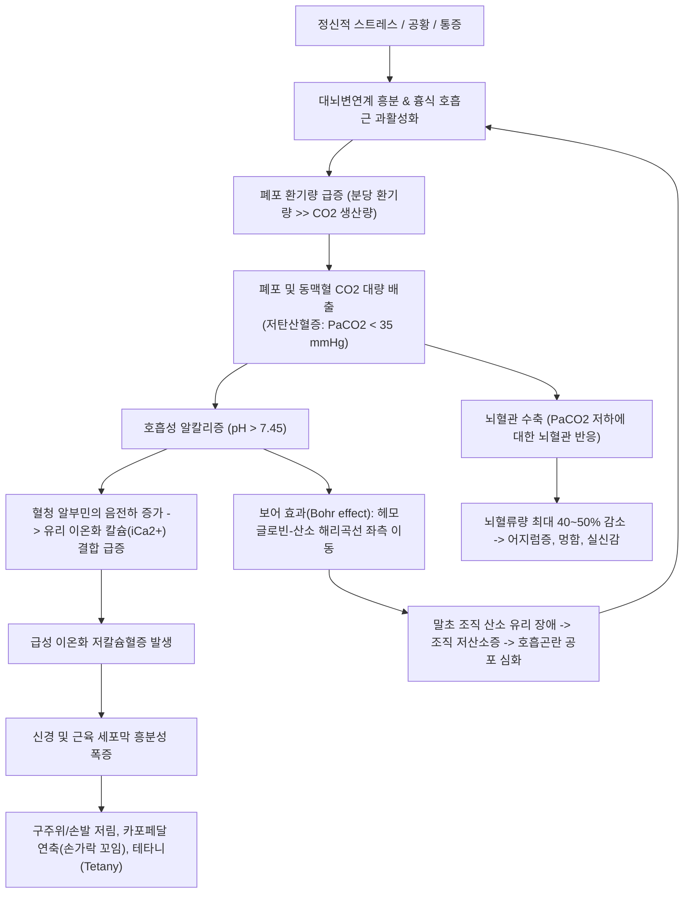

# 🩺 과호흡 증후군 (Hyperventilation Syndrome)

> **핵심 3줄 요약 (Key Summary)**:
> - 📍 병소 부위 & 해부·병태생리: 불안, 공황, 신체적 스트레스 등에 의해 폐포 환기량이 대사성 이산화탄소($\text{CO}_2$) 생산량을 초과하여 급격한 저탄산혈증($\text{PaCO}_2 < 35 \text{ mmHg}$) 및 호흡성 알칼리증(Respiratory Alkalosis)을 유발하는 호흡 조절 장애.
> - 🚩 전형적 임상 양상: 숨이 가쁘고 막히는 호흡곤란, 어지럼증, 구주위(입술 주변) 및 사지 말단 이상감각(저림), 수족 연축(카포페달 연축, Trousseau 징후), 흉통, 실신감.
> - 🛠️ 핵심 검사 & 치료 전략: 나이메헨 설문지(Nijmegen Questionnaire $\ge 23$점), 동맥혈가스분석(ABGA: pH $\uparrow$, $\text{PaCO}_2 \downarrow$), 폐색전증 등 기질적 기저질환 철저 배제; 복식호흡 지도, 7-11 호흡법, 안심시키기(Reassurance), 벤조디아제핀계 단기 투여.
> - ⚠️ 응급 의뢰 레드플래그: 흉막성 흉통, 편측성 하지 부종, 객혈, 저산소혈증($\text{SpO}_2 < 95\%$), D-dimer 상승 -> 폐색전증(PTE) 및 기흉 강력 의심으로 즉각 응급실 의뢰.

---

## 📌 목차
1. [질환 개요 & 해부학적 병태생리](#1-질환-개요--해부학적-병태생리)
2. [병태생리 메커니즘 & 생체역학적 악순환 네트워크](#2-병태생리-메커니즘--생체역학적-악순환-네트워크)
3. [임상 증상 & 이학적 검사(Physical Exam) 알고리즘](#3-임상-증상--이학적-검사physical-exam-알고리즘)
4. [감별 진단 매트릭스 (Differential Diagnosis)](#4-감별-진단-매트릭스-differential-diagnosis)
5. [한의 통합 치료 프로토콜 (침·약침·추나·한약)](#5-한의-통합-치료-프로토콜-침약침추나한약)
6. [양방 치료 & 병용·의뢰 기준 (Conventional Treatment & Referral)](#6-양방-치료--병용의뢰-기준-conventional-treatment--referral)
7. [재활 운동 & 생활습관 티칭 가이드](#7-재활-운동--생활습관-티칭-가이드)
8. [💡 사용자 진료실 핵심 필기 & 임상 노하우 (Melt-In 잔여 심화 집약)](#8--사용자-진료실-핵심-필기--임상-노하우-melt-in-잔여-심화-집약)
9. [출처 및 학술 참고 문헌 (References)](#9-출처-및-학술-참고-문헌--references)

---

## 1. 질환 개요 & 해부학적 병태생리

* **정의**: 과호흡 증후군(Hyperventilation Syndrome, HVS)은 신체의 대사적 요구를 초과하는 과도한 호흡(환기량 증가)으로 인해 체내 이산화탄소가 비정상적으로 과다 배출되어 일련의 신체적·신경학적 증상이 복합적으로 발현되는 기능성 호흡 패턴 장애(Breathing Pattern Disorder, BPD)이다.
* **해부생리학적 조절 기전**:
  * **호흡 중추**: 연수(Medulla oblongata)의 복측/배측 호흡군 및 뇌교(Pons)의 호흡조절중추는 중추 화학수용체(수소이온 농도 감지)와 경동맥체·대동맥궁의 말초 화학수용체로부터 입력을 받아 호흡수를 조절한다.
  * **대뇌변연계(Limbic System)의 간섭**: 편도체(Amygdala)와 시상하부 등 감정·불안 조절 뇌 회로가 급성 스트레스, 공황, 통증에 반응하여 자율신경계 교감 신경을 과활성화시키고 뇌간 호흡 중추를 직접 자극하여 과호흡을 촉발한다.
* **역학**:
  * 일반 인구의 6~10%에서 발생하며, 여성에서 남성보다 약 2~4배 호발한다.
  * 천식, 만성 폐쇄성 폐질환 환자의 30% 이상에서 기능성 과호흡 패턴이 중복되어 호흡기 증상을 악화시킨다.

---

## 2. 병태생리 메커니즘 & 생체역학적 악순환 네트워크

* **보어 효과(Bohr Effect)의 악순환**:
  * 알칼리혈증 환경에서는 산소-헤모글로빈 결합력이 오히려 지나치게 강해져 조직으로 산소를 내어놓지 못한다.
  * 혈중 산소포화도($\text{SpO}_2$)는 99~100%로 완벽하게 측정됨에도 불구하고, 환자 본인의 뇌와 조직은 '산소가 부족하다'고 느껴 더욱 격렬하게 숨을 들이쉬게 되는 생체역학적 악순환이 형성된다.

---

## 3. 임상 증상 & 이학적 검사(Physical Exam) 알고리즘

### 1) 주요 임상 증상
* **호흡기계**:
  * "공기가 폐로 다 들어오지 않는 것 같다", "숨을 깊이 들이마실 수 없다"는 공기 기갈(Air hunger).
  * 빈호흡(Tachypnea, 분당 25회 이상), 잦은 한숨(Frequent sighing), 마른 기침.
* **신경계 및 근골격계 (저칼슘혈증/알칼리증)**:
  * 입술 주변(구주위) 및 혀, 손가락 끝의 찌릿한 저림(Paresthesia).
  * 손가락이 안쪽으로 오그라들며 굳는 산파손 징후(Main d'accoucheur, Carpopedal spasm).
  * 어지럼증, 비현실감(Derealization), 시야 흐림, 두통.
* **심혈관계**:
  * 가슴이 쿵쾅거리는 빈맥, 비특이적 흉통(관상동맥 연축 유발 가능).

### 2) 이학적 검사
* **크보스텍 징후(Chvostek's sign)**: 이개 전방 안면신경 주행 부위를 가볍게 톡톡 쳤을 때 동측 입꼬리가 씰룩거리며 경련(안면신경 과흥분성 확인).
* **트루소 징후(Trousseau's sign)**: 상완에 혈압 커프를 감고 수축기 혈압보다 20 mmHg 높게 3분간 유지했을 때 손목과 손가락이 안쪽으로 굴곡 경련을 일으킴.
* **나이메헨 설문지 (Nijmegen Questionnaire)**: 16개 문항(호흡곤란, 불안, 어지럼, 수족 저림 등 0~4점), **총점 23점 이상 시 과호흡 증후군 강력 시사**.

---

## 4. 감별 진단 매트릭스 (Differential Diagnosis)

| 질환 | 동맥혈가스(ABGA) | 산소포화도($\text{SpO}_2$) | 발병 배경 및 동반 증상 | 치명성 및 감별 핵심 |
| :--- | :--- | :--- | :--- | :--- |
| **과호흡 증후군 (HVS)** | **pH $\uparrow$, $\text{PaCO}_2 \downarrow$, $\text{PaO}_2$ 정상/$\uparrow$** | **98~100%** | 급성 불안, 스트레스, 손발 저림 | 기질적 질환 배제 후 진단 |
| **[[폐색전증]](PTE)** | pH $\uparrow$, $\text{PaCO}_2 \downarrow$, **$\text{PaO}_2 \downarrow$** | **대개 저하 (< 95%)** | 흉막성 흉통, 편측 다리 부종, 객혈 | **즉각 의뢰 레드플래그** (D-dimer, CT) |
| **[[기흉]](Pneumothorax)** | 다양함 | 저하 가능 | 급작스러운 편측 흉통, 호흡음 소실 | 흉부 X-ray상 폐허탈 확인 |
| **급성 천식 발작** | 초기 알칼리증 $\rightarrow$ 후기 산증 | 저하 | 쌕쌕거림(Wheezing), 호기 연장 | 청진상 천명음 뚜렷 |
| **당뇨병성 케톤산증 (DKA)** | **pH $\downarrow$, $\text{HCO}_3^- \downarrow$, $\text{PaCO}_2 \downarrow$** | 정상 | 깊고 빠른 쿠스마울(Kussmaul) 호흡 | **대사성 산증** 보상성 과호흡 (혈당 > 250) |
| **심근경색증 (AMI)** | 다양함 | 저하 가능 | 쥐어짜는 흉통, 방사통, 식은땀 | 심전도 ST 분절 변화, 트로포닌 상승 |

---

## 5. 한의 통합 치료 프로토콜 (침·약침·추나·한약)

### 1) 변증 분류
* **간기울결·기역상충(肝氣鬱結·氣逆上衝)**: 심한 분노나 억울함, 흉협고만, 호흡이 목구멍에 걸려 안 내려감, 한숨, 설암태박, 맥현삭.
* **심담허겁(心膽虛怯)**: 공황 발작 동반, 가슴 두근거림, 잘 놀람, 불면, 불안 초조, 설담태박, 맥현세.
* **비허기함·담탁조폐(脾虛氣陷·痰濁阻肺)**: 만성적인 호흡 불편감, 무기력, 식후 피로, 맑은 가래, 설담반치흔, 맥침완.

### 2) 침구 치료
* **주요 혈위**:
  * 흉격 이완 및 강기(降氣): [[전중]](CV17), [[중완]](CV12), [[내관]](PC6), [[척택]](LU5).
  * 자율신경 안정 및 교감신경 억제: [[태충]](LR3), [[신문]](HT7), [[백회]](GV20), [[풍지]](GB20).
  * 횡격막 호흡 유도 및 말초 순환: [[족삼리]](ST36), [[합곡]](LI4), [[태계]](KI3).
* **자침 기법**: 전중 및 내관은 사법(瀉法) 자침으로 가슴의 울체된 기운을 소통시키고, 태충-합곡(사관혈 四關穴)을 개방하여 기혈 순환 정상화.

### 3) 추나 요법
* **흉곽 및 호흡보조근 이완 추나**:
  * 상부 승모근, 흉쇄유돌근, 사각근의 과긴장성 단축을 이완시키는 근막이완기법(Myofascial Release).
  * 늑골 가동화(Rib Mobilization) 기법을 통해 흡기성으로 굳어진 흉곽의 탄력성 회복.

### 4) 한약 처방
* **분심기음(分心氣飮) 가감**: 칠정(七情) 울결로 인한 가슴 답답함, 호흡 곤란, 식은땀, 불안을 해소하는 대표 방제. (자소엽, 반하, 지각, 청피, 진피, 목통, 대복피, 백복령, 향부자, 감초).
* **사칠탕(四七湯) 또는 반하후박탕(半夏厚朴湯)**: 매핵기(梅核氣)와 동반된 인후부 이물감, 호흡 폐색감에 강기화담(降氣化痰). (반하, 후박, 복령, 생강, 소엽).
* **시호가지골피탕(柴胡加地骨皮湯)**: 허열이 뜨고 가슴이 두근거리며 손발이 저린 자율신경실조증 개선.

---

## 6. 양방 치료 & 병용·의뢰 기준 (Conventional Treatment & Referral)

* **급성기 비약물 처치 (Acute Management)**:
  * **안심시키기(Reassurance)**: "심장이나 폐가 망가진 것이 아니며, 숨을 너무 많이 쉬어서 생긴 일시적인 알칼리 반응으로 안전하다"는 것을 단호하고 차분하게 확신시킴.
  * **호흡 재훈련 (Breathing Retraining)**:
    * 흉곽 호흡을 멈추고 복부 횡격막을 사용하게 유도.
    * **7-11 호흡법**: 4초간 코로 천천히 들이마시고, 7초간 입을 오므려 천천히 내쉬기 (호기 시간 연장).
    * *⚠️ 종이봉투 호흡법(Paper bag rebreathing)의 금기*: 과거 널리 쓰였으나, 실제 폐색전증이나 심근경색 환자에게 봉투 호흡을 시킬 경우 치명적인 저산소증으로 사망할 위험이 있어 **현대 응급의학 가이드라인에서 공식 금지**됨.
* **약물 치료 (Medication)**:
  * 급성 발작 지속 시: 속효성 벤조디아제핀(Lorazepam 0.5~1mg 또는 Alprazolam 0.25mg 경구/설하 투여).
  * 만성/반복성: 선택적 세로토닌 재흡수 억제제(SSRI) 및 인지행동치료(CBT) 병행.
* **양방·전문과 의뢰 기준 (Referral Criteria)**:
  * **즉각 응급 전원 (Red Flag)**:
    * $\text{SpO}_2 < 95\%$ (과호흡 증후군은 정상적으로 98~100%여야 함. 산소포화도가 낮다면 즉각 폐색전증, 폐렴, 기흉 의심).
    * 날카로운 편측성 흉막통, 다리 부종, 객혈 동반.
    * 심전도상 심근허혈 또는 부정맥 소견.

---

## 7. 재활 운동 & 생활습관 티칭 가이드

* **일상 속 횡격막(복식) 호흡 훈련**:
  * 하루 2회, 1회 10분씩 바닥에 누워 배 위에 가벼운 책을 올려놓고 책이 오르내리는 복식 호흡 연습.
* **카페인 및 자극제 엄격 제한**:
  * 커피, 에너지 드링크, 니코틴은 교감신경을 자극하여 호흡 역치를 낮추므로 완전 차단.
* **신체화 증상 이해 교육**:
  * 손발 저림과 굳어짐이 뇌졸중이나 마비가 아니라 "숨을 빨리 쉬어 칼슘이 일시적으로 단백질에 붙어서 생기는 생리적 현상"임을 인지시켜 공포감 제거.

---

## 8. 💡 사용자 진료실 핵심 필기 & 임상 노하우 (Melt-In 잔여 심화 집약)

* **펄스 옥시미터(Pulse Oximeter)를 이용한 진료실 10초 역설 티칭법**:
  * 환자가 숨이 넘어가며 "산소가 부족해서 죽을 것 같다"고 울부짖을 때, 손가락에 산소포화도 측정기를 꽂아 보여주라.
  * 수치 99~100%를 눈으로 직접 확인시키며 "보세요, 지금 몸 안에는 산소가 100% 꽉 차 있습니다. 문제는 산소가 모자란 게 아니라 이산화탄소를 너무 많이 내보내서 피가 알칼리로 변해 손발이 저린 것입니다. 숨을 천천히 멈추듯 쉬어야 혈액이 산소를 뇌에 전해줍니다"라고 설명하면 환자의 공황이 급격히 진정된다.
* **절대 종이봉투를 씌우지 말 것**:
  * 한의원 외래에서 과호흡 환자가 발생했을 때 환자에게 비닐봉지나 종이봉투를 씌우는 행위는 절대 삼가야 한다. 만약 기저에 폐색전증이나 긴장성 기흉이 숨어있었다면 봉투 호흡으로 산소 분압이 급락하여 사망 사고로 직결된다. 차분한 복식호흡 지도와 사관혈 자침이 가장 안전하다.

---

## 9. 출처 및 학술 참고 문헌 (References)

* Thomas M, et al. (2025 Feb). Breathing Pattern Disorder: Introduction and Diagnostics. *Immunol Allergy Clin North Am*, 45(1):15-28. PMID: 39608873.

* Jones M, et al. (2025 Nov). Measurement properties of outcome measurement instruments for pediatric dysfunctional breathing: a systematic review. *Qual Life Res*, 34(11):3105-3122. PMID: 41071440.

* Mitchell AJ, et al. (2024 Apr 16). Validity and reliability of outcome measures to assess dysfunctional breathing: a systematic review. *BMJ Open Respir Res*, 11(1):e002011. PMID: 38626928.

---

## 관련 노트

- [[_의학/03_이론/질환/호흡기 질환/기타 호흡기/호흡 부전|호흡 부전]]
- [[_의학/03_이론/질환/내분비 질환/부신/크롬친화세포종|크롬친화세포종]]
- [[폐색전증]]
- [[공황 장애]]
- [[기흉]]
