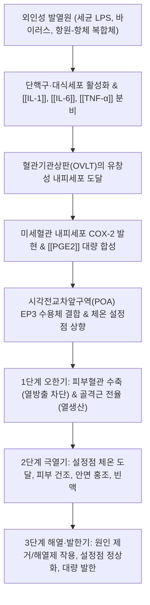
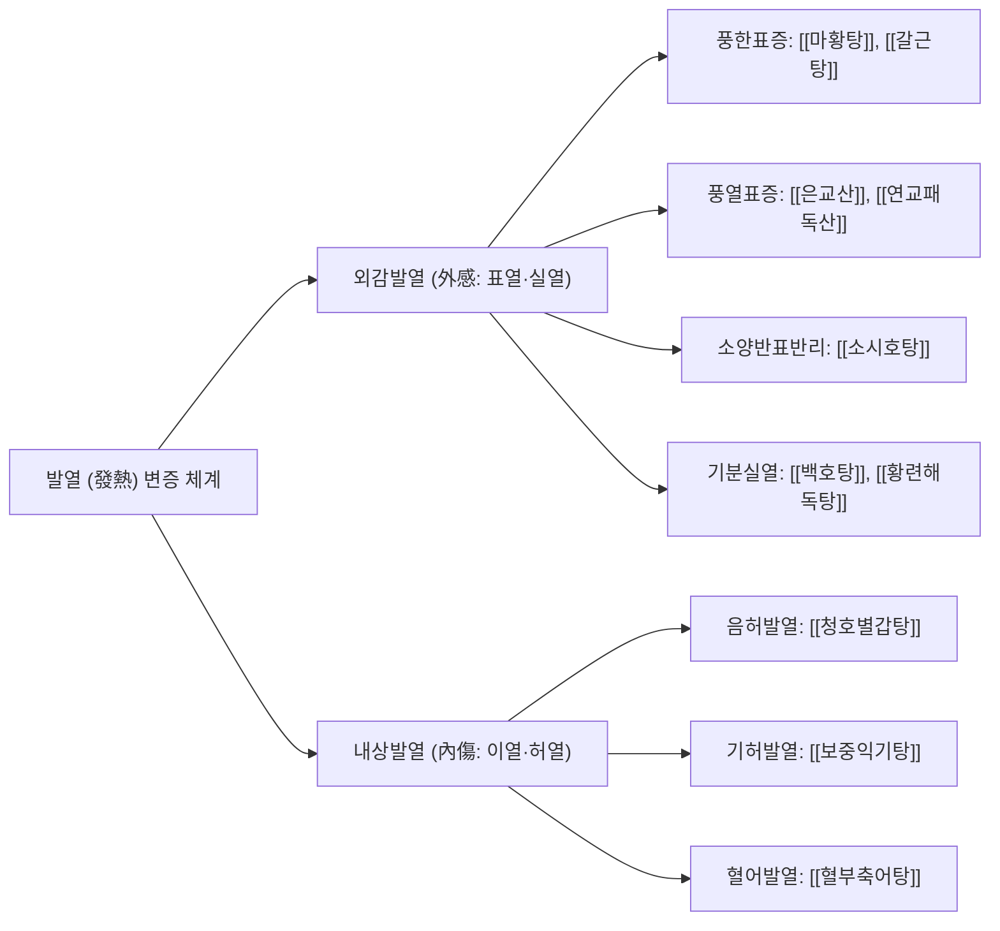

# 🌡️ [[발열]] (Fever / Pyrexia / 發熱, ICD-10 R50 / KCD-8 R50, U20.0)

> **핵심 3줄 요약 (Key Summary)**:
> - 📍 **병소 부위 & 해부·병태생리**: 감염, 염증, 종양 등 병적 자극에 반응하여 간뇌 시상하부(Hypothalamus) 시각전교차앞구역(POA)의 **체온조절 설정점(Thermoregulatory Set-Point)이 상향 이동**함으로써 심부 체온이 능동적으로 상승하는 전신 방어 생체 반응. 외인성 발열원(LPS 등) $\rightarrow$ 대식세포의 내인성 발열 사이토카인([[IL-1]], [[IL-6]], [[TNF-α]]) 분비 $\rightarrow$ 종판혈관기관(OVLT) 내피세포의 COX-2 발현 $\rightarrow$ **[[PGE2]] 합성** $\rightarrow$ 교감신경 흥분을 통한 말초혈관 수축 및 골격근 전율(오한) 발생.
> - 🚩 **전형적 임상 양상 & 판정 기준**: 측정 부위별로 차이가 존재하며, 임상적으로 **구강 체온 $\ge 37.8^\circ\text{C}$, 직장(고막) 체온 $\ge 38.2^\circ\text{C}$, 액와(겨드랑이) 체온 $\ge 37.2^\circ\text{C}$** 이상일 때 발열로 진단한다. 임상 경과는 오한기(Chills) $\rightarrow$ 극열기(Plateau) $\rightarrow$ 해열·발한기(Defervescence)의 3단계를 거친다.
> - 🛠️ **핵심 감별 검사 & 한·양방 다각적 치료 전략**: 원인 질환 감별이 최우선이며, 대증적 해열제로 [[아세트아미노펜]](10~15 mg/kg) 또는 [[이부프로펜]](5~10 mg/kg) 단일제 투여(교대 투여 금기, 소아 아스피린 절대 금기). 한의 치료는 외감발열(풍한·풍열·온병 위기영혈)과 내상발열(음허·기허·혈어)로 변증하여 [[은교산]], [[갈근탕]], [[소시호탕]], [[백호탕]], [[청호별갑탕]]을 투여하고, [[대추]](GV14) 점자출혈 및 대추·신궐 경혈 첩부요법으로 신속하고 안전한 해열을 유도한다.
> - ⚠️ **응급 의뢰 레드플래그 & 악화 요인**: 생후 3개월 미만 영아의 체온 $\ge 38.0^\circ\text{C}$, 의식 저하 및 기면(Lethargy), 점상출혈 및 자반(수막구균 패혈증 의심), 호흡곤란, 3일 이상 지속되는 고열, 체온 설정점 변화가 없는 과열(Hyperthermia, 열사병 등: 해열제 무효, 즉각 체외 냉각 필요) 시 즉시 상급병원 응급실 이송.

---

## 📌 목차
1. [질환 개요 & 해부학적 병태생리](#1-질환-개요--해부학적-병태생리)
2. [병태생리 메커니즘 & 생체역학적 악순환 네트워크](#2-병태생리-메커니즘--생체역학적-악순환-네트워크)
3. [임상 증상 & 이학적 검사(Physical Exam) 알고리즘](#3-임상-증상--이학적-검사physical-exam-알고리즘)
4. [감별 진단 매트릭스 (Differential Diagnosis)](#4-감별-진단-매트릭스-differential-diagnosis)
5. [한의 통합 치료 프로토콜 (침·약침·추나·한약)](#5-한의-통합-치료-프로토콜-침약침추나한약)
6. [양방 치료 & 병용·의뢰 기준 (Conventional Treatment & Referral)](#6-양방-치료--병용의뢰-기준-conventional-treatment--referral)
7. [재활 운동 & 생활습관 티칭 가이드](#7-재활-운동--생활습관-티칭-가이드)
8. [💡 사용자 진료실 핵심 필기 & 임상 노하우 (Melt-In 잔여 심화 집약)](#8--사용자-진료실-핵심-필기--임상-노하우-melt-in-잔여-심화-집약)
9. [출처 및 학술 참고 문헌 (References)](#9-출처-및-학술-참고-문헌-references)

---

## 1. 질환 개요 & 해부학적 병태생리

* **질환 정의 및 분류**:
  * **정의**: 발열은 단일 질병 단위가 아니라, 다양한 병적 자극에 반응하여 **간뇌 시상하부(Hypothalamus)의 체온조절 설정점(Set-point)이 상향 이동**함으로써 심부 체온이 생리적 정상 범위를 초과하여 능동적으로 상승하는 전신 급성기 반응(Acute-phase response)이다.
  * **지속 기간 및 임상 양상에 따른 분류**:
    | 분류 유형 | 지속 기간 및 특성 | 대표 질환 및 임상 소견 |
    | :--- | :--- | :--- |
    | **급성 발열 (Acute Fever)** | 2주 미만 | 상기도 감염([[감모]]), [[폐렴]], 급성 장염, 요로감염 |
    | **원인불명열 (FUO)** | 3주 이상 $38.3^\circ\text{C}$ 초과, 1주 정밀검사 미확인 | 잠복 결핵([[결핵]]), 감염성 심내막염, 자가면역질환, 림프종 |
    | **고열 (Hyperpyrexia)** | 심부 체온 $> 41.0^\circ\text{C}$ | 중추신경계 중증 감염(뇌수막염), 중증 [[패혈증]], 뇌출혈 |
    | **과열 (Hyperthermia)** | **설정점 변화 없이** 열 생산 과다 또는 방출 장애 | **열사병(Heat stroke)**, 악성고열증 (**해열제 반응 없음**) |
  * **호발 인구 및 위험군**: 영유아(체온조절 중추 미성숙 및 열성경련 소인), 65세 이상 고령자(발열 반응 둔화로 저체온 또는 비전형 발현), 면역저하자, 항암치료 환자(호중구감소성 발열).

* **관련 해부학적 구조물**:
  * **간뇌 시상하부(Hypothalamus)**: 시각전교차앞구역(Preoptic area, POA)의 체온 신경핵. 온열민감신경원 및 냉감민감신경원의 균형으로 기준 체온 유지.
  * **종판혈관기관(OVLT, Organum Vasculosum of the Lamina Terminalis)**: 제3뇌실 전벽에 위치하며 뇌혈관장벽(BBB)이 결손된 유창성 모세혈관 구조를 가져 순환 사이토카인이 시상하부로 신호를 전달하는 관문.
  * **자율신경계 및 작동기**: 사지 말초 피부 모세혈관(교감신경 매개 수축/확장), 에크린 땀샘(발한), 갈색지방 조직(UCP-1 매개 비전율성 열생산), 골격근(체성 운동신경 매개 전율성 오한).

---

## 2. 병태생리 메커니즘 & 생체역학적 악순환 네트워크

### 1) 분자 매개 캐스케이드 (Molecular Cascade)
1. **내인성 발열원 생성**: 세균 리포다당류(LPS) 등 외인성 발열원에 의해 단핵구와 조직 대식세포가 자극되어 [[IL-1]], [[IL-6]], [[TNF-α]], 인터페론 등의 발열 사이토카인을 전신 순환계로 방출한다.
2. **BBB 통과 및 PGE2 유도**: 순환 사이토카인은 BBB가 불완전한 종판혈관기관(OVLT)의 내피세포에 작용하여 **COX-2(Cyclooxygenase-2)** 효소 합성을 폭발적으로 유도한다.
3. **체온 설정점 재설정**: COX-2에 의해 합성된 **[[PGE2]]**가 POA의 신경세포 EP3 수용체에 결합하여 cAMP를 증가시키고, 온열민감신경원을 억제하여 시상하부 체온 설정점을 $38\sim41^\circ\text{C}$로 상향 이동시킨다.

### 2) 3단계 임상 경과 및 전신 반응
* **1단계: 오한기 (Chills stage)**:
  * 체온 설정점은 올라갔으나 실제 혈액 온도는 아직 낮아 인체가 "춥다"고 인지함.
  * 사지 피부 혈관이 급격히 수축하여 피부 창백, 수족 냉감이 나타나며, 골격근의 불수의적 미세 수축([[오한]])으로 열을 급속히 생산함.
* **2단계: 극열기 (Plateau stage)**:
  * 심부 체온이 상향된 설정점에 도달함. 오한이 멈추고 피부가 붉어지며(혈관 확장), 두통, 빈맥, 근육통, 구갈이 동반됨.
* **3단계: 해열·발한기 (Defervescence stage)**:
  * 감염원 소실 또는 해열제 작용으로 시상하부 설정점이 정상($37.0^\circ\text{C}$)으로 복귀함.
  * 인체가 체온을 낮추기 위해 말초 혈관을 최대로 확장하고 에크린 땀샘에서 대량 발한을 유도하여 기화열로 체온을 떨어뜨림.

---

## 3. 임상 증상 & 이학적 검사(Physical Exam) 알고리즘

### 1) 정확한 체온 측정 부위 및 판독 기준
* **직장 체온 (Rectal)**: 심부 체온을 가장 정확히 반영하는 황금 표준 ($> 38.2^\circ\text{C}$). 영유아 진료의 기준.
* **구강 체온 (Oral)**: 성인 외래 진료의 기본 지표 ($> 37.8^\circ\text{C}$). 직장 체온보다 약 $0.4\sim0.5^\circ\text{C}$ 낮게 측정됨.
* **액와 체온 (Axillary)**: 안전하나 땀과 외부 환경에 취약 ($> 37.2^\circ\text{C}$). 직장보다 약 $0.6\sim0.8^\circ\text{C}$ 낮음.
* **고막 체온 (Tympanic)**: 시상하부와 동일한 내경동맥 혈류를 공급받아 신속하나, 탐촉자 각도와 귀지에 의한 오차 주의.

### 2) 발열(Fever)과 과열(Hyperthermia)의 필수 감별
* **발열 (Fever)**: 시상하부 설정점이 상향 이동한 생체 방어 반응. 오한기 후 발한이 따르며, **해열제(아세트아미노펜, NSAIDs) 투여 시 극적인 체온 하강**이 일어난다.
* **과열 (Hyperthermia)**: 시상하부 설정점은 정상이지만 외부 고열 노출(열사병), 격렬한 운동, 악성고열증, 약물 부작용으로 열 방출이 차단되거나 열 생산이 폭증한 상태. **피부가 뜨겁고 완전히 건조하며(무한증), 해열제가 전혀 듣지 않으므로 즉각적인 체외 물리적 냉각 요법(얼음물, 미온수 분무+선풍기)이 필수적**이다.

### 3) 소아 및 성인 발열 응급 전원 신호 (Red Flags)
1. **생후 3개월 미만 영아의 체온 $\ge 38.0^\circ\text{C}$**: 패혈증, 뇌수막염, 요로감염 등 중증 세균 감염(SBI) 위험으로 즉각 입원 정밀 검사 필수.
2. **의식 저하 및 기면(Lethargy)**: 눈맞춤 불가, 자극에 반응 없음, 헛소리.
3. **피부 점상출혈(Petechiae) 및 자반(Purpura)**: 수막구균 패혈증 등 파종성 혈관내 응고 의심.
4. **호흡곤란**: 빈호흡, 흉벽 함몰, 신음 호흡, 청색증.
5. **해열제 불응성 지속 고열**: 적정 용량 투약에도 3일 이상 지속되는 39℃ 이상 고열.

---

## 4. 감별 진단 매트릭스 (Differential Diagnosis)

| 감별 질환 | 시상하부 설정점 | 주 병태생리 | 피부 상태 및 임상 특징 | 해열제 반응 |
| :--- | :--- | :--- | :--- | :--- |
| **감염성 [[발열]] (본 질환)** | **상향 이동 ($38\sim41^\circ\text{C}$)** | 발열원 $\rightarrow$ 사이토카인 $\rightarrow$ PGE2 매개 | 오한기 창백/수족냉감 $\rightarrow$ 해열 시 발한 | **극적인 반응 (체온 하강)** |
| **과열 (열사병 / 악성고열증)** | **정상 ($37.0^\circ\text{C}$ 불변)** | 외부 고열 노출 또는 근골격 대사 폭증 | **피부 극도로 뜨겁고 건조 (땀 안 남), 혼수** | **반응 전혀 없음 (체외 냉각 필수)** |
| **원인불명열 (FUO)** | 상향 이동 | 잠복 결핵, 심내막염, SLE, 림프종 | 3주 이상 $38.3^\circ\text{C}$ 초과 지속, 체중 감소 | 가역적 반응, 기저 질환 치료 필요 |
| **약물열 (Drug Fever)** | 상향 이동 | 약물 과민 반응 (항생제, 항경련제 등) | 약물 투여 7~10일 후 발열, 호산구 증가, 서맥 | 약물 중단 시 48~72시간 내 해열 |
| **중추성 발열 (Central Fever)** | 조절 기능 소실 | 시상하부 뇌출혈, 뇌경색, 중증 두부 외상 | 주야간 체온 변동 소실, 무한증, 신경학적 결손 | 해열제 반응 불량, 물리적 냉각 |

---

## 5. 한의 통합 치료 프로토콜 (침·약침·추나·한약)

* **한의학적 변증 체계**:
  * 한의학에서 발열은 사기가 체표에 머물러 정기와 사기가 다투는 **외감발열(外感發熱)**과 장부 기혈 손상으로 발생하는 **내상발열(內傷發熱)**로 대별된다.

* **한약 치료 (Herbal Medicine) — 5대 변증 처방**:
  1. **풍한표증(風寒表證, 오한우세형)**: 심한 오한, 발열, 무한, 두통, 맑은 콧물.
     - 처방: **[[갈근탕]](葛根湯)** 또는 **[[마황탕]](麻黃湯)**, **[[형방패독산]](荊防敗毒散)** (신온해표, 발한퇴열).
  2. **풍열표증(風熱表證, 인후통·발열우세형)**: 발열 우세, 경미한 오한, 인후 발적종통, 구갈.
     - 처방: **[[은교산]](銀翹散)** 또는 **[[연교패독산]](連翹敗毒散)** (신량해표, 청열해독).
  3. **소양병(少陽病, 한열왕래형)**: 추웠다 더웠다 반복, 흉협고만, 구역, 입안이 씀(구고).
     - 처방: **[[소시호탕]](小柴胡湯)** 또는 **[[시호해기탕]](柴胡解肌湯)** (화해소양).
  4. **기분실열(氣分實熱, 고열·갈증형)**: $39^\circ\text{C}$ 이상 장열, 대한출, 대갈인음, 홍대맥.
     - 처방: **[[백호탕]](白虎湯)** 또는 **[[백호가인삼탕]](白虎加人參湯)** (청열생진).
  5. **음허발열(陰虛發熱, 야간 미열·도한형)**: 오후/야간 조열, 오심번열, 수면 중 식은땀, 마른기침.
     - 처방: **[[청호별갑탕]](靑蒿鼈甲湯)** (양음청열, 퇴열제증).

* **침구 치료 및 응급 사혈 프로토콜**:
  * **[[대추]](GV14) 점자출혈(點刺出血)**: C7 극돌기 하연의 대추혈을 삼릉침으로 3~5회 점자하여 3~5방울 사혈. 즉각적인 교감신경 긴장 완화로 $15\sim30$분 내 신속한 체온 강하 유도 (실열성 고열의 요혈).
  * **사지 청열혈**: [[곡지]](LI11, 합혈 전신 해열), [[합곡]](LI4, 표열 발산), [[외관]](TE5, 소양 울열 해소).
  * **소아 십선혈(十宣) 점자**: 소아 고열로 인한 불온, 경련 전조 시 손가락 끝 10개 혈위 점자 사혈로 신속한 개규진경(開竅鎭驚).

* **소아 경혈 첩부요법 (Acupoint Plaster Therapy)**:
  * 대추(GV14) 및 신궐(CV8)에 퇴열해표(退熱解表) 패치를 첩부하여 해열 시간을 단축하고 경구 투약 거부 소아에게 안전한 비침습적 해열 효과 제공.

---

## 6. 양방 치료 & 병용·의뢰 기준 (Conventional Treatment & Referral)

* **약물 치료 (Medication)**:
  * **해열제의 목적**: 미국소아과학회(AAP) 지침에 따르면 해열제의 목적은 체온을 억지로 $36.5^\circ\text{C}$로 떨어뜨리는 것이 아니라, 환자의 불편감(통증, 보챔, 탈수 위험)을 경감시키는 데 있다. $38.5^\circ\text{C}$ 미만의 미열이면서 컨디션이 양호하면 무리한 투약을 지양한다.
  * **1차 선택 해열제**:
    * **[[아세트아미노펜]](Acetaminophen)**: $10\sim15\text{ mg/kg/회}$, $4\sim6$시간 간격 (1일 최대 $75\text{ mg/kg}$ 또는 $4,000\text{ mg}$ 초과 금지). 위장 장애가 적으나 과량 복용 시 급성 간독성 주의.
    * **[[이부프로펜]](Ibuprofen)**: $5\sim10\text{ mg/kg/회}$, $6\sim8$시간 간격 (1일 최대 $40\text{ mg/kg}$ 또는 $2,400\text{ mg}$ 초과 금지). 소염 효과 우수하나 생후 6개월 이상 사용 권장, 탈수 시 신독성 주의.
  * **항생제 vs 소염제 적응증 원칙**:
    * 세균 감염성 발열([[폐렴]], 요로감염 등)은 배양 및 감수성 결과에 맞춘 항생제로 원인균을 박멸해야 한다.
    * 바이러스 감염 후 상피 염증 장기화나 비감염성 자가면역 염증 발열에는 항생제가 무효하며, 소염제 또는 한의학적 청열 처방을 투여한다.
* **절대 금기 요법 (Contraindications)**:
  * **교대 투여(Alternating Therapy) 금지**: 아세트아미노펜과 이부프로펜을 번갈아 먹이는 교대 투여는 부모의 투약 용량 착오 및 간·신독성 위험을 현저히 높이므로 권장되지 않는다.
  * **소아 아스피린 절대 금기**: 소아 인플루엔자나 수두 등 바이러스 감염 시 아스피린 복용은 치명적인 간부전과 뇌병증을 초래하는 **라이 증후군(Reye syndrome)**을 유발하므로 절대 투여 금기이다.
  * **알코올 마사지 금기**: 피부를 통한 알코올 흡수로 중독 및 혼수 위험.
* **수술·시술 적응증**:
  * 복강 내 농양, 농흉, 급성 화농성 관절염, 중이염 등 해부학적 화농성 병소에 의한 발열 시 절개 배농(I&D) 또는 경피적 배농술 시행.
* **한의 병용 판단 (Combination Therapy)**:
  * 해열진통제 복용 중인 환자에게 [[은교산]], [[갈근탕]] 등 한약을 병용할 경우 1~2시간 시간차를 두고 투약한다.
  * 한의 대추혈 사혈요법이나 첩부요법은 약물 대사 부담 없이 즉각적인 설정점 하강을 도와 해열제 사용량과 투약 간격을 줄이는 우수한 병용 이점을 가진다.
* **양방·응급실 의뢰 기준 (Referral Criteria)**:
  * 생후 3개월 미만 영아 발열 ($\ge 38.0^\circ\text{C}$).
  * 의식 혼돈, 기면, 수면에서 깨어나지 못함.
  * 누르면 사라지지 않는 점상출혈 또는 자반증.
  * 열사병 의심 과열 환자(체온 > 40℃, 땀이 안 나고 피부 건조, 섬망) → 즉시 체외 냉각 및 응급실 이송.

---

## 7. 재활 운동 & 생활습관 티칭 가이드

* **오한기와 해열기의 차별적 체온 관리**:
  * **오한기 (체온 상승기)**: 덜덜 떨며 추위를 호소할 때는 옷을 벗기지 말고 얇은 이불을 덮어주어 환자가 편안함을 느끼도록 보온한다 (찬물 마사지는 혈관을 수축시켜 체온을 더 올림).
  * **해열·발한기 (체온 하강기)**: 땀이 나기 시작하면 즉시 얇은 옷으로 갈아입히고 젖은 옷을 벗긴다. 미온수($30\sim33^\circ\text{C}$) 마사지는 말초 혈관을 확장시켜 열 방출을 돕는다.
* **수분 및 전해질의 철저한 보충**:
  * 체온이 $1^\circ\text{C}$ 상승할 때마다 기초대사율 $10\sim12\%$, 불감수분손실이 $100\sim150\text{ mL/m}^2/\text{일}$씩 증가한다. 탈수 예방을 위해 경구수액제(ORS), 보리차, 미음을 소량씩 자주 섭취하도록 지도한다.
* **부모의 발열 공포증(Fever Phobia) 완화 상담**:
  * 감염에 의한 생리적 발열은 인체의 내인성 방어 기전에 의해 대개 $41^\circ\text{C}$를 넘지 않으며 뇌가 녹거나 지능이 떨어지지 않는다는 사실을 설명하여 부모의 과도한 불안을 경감시킨다.

---

## 8. 💡 사용자 진료실 핵심 필기 & 임상 노하우 (Melt-In 잔여 심화 집약)

> [!IMPORTANT]
> **🛡️ 원문 융합(Melt-In) 및 8번 섹션 집약 핵심**
> 1. **기존 필기 내용 상부 전면 융합**: 시상하부 체온 조절 중추, 감염성 원인, 혈관 확장/땀분비/기초대사율 증가 증상, 구강 37.8 / 직장 38.2 기준, 항생제 vs 소염제 원칙을 상부 1~6번에 유기적으로 100% 녹여냈습니다.
> 2. **8번 섹션의 차별화된 심화 집약**: 세균성 vs 염증 장기화 발열의 진료실 실전 감별, 소아 단순 열성경련 현장 대처법입니다.

* **상부 섹션에 미처 다 담지 못한 고유 원문 필기**:
  * "정의: 시상하부의 체온 조절 중추의 작용으로 인해 체온이 정상 범위 이상으로 상승하는 상태이다. 원인: 세균, 바이러스 감염과 같은 각종 감염성 질환. 증상: 혈관 확장, 땀분비 증가, 기초대사률 증가, 심박수 증가, 수분 소실."
  * "보통 구강 체온 37.8도, 직장 체온 38.2도 이상이면 발열이 있다고 판단한다. 세균 감염에 의한 발열은 항생제, 염증의 장기화로 인한 발열은 소염제를 사용하는 것이 옳다."

* **진료실 실전 감별 & 치료 노하우**:
  * **1. "세균 감염은 항생제, 염증의 장기화는 소염제" 진료실 원칙**:
    * 세균성 폐렴이나 요로감염은 즉각적인 항생제로 원인균을 박멸해야 하나, 바이러스 감염 후 상피 염증이 장기화되거나 자가면역성 결체조직 질환으로 이행되는 발열에는 항생제가 무효하다. 이 경우 소염제 또는 한의학적 청열양혈(淸熱凉血)·화어통락 처방을 투여해야 열이 가라앉는다.
  * **2. 소아 단순 열성경련(Simple Febrile Seizure) 현장 대처법**:
    * 생후 6개월~5세 사이 소아에서 고열 발생 첫 24시간 이내 전신 강직-간대 발작이 15분 이내로 1회 발생하고 후유증이 없는 경우이다.
    * 부모를 진정시키고 기도 확보(고개를 옆으로 돌려 흡인 방지)를 지시하며, 입안에 손가락이나 숟가락을 억지로 넣지 않도록 교육한다. 경련이 5분 이상 지속되거나 호흡곤란 동반 시 즉시 119를 호출한다.
  * **3. 환자 티칭 스크립트**:
    * "열은 우리 몸의 면역세포들이 세균이나 바이러스와 싸우기 위해 군대를 동원하는 지극히 정상적인 방어 작용입니다. 체온을 억지로 36.5도까지 떨어뜨릴 필요는 없으며, 아이가 잘 놀고 물을 잘 마신다면 미열은 지켜보셔도 안전합니다. 다만 숨이 가쁘거나 축 처진다면 즉시 병원으로 오셔야 합니다."

---

## 9. 출처 및 학술 참고 문헌 (References)

- Polinesi C et al. (2026). Development and validation of a scenario-based judgment skills scale on parental fever management. *Patient Educ Couns*. 153():109873. PMID: 42759083.

- Liu Y et al. (2026). Continuous Temperature Monitoring via Wearable Devices for Fever or Infection Management in Acute Care Hospitals: Scoping Review of Clinical Implementation and Data Analytics. *JMIR Mhealth Uhealth*. 14():e89773. PMID: 42727075.

- Bittle E et al. (2026). Methodological Quality and Content Analysis of Clinical Practice Guidelines for Fever Management in Children With Sickle Cell Disease. *Pediatr Blood Cancer*. 73(10):e70529. PMID: 42549946.
