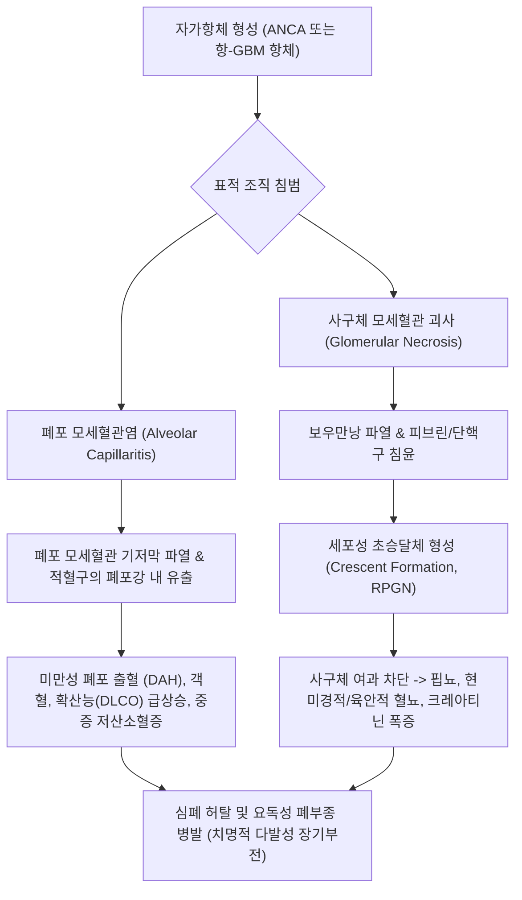
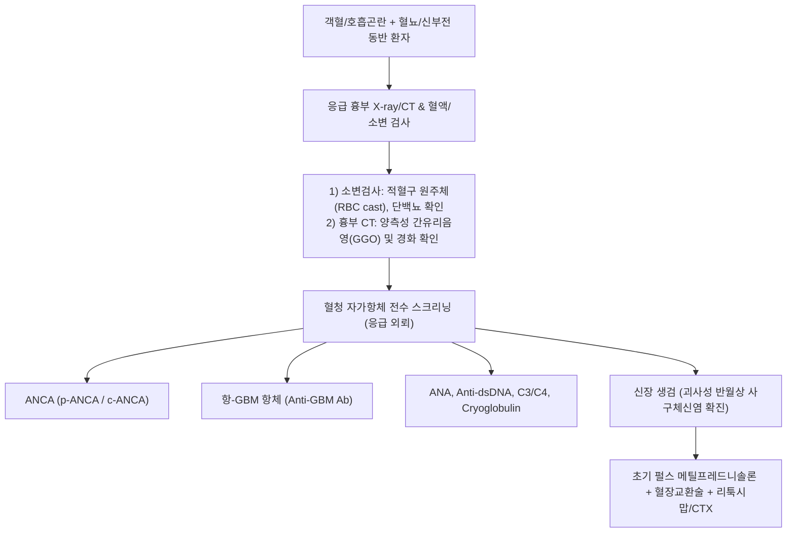

# 🩺 폐 신장 증후군 (Pulmonary-Renal Syndrome)

> **핵심 3줄 요약 (Key Summary)**:
> - 📍 병소 부위 & 해부·병태생리: 폐포 모세혈관염(미만성 폐포 출혈, DAH)과 신장 사구체 모세혈관염(급속 진행성 사구체신염, RPGN)이 동시에 또는 연속적으로 발병하는 생명 위협 자가면역성 혈관염 증후군.
> - 🚩 전형적 임상 양상: 객혈(Hemoptysis), 급격한 호흡곤란, 흉부 X-ray상 양측성 미만성 침윤, 현미경적/육안적 혈뇨, 단백뇨, 핍뇨, 수일~수주 내 급성 신부전(신장 기능 급락).
> - 🛠️ 핵심 검사 & 치료 전략: 혈청 ANCA(p-ANCA/MPO, c-ANCA/PR3), 항-GBM(사구체기저막) 항체, ANA 검사; 신장 생검(초승달 사구체신염 확진); 고용량 펄스 스테로이드, 사이클로포스파마이드/리툭시맙, 혈장교환술(Plasmapheresis).
> - ⚠️ 응급 의뢰 레드플래그: 객혈을 동반한 급격한 저산소혈증, 핍뇨 및 크레아티닌 폭증, 광범위 폐포 출혈 -> 영구적 말기신부전 및 질식 사망 위험으로 즉각 상급종합병원 응급실 의뢰.

---

## 📌 목차
1. [질환 개요 & 해부학적 병태생리](#1-질환-개요--해부학적-병태생리)
2. [병태생리 메커니즘 & 생체역학적 악순환 네트워크](#2-병태생리-메커니즘--생체역학적-악순환-네트워크)
3. [임상 증상 & 이학적 검사(Physical Exam) 알고리즘](#3-임상-증상--이학적-검사physical-exam-알고리즘)
4. [감별 진단 매트릭스 (Differential Diagnosis)](#4-감별-진단-매트릭스-differential-diagnosis)
5. [한의 통합 치료 프로토콜 (침·약침·추나·한약)](#5-한의-통합-치료-프로토콜--침-약침-추나-한약-)
6. [양방 치료 & 병용·의뢰 기준 (Conventional Treatment & Referral)](#6-양방-치료--병용의뢰-기준-conventional-treatment--referral)
7. [재활 운동 & 생활습관 티칭 가이드](#7-재활-운동--생활습관-티칭-가이드)
8. [💡 사용자 진료실 핵심 필기 & 임상 노하우 (Melt-In 잔여 심화 집약)](#8--사용자-진료실-핵심-필기--임상-노하우--melt-in-잔여-심화-집약-)
9. [출처 및 학술 참고 문헌 (References)](#9-출처-및-학술-참고-문헌--references)

---

## 1. 질환 개요 & 해부학적 병태생리

* **정의**: 폐 신장 증후군(Pulmonary-Renal Syndrome, PRS)은 미만성 폐포 출혈(Diffuse Alveolar Hemorrhage, DAH)과 급속 진행성 사구체신염(Rapidly Progressive Glomerulonephritis, RPGN)이 단일 환자에서 병발하는 중증 임상 증후군이다.
* **해부학적 병소 및 주 원인 질환군**:
  * **ANCA 연관 혈관염 (ANCA-associated Vasculitis, AAV - 가장 흔함, 약 70~80%)**:
    * 현미경적 다발혈관염(MPA, p-ANCA / MPO 항체 우세).
    * 육아종증 다발혈관염(GPA, 과거 베게너 육아종증, c-ANCA / PR3 항체 우세).
    * 호산구성 육아종증 다발혈관염(EGPA, 처그-스트라우스 증후군).
  * **항-사구체기저막 항체 질환 (Anti-GBM Disease / [[굿패스처 증후군]] Goodpasture's Syndrome, 약 15~20%)**:
    * 4형 콜라겐 $\alpha3$ 사슬의 비콜라겐 도메인(NC1)에 대한 자가항체가 사구체 기저막 및 폐포 기저막에 선상(Linear)으로 결합하여 보체 매개 조직 괴사를 유발.
  * **면역복합체 매개 질환**:
    * 전신 홍반성 루푸스(SLE, 루푸스 신염 및 폐출혈), 한랭글로불린혈증(Cryoglobulinemia), IgA 혈관염.
* **역학 및 예후**:
  * 모든 연령에서 발생 가능하나 50~70대에서 호발한다.
  * 조기에 공격적인 면역억제 치료를 시작하지 않으면 수일 내에 비가역적 말기신부전(ESRD) 또는 호흡부전으로 사망률이 50%를 상회하는 초응급 질환이다.

---

## 2. 병태생리 메커니즘 & 생체역학적 악순환 네트워크

---

## 3. 임상 증상 & 이학적 검사(Physical Exam) 알고리즘

### 1) 주요 임상 증상
* **호흡기계 (폐포 출혈 관련)**:
  * 객혈(Hemoptysis, 선홍색 혈담부터 대량 각혈까지 다양하나 환자의 약 1/3에서는 객혈이 겉으로 드러나지 않을 수 있음).
  * 수일 내 악화되는 진행성 호흡곤란, 마른 기침, 빈호흡.
* **신장계 (사구체신염 관련)**:
  * 콜라색/콜라색 소변(육안적 혈뇨), 거품뇨(단백뇨), 요량 감소(핍뇨 Oliguria).
  * 급격한 체중 증가, 전신성 부종, 조절되지 않는 급성 [[고혈압]].
* **전신 자가면역 징후**:
  * 원인 불명의 발열, 피로, 야간 발한, 관절통, 근육통, 자반증(Purpura).

### 2) 진단 검사 및 알고리즘

---

## 4. 감별 진단 매트릭스 (Differential Diagnosis)

| 원인 질환 | 혈청학적 표지자 | 신장 생검 면역형광 소견 | 상기도/기타 장기 침범 | 치료 핵심 |
| :--- | :--- | :--- | :--- | :--- |
| **ANCA 연관 혈관염 (GPA/MPA)** | **c-ANCA(PR3) / p-ANCA(MPO)** | **소면역성 (Pauci-immune, 면역침착 없음)** | 부비동염, 안장코(GPA), 천식(EGPA) | 펄스 스테로이드 + 리툭시맙 |
| **[[굿패스처 증후군]] (Anti-GBM)** | **항-GBM 항체 양성** | **기저막 선상 침착 (Linear IgG)** | 폐와 신장에만 국한 | **혈장교환술(필수)** + 면역억제 |
| **루푸스 신염 (SLE)** | **ANA, Anti-dsDNA, C3/C4 저하** | **풀하우스 침착 (Full-house granular)** | 나비모양 홍반, 관절염, 광과민성 | 펄스 스테로이드 + MMF/CTX |
| **중증 심부전 + 폐부종** | BNP/NT-proBNP 상승 | 정상 사구체 | 심비대, 경정맥 확장 | 이뇨제, 혈관확장제 |
| **세균성 폐렴 + 패혈증 신손상** | Procalcitonin/CRP 상승 | 급성 세뇨관 괴사(ATN) 소견 | 화농성 객담, 폐 침윤 | 광범위 항생제, 수액 소생 |

---

## 5. 한의 통합 치료 프로토콜 (침·약침·추나·한약)

> 🚨 **초응급 절대 레드플래그 (Red Flag Alert)**: 폐 신장 증후군은 한의원 1차 진료실에서 치료를 시도해서는 안 되는 **절대적 응급 전원 질환**이다. 폐출혈에 의한 질식과 수일 내 사구체 완전 파괴를 막기 위해 분초를 다투어 3차 병원 신장내과/호흡기내과로 즉각 후송해야 한다. 한의 치료는 양방 면역억제 요법으로 질환이 관해(Remission)된 후 만성 신부전 관리 및 스테로이드 부작용 완화의 **안정기 보조 요법으로만 제한**된다.

### 1) 관해 후 안정기 변증 분류
* **폐신음허·어혈조체(肺腎陰虛·瘀血阻滯)**: 마른 기침, 조열, 도한, 단백뇨 잔여, 요통, 설홍소태, 맥세삭.
* **비신양허·수습정체(脾腎陽虛·水濕停滯)**: 만성 신부전 이행 상태, 안면 및 하지 부종, 피로, 외한지냉, 설담반치흔, 맥침세무력.

### 2) 안정기 침구 요법
* **혈위**: [[폐수]](BL13), [[신수]](BL23), [[비수]](BL20), [[태계]](KI3), [[족삼리]](ST36), [[음릉천]](SP9).
* **목적**: 신장 잔여 사구체 혈류 순환 개선 및 진액 보충.

### 3) 안정기 한약 요법 (사구체 부담 최소화)
* **육미지황탕(六味地黃湯) 합 맥문동탕(麥門冬湯) 가감**: 폐신음허를 보하고 폐 점막 및 신실질 보호.
* **신부전 잔여 부종 시**: 온비탕(溫脾湯) 또는 진무탕(眞武湯) 가감으로 수습 배출 및 요독 배설 도모. (단, 신기능 수치 GFR 철저 모니터링).

---

## 6. 양방 치료 & 병용·의뢰 기준 (Conventional Treatment & Referral)

* **초기 유도 면역억제 치료 (Induction Therapy - 분초를 다툼)**:
  * **메틸프레드니솔론 고용량 정맥 펄스(IV Methylprednisolone)**: 500~1,000 mg/day 3일간 연속 투여 후 고용량 경구 프레드니솔론(1 mg/kg/day) 전환.
  * **혈장교환술 (Plasma Exchange, PLEX)**:
    * 항-GBM 질환: 순환 자가항체를 직접 물리적으로 제거하기 위해 진단 즉시 14일간 매일 또는 격일 시행 (생존율 결정).
    * ANCA 혈관염: 중증 폐포 출혈 또는 투석 의존성 신부전 동반 시 강력 권고.
  * **세포독성 면역억제제 투여**:
    * **리툭시맙(Rituximab, 항-CD20 단클론항체)** 또는 **사이클로포스파마이드(Cyclophosphamide)** 정맥 투여.
* **유지 치료 (Maintenance Therapy)**:
  * 아자티오프린(Azathioprine) 또는 리툭시맙 정기 유지 투여, 스테로이드 점진적 감량.
* **양방·전문과 의뢰 기준 (Referral Criteria)**:
  * **즉각 119 응급실 전원 (Red Flag)**:
    * 객혈 + 현미경적 혈뇨 또는 크레아티닌 상승이 동반된 모든 환자.
    * 흉부 영상상 양측성 폐포 침윤 및 저산소혈증.

---

## 7. 재활 운동 & 생활습관 티칭 가이드

* **금연 필수 티칭**:
  * 흡연은 폐포 모세혈관의 투과성을 급격히 증가시켜 항-GBM 항체가 폐포 기저막에 결합하는 것을 촉발하므로, 절대 금연 지도.
* **유기용매 및 탄화수소 노출 차단**:
  * 페인트, 신나, 살충제 등 탄화수소 유기용매 흡입은 폐포 모세혈관염의 대표적 외인성 유발 인자임.
* **면역저하 상태 감염 예방**:
  * 고용량 면역억제제 투여 중이므로 마스크 착용, 손 위생 철저, 생균 백신 접종 금지.

---

## 8. 💡 사용자 진료실 핵심 필기 & 임상 노하우 (Melt-In 잔여 심화 집약)

* **진료실 단순 감기와 혈뇨의 위험한 교차점**:
  * "기침하면서 가래에 피가 좀 섞여 나오고 몸이 붓는다"며 감기나 기관지염으로 침 치료를 받으러 오는 고령 환자가 있다.
  * 이때 단순 감기로 치부하지 말고 **소변 검사지(Dipstick)**를 반드시 찍어보라. 소변에 잠혈(Blood 3+)과 단백뇨가 동시에 뜬다면, 그것은 단순 기관지염이 아니라 폐와 신장을 동시에 파괴하고 있는 **폐 신장 증후군**이다. 하루 치료가 늦어지면 영구 투석 환자가 된다. 즉시 상급병원으로 보내야 한다.

---

## 9. 출처 및 학술 참고 문헌 (References)

* Lin B, et al. (2026 Oct 5). Nephrotic range proteinuria and rapid progression to end-stage kidney disease in seronegative pauci-immune necrotizing glomerulonephritis masked by cutaneous lesions: a case-based review. *Rheumatol Int*, 46(10):1923-1934. PMID: 42832069.

* Xu R, et al. (2024). Pediatric double-seropositive anti-glomerular basement membrane antibody disease: A case report and literature review. *Clin Nephrol Case Stud*, 12:89-96. PMID: 39564132.

* Shanmugam VK, et al. (2024 Aug). Spectrum of renal disease in scleroderma other than scleroderma renal crisis: A review of the literature. *Clin Nephrol*, 102(2):65-76. PMID: 38699985.

---

## 관련 노트

- [[_의학/03_이론/질환/호흡기 질환/기타 호흡기/호흡 부전|호흡 부전]]
- [[_의학/03_이론/질환/호흡기 질환/기타 호흡기/과호흡 증후군|과호흡 증후군]]
- [[굿패스처 증후군]]
- [[신부전]]
- [[고혈압]]
- [[폐렴]]
- [[급성 호흡곤란 증후군]]

