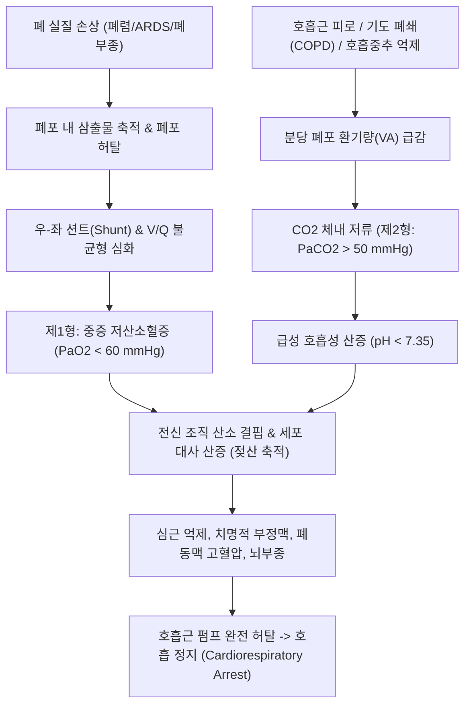
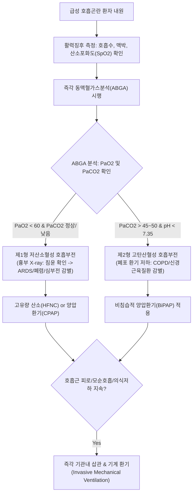

# 🩺 호흡 부전 (Respiratory Failure)

> **핵심 3줄 요약 (Key Summary)**:
> - 📍 병소 부위 & 해부·병태생리: 폐포 모세혈관막의 가스교환 장애(저산소혈성/1형 호흡부전, $\text{PaO}_2 < 60 \text{ mmHg}$) 또는 호흡근·신경계 펌프 부전에 따른 환기 저하(고탄산혈성/2형 호흡부전, $\text{PaCO}_2 > 45~50 \text{ mmHg}$, pH $< 7.35$)로 신체 조직의 산소 공급 및 탄산가스 배출이 파탄에 이른 상태.
> - 🚩 전형적 임상 양상: 빈호흡, 흉쇄유돌근/늑간근 등 부호흡근 동원 호흡, 청색증(Cyanosis), 빈맥, 고탄산혈증에 기인한 의식 혼돈·기면·자세고정불능증(Asterixis), 발한.
> - 🛠️ 핵심 검사 & 치료 전략: 즉각적인 동맥혈가스분석(ABGA), 흉부 X-ray/CT, 심전도; 산소 요법(비강 캐뉼라, 고유량 비강 캐뉼라 HFNC), 비침습적 양압환기(NIV/BiPAP), 기도 삽관 및 기계 환기(Mechanical Ventilation), ECMO; 원인 기저질환(폐렴, COPD, 심부전 등) 교정.
> - ⚠️ 응급 의뢰 레드플래그: 분당 호흡수 > 30회 또는 < 8회(호흡 정지 임박), 청색증, SpO2 < 88%, 의식 저하, 모순 호흡(Paradoxical breathing) -> 즉각 119 구급대 호출 및 기도 확보 응급실 후송.

---

## 📌 목차
1. [질환 개요 & 해부학적 병태생리](#1-질환-개요--해부학적-병태생리)
2. [병태생리 메커니즘 & 생체역학적 악순환 네트워크](#2-병태생리-메커니즘--생체역학적-악순환-네트워크)
3. [임상 증상 & 이학적 검사(Physical Exam) 알고리즘](#3-임상-증상--이학적-검사physical-exam-알고리즘)
4. [감별 진단 매트릭스 (Differential Diagnosis)](#4-감별-진단-매트릭스-differential-diagnosis)
5. [한의 통합 치료 프로토콜 (침·약침·추나·한약)](#5-한의-통합-치료-프로토콜--침-약침-추나-한약-)
6. [양방 치료 & 병용·의뢰 기준 (Conventional Treatment & Referral)](#6-양방-치료--병용의뢰-기준-conventional-treatment--referral)
7. [재활 운동 & 생활습관 티칭 가이드](#7-재활-운동--생활습관-티칭-가이드)
8. [💡 사용자 진료실 핵심 필기 & 임상 노하우 (Melt-In 잔여 심화 집약)](#8--사용자-진료실-핵심-필기--임상-노하우--melt-in-잔여-심화-집약-)
9. [출처 및 학술 참고 문헌 (References)](#9-출처-및-학술-참고-문헌--references)

---

## 1. 질환 개요 & 해부학적 병태생리

* **정의**: 호흡 부전(Respiratory Failure)은 호흡계가 혈액 내 산소화(Oxygenation)와 이산화탄소 제거(Carbon dioxide elimination)라는 본연의 가스교환 기능을 적절히 수행하지 못하여, 대기 호흡 상태에서 동맥혈 산소분압이 비정상적으로 저하되거나 이산화탄소 분압이 축적되는 치명적 병태생리학적 상태이다.
* **병태생리학적 2대 분류**:
  * **제1형: 저산소혈성 호흡부전 (Hypoxemic Respiratory Failure / Type 1)**:
    * 정의: $\text{PaO}_2 < 60 \text{ mmHg}$ (실내 공기 호흡 시), $\text{PaCO}_2$는 정상이거나 오히려 과호흡으로 저하됨.
    * 병소: 폐 실질(Alveoli) 및 폐혈관 가스교환막.
    * 기전: 환기-관류 불균형(V/Q mismatch), 우-좌 단락(Right-to-left shunt, 단락률 > 20%), 확산 장애(Diffusion impairment).
    * 대표 질환: [[급성 호흡곤란 증후군]](ARDS), 중증 [[폐렴]], 심인성 폐부종, 폐색전증.
  * **제2형: 고탄산혈성 호흡부전 (Hypercapnic Respiratory Failure / Type 2, 환기 부전)**:
    * 정의: $\text{PaCO}_2 > 45~50 \text{ mmHg}$ 및 급성 호흡성 산증(pH $< 7.35$), 저산소혈증 동반 가능.
    * 병소: 호흡 중추, 척수, 말초신경, 흉벽 및 호흡근 펌프(Ventilatory pump).
    * 기전: 폐포 환기량(Alveolar ventilation) 자체의 절대적 감소 또는 사강(Dead space) 환기량 급증.
    * 대표 질환: 만성 폐쇄성 폐질환(COPD) 급성 악화, 중증 천식, 길랑-바레 증후군, 근무력증, 중추신경계 억제제 과다복용.

---

## 2. 병태생리 메커니즘 & 생체역학적 악순환 네트워크

---

## 3. 임상 증상 & 이학적 검사(Physical Exam) 알고리즘

### 1) 주요 임상 증상
* **저산소혈증 관련 증상**:
  * 빈호흡(Tachypnea), 호흡곤란, 불안, 초조, 지남력 상실.
  * 입술 및 손톱밑의 중심성 청색증(Cyanosis, 환원 헤모글로빈 $> 5 \text{ g/dL}$).
  * 심혈관 대상 반응: 빈맥, 부정맥, 초기 고혈압에서 후기 저혈압 쇼크.
* **고탄산혈증 관련 증상**:
  * 뇌혈관 확장으로 인한 박동성 두통, 안면 홍조, 결막 충혈.
  * 의식 혼탁, 졸음(기면), 혼미, 혼수(CO2 혼수, $\text{CO}_2$ narcosis).
  * 손을 앞으로 뻗었을 때 손목이 불수의적으로 펄럭이는 자세고정불능증(Asterixis, Flapping tremor).
* **호흡근 피로 징후 (호흡근 탈진의 결정적 단서)**:
  * 흉쇄유돌근 및 사각근이 흡기 시 팽팽하게 솟아오름.
  * 늑간 함몰(Intercostal retractions).
  * **모순 복부 호흡(Paradoxical abdominal breathing)**: 흡기 시 횡격막 피로로 인해 복부가 밖으로 나오지 않고 안으로 쑥 꺼지는 현상 (기도 삽관 임박 신호).

### 2) 이학적 검사 및 진단 알고리즘

---

## 4. 감별 진단 매트릭스 (Differential Diagnosis)

| 질환군 | 주요 ABGA 소견 | 흉부 X-ray 소견 | 주 병태생리 | 치료 요점 |
| :--- | :--- | :--- | :--- | :--- |
| **급성 호흡곤란 증후군 (ARDS)** | **심한 저산소혈증**, P/F비 $\le 300$ | **양측성 미만성 폐침윤** | 비심인성 폐포 모세혈관 투과성 증가 | 폐보호 기계환기 (낮은 일회호흡량), PEEP |
| **급성 심인성 폐부종** | 저산소혈증 | 심비대, 폐문부 나비모양 침윤 | 좌심실 부전으로 인한 정수압 상승 | 이뇨제, 혈관확장제, CPAP |
| **COPD 급성 악화** | **심한 고탄산혈증 + 산증** | 폐과팽창, 횡격막 평탄화 | 기도 저항 급증 및 호흡근 피로 | 기관지확장제, 스테로이드, BiPAP |
| **[[폐색전증]]** | 저산소혈증 + 저탄산혈증 | 대개 정상 (폐문부 혈류결손) | 폐포 관류 차단 (사강 환기 증가) | 항응고제, 혈전용해술 |
| **[[과호흡 증후군]]** | **$\text{PaO}_2$ 정상, $\text{PaCO}_2$ 급락, pH $\uparrow$** | 완전 정상 | 심리적/기능성 과호흡 | 안심시키기, 복식호흡 재훈련 |

---

## 5. 한의 통합 치료 프로토콜 (침·약침·추나·한약)

> 🚨 **초응급 절대 레드플래그 (Red Flag Alert)**: 급성 호흡 부전은 분초를 다투는 기도 확보와 기계적 환기가 필요한 **중환자실 입원 적응증**이다. 외래 한의원에서 침이나 한약으로 해결하려 해서는 절대로 안 되며 즉각 119 구급대를 호출해야 한다. 한의 치료는 중환자실 기계 환기 이탈(Weaning) 후의 **만성 폐재활 및 호흡근 기능 회복기 치료로만 엄격히 제한**된다.

### 1) 회복기 및 만성 호흡부전 변증 분류
* **폐비기허·담음조폐(肺脾氣虛·痰飲阻肺)**: 기침, 가래, 가벼운 활동에도 숨참, 식욕부진, 전신 무력, 설담태백니, 맥침세약.
* **폐신양허·신불납기(肺腎兩虛·腎不納氣)**: 숨을 들이쉬기 어렵고 뱉기만 급함, 요슬산연, 손발 차가움, 부종, 설담소태, 맥미약.

### 2) 회복기 침구 치료
* **혈위**: [[폐수]](BL13), [[비수]](BL20), [[신수]](BL23), [[전중]](CV17), [[기해]](CV6), [[족삼리]](ST36), [[정천]](Dingchuan).
* **목적**: 횡격막 및 호흡근 기능 강화, 가래 배출 촉진, 기침 안정.

### 3) 만성 안정기 한약 요법
* **보폐탕(補肺湯) 가감**: 폐기 허약으로 인한 만성 호흡곤란 개선. (인삼, 황기, 숙지황, 오미자, 자완, 상백피).
* **이중탕(理中湯) 합 금궤요략 신기환(腎氣丸)**: 신불납기(腎不納氣)로 인한 호흡근 쇠약 환자의 하초 원기 보강.

---

## 6. 양방 치료 & 병용·의뢰 기준 (Conventional Treatment & Referral)

* **산소 요법 및 호흡 지지 전략 (Step-by-Step Respiratory Support)**:
  * **저유량/고농도 산소**: 비강 캐뉼라(1~6 L/min), 비재호흡 마스크(NRB mask 10~15 L/min).
  * **고유량 비강 캐뉼라 (HFNC)**: 가온 가습된 산소를 최대 60 L/min, $\text{FiO}_2$ 1.0까지 정밀 투여 (ARDS 1차 지지).
  * **비침습적 양압환기 (NIV / BiPAP)**:
    * COPD 급성 악화 및 심인성 폐부종의 1차 표준 치료 (기관 삽관율 및 사망률 유의미 감소).
  * **침습적 기계 환기 (Invasive Mechanical Ventilation)**:
    * 적응증: 심각한 의식 저하, 모순 호흡, 심한 산증(pH $< 7.20$), 지속적 저산소혈증.
    * ARDS 기계환기 원칙: 폐보호 환기(일회호흡량 4~8 mL/kg of predicted body weight, 플래토 압력 $\le 30 \text{ cmH}_2\text{O}$).
  * **체외막산소공급 (ECMO)**:
    * 초중증 불응성 저산소혈증 시 정맥-정맥(V-V) ECMO 적용.
* **양방·전문과 의뢰 기준 (Referral Criteria)**:
  * **즉각 119 응급실 전원 (Red Flag)**:
    * 호흡수 > 30회/분 또는 < 10회/분.
    * $\text{SpO}_2 < 90\%$ (산소 투여에도 불응).
    * 의식 저하, 청색증, 흉부 견축, 모순 호흡.

---

## 7. 재활 운동 & 생활습관 티칭 가이드

* **만성 폐질환 환자의 입술 오므리기 호흡(Pursed-lip breathing)**:
  * 코로 2초간 들이마시고 입술을 촛불 끄듯 오므려 4초간 길게 내쉬어 기도 내 양압을 유지, 소기도 허탈 방지.
* **호흡근 근력 훈련(Inspiratory Muscle Training, IMT)**:
  * 흡기 저항 기구를 이용하여 횡격막과 늑간근 근력을 점진적으로 강화.
* **감염 예방 접종**:
  * 인플루엔자, 폐렴구균, 코로나19 백신 필수 접종으로 호흡부전 급성 재발 차단.

---

## 8. 💡 사용자 진료실 핵심 필기 & 임상 노하우 (Melt-In 잔여 심화 집약)

* **COPD 환자에게 무턱대고 고농도 산소를 주면 안 되는 이유 (Hypoxic Drive 함정)**:
  * 만성 고탄산혈증 환자는 중추 화학수용체의 $\text{CO}_2$ 감수성이 무뎌져 저산소혈증(Hypoxic drive)에 의존해 숨을 쉰다.
  * 이때 산소포화도를 100%로 만들겠다고 고농도 산소를 마구 투여하면 호흡 자극이 사라져 호흡수가 급감하고 $\text{CO}_2$가 100 이상으로 치솟아 **이산화탄소 혼수(Narcosis)**로 심정지가 발생할 수 있다. COPD 환자의 목표 $\text{SpO}_2$는 88~92%로 유지해야 한다.
* **'조용한 흉부(Silent Chest)'의 치명적 경고**:
  * 천식 환자가 거칠게 쌕쌕거리며 숨을 쉬다가 갑자기 숨소리가 조용해지면 "병이 나은 것"이 아니라 **기도가 완전히 막혀 공기가 아예 드나들지 못하는 호흡 정지 직전**이다. 청진기에서 소리가 사라지는 순간이 가장 위험하다.

---

## 9. 출처 및 학술 참고 문헌 (References)

* Grassi LG, et al. (2026 Dec). Assessing respiratory muscle effort during noninvasive respiratory support in acute hypoxemic respiratory failure: A State-of-the Art Review from physiology to bedside. *Intensive Crit Care Nurs*, 97:104085. PMID: 42407343.

* Combes A, et al. (2026 Sep). Extracorporeal Gas Exchange: Indications and Implementation. *Clin Chest Med*, 47(3):481-494. PMID: 42486562.

* Williams GW, et al. (2025 Oct 28). Acute Respiratory Distress Syndrome Definitions in Adults and Children: A Comparative Narrative Review. *J Clin Med*, 14(21):7512. PMID: 41227040.

---

## 관련 노트

- [[_의학/03_이론/질환/호흡기 질환/기타 호흡기/과호흡 증후군|과호흡 증후군]]
- [[_의학/03_이론/질환/호흡기 질환/기타 호흡기/폐 신장 증후군|폐 신장 증후군]]
- [[급성 호흡곤란 증후군]]
- [[폐렴]]
- [[폐색전증]]
