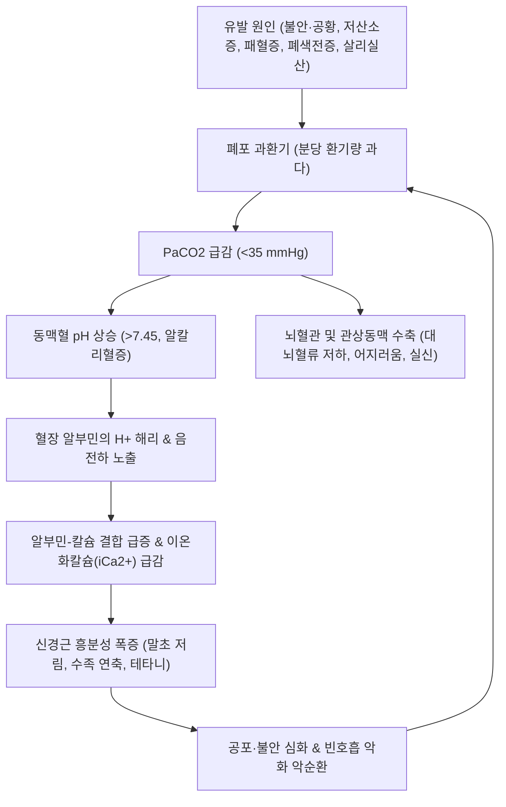

# 🩺 [[호흡성 알칼리증]] (Respiratory Alkalosis / 呼吸性알칼리症, ICD-10 E87.3 / KCD-8 E87.3)

> **핵심 3줄 요약 (Key Summary)**:
> - 📍 **병소 부위 & 해부·병태생리**: 폐포 과환기(Alveolar hyperventilation)로 인해 체내 생성량보다 많은 양의 이산화탄소($\text{CO}_2$)가 배출되어 $\text{PaCO}_2 < 35\text{ mmHg}$로 떨어지고 동맥혈 $\text{pH} > 7.45$로 상승하는 전신 산-염기 장애. 불안·공황발작, 저산소혈증, 폐색전증, [[패혈증]] 초기, 살리실산 중독 등이 주원인이다.
> - 🚩 **전형적 임상 양상 & 3대 징후**: 알칼리혈증으로 인한 혈청 단백-칼슘 결합 증가로 **이온화칼슘($\text{iCa}^{2+}$)이 급감**하여 구주위 및 수족 말초 감각 이상(저림), 근연축 및 테타니(Tetany, 손발 뒤틀림), 뇌혈관 수축에 따른 어지러움, 실신, 불안감이 발현한다.
> - 🛠️ **핵심 감별 검사 & 한·양방 다각적 치료 전략**: 동맥혈가스분석(ABGA)으로 $\text{pH}$, $\text{PaCO}_2$, $\text{HCO}_3^-$ 확인. 원인 감별(저산소혈증, 폐색전증, 중독)이 최우선이며, 심인성 과환기 시 저유량 산소 투여 및 벤조디아제핀, 호흡 안정화 티칭을 시행한다. 한의 치료는 근긴장 완화를 위한 [[작약감초탕]] 및 [[내관]](PC6)·[[태충]](LR3) 침구 치료로 자율신경 균형을 유도한다.
> - ⚠️ **응급 의뢰 레드플래그 & 악화 요인**: 저산소증·폐색전증·패혈증·살리실산 중독에 의한 병적 과환기를 단순 '과호흡증후군'으로 오진하여 종이봉투 재호흡을 시키면 치명적인 저산소성 뇌손상이나 심정지를 유발할 수 있다. 심한 알칼리혈증($\text{pH} > 7.60$)은 악성 부정맥과 혼수를 초래하므로 즉시 상급병원 전원이 필요하다.

---

## 📌 목차
1. [질환 개요 & 해부학적 병태생리](#1-질환-개요--해부학적-병태생리)
2. [병태생리 메커니즘 & 생체역학적 악순환 네트워크](#2-병태생리-메커니즘--생체역학적-악순환-네트워크)
3. [임상 증상 & 이학적 검사(Physical Exam) 알고리즘](#3-임상-증상--이학적-검사physical-exam-알고리즘)
4. [감별 진단 매트릭스 (Differential Diagnosis)](#4-감별-진단-매트릭스-differential-diagnosis)
5. [한의 통합 치료 프로토콜 (침·약침·추나·한약)](#5-한의-통합-치료-프로토콜-침약침추나한약)
6. [양방 치료 & 병용·의뢰 기준 (Conventional Treatment & Referral)](#6-양방-치료--병용의뢰-기준-conventional-treatment--referral)
7. [재활 운동 & 생활습관 티칭 가이드](#7-재활-운동--생활습관-티칭-가이드)
8. [💡 사용자 진료실 핵심 필기 & 임상 노하우 (Melt-In 잔여 심화 집약)](#8--사용자-진료실-핵심-필기--임상-노하우-melt-in-잔여-심화-집약)
9. [출처 및 학술 참고 문헌 (References)](#9-출처-및-학술-참고-문헌-references)

---

## 1. 질환 개요 & 해부학적 병태생리

* **질환 정의 및 분류**:
  * **정의**: 폐포 환기량(Alveolar ventilation)이 체내 대사 요구량보다 비정상적으로 과도하여 동맥혈 이산화탄소 분압($\text{PaCO}_2$)이 $35\text{ mmHg}$ 미만으로 저하되고, 이로 인해 동맥혈 수소이온 농도가 감소하여 $\text{pH}$가 $7.45$를 초과하는 산-염기 불균형 상태이다.
  * **시간 경과 및 보상에 따른 분류**:
    * **급성 호흡성 알칼리증 (Acute Respiratory Alkalosis)**: 수 분~수 시간 내에 급격한 과환기로 발생. 신장 보상이 일어날 시간이 없어 적혈구 및 세포내 단백질 완충계(H+ 방출)에 의해서만 $\text{PaCO}_2\ 10\text{ mmHg}$ 저하당 $\text{HCO}_3^-$가 약 $2\text{ mEq/L}$ 감소하는 데 그치며 $\text{pH}$가 급격히 상승한다.
    * **만성 호흡성 알칼리증 (Chronic Respiratory Alkalosis)**: 수일 이상 지속(고산 거주, 만성 간부전, 임신 등). 신장 근위세뇨관에서 $\text{HCO}_3^-$ 재흡수가 억제되고 $\text{H}^+$ 배설이 감소하여, $\text{PaCO}_2\ 10\text{ mmHg}$ 저하당 $\text{HCO}_3^-$가 약 $4\sim5\text{ mEq/L}$ 감소하여 $\text{pH}$가 정상에 가깝게 조절된다.

* **원인 계통 및 관련 구조물**:
  * **중추신경 및 정신성**: 불안, 공황발작([[공황장애]]), 급성 통증, [[발열]], 뇌혈관질환, 두부 외상.
  * **저산소혈증 유발성**: 고산지대, [[폐렴]], [[폐색전증]], 중증 [[빈혈]], 심부전 말초 화학수용체 자극.
  * **약물 및 독소**: 살리실산([[아스피린]]) 중독 초기(연수 호흡중추 직접 자극), 프로게스테론(임신 중 호흡 자극), 니코틴.
  * **전신 염증**: [[패혈증]] 초기 내독소 및 사이토카인 자극.
  * **의인성**: 인공호흡기 분당 환기량 과다 설정.

---

## 2. 병태생리 메커니즘 & 생체역학적 악순환 네트워크

### 1) 알칼리혈증과 전해질 이동 기전
* **이온화칼슘($\text{iCa}^{2+}$) 감소와 테타니**:
  * 혈액 $\text{pH}$가 상승하면 혈청 알부민에 결합되어 있던 수소이온($\text{H}^+$)이 해리되어 알칼리 완충에 동원된다.
  * 이로 인해 알부민 분자 표면의 음전하가 노출되어 혈청 내 유리 칼슘 이온($\text{Ca}^{2+}$)과 강력하게 결합한다.
  * 총 혈청 칼슘 농도는 정상이더라도 신경-근육 안정화에 필수적인 **이온화칼슘($\text{iCa}^{2+}$) 농도가 급감**하게 된다.
  * 이온화칼슘이 결핍되면 신경세포막의 나트륨 통로가 비정상적으로 개방되어 휴지막 전위가 탈분극 역치에 근접함으로써 사지 말초 감각 이상과 근육 경련(테타니)이 유발된다.

### 2) 뇌혈류 및 심혈관계 영향
* **뇌혈관 수축**: 동맥혈 $\text{PaCO}_2$는 뇌혈관 저항을 조절하는 가장 강력한 인자이다. $\text{PaCO}_2$가 급격히 떨어지면 뇌세동맥이 강력하게 수축하여 대뇌 혈류량이 최대 40~50%까지 감소하며, 이로 인해 어지러움, 시야 혼탁, 이인증, 실신(Syncope)이 발생한다.
* **관상동맥 연축**: 중증 알칼리혈증($\text{pH} > 7.60$)에서는 관상동맥 연축 및 부정맥, 심근 허혈 소견이 동반될 수 있다.

---

## 3. 임상 증상 & 이학적 검사(Physical Exam) 알고리즘

### 1) 주소증 및 신경학적 증상
* **감각 및 신경근 징후**:
  * 입 주위(구주위) 무감각증 및 저림, 양측 손끝·발끝의 찌릿찌릿한 이상 감각.
  * **수족 연축(Carpopedal spasm)** 및 근육 뒤틀림, 떨림.
  * 어지러움, 몽롱함, 비현실감, 실신.
* **호흡기 및 심혈관 징후**:
  * 얕고 빠른 빈호흡, 한숨 쉬는 듯한 호흡 패턴, 가슴 답답함(흉민), 두근거림(심계).

### 2) 필수 이학적 검사법 (Physical Examination)
* **크보스텍 징후 (Chvostek sign)**:
  * 외이도 전방 약 2cm 부위의 안면신경(Cranial nerve VII) 주행 부위를 손끝으로 가볍게 톡톡 두드림.
  * 동측의 윗입술, 코, 눈 주위 근육이 불수의적으로 씰룩거리면 양성 (저칼슘혈증/이온화칼슘 저하 시사).
* **트루소 징후 (Trousseau sign)**:
  * 상완에 혈압계 커프를 감고 수축기 혈압보다 $20\text{ mmHg}$ 높게 $3$분간 유지하여 허혈을 유발.
  * 손목 굴곡, 중수수지관절 굴곡, 지절간관절 신전 및 모지 내전으로 구성되는 전형적인 **산과의사의 손(Main d'accoucheur)** 연축이 나타나면 양성.
* **동맥혈가스분석(ABGA)**:
  * $\text{pH} > 7.45$, $\text{PaCO}_2 < 35\text{ mmHg}$.
  * 급성: $\text{PaCO}_2\ 10\text{ mmHg}$ 저하당 $\text{HCO}_3^-$ 약 $2\text{ mEq/L}$ 감소.
  * 만성: $\text{PaCO}_2\ 10\text{ mmHg}$ 저하당 $\text{HCO}_3^-$ 약 $4\sim5\text{ mEq/L}$ 감소.
* **혈청 전해질 및 이온화칼슘 측정**:
  * 이온화칼슘($\text{iCa}^{2+}$) 저하 확인, 알칼리혈증에 따른 저칼륨혈증 및 저인산혈증 동반 여부 검토.

---

## 4. 감별 진단 매트릭스 (Differential Diagnosis)

| 감별 질환 | 주 병태생리 | ABGA 특이 소견 | 주요 임상 양상 |
| :--- | :--- | :--- | :--- |
| **[[호흡성 알칼리증]] (본 질환)** | 폐포 과환기 ($\text{CO}_2$ 과다 배출) | **$\text{pH} \uparrow$, $\text{PaCO}_2 \downarrow$, $\text{HCO}_3^- \downarrow$ (보상)** | 구주위 저림, 테타니, 어지러움, 크보스텍/트루소 양성 |
| **[[호흡성 산증]]** | 폐포 저환기 ($\text{CO}_2$ 배출 저하) | $\text{pH} \downarrow$, $\text{PaCO}_2 \uparrow$, $\text{HCO}_3^- \uparrow$ (보상) | 두통, 졸림, 기면, 진전, $\text{CO}_2$ 마취 |
| **[[대사성 알칼리증]]** | 위산 소실(구토) 또는 이뇨제 | $\text{pH} \uparrow$, $\text{HCO}_3^- \uparrow$, $\text{PaCO}_2 \uparrow$ (보상) | 저환기 보상, 근연축, 부정맥, 구토 병력 |
| **[[대사성 산증]]** | 산 생성 과다, 젖산 축적 | $\text{pH} \downarrow$, $\text{HCO}_3^- \downarrow$, $\text{PaCO}_2 \downarrow$ (보상) | 쿠스마울 심호흡, 의식 혼미, 쇼크 |

---

## 5. 한의 통합 치료 프로토콜 (침·약침·추나·한약)

* **한의학적 병태 인식**:
  * 호흡성 알칼리증의 주된 임상 발현(과호흡, 가슴 답답함, 손발 연축, 공포감)은 한의학에서 **기울(氣鬱), 흉민(胸悶), 심계정충(心悸怔忡), 전간(癲癎) 및 경련(痙攣)**의 범주로 파악된다.
  * 간기울결(肝氣鬱結)로 기기가 상역하여 흉곽을 압박하거나, 간혈허(肝血虛)로 근맥이 자양되지 못하여 풍(風)이 동하는 병태로 본다.
* **침구 치료 (Acupuncture)**:
  * **진정 및 사지 연축 해소 혈위**:
    * **안신평간(安神平肝)**: [[내관]](PC6, 심포경 낙혈 가슴 답답함 및 불안 진정), [[신문]](HT7, 심경 원혈 신경 안정), 백회(GV20), 인당(EX-HN3).
    * **평간식풍(平肝熄風) 및 근경련 완화**: [[태충]](LR3, 간경 원혈 사간화), 양릉천(GB34, 근회), [[합곡]](LI4).
    * **선폐리기(宣肺理氣)**: [[단중]](CV17), [[폐수]](BL13).
  * 자침 기법: 급성 과호흡 및 테타니 발작 시 내관, 태충, 합곡에 사법으로 강자극 유침하여 부교감신경 활성을 유도한다.
* **한약 치료 (Herbal Medicine)**:
  * **1) 급성 근경련 및 손발 뒤틀림 (테타니 발작)**:
    * **[[작약감초탕]](芍藥甘草湯)**: 백작약 20~30g, 감초 10~15g. 백작약의 파에오니플로린(Paeoniflorin) 성분과 감초의 글리시리진이 칼슘 이온 이동 조절 및 골격근 수축을 신속히 이완시키는 진경(鎭痙)의 성약.
  * **2) 심인성 과환기 및 공황장애 소인 (간기울결, 기상충)**:
    * **[[시호가용골모려탕]](柴胡加龍骨牡蠣湯)**: 시호, 황금, 용골, 모려, 복령, 반하, 대황 등. 가슴 답답함, 두근거림, 불안, 상열감 동반 시 중추신경 흥분을 진정.
    * **[[영계출감탕]](苓桂朮甘湯)**: 수음이 상역하여 심하가 두근거리고 어지러움, 호흡이 가쁠 때 기운을 내리고 수기를 정돈.
    * **[[귀비탕]](歸脾湯)**: 사려과다, 심비양허로 만성적인 불안과 빈호흡이 유발되는 경우.

---

## 6. 양방 치료 & 병용·의뢰 기준 (Conventional Treatment & Referral)

* **약물 치료 (Medication)**:
  * **원인별 맞춤 약물 치료**:
    * **심인성 과환기/공황발작**: 급성기 불안 조절을 위한 단기 속효성 벤조디아제핀(로라제팜 $0.5\sim1.0\text{ mg}$ 경구 또는 정맥 투여).
    * **패혈증 조기 과환기**: 즉각적인 정맥 수액 소생술 및 조기 광범위 항생제 투여.
    * **폐색전증**: 저분자량 헤파린 또는 경구 항응고제(DOAC) 즉시 투여.
    * **살리실산 중독**: 탄산수소나트륨($\text{NaHCO}_3$) 정맥 투여로 요 알칼리화 유도, 중증 시 긴급 혈액투석.
  * **저유량 산소 투여 요법**:
    * 심인성 과호흡 환자에게 저유량 마스크 산소($2\sim4\text{ L/min}$)를 공급하면 마스크의 소량 사강(Dead space) 효과와 산소 공급으로 심리적 안정과 호흡 조절을 신속히 유도한다.
* **종이봉투 재호흡법(Paper Bag Rebreathing)에 대한 엄격한 경고**:
  * 과거 과호흡 환자에게 종이봉투를 대고 호흡하게 하는 재호흡법이 널리 쓰였으나, **저산소혈증, 폐색전증, 심근경색, 살리실산 중독 환자에게 적용할 경우 치명적인 저산소성 뇌손상이나 질식, 심정지를 유발**할 수 있다.
  * 따라서 기저 기질적 질환이 100% 배제되기 전에는 절대 시행해서는 안 되며, 현대 응급의학 가이드라인에서는 권장되지 않는다.
* **전해질 교정**:
  * 중증 이온화칼슘 결핍으로 인한 후두경련이나 전신 테타니 발작 시 **10% 글루콘산칼슘(Calcium gluconate)** $10\text{ mL}$를 10분에 걸쳐 천천히 정맥 주사한다.
* **한의 병용 판단 (Combination Therapy)**:
  * 급성 발작기에는 산소포화도 및 활력징후를 감시하며 [[작약감초탕]] 또는 침구 요법을 적용하여 약물 의존성을 줄인다.
  * 기저에 공황장애나 범불안장애가 있는 환자는 양방 신경정신과 약물(SSRI)과 함께 [[시호가용골모려탕]]을 병용하여 자율신경 안정화를 도모한다.
* **양방·전문과 응급 의뢰 기준 (Referral Criteria)**:
  * 산소포화도($\text{SpO}_2$) $< 92\%$ 저하 (단순 과호흡이 아닌 폐색전증, 폐렴 의심).
  * 동맥혈 $\text{pH} > 7.60$, 흉통 동반, 심전도상 허혈성 ST 분절 변화 또는 악성 부정맥.
  * 의식 혼돈, 기면, 실신, 고열 동반 패혈증 의심 시 즉시 3차 상급병원 응급실 이송.

---

## 7. 재활 운동 & 생활습관 티칭 가이드

* **느린 횡격막 호흡 훈련 (Slow Diaphragmatic Breathing)**:
  * **호흡 주기 조절**: 1분에 6~8회 속도로 "코로 4초간 들이마시고, 6초간 천천히 내쉬기" 리듬 훈련.
  * 과호흡 발작 조기 신호(손끝 저림, 가슴 답답함)를 인지했을 때 즉시 한 손을 배에 올리고 복식호흡을 시행하도록 교육.
* **스트레스 및 불안 관리 이완 요법**:
  * 점진적 근육 이완법(PMR) 및 마음챙김 명상.
* **카페인 및 각성 물질 제한**:
  * 커피, 에너지 음료, 니코틴은 교감신경을 자극하여 과환기를 유발하므로 섭취를 중단한다.
* **고산 등반 전 준비**:
  * 해발 2,500m 이상 고산 환경 진입 시 생리적 과환기가 발생하므로 점진적 고도 적응(하루 300~500m 상승)을 준수한다.

---

## 8. 💡 사용자 진료실 핵심 필기 & 임상 노하우 (Melt-In 잔여 심화 집약)

> [!IMPORTANT]
> **🛡️ 원문 융합(Melt-In) 및 8번 섹션 집약 핵심**
> 1. **기존 필기 내용 상부 전면 융합**: 과환기 $\text{PaCO}_2$ 하강 기전, 이온화칼슘 저하와 테타니, 종이봉투 재호흡 위험성, 작약감초탕 진경을 상부 1~6번에 유기적으로 100% 녹여냈습니다.
> 2. **8번 섹션의 차별화된 심화 집약**: 진료실 현장 과호흡 즉각 진정 스크립트, 크보스텍/트루소 손맛 진찰 노하우입니다.

* **상부 섹션에 미처 다 담지 못한 고유 원문 필기**:
  * "과환기(PaCO2 < 35) → 알칼리혈증 → 알부민-칼슘 결합 증가로 이온화칼슘 저하 → 손발 저림 및 테타니."
  * "과호흡 환자에게 무턱대고 비닐봉지를 씌우는 것은 저산소증 환자에게 치명적일 수 있으므로 금기이다."

* **진료실 실전 감별 & 치료 노하우**:
  * **1. 현장 과호흡 환자 마주쳤을 때의 3단계 대처법**:
    * 1단계: **맥박산소포화도측정기(Pulse oximeter)**를 먼저 손가락에 물린다. $\text{SpO}_2$가 98~100%라면 심인성 과호흡에 무게가 실리지만, 만약 $\text{SpO}_2 < 94\%$라면 폐색전증, 기흉, 폐렴에 의한 보상성 빈호흡이므로 즉시 산소를 투여하고 119를 불러야 한다.
    * 2단계: 의사의 차분하고 단호한 목소리로 눈을 맞추며 아이컨택을 유지한다: "숨이 차서 겁나시겠지만, 지금 산소는 몸속에 아주 충분합니다. 제가 쉬는 숨을 보고 그대로 따라 하세요. 습- 둘 셋, 후- 둘 셋 넷."
    * 3단계: 양측 **[[내관]](PC6)** 및 **[[합곡]](LI4)**혈을 강하게 지압하면서 긴장을 푼다.
  * **2. 테타니 환자 탕전 손맛 노하우**:
    * 손발이 굳어 꼬이는 테타니 환자에게는 **[[작약감초탕]]을 백작약 24g, 감초 12g**으로 대량 전탕하여 따뜻하게 복용시키면 $15\sim20$분 내로 손가락의 강직이 부드럽게 풀린다.
  * **3. 환자 티칭 스크립트**:
    * "과호흡은 몸에 산소가 부족해서 생기는 것이 아니라, 너무 가쁘게 숨을 몰아쉬어 몸속에 꼭 있어야 할 이산화탄소가 다 빠져나가 피가 알칼리성으로 변해 생기는 증상입니다. 피가 알칼리가 되면 칼슘이 일시적으로 활동을 멈춰 손발이 저리고 뒤틀리는 것입니다. 천천히 길게 숨을 내쉬면 몇 분 안에 저절로 정상으로 돌아옵니다."

---

## 9. 출처 및 학술 참고 문헌 (References)

- Fesseler L et al. (2026). The effect of pre-exercise hyperventilation on repeated high-intensity inclined sprint performance. *Exp Physiol*. 111(7):3412-3424. PMID: 42185035.

- Molano Franco D et al. (2026). Evaluating acid-base status and perfusion: arterial and venous blood gases during pregnancy. *Rev Colomb Obstet Ginecol*. 77(1):. PMID: 42049011.

- Stepanek J et al. (2025). The Contribution of Aerospace Medicine Specialty Expertise in the Diagnosis and Treatment of Headache Disorders with Concomitant Clinically Symptomatic Dyscapnia (Respiratory Alkalosis/Acidosis). *Curr Neurol Neurosci Rep*. 25(1):72. PMID: 41123745.
