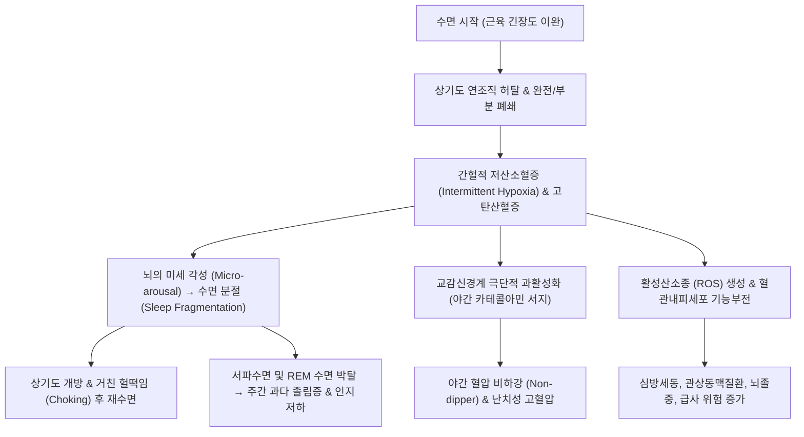

# 🩺 수면 무호흡 (Sleep Apnea)

> **핵심 3줄 요약 (Key Summary)**:
> - 📍 병소 부위 & 해부·병태생리: 수면 중 인두 근육 긴장도 저하 및 연조직 허탈로 인한 상기도의 반복적 폐쇄(폐쇄성 수면무호흡증, OSA) 또는 뇌간 호흡중추의 호흡 노력 신호 소실(중추성 수면무호흡증, CSA); 간헐적 저산소혈증 및 수면 분절 유발.
> - 🚩 전형적 임상 양상: 심한 코골이, 수면 중 숨 멈춤(choking/gasping), 과도한 주간 졸림증(Epworth 척도 상승), 아침 두통, 야간 빈뇨, 집중력 저하 및 난치성 고혈압.
> - 🛠️ 핵심 검사 & 치료 전략: 표준 야간 수면다원검사(PSG)상 무호흡-저호흡 지수(AHI) $\ge 5$회/시간 확인; 중등도~중증 표준 치료는 지속양압기(CPAP), 경증/자세성은 하악전방이동장치(MAD), 체중 감량 및 금주.
> - <font color="#fa7e7e">⚠️ 응급 의뢰 레드플래그: 주간 졸음으로 인한 잦은 졸음운전/사고 이력, 이른 아침 조절되지 않는 악성 고혈압, 야간 심실성 부정맥, 중증 심부전(체인-스톡스 호흡 동반) 발견 시 즉시 상급병원 수면클리닉/순환기내과 전원.</font>

---

## 📌 목차
1. [질환 개요 & 해부학적 병태생리](#1-질환-개요--해부학적-병태생리)
2. [병태생리 메커니즘 & 심뇌혈관 악순환 네트워크](#2-병태생리-메커니즘--심뇌혈관-악순환-네트워크)
3. [임상 증상 & 이학적 검사 알고리즘](#3-임상-증상--이학적-검사-알고리즘)
4. [감별 진단 매트릭스 (Differential Diagnosis)](#4-감별-진단-매트릭스-differential-diagnosis)
5. [한의학적 변증 & 이설·비강 치료 프로토콜](#5-한의학적-변증--이설비강-치료-프로토콜)
6. [양방 치료 & 비약물·수술 기준 (Conventional Treatment & Referral)](#6-양방-치료--비약물수술-기준-conventional-treatment--referral)
7. [환자 관리 & 생활습관 티칭 가이드](#7-환자-관리--생활습관-티칭-가이드)
8. [💡 진료실 핵심 필기 & 임상 노하우 (Melt-In 심화 집약)](#8--진료실-핵심-필기--임상-노하우-melt-in-심화-집약)
9. [출처 및 학술 참고 문헌 (References)](#9-출처-및-학술-참고-문헌-references)

---

## 1. 질환 개요 & 해부학적 병태생리

![[수면 무호흡_01_기도폐쇄도해.png|450]]
> [그림 1: 수면 중 인두 기도의 폐쇄(obstruction) 도해 — 설근·연구개가 후인두로 처지며 기도가 막힌다 — 출처: Wikimedia Commons — File:Airway obstruction.png (CC BY-SA 4.0)]


### 1) 정의 및 임상적 분류
**수면 무호흡(Sleep Apnea)** 은 수면 중에 반복적으로 호흡이 완전히 멈추거나(무호흡, Apnea: 기류 $\ge 90\%$ 감소가 10초 이상 지속) 호흡량이 현저히 감소하는(저호흡, Hypopnea: 기류 $\ge 30\%$ 감소 및 산소포화도 $\ge 3\%$ 저하 또는 각성 동반) 수면 호흡 장애 증후군이다.

1. **폐쇄성 수면무호흡증 (Obstructive Sleep Apnea, OSA, 85% 이상)**:
   * 호흡 노력(흉복부 운동)은 유지되나 상기도의 물리적 허탈로 기류가 차단되는 가장 흔한 형태.
2. **중추성 수면무호흡증 (Central Sleep Apnea, CSA, 5~10%)**:
   * 상기도 폐쇄 없이 연수(Medulla) 호흡중추의 일시적 환기 구동력(ventilatory drive) 소실로 흉복부 호흡 노력 자체가 멈추는 형태 (체인-스톡스 호흡, 심부전, 뇌졸중 환자 호발).
3. **복합성 / 혼합성 수면무호흡증 (Mixed Sleep Apnea)**:
   * 중추성 무호흡으로 시작하여 상기도 폐쇄성 무호흡으로 끝나는 형태.

### 2) 상기도 폐쇄의 해부학적 병소
* **주요 허탈 부위**: 인두강(Pharyngeal airway) — 특히 **구개수 및 연구개 후방(Velopharynx)** 과 **설근부 후방(Oropharynx/Tongue base)**.
* **해부학적 위험 인자**:
  * 비만으로 인한 인두 외측벽 및 설근부 지방 침착.
  * 하악 후퇴증(Retrognathia), 소하악증(Micrognathia), 좁은 하악궁.
  * 구개편도 및 인두편도(아데노이드) 비대, 긴 연구개, 거설증(Macroglossia).
  * Mallampati 척도 III~IV 등급(입을 크게 벌렸을 때 목젖이 보이지 않는 좁은 구인두 구조).

---

## 2. 병태생리 메커니즘 & 심뇌혈관 악순환 네트워크

![[수면 무호흡_02_정상개방기도.png|450]]
> [그림 2: 폐쇄가 없는 정상 기도 — 각성 시 인두 확장근 긴장이 유지되어 기도가 열려 있다 — 출처: Wikimedia Commons — File:New no obstruction.png (CC BY-SA 4.0)]




### 1) 간헐적 저산소혈증과 전신 염증
* 수면 중 수백 회 반복되는 저산소-재산소화(Hypoxia-Reoxygenation) 주기는 허혈-재관류 손상과 유사하여 대량의 활성산소종(ROS)을 방출함.
* 이는 NF-$\kappa$B 경로 활성화, 전신 염증 사이토카인(TNF-$\alpha$, IL-6) 분비, 인슐린 저항성 악화 및 대사증후군을 촉진함.

### 2) 흉강 내 음압 상승과 혈역학적 타격
* 기도가 막힌 상태에서 억지로 숨을 들이쉬려 할 때 흉강 내압이 $-60$ to $-80\text{ mmHg}$까지 급락함.
* 좌심실 후부하(afterload) 급증 및 심실 중격 편위로 심박출량 감소 유발, 장기적으로 심비대 및 야간 심방세동 위험 증가.

---

## 3. 임상 증상 & 이학적 검사 알고리즘

![[수면 무호흡_03_PSG렘수면.png|450]]
> [그림 5: 수면다원검사 기록지 — 렘수면 구간에서 호흡 사건이 몰리는 양상을 확인한다 — 출처: Wikimeda Commons — File:Sleep Stage REM.png (CC BY-SA 3.0)]


![[수면 무호흡_03_수면다원검사.png|450]]
> [그림 3: 수면다원검사(PSG) — 뇌파·안구운동·근전도·호흡 센서를 부착해 무호흡·저호흡 지수(AHI)를 산출한다 — 출처: Wikimedia Commons — File:Polysomnography tester.jpg (CC BY-SA 4.0)]


### 1) 전형적 주증상
* **야간 증상**:
  * 크고 불규칙한 코골이 (숨이 컥컥 막히다가 "푸하-" 하고 터지는 양상).
  * 목격된 무호흡(Witnessed apneas).
  * 질식감(Choking)으로 인한 야간 각성.
  * 야간 빈뇨(Nocturia): 심방벽 신장에 따른 심방나트륨이뇨펩티드(ANP) 분비 증가로 시간당 소변 마려움.
* **주간 증상**:
  * 기상 시 입안 건조 및 조조 두통(혈관 확장).
  * 통제되지 않는 주간 과다 졸림증(EDS): 운전 중, 회의 중 수면.
  * 만성 피로, 기억력 감퇴, 우울감, 성기능 장애.

### 2) 신체 진찰 및 스크리닝 척도
* **신체 계측**: 체질량지수(BMI $\ge 30\text{ kg/m}^2$), 목둘레(남성 $\ge 43\text{ cm}$ / 여성 $\ge 38\text{ cm}$).
* **변형 Mallampati 척도**: I등급(연구개, 구개수 전체 관찰) ~ IV등급(경구개만 관찰).
* **STOP-BANG 설문지**: 코골이(Snoring), 피로(Tired), 무호흡 목격(Observed), 혈압(Pressure), BMI > 35, 연령 > 50, 목둘레, 성별(남성). 5점 이상 시 고위험군.
* **주간 졸림 척도 (Epworth Sleepiness Scale, ESS)**: 10점 초과 시 유의한 졸림증.

### 3) 수면다원검사 (Polysomnography, PSG) 진단 기준
* **무호흡-저호흡 지수 (Apnea-Hypopnea Index, AHI)**: 시간당 무호흡 + 저호흡 횟수.
  * **정상**: $< 5$회/시간.
  * **경증 (Mild)**: $5 \le \text{AHI} < 15$회/시간.
  * **중등도 (Moderate)**: $15 \le \text{AHI} < 30$회/시간.
  * **중증 (Severe)**: $\text{AHI} \ge 30$회/시간.
* (AHI $\ge 5$ 이면서 주간 졸림, 코골이 등 전형적 증상이 있거나, 증상 없이도 AHI $\ge 15$이면 확진).

---

## 4. 감별 진단 매트릭스 (Differential Diagnosis)

| 감별 질환 | 호흡 노력(Effort) 유무 | 주 임상 양상 | 결정적 감별 포인트 |
| :--- | :--- | :--- | :--- |
| [[수면 무호흡]], 폐쇄성 수면무호흡증 (OSA) | **호흡 노력 유지됨 (흉복 역설 운동)** | 비만, 거친 코골이, 주간 졸림, 목둘레 굵음 | PSG상 기도 폐쇄 확인, CPAP 반응 우수 |
| **중추성 수면무호흡증 (CSA)** | **호흡 노력 없음 (흉복 운동 정지)** | 심부전, 뇌졸중 환자, 체인-스톡스 호흡 | 코골이 적음, 신경학적/심장 질환 선행, ASR 치료 |
| **단순 코골이 (Primary Snoring)** | 호흡 기류 정상 유지 | 코골이 소음만 존재 | **무호흡/저호흡 없음 (AHI < 5)**, 주간 졸림 없음 |
| **기면증 (Narcolepsy)** | 호흡 정상 | 탈력발작(Cataplexy), 입면 환각, 수면마비 | 다중수면잠복기검사(MSLT)상 수면잠복기 < 8분, SOREMP |
| **하지불안증후군 (RLS)** | 호흡 정상 | 야간 하지 불쾌감, 다리를 움직이고 싶은 충동 | 다리 감각 이상, 움직이면 호전되는 일주기성 |

---

## 5. 한의학적 변증 & 이설·비강 치료 프로토콜

> 🎯 **치료 접근 원칙**: 수면 무호흡은 한의학에서 '비식(鼻息)', '수면호식(睡眠呼息)', '담음(痰飮)', '비허습담(脾虛濕痰)'의 범주에 속한다. 비만과 기허로 인해 비습(脾濕)이 정체되어 구강 인두 부위에 담탁(痰濁)이 적체되고 설근이 비대해지며, 심비양허(心脾兩虛)로 인해 수면의 질이 저하된다. 비강 통기와 인두 연조직 긴장도 회복, 체중 감량을 통한 기도 내경 확장을 목표로 한다.

### 1) 한의학적 변증 분류
* **담습조체증 (痰濕阻滯證 / 비만형 OSA)**:
  * 주증: 심한 코골이, 비만, 머리가 무겁고 어지러움, 가슴 답답함, 소화불량, 설반대 치흔 태백니, 맥활.
  * 치법: 조습화담(燥濕化痰), 건비강기(健脾降氣).
  * 대표 처방: [[이진탕]](二陳湯) 합 [[온담탕]](溫膽湯) 가감 (반하, 진피, 복령, 죽여, 지실, 창출).
* **기허어혈증 (氣虛瘀血證 / 만성 피로 및 심혈관 합병증)**:
  * 주증: 주간 극심한 피로, 호흡 촉박, 아침 두통, 안색 암담, 설암자 어반, 맥세삽 또는 결대.
  * 치법: 익기활혈(益氣活血), 통규평천(通竅平喘).
  * 대표 처방: [[보중익기탕]](補中益氣湯) 합 [[혈부축어탕]](血府逐瘀湯) 가감.
* **심신불교증 (心腎不交證 / 불면 및 야간 각성 동반형)**:
  * 주증: 잠들기 어렵고 자주 깸, 가슴 두근거림, 건망증, 야간 빈뇨, 식은땀, 설홍소태, 맥세삭.
  * 치법: 자음강화(滋陰降火), 안신교제(安神交濟).
  * 대표 처방: [[산조인탕]](酸棗仁湯) 또는 [[천왕보심단]](天王補心丹) 가감.

### 2) 침구 치료 및 비강 통규
* **비강 및 인두 통규 혈위**: [[영향]](LI20), [[상영향]](EX-HN8), [[인당]](EX-HN3), [[풍지]](GB20), [[염천]](CV23, 설근부 긴장 개선), [[천돌]](CV22).
* **전신 조절 혈위**: [[족삼리]](ST36), [[풍륭]](ST40, 화담), [[신문]](HT7, 안신), [[내관]](PC6).
* **특수 외치 요법**: 비강 점막 사혈 및 한약 도포(통규유 요법)를 통한 비강 비후 점막 부종 감압.

---

## 6. 양방 치료 & 비약물·수술 기준 (Conventional Treatment & Referral)

![[수면 무호흡_06_CPAP기기.png|450]]
> [그림 4: CPAP 기기 — 지속적 양압으로 상기도를 개통 상태로 유지하는 표준 치료 — 출처: Wikimedia Commons — File:CPAP device on a nightstand.jpg (CC0)]


### 1) 표준 비침습 치료 (Gold Standard)
1. **지속양압기 (Continuous Positive Airway Pressure, CPAP)**:
   * **중등도~중증 OSA의 1차 표준 치료**.
   * 수면 중 양압 공기를 비강으로 주입하여 상기도 연조직이 찌그러지지 않도록 '공기 부목(Pneumatic splint)' 역할 수행.
   * 국내 국민건강보험 적용(순응도 평가 통과 시 월 대여료 지원).
2. **구강 내 장치 (Oral Appliance / Mandibular Advancement Device, MAD)**:
   * 하악을 전방으로 이동시켜 설근부를 인두 후벽에서 떼어놓음으로써 기도 확보.
   * 경증~중등도 OSA, 자세성 OSA, CPAP 순응 실패 환자에 우수한 대안.

### 2) 외과적 수술 치료
* **구개수구개인두성형술 (UPPP)**: 연구개와 목젖, 편도 조직 절제.
* **설하신경 자극술 (Hypoglossal Nerve Stimulation, HNS)**:
  * 흡기 시 설하신경을 전기 자극하여 이설근(Genioglossus)을 수축시켜 혀를 전방으로 전진시킴.
* **하악-상악 전진술 (Maxillomandibular Advancement, MMA)**: 골격성 기도 협착 시 상하악 뼈를 앞으로 빼내는 악교정 수술.

### 3) 🚨 심혈관 합병증 및 응급 의뢰 기준 (Referral Criteria)

```
[🚨 수면 무호흡 고위험 레드플래그 체크리스트]
1. 운전 중 신호 대기나 고속도로 주행 시 통제 불능의 졸음으로 인한 사고 이력
2. 3가지 이상의 항고혈압제 복용에도 조절되지 않는 저항성 고혈압 (Resistant hypertension)
3. 수면 중 급격한 산소포화도 하강 (SpO2 < 70% 심각한 탈포화)
4. 심전도상 야간 빈맥-서맥 증후군, 심방세동, 또는 잦은 심실성 조기수축
5. 심부전 환자의 주기적 호흡 정지 (체인-스톡스 호흡 소견)

=> 상기 환자는 즉시 상급종합병원 수면클리닉(이비인후과/신경과/호흡기내과)으로
   정밀 수면다원검사 및 양압기 처방을 위해 전원한다.
```

---

## 7. 환자 관리 & 생활습관 티칭 가이드

### 1) 생활습관 교정의 핵심 3대 원칙
* **체중 감량 (Weight Loss)**:
  * 체중을 10% 감량하면 AHI가 26~30% 감소함. 식단 조절과 유산소 운동 필수.
* **취침 전 금주 및 진정제 금기**:
  * 알코올과 수면제(벤조디아제핀)는 인두 근육 긴장도를 급격히 떨어뜨리고 각성 역치를 높여 무호흡 지속 시간을 치명적으로 연장시킴.
* **자세 치료 (Positional Therapy)**:
  * 앙와위(똑바로 누운 자세) 시 혀가 뒤로 넘어가므로, 측와위(옆으로 누워 자기, 베개 활용) 교육.

---

## 8. 💡 진료실 핵심 필기 & 임상 노하우 (Melt-In 심화 집약)

### 1) "혈압약 3개 먹어도 혈압이 안 떨어져요"
* 진료실에 내원한 고혈압 환자가 여러 종류의 혈압약을 복용함에도 아침 수축기 혈압이 150 이상으로 높고, 낮에 자주 존다고 호소하면 80% 이상 **OSA에 의한 2차성 저항성 고혈압**이다.
* 이때 혈압약만 늘릴 것이 아니라 수면다원검사를 통해 CPAP을 처방받게 하면, 수주 내에 혈압이 극적으로 떨어지며 복용 약제를 줄일 수 있다.

### 2) 비염과 수면 무호흡의 악순환 고리
* 코막힘(비염, 비중격 만곡)이 있으면 수면 중 구강 호흡을 하게 된다. 입을 벌리는 순간 하악과 혀가 후하방으로 떨어져 구인두 기도가 좁아지며 OSA가 2배 이상 악화된다.
* 한의원에서 비강 통기 치료(영향혈 사혈, 한약 도포)를 통해 코막힘을 뚫어주는 것만으로도 수면 중 구강 호흡을 방지하여 코골이와 수면의 질을 현저히 개선할 수 있다.

---

## 9. 출처 및 학술 참고 문헌 (References)

1. Individualized Treatment Approaches for Obstructive Sleep Apnea in Older Adults: Beyond Continuous Positive Airway Pressure. (2026). *Adv Geriatr Med Res*, 8(3):e260020. PMID: 42836238.

2. Alternatives to positive airway pressure devices for obstructive sleep apnea: a phenotype-guided review. (2026). *Expert Rev Respir Med*, 2026:1-14. PMID: 42770786.

3. Sleep Diagnostics and Monitoring Technology in Obstructive Sleep Apnea. (2026). *Continuum (Minneap Minn)*, 32(4):1021-1038. PMID: 42544978.

---

## 관련 노트

- [[비염]]
- [[고혈압]]
- [[폐색전증]]
- [[급성 호흡 곤란 증후군]]
- [[기도 흡인증후군]]
