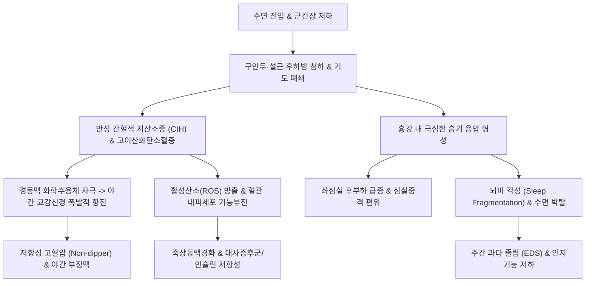

# 😴 폐쇄성 수면무호흡증 (Obstructive Sleep Apnea, OSA)

> **핵심 3줄 요약 (Key Summary)**:
> - 📍 병소 부위 & 해부·병태생리: 수면 중 구인두(Oropharynx) 및 인두 기도의 유연한 근육성 관이 음압에 의해 반복적으로 허탈(Collapse)되어 발생하는 만성 상기도 폐쇄 질환으로, 만성 간헐적 저산소증(Chronic Intermittent Hypoxia)과 수면 분절을 초래함.
> - 🚩 전형적 임상 양상: 습관성 코골이, 목격된 무호흡(Gasping), 과도한 주간 졸림증(EDS), 기상 시 두통 및 구강 건조, 야간뇨, 난치성 고혈압 및 대사증후군 동반.
> - 🛠️ 핵심 검사 & 치료 전략: 표준 야간 수면다원검사(PSG, AHI ≥ 5회/시간 + 증상 또는 AHI ≥ 15회/시간)로 확진; 양방 표준은 지속기도양압기(CPAP) 및 구강내 하악전진장치(MAD); 한의학적으로 비허습담(脾虛濕痰)·담어호결(痰瘀互結) 변증 하에 [[도담탕]], [[방풍통성산]], [[온담탕]] 투여 및 설골하근군·경추 추나요법과 염천·인영 자침 병용.
> - ⚠️ 응급 의뢰 레드플래그: 주간 운전 중 수면 발작(치명적 교통사고 위험), 중증 저산소혈증(최저 SpO2 < 70%), 야간 악성 부정맥 및 심실 빈맥, 조절되지 않는 저항성 악성 고혈압.

---

## 📌 목차
1. [질환 개요 & 해부학적 병태생리](#1-질환-개요--해부학적-병태생리)
2. [병태생리 메커니즘 & 생체역학적 악순환 네트워크](#2-병태생리-메커니즘--생체역학적-악순환-네트워크)
3. [임상 증상 & 이학적 검사(Physical Exam) 알고리즘](#3-임상-증상--이학적-검사physical-exam-알고리즘)
4. [감별 진단 매트릭스 (Differential Diagnosis)](#4-감별-진단-매트릭스--differential-diagnosis)
5. [한의 통합 치료 프로토콜 (침·약침·추나·한약)](#5-한의-통합-치료-프로토콜-침약침추나한약)
6. [양방 치료 & 병용·의뢰 기준 (Conventional Treatment & Referral)](#6-양방-치료--병용의뢰-기준-conventional-treatment--referral)
7. [재활 운동 & 생활습관 티칭 가이드](#7-재활-운동--생활습관-티칭-가이드)
8. [💡 사용자 진료실 핵심 필기 & 임상 노하우 (Melt-In 잔여 심화 집약)](#8--사용자-진료실-핵심-필기--임상-노하우--melt-in-잔여-심화-집약)
9. [출처 및 학술 참고 문헌 (References)](#9-출처-및-학술-참고-문헌--references)

---

## 1. 질환 개요 & 해부학적 병태생리

* **질환의 정의**:
  * 폐쇄성 수면무호흡증(Obstructive Sleep Apnea, OSA)은 수면 중 상기도 확장근의 긴장도 저하 및 해부학적 협착으로 인해 구인두 및 후두인두 부위 기도가 반복적으로 부분 폐쇄(저호흡) 또는 완전 폐쇄(무호흡)되는 만성 호흡 장애 질환이다.
  * 반복적인 폐쇄는 **만성 간헐적 저산소증(CIH, Chronic Intermittent Hypoxia)**과 고이산화탄소혈증, 빈번한 미세 뇌파 각성(Arousal)에 의한 **수면 분절(Sleep fragmentation)**을 초래하여 심혈관계, 뇌신경계, 내분비계 전신 합병증을 유발한다.

* **호발 해부학적 구조와 상기도 붕괴 역학**:
  * **구인두(Oropharynx) 및 벨로인두(Velopharynx)**: 연구개(Soft palate)와 구개수(Uvula), 구개편도가 후방 인두벽과 밀착하여 폐쇄 발생.
  * **설인두(Glossopharynx)**: 수면 중 혀뿌리(Tongue base, 이설근 부위)가 후하방으로 떨어지면서 후두개와 인두강을 압박.
  * **스타링 저항 모델(Starling Resistor)**: 인두는 골성 지지가 없는 연부조직 관이므로 기도를 둘러싼 외압(임계 폐쇄압, Critical closing pressure, Pcrit)이 음압인 흡기 기류압을 초과할 때 기도가 허탈된다. 정상인은 Pcrit < -5 cmH2O이나, 비만 및 해부학적 이상 환자는 Pcrit > 0 cmH2O(양압)로 역전되어 사소한 흡기에도 기도가 쉽게 붕괴된다.

* **두경부 근골격계와 설골하근군의 생체역학적 연계**:
  * **전방 머리 자세(Forward Head Posture, 거북목)**: 두경부가 전방으로 편위되면 설골하근군([[흉골갑상근]], 흉골설골근, 견갑설골근)이 과도하게 신장·단축되어 [[설골]]을 후하방으로 견인한다.
  * 견인된 설골은 혀 기저부를 인두강 안쪽으로 깊숙이 밀어 넣어 기도의 전후 직경을 30~40% 협착시키고 무호흡을 기하급수적으로 악화시킨다.

---

## 2. 병태생리 메커니즘 & 생체역학적 악순환 네트워크

* **만성 간헐적 저산소증(CIH)과 심혈관 손상 캐스케이드**:
  * 반복적인 산소포화도 급락과 재산소화(Reoxygenation) 주기는 허혈-재관류 손상과 유사한 산화 스트레스(ROS)를 대량 생성한다.
  * 혈관 내피세포의 산화질소(NO) 생체이용률이 급감하고 염증성 사이토카인(TNF-α, IL-6, CRP)이 증가하여 죽상동맥경화가 가속화된다.
  * 야간에 폭발하는 카테콜아민 분비는 정상적인 야간 혈압 강하(Nocturnal dipping)를 소실시켜 **저항성 고혈압(Resistant hypertension)**과 좌심실 비대를 유발한다.

* **흉강 내 강한 음압 형성과 혈역학적 부하**:
  * 닫힌 기도를 열기 위해 횡격막과 흉벽 근육이 수축하면서 흉강 내압이 -60~-80 cmH2O까지 급락한다.
  * 이로 인해 심장 좌심실벽의 투벽압(Transmural pressure)과 후부하가 급증하여 심근 산소요구량이 증가하며, 우심 정맥 환류 증가로 심실중격이 좌심실강 쪽으로 밀려 심박출량이 일시적으로 감소한다.

---

## 3. 임상 증상 & 이학적 검사(Physical Exam) 알고리즘

* **전형적 3대 임상 양상**:
  1. **야간 호흡 징후**: 격렬한 습관성 코골이, 갑작스러운 호흡 정지 후 컥컥거림(Choking/Gasping), 수면 중 뒤척임 및 잦은 각성, 야간 다뇨(야간 심방성 나트륨이뇨펩티드 ANP 분비 증가).
  2. **주간 신경인지 징후**: 아침 두통(야간 고이산화탄소혈증에 의한 뇌혈관 확장), 구강 건조, 심각한 주간 과다 졸림증(EDS), 집중력 저하, 기분 장애.
  3. **전신 동반 질환**: 체중 증가, 약물에 반응하지 않는 본태성 고혈압, 제2형 당뇨병, 발기부전.

* **이학적 검사 및 위험도 선별 척도**:
  * **말람파티 점수(Mallampati Score)**: 환자가 혀를 내밀지 않은 상태에서 구인두 개구도 확인:
    * Class III: 연하부와 연구개 기저부만 시진됨.
    * Class IV: 경구개만 시진되고 연구개 및 목젖이 완전히 가려짐 (OSA 초고위험).
  * **STOP-Bang 선별 설문**: Snoring(코골이), Tired(주간 피로), Observed(목격된 무호흡), Blood pressure(고혈압), BMI > 35, Age > 50, Neck circumference(목둘레 남 > 40cm, 여 > 35cm), Gender(남성). 8문항 중 3점 이상 시 중등도 이상 위험.
  * **앱워스 졸림증 척도(ESS, Epworth Sleepiness Scale)**: 8개 일상 상황에서의 졸림 점수 합산 ($0\sim24$점, $\ge 11$점 이상 시 병적 주간 졸림증).

* **표준 진단 기준 (야간 수면다원검사, In-Lab PSG)**:
  * 무호흡-저호흡 지수(Apnea-Hypopnea Index, AHI): 시간당 무호흡과 저호흡의 총합.
  * **진단 확진**:
    * $	ext{AHI} \ge 5	ext{회/시간}$이면서 주간 졸림, 코골이, 야간 질식감, 고혈압 등이 동반되는 경우.
    * 증상 유무와 무관하게 $	ext{AHI} \ge 15	ext{회/시간}$인 경우.
  * **중증도 분류**: 경증($5\le 	ext{AHI} < 15$), 중등도($15\le 	ext{AHI} < 30$), 중증($	ext{AHI} \ge 30$).

---

## 4. 감별 진단 매트릭스 (Differential Diagnosis)

| 감별 질환 | 호흡 노력(Thoracoabdominal Effort) | AHI / PSG 특징 | 주요 원인 및 감별점 | 주간 증상 |
| :--- | :--- | :--- | :--- | :--- |
| **폐쇄성 수면무호흡증 (OSA)** | **호흡 노력 유지됨 (흉복부 역행 운동)** | **폐쇄성 무호흡/저호흡 우세, 산소 급락** | **비만, 상기도 해부학적 협착, 설근 비대** | **습관성 코골이, 심한 주간 졸림증** |
| **중추성 수면무호흡증 (CSA)** | **호흡 노력 완전 소실 (흉복부 평탄)** | 중추성 무호흡 우세, 체인-스톡스 호흡 동반 | 뇌간 호흡중추 손상, 울혈성 심부전, 뇌졸중 | 코골이 적음, 야간 잦은 각성, 불면증 호소 |
| **비만저환기증후군 (OHS)** | 호흡 노력 유지되나 전반적 저하 | 주간 안정 시 동맥혈 $	ext{PaCO}_2 \ge 45	ext{ mmHg}$ | 고도비만($	ext{BMI}\ge 30$), 흉벽 유응도 저하 | 청색증, 심한 주간 과탄산혈증, 다혈구증 |
| **상기도저항증후군 (UARS)** | 호흡 노력 현저히 증가 | $	ext{AHI} < 5$, RERA(호흡노력관련각성) 다발 | 상기도 미세 협착으로 뇌파 각성 빈번 | 마른 체형 여성 흔함, 피로감, 저혈압 경향 |
| **기면증 (Narcolepsy)** | 정상 호흡 소견 | 다중수면잠복기검사(MSLT) 평균잠복기 $\le 8$분 | 히포크레틴(오렉신) 결핍, 탈력발작(Cataplexy) | 수면마비(가위눌림), 입면환각, 웃을 때 탈력 |

---

## 5. 한의 통합 치료 프로토콜 (침·약침·추나·한약)

* **진료 원칙 및 병기 이해**:
  * 한의학에서 OSA는 **비한(鼻鼾)**, **수면호흡잠정(睡眠呼吸暫停)**, **기와(嗜臥)·다매(多寐)**의 범주이다.
  * 비만과 기허(氣虛)로 인한 습담(濕痰)이 상기도에 쌓여 기도를 폐쇄하는 **비허습담(脾虛濕痰)**과, 만성 저산소증으로 혈행이 정체되어 혈관 합병증을 유발하는 **담어호결(痰瘀互結)**이 핵심 병태이다.

* **침구 치료 프로토콜**:
  * **설골 및 상기도 확장 국소혈**:
    * **[[염천]](CV23)**: 설골 상연 중앙 함요처에서 혀뿌리 방향으로 $1\sim1.5$촌 사자하여 설하신경(CN XII) 및 이설근(Genioglossus) 수축을 유도.
    * **[[인영]](ST9)**: 갑상연골 상연 외방 1.5촌, 총경동맥 박동부. 경동맥동 화학수용체 및 경부 혈류 순환 개선.
    * **[[천돌]](CV22)**: 흉골병 상연에서 하방으로 완만하게 $1$촌 사자하여 기관 전벽 근막 이완.
  * **원위 담음 및 혈액순환 배혈**:
    * **[[풍륭]](ST40)**: 전신 담음(痰飮) 배출.
    * **[[족삼리]](ST36)**, **[[음릉천]](SP9)**: 비위 건운 및 수습 배출.
    * **[[혈해]](SP10)**, **[[삼음교]](SP6)**: 혈액순환 개선 및 혈관 내피세포 염증 조절.

* **추나 치료 프로토콜 (경추-설골 근막 추나)**:
  * **후두하근군(Suboccipital muscles) 근막 이완 기법**: 대후두직근과 상두사근의 과긴장을 접촉 견인하여 후두골-경추 분절 아탈구를 교정하고 상부 경추 전방 편위를 정상화.
  * **설골하근군(Infrahyoid release) 이완술**: 단축된 흉골설골근 및 견갑설골근을 횡방향으로 부드럽게 이완하여 하방 견인된 설골을 거상, 혀뿌리의 인두강 침하를 역학적으로 해제.

* **변증별 한약 처방**:
  * **비허습담형 (脾虛濕痰 - 복부 비만, 코골이, 주간 졸림, 설태백니, 맥활)**:
    * 처방: **[[도담탕]](導痰湯)** 합 **[[방풍통성산]](防風通聖散)**.
    * 작용: 상기도 점막 부종과 끈적한 가래를 제거하고 복부 내장지방을 감량하여 횡격막 호흡 운동을 원활하게 함.
  * **담어호결형 (痰瘀互結 - 만성 무호흡, 조절 불량 고혈압, 협심증 동반, 설암어반, 맥활삽)**:
    * 처방: **[[온담탕]](溫膽湯)** 합 **[[혈부축어탕]](血府逐瘀湯)**.
    * 작용: 흉격 담열을 해소하고 전신 미세혈관 혈전을 억제하며 교감신경 흥분을 진정시킴.
  * **기허불섭형 (氣虛不攝 - 마른 체형 고령자, 인두 확장근 무력증, 설담, 맥완약)**:
    * 처방: **[[보중익기탕]](補中益氣湯)** 가 감초, 승마 증량.
    * 작용: 중초 기운을 끌어올려 상기도 확장근의 신경근 긴장도를 강화.

---

## 6. 양방 치료 & 병용·의뢰 기준 (Conventional Treatment & Referral)

* **양방 표준 치료 요법**:
  1. **지속기도양압기 (CPAP: Continuous Positive Airway Pressure, 1차 표준 치료)**:
     * 마스크를 통해 수면 중 양압 공기를 불어넣어 인두 기도를 물리적으로 지지하는 **공기 부목(Pneumatic splint)** 역할.
     * 중등도~중증 OSA($	ext{AHI}\ge 15$) 및 심혈관 질환 동반 환자의 1차 선택. AHI 정상화, 혈압 2~4 mmHg 하강 입증.
     * 순응도 기준: 하루 4시간 이상, 전체 일수의 70% 이상 착용.
  2. **구강 내 장치 (MAD, Mandibular Advancement Device)**:
     * 하악(아래턱)을 전방으로 5~10mm 전진 고정하여 설근을 전방으로 견인, 후인두 기도 공간을 확장.
     * 경·중등도 OSA, 앙와위 의존형 환자, CPAP 거부 환자에서 우수한 대안.
  3. **외과적 수술 치료**:
     * 구개수인인두성형술(UPPP): 비대한 편도와 구개수 일부 절제.
     * 설골 현수술(Hyoid suspension) 및 하악전진술(MMA): 골격 구조 확장이 필요한 중증 환자.

* **한의 병용 판단 및 관리**:
  * CPAP을 착용 중인 환자에서 비강 건조, 마스크 착용 불편감으로 순응도가 떨어질 때 한약(도담탕, 방풍통성산)과 추나요법을 병용하면 기도 저항과 임계 폐쇄압(Pcrit)이 낮아져 양압기 요구 압력이 줄어들고 순응도가 현저히 상승함.
  * 중추신경계 진정 수면제(벤조디아제핀, 졸피뎀 등)는 상기도 근긴장도를 떨어뜨리고 각성 역치를 높여 치명적 무호흡을 연장시키므로 한방 진료 시 양방 수면제 병용 여부를 반드시 확인하고 감량을 유도해야 함.

* **양방·전문과 응급 의뢰 기준 (Referral Criteria)**:
  * 🚨 **즉각적인 수면클리닉 및 3차 상급병원 전원 레드플래그**:
    1. 주간 운전 중 깜빡 졸아 사고를 낼 뻔한 심각한 주간 졸림증 환자.
    2. 동맥혈 산소포화도가 야간 수면 중 70% 이하로 급락하거나 심실성 부정맥(V-tach, 심방세동)이 동반된 환자.
    3. 3종 이상의 고혈압 약제 복용에도 혈압이 160/100 mmHg 이상 유지되는 저항성 고혈압 환자.

---

## 7. 재활 운동 & 생활습관 티칭 가이드

* **체중 감량 (Weight Loss, 최우선 치료)**:
  * 체중을 10% 감량하면 AHI가 평균 26% 감소하며, 경증 OSA 환자의 상당수는 정상 범위로 호전됨.
  * 저염식, 저탄수화물 식단과 주 150분 이상의 중강도 유산소 운동 티칭.

* **체위 수면 요법 (Positional Therapy)**:
  * 바로 누워 자면 중력에 의해 혀와 연구개가 후하방으로 떨어져 기도 폐쇄가 2~3배 악화됨.
  * **측와위(옆으로 눕기) 수면 지도**: 옆으로 잘 수 있도록 높이가 맞는 경추 베개를 사용하고, 등 뒤에 쿠션을 받치거나 잠옷 등 뒤에 테니스공을 부착하는 체위 교정법 지도.

* **구강인두 근기능 운동 (Myofunctional Therapy, 혀·인두 강화 운동)**:
  * 혀끝을 경구개 앞쪽에 대고 뒤로 밀기, 입천장 훑기, 볼 부풀리기, 모음 발음 훈련을 하루 20분씩 시행하여 인두 확장근과 이설근 근력을 강화.

* **금주 및 금연, 야식 금지**:
  * 취침 전 음주는 이설근을 마비시켜 단순 코골이를 중증 무호흡으로 전환시키므로 취침 전 최소 4시간 이내 음주 엄금.
  * 흡연은 상기도 점막 부종을 유발하므로 금연 필수.

---

## 8. 💡 사용자 진료실 핵심 필기 & 임상 노하우 (Melt-In 잔여 심화 집약)

* **비오님 진료실 핵심 필기 & 원문 집약**:
  1. "한의원에 내원하는 수면무호흡증 환자의 80% 이상은 복부 비만과 목 둘레가 두꺼운 전형적인 태음인 습담(濕痰)형 환자이다."
  2. "양압기(CPAP)를 처방받았으나 마스크 압박감과 비강 건조로 장롱에 처박아둔 환자가 태반이다. 이들에게 방풍통성산이나 도담탕으로 복부 내장지방과 경부 연부조직 부종을 빼주면서, 주 2회 경추-설골 근막 추나와 염천혈 사자를 병행하면 기도 단면적이 넓어져 AHI와 주간 피로가 극적으로 호전된다."
  3. "혈압약 3~4개를 먹어도 아침 혈압이 150을 넘는 저항성 고혈압 환자는 80% 이상이 무증상 OSA를 동반하고 있다(Non-dipper). 고혈압 환자가 아침 두통이나 야간뇨를 호소하면 단순 뇌혈류 문제로 넘기지 말고 반드시 수면무호흡증을 스크리닝해야 한다."

---

## 9. 출처 및 학술 참고 문헌 (References)

- Fabozzi A et al. (2027). Oxygen, carbon dioxide, and nitric oxide: role in the pathophysiology of obstructive sleep apnea. *Med Gas Res*. 17(1):285-300. PMID: 42734464.

- Hedayatpour MJ et al. (2027). Developmental myelination deficits and impaired fine motor function in a mouse model of pediatric obstructive sleep apnea. *Exp Neurol*. 407():115991. PMID: 42710774.

- Lu K et al. (2026). Possible cross-talk between sarcopenia and obstructive sleep apnea revealed by WGCNA analysis and machine learning. *Aging Male*. 29(1):2640269. PMID: 41784220.\n