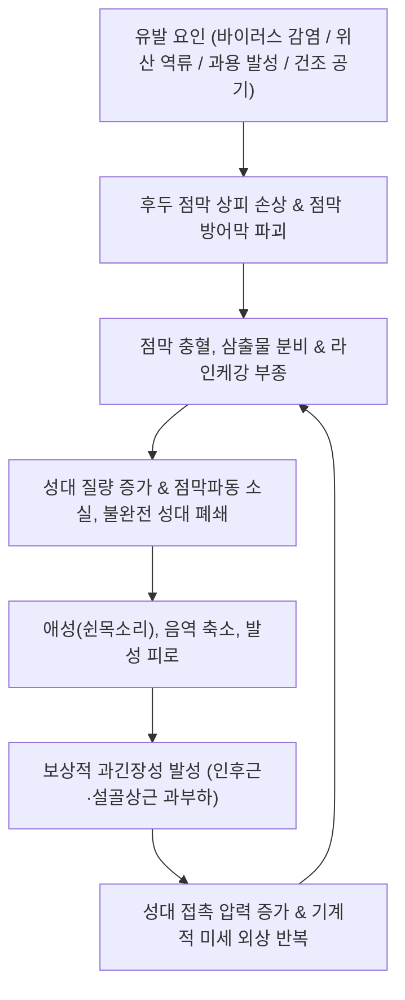

# 🩺 후두염 (Laryngitis)

> **핵심 3줄 요약 (Key Summary)**:
> - 📍 병소 부위 & 해부·병태생리: 후두 점막·점막하층 및 진성대(True vocal cords)의 급·만성 염증으로, 점막 부종 및 점막고유층(Superficial lamina propria)의 진동 장애로 인해 성대 접촉 불완전과 애성(쉰목소리)이 발생함.
> - 🚩 전형적 임상 양상: 애성(Dysphonia/Hoarseness), 인후 이물감(Globus), 건성 기침, 목의 통증 및 발성 피로; 소아의 경우 컹컹거리는 개 짖는 듯한 기침(Barking cough) 및 흡기성 협착음(Stridor)을 동반하는 성문하 후두염(크룹) 양상.
> - 🛠️ 핵심 검사 & 치료 전략: 후두내시경(Laryngoscopy) 및 스트로보스코피로 성대 부종, 충혈, 궤양, 결절 감별; 양방 대증요법(발성 휴식, 소염진통제, LPR 환자 PPI/P-CAB 투여, 크룹 시 덱사메타손/에피네프린 분무); 한의학적으로 풍열/풍한 외감 및 담음, 음허 변증 하에 [[갈근탕]], [[은교산]], [[반하후박탕]], [[맥문동탕]] 투여 및 천돌·염천·열결 자침.
> - ⚠️ 응급 의뢰 레드플래그: 흡기성 협착음 및 흉골상부 함몰 호흡(급성 크룹/후두개염 기도 폐쇄), 고열과 연하곤란 및 침흘림(급성 후두개염), 3주 이상 지속되는 애성(후두암/성대 악성 병변 배제 필수).

---

## 📌 목차
1. [질환 개요 & 해부학적 병태생리](#1-질환-개요--해부학적-병태생리)
2. [병태생리 메커니즘 & 생체역학적 악순환 네트워크](#2-병태생리-메커니즘--생체역학적-악순환-네트워크)
3. [임상 증상 & 이학적 검사(Physical Exam) 알고리즘](#3-임상-증상--이학적-검사physical-exam-알고리즘)
4. [감별 진단 매트릭스 (Differential Diagnosis)](#4-감별-진단-매트릭스--differential-diagnosis)
5. [한의 통합 치료 프로토콜 (침·약침·추나·한약)](#5-한의-통합-치료-프로토콜-침약침추나한약)
6. [양방 치료 & 병용·의뢰 기준 (Conventional Treatment & Referral)](#6-양방-치료--병용의뢰-기준-conventional-treatment--referral)
7. [재활 운동 & 생활습관 티칭 가이드](#7-재활-운동--생활습관-티칭-가이드)
8. [💡 사용자 진료실 핵심 필기 & 임상 노하우 (Melt-In 잔여 심화 집약)](#8--사용자-진료실-핵심-필기--임상-노하우--melt-in-잔여-심화-집약)
9. [출처 및 학술 참고 문헌 (References)](#9-출처-및-학술-참고-문헌--references)

---

## 1. 질환 개요 & 해부학적 병태생리

* **질환의 정의 및 임상 분류**:
  * 후두염(Laryngitis)은 후두 점막 및 점막하층에 발생하는 염증성 질환군이다. 성대 진동의 비대칭 및 불규칙으로 인한 **애성(Dysphonia, 목쉼)**이 핵심 주소증이며, 인후 건조감, 이물감, 기침, 발성통을 동반한다.
  * **경과에 따른 분류**:
    * **급성 후두염(Acute Laryngitis)**: 상기도 감염(감기, 인두염) 후 급격히 발생하는 3주 미만의 일과성 염증.
    * **만성 후두염(Chronic Laryngitis)**: 3주 이상 지속되는 염증으로, 음성 과용, 흡연, 위식도/인후두 역류질환(LPR) 등이 주요 원인.
  * **침범 부위 및 원인별 분류**:
    * **감염성 후두염**: 리노바이러스, 인플루엔자 등 바이러스성이 90% 이상이며, 세균성 이차 감염 동반 가능.
    * **역류성 인후두염(LPRD, Laryngopharyngeal Reflux Disease)**: 위산과 펩신이 후두 점막(특히 피열간부, Interarytenoid area)을 화학적으로 자극.
    * **급성 성문하 후두염(크룹, Croup)**: 주로 영유아에서 파라인플루엔자 바이러스 감염으로 성문하부(Subglottis)가 부어올라 기도 협착을 유발.

* **관련 해부학적 구조와 발성 역학**:
  * **연골 골격**: [[갑상연골]](Thyroid cartilage), [[윤상연골]](Cricoid cartilage), 피열연골(Arytenoid cartilage)이 관절을 이루며 성대의 긴장과 개폐를 조절함.
  * **성대의 조직학적 층 구조**: 성대 상피 아래의 **점막고유층 천층(Superficial lamina propria, Reinke's space)**은 유연한 젤리 같은 구조로 공기 역학적 점막 파동(Mucosal wave)을 형성함. 염증 시 라인케 강에 체액이 저류되어 부종이 생기면 질량이 증가하고 점막 파동이 소실되어 저음성의 쉰목소리가 발생함.
  * **신경 지배**: 미주신경(CN X) 가지인 **[[상후두신경]](Superior laryngeal nerve)**(윤상갑상근 지배, 음도 조절)과 **[[반회후두신경]](Recurrent laryngeal nerve)**(후두 내재근 대부분 지배, 성대 개폐 조절)이 정밀하게 협응함.

---

## 2. 병태생리 메커니즘 & 생체역학적 악순환 네트워크

* **점막 부종과 발성 공기역학 장애**:
  * 후두 점막의 염증 반응은 히스타민, 브라디키닌, 프로스타글란딘을 방출하여 모세혈관 투과성을 증가시키고 진성대 점막하층의 심한 부종을 유발한다.
  * 부종으로 인해 성대가 두꺼워지고 뻣뻣해지면 발성에 필요한 최소 호흡 압력(발성역치압력, Phonation threshold pressure)이 급증한다. 환자는 소리를 내기 위해 무의식적으로 더 강한 흉강 압력과 경부 근육 긴장을 동원하게 된다.

* **보상적 근긴장성 발성장애(Muscle Tension Dysphonia, MTD) 악순환**:
  * 염증으로 쉰 목소리가 나면 환자는 목에 힘을 주어 억지로 발성하려 한다.
  * 이로 인해 흉쇄유돌근, 설골상근군, 후두 외재근이 과도하게 단축되어 후두를 상방으로 거상시키며, 성대 유리연의 기계적 마찰 충격이 가중되어 점막 출혈, 궤양, 결절로 악화되는 악순환이 고착된다.

---

## 3. 임상 증상 & 이학적 검사(Physical Exam) 알고리즘

* **전형적 임상 증상**:
  1. **음성 변화**: 애성(Hoarseness), 거친 숨소리 섞인 음성(Breathy voice), 발성 시 음역 축소, 고음 발성 불가.
  2. **국소 불쾌감**: 목의 건조감, 칼칼한 인후통, 목구멍에 무엇인가 걸려 있는 듯한 이물감(Globus pharyngeus), 잦은 헛기침(Throat clearing).
  3. **기침 및 호흡 증상**: 마른기침, 후비루 느낌; 소아의 경우 야간에 악화되는 개 짖는 듯한 컹컹거리는 기침(Seal bark-like cough).

* **이학적 검사 및 진단 도구**:
  * **경성/연성 후두내시경(Laryngoscopy, 진단 표준)**:
    * 진성대 유리연의 충혈, 미만성 부종, 투명하거나 점액성의 분비물 확인.
    * 만성 역류성(LPR)의 경우 피열간부 점막 비후(Pachydermia laryngis), 후두 후방 홍반, 성대하 부종(Pseudo-sulcus vocalis) 관찰.
  * **후두 스트로보스코피(Stroboscopy)**: 발성 시 성대 점막 파동의 대칭성, 규칙성, 성문 폐쇄 부전 여부를 평가하여 단순 염증과 기질적 성대 결절/폴립/암종을 감별.
  * **경부 촉진**: 갑상연골과 설골 주변 근막의 압통, 설골상근군의 긴장도, 경부 림프절 종대 유무 촉진.

---

## 4. 감별 진단 매트릭스 (Differential Diagnosis)

| 감별 질환 | 호발 연령 및 병인 | 특징적 임상 양상 | 후두내시경 소견 | 감별 핵심 포인트 |
| :--- | :--- | :--- | :--- | :--- |
| **급성 후두염** | 전 연령, 바이러스 상기도 감염 | 1~2주 내의 애성, 인후통, 발열 | 진성대의 미만성 발적 및 부종 | 감기 전후 급격 발생, 보존적 치료로 자연 관해 |
| **역류성 인후두염 (LPR)** | 성인, 위산·펩신 역류 | **아침 애성**, 지속적 이물감(Globus), 잦은 헛기침 | **피열간 점막 비후**, 후두 후벽 발적 | 가슴쓰림 없을 수 있음, 야간 악화 패턴 |
| **급성 성문하 후두염 (크룹)** | 6개월~3세 소아, 파라인플루엔자 | **개 짖는 기침**, 흡기성 협착음, 야간 호흡곤란 | 성문하부 점막 부종 (경부 X선 탑상 징후 Steeple sign) | 소아 야간 급성 기도 협착 응급 질환 |
| **급성 후두개염** | 소아 및 성인, 세균 감염(Hib 등) | **고열, 연하통, 침흘림(Drooling), 전경 자세** | **체리빛으로 팽대된 후두개 종창** | **절대 응급 기도 확보 질환, 설압자 확인 금기** |
| **성대 결절 / 폴립** | 교사, 가수 등 음성 과용자 | 만성적 지속성 애성, 음성 피로 | 성대 전·중 1/3 경계부 양측성(결절) 또는 일측성(폴립) 융기 | 기질적 점막 융기, 음성 치료 또는 미세수술 필요 |
| **후두암 (Laryngeal Ca)** | 50대 이상 흡연 남성 | **3주 이상 지속·악화되는 애성**, 체중 감소 | 성대 표면의 궤양성, 외향성 백색 종괴 | **3주 규칙, 조직 생검 필수** |

---

## 5. 한의 통합 치료 프로토콜 (침·약침·추나·한약)

* **진료 원칙 및 한의 병기**:
  * 한의학에서 후두염은 **후비(喉痺)**, **음아(瘖啞)**, **실음(失音)**의 범주이다.
  * 급성은 풍열(風熱) 또는 풍한(風寒) 외감 사기가 인후에 울결된 것이며, 만성은 폐음허(肺陰虛), 신음허(腎陰虛)로 허화(虛火)가 상염하거나 담음(痰飮)이 인후를 막아 발생한다.

* **침구 치료 프로토콜**:
  * **인후 및 후두 국소 순환혈**:
    * **[[천돌]](CV22)**: 흉골병 상연에서 흉골 후방으로 $0.5\sim1$촌 완만하게 사자하여 기관 및 후두 전벽 근막을 이완 (천자 각도 엄수).
    * **[[염천]](CV23)**: 설골 상연 중앙에서 설근 방향으로 사자하여 설인신경 및 후두 내재근 반사 개선.
  * **폐경 및 경부 원위 배혈**:
    * **[[열결]](LU7)**, **[[조해]](KI6)**: 팔맥교회혈 배합으로 인후부 음기 보충 및 개규(開竅).
    * **[[척택]](LU5)**, **[[어제]](LU10)**: 폐열(肺熱)을 끄고 성대 염증을 신속 완화.
    * **[[합곡]](LI4)**, **[[소상]](LU11)**: 급성 인후통 시 소상 점자출혈로 열독 배출.

* **추나 치료 프로토콜 (경추 및 설골 근막 이완)**:
  * 앙와위에서 경추를 중립으로 두고 후두하근군과 흉쇄유돌근, 견갑거근의 경결점을 부드럽게 지압 이완.
  * 설골상근군(악이복근, 경돌설골근)을 접촉 견인하여 상방으로 과긴장된 후두 복합체를 하강 유도함으로써 후두 내 압박을 해소.

* **변증별 한약 처방**:
  * **외감풍열형 (風熱型 - 급성기 인후통, 발열, 애성, 설변첨홍, 맥부삭)**:
    * 처방: **[[은교산]](銀翹散)** 합 **[[갈근탕]](葛根湯)** 가미.
    * 작용: 소염, 해열, 상기도 점막 충혈 제거.
  * **담탁응체·기체형 (痰濁氣滯 - 만성 역류성 LPR, 인후 이물감, 잦은 헛기침, 설태백니, 맥현활)**:
    * 처방: **[[반하후박탕]](半夏厚朴湯)** 합 **[[향사양위탕]](香砂養胃湯)**.
    * 작용: 매핵기(梅核氣) 해소, 위식도 역류 억제 및 위장관 배출능 촉진.
  * **폐신음허형 (肺腎陰虛 - 만성 과용, 오후 목마름, 쉰목소리 지속, 설홍소태, 맥세삭)**:
    * 처방: **[[맥문동탕]](麥門冬湯)** 합 백합고금탕(百合固金湯).
    * 작용: 인후 점막의 진액(津液)을 보충하고 성대 윤활작용을 회복.

---

## 6. 양방 치료 & 병용·의뢰 기준 (Conventional Treatment & Referral)

* **원인별 양방 표준 치료**:
  1. **급성 바이러스성 후두염**:
     * 항생제는 불필요하며 대증요법 위주. 아세트아미노펜 또는 NSAIDs로 통증과 열 조절.
     * **엄격한 음성 휴식(Voice rest)**과 실내 습도 유지(가습기).
  2. **역류성 인후두염(LPR)**:
     * 프로톤펌프억제제(PPI, 예: Esomeprazole 20~40mg bid) 또는 칼륨경쟁적위산분비차단제(P-CAB, Tegoprazan 50mg) 8~12주 투여.
  3. **소아 급성 성문하 후두염 (크룹)**:
     * 기도 부종을 줄이기 위해 경구 또는 근주 **덱사메타손(Dexamethasone, 0.15~0.6 mg/kg 단회 투여)**.
     * 중등도 이상 호흡곤란 시 흡입용 네뷸라이저 에피네프린(L-epinephrine/Racemic epinephrine) 응급 분무.
  4. **외과적 치료 (LMS, 후두미세수술)**:
     * 만성 후두염에 동반된 성대 폴립, 백반증(Leukoplakia), 궤양 조직 생검 및 절제.

* **한의 병용 치료 가이드**:
  * 양방 역류성 후두염 환자에서 PPI 장기 복용으로 인한 소화불량 및 흡수 장애가 발생할 때 반하후박탕과 향사양위탕을 병용하면 하부식도괄약근 압력을 높이고 위 배출능을 촉진하여 위산 억제제 감량과 역류 억제 시너지를 발휘함.
  * 교사, 상담사 등 음성 과용 직업군의 만성 후두염 환자는 침구 치료(천돌, 염천, 어제)와 음성 위생 티칭을 병용하면 성대 점막 부종을 신속히 안정시킬 수 있음.

* **양방·전문과 응급 의뢰 기준 (Referral Criteria)**:
  * 🚨 **즉각 응급실 및 이비인후과 상급병원 의뢰 레드플래그**:
    1. **소아 크룹/성문하 폐쇄**: 흡기성 협착음(Stridor), 흉골상부/늑간 함몰 호흡, 청색증, 보챔(기도 폐쇄 응급).
    2. **급성 후두개염 의심**: 고열과 함께 침을 삼키지 못해 흘리는 경우(Drooling), 숨을 쉬기 위해 몸을 앞으로 숙이는 전경 자세(Tripod position).
    3. **성인 3주 이상 지속되는 애성 (The 3-Week Rule)**: 후두암, 성대마비, 결핵 등 중증 기질적 병변 감별을 위한 후두경 정밀 검사 필수.

---

## 7. 재활 운동 & 생활습관 티칭 가이드

* **절대적 음성 휴식 및 올바른 발성법**:
  * 급성기에는 가능한 한 말을 하지 않는 것이 가장 좋은 약이다.
  * **속삭이는 소리(Whispering) 절대 금지**: 목소리가 안 나온다고 속삭이면 성대 앞쪽이 강하게 압착되어 일반 발성보다 성대에 2~3배 더 큰 기계적 부담을 준다. 말을 해야 한다면 편안하고 낮은 톤으로 짧게 말하도록 지도한다.

* **성대 수분 공급 (Vocal Hydration)**:
  * 성대 점막 파동의 윤활을 위해 미온수를 하루 1.5~2L 자주 마신다.
  * 카페인 음료, 녹차, 탄산음료는 이뇨작용으로 성대 점막을 건조하게 하므로 피한다.

* **역류 방지 생활습관 (LPR 환자 필수)**:
  * 취침 3시간 전 야식, 과식, 알코올 섭취 엄금.
  * 취침 시 베개나 상체 각도를 15도 정도 높여 위산 역류를 차단.

* **목 스트레칭 및 횡격막 호흡 훈련**:
  * 턱을 뒤로 당기는 친턱(Chin-tuck) 운동으로 전방 경추 편위를 교정.
  * 흉식 호흡 대신 복식(횡격막) 호흡을 훈련하여 후두 외재근에 걸리는 과도한 긴장을 해소.

---

## 8. 💡 사용자 진료실 핵심 필기 & 임상 노하우 (Melt-In 잔여 심화 집약)

* **비오님 진료실 1초 진단 & 치료 노하우**:
  1. **"3주 규칙(The 3-Week Rule)"**: "감기 뒤끝에 목이 쉬었다고 온 환자가 3주가 넘도록 애성이 지속된다면, 절대 단순 후두염으로 단정하고 한약만 주어서는 안 된다. 특히 흡연력이 있는 50대 이상 남성은 후두암이나 성대 악성 종괴를 배제하기 위해 당장 이비인후과 후두내시경을 의뢰해야 한다."
  2. **"소아 크룹은 골든타임의 싸움"**: "야간에 아이가 개 짖는 듯한 컹컹거리는 기침(Barking cough)을 하고 숨을 들이쉴 때 쌕쌕거리는 협착음(Stridor)이 들리면, 한의원에서 지체하지 말고 즉시 대학병원 응급실로 전원시켜 덱사메타손과 에피네프린 분무 치료를 받게 해야 기도 폐쇄 질식을 막는다."
  3. **"아침에 목이 잠기는 환자는 위장부터 고쳐라"**: "낮에는 괜찮은데 유독 아침에 일어났을 때 목이 잠기고 헛기침을 반복하며 목에 가래가 낀 느낌(매핵기)이 든다는 환자는 십중팔구 인후두 역류질환(LPR)이다. 이비인후과 약을 먹어도 낫지 않으면 반하후박탕이나 향사양위탕을 처방하고 취침 전 야식 금지를 철저히 티칭해야 완치된다."

---

## 9. 출처 및 학술 참고 문헌 (References)

- Gudla SK et al. (2026). Invasive fungal laryngitis: A rare mimic of laryngeal cancer. *Radiol Case Rep*. 21(12):6027-6030. PMID: 42756684.

- Chang H et al. (2026). Non-acid reflux and reflux laryngitis: new perspectives on mechanism, diagnosis and treatment. *Front Med (Lausanne)*. 13():1949945. PMID: 42936441.

- Xin S et al. (2026). [Wrist-ankle acupuncture in treatment of chronic laryngitis based on "yang transforms qi, yin constitutes form"]. *Zhongguo Zhen Jiu*. 46(9):1521-1525. PMID: 42744641.\n