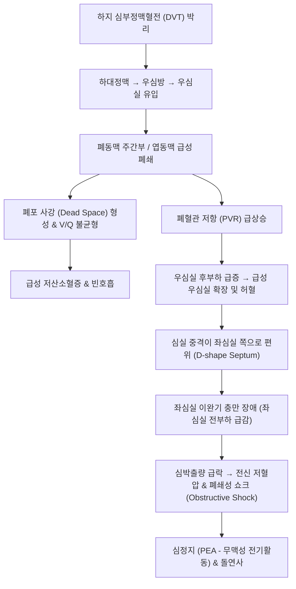

# 🩺 폐색전증 (Pulmonary Embolism, PE)

> **핵심 3줄 요약 (Key Summary)**:
> - 📍 병소 부위 & 해부·병태생리: 하지 또는 골반의 심부정맥혈전(DVT)이 유리되어 대정맥과 우심방/우심실을 거쳐 폐동맥 혈관상을 급성 폐쇄; 폐포 사강(dead space) 증가, 환기-관류 불균형 및 급성 폐혈관 저항 급증에 의한 우심부전(폐성심) 유발.
> - 🚩 전형적 임상 양상: 갑작스러운 원인 불명의 호흡곤란, 흡기 시 악화되는 흉막성 흉통(pleuritic chest pain), 빈호흡(> 20회/분), 빈맥(> 100회/분), 객혈, 하지 부종/동통(DVT 징후), 심인성 실신.
> - 🛠️ 핵심 검사 & 치료 전략: Wells 척도 기반 사전 확률 평가, 연령 보정 D-dimer 검사, 조영증강 흉부 CT 폐동맥조영술(CTPA); 혈역학적 불안정 시 즉각적인 전신 정맥 혈전용해술(tPA) 또는 카테터 중재술(CDT), 안정 시 직접 작용 경구 항응고제(DOAC) 즉각 투여.
> - <font color="#fa7e7e">⚠️ 응급 의뢰 레드플래그: 수축기 혈압 < 90 mmHg (폐쇄성 쇼크), 실신(Syncope), 심정지(PEA arrest), 심한 저산소혈증 발견 즉시 119 구급대를 통한 권역응급의료센터 직송.</font>

---

## 📌 목차
1. [질환 개요 & 해부학적 병태생리](#1-질환-개요--해부학적-병태생리)
2. [병태생리 메커니즘 & 폐쇄성 쇼크 네트워크](#2-병태생리-메커니즘--폐쇄성-쇼크-네트워크)
3. [임상 증상 & 이학적 검사 및 위험도 계층화](#3-임상-증상--이학적-검사-및-위험도-계층화)
4. [감별 진단 매트릭스 (Differential Diagnosis)](#4-감별-진단-매트릭스-differential-diagnosis)
5. [한의학적 변증 & 회복기 항응고 보조 프로토콜](#5-한의학적-변증--회복기-항응고-보조-프로토콜)
6. [양방 치료 & 항응고·혈전용해 기준 (Conventional Treatment & Referral)](#6-양방-치료--항응고혈전용해-기준-conventional-treatment--referral)
7. [환자 관리 & 생활습관 티칭 가이드](#7-환자-관리--생활습관-티칭-가이드)
8. [💡 진료실 핵심 필기 & 임상 노하우 (Melt-In 심화 집약)](#8--진료실-핵심-필기--임상-노하우-melt-in-심화-집약)
9. [출처 및 학술 참고 문헌 (References)](#9-출처-및-학술-참고-문헌-references)

---

## 1. 질환 개요 & 해부학적 병태생리

### 1) 정의 및 역학
**폐색전증(Pulmonary Embolism, PE)** 은 혈전, 공기, 지방, 양수 등의 색전 물질이 정맥계를 순환하여 **폐동맥(Pulmonary artery)** 또는 그 분지를 막아 폐 순환을 급격히 차단하는 심혈관-호흡기계 응급 질환이다.

* **정맥 혈전색전증(VTE)의 연장선**:
  * 90% 이상이 하지의 슬와정맥, 대퇴정맥, 장골정맥 등 **심부정맥혈전증(Deep Vein Thrombosis, DVT)** 에서 유리된 혈전에 기인함.
* **치명률**: 치료받지 않을 경우 사망률이 30%에 달하나, 신속한 조기 진단 및 항응고 요법 시 2~8%로 급감함.

### 2) 비르쇼 3징 (Virchow's Triad)
혈전 형성의 근본적인 3대 병태생리학적 축:
1. **정맥 정체 (Stasis)**: 장기 침상 안정(수술 후, 고관절 골절), 장시간 비행/차량 탑승(이코노미 클래스 증후군), 마비.
2. **혈관내피 손상 (Endothelial injury)**: 정형외과/골반 수술, 외상, 중심정맥관 삽입.
3. **과응고 상태 (Hypercoagulability)**: 악성 종양(Trousseau 증후군), 경구 피임약/호르몬 대체요법, 항인지질항체증후군, 제5인자 라이덴(Factor V Leiden) 변이, 임신 및 산후.

---

![[폐색전증_01_병태도해_폐동맥색전3D.jpg|450]]
> [그림 1: 폐색전증 3D 도해 — 폐동맥을 막은 혈전을 보여주며, 작은 삽화에 다리 정맥에서 떨어져 나온 혈전(심부정맥혈전)의 이동 경로를 함께 표시. — 출처: File:3D Medical Animation still shot Pulmonary Embolism.jpg (Wikimedia Commons)]

![[폐색전증_03_병태_혈전위험인자표.png|450]]
> [그림 3: [표1] 혈전 발생의 위험 인자 — 유전성·후천성·기타 요인으로 나누어 정리한 한국어 표. — 출처: 질병관리청 국가건강정보포털 「심부 정맥 혈전증」 (공공누리 제4유형)]

## 2. 병태생리 메커니즘 & 폐쇄성 쇼크 네트워크



### 1) 혈역학적 파탄 기전 (우심실 부전의 악순환)
* 폐혈관상의 30~50% 이상이 폐쇄되면 폐동맥압이 급상승하여 얇은 벽을 가진 우심실이 급격히 확장됨.
* 우심실벽 긴장도 증가로 우관상동맥 관류압이 떨어져 우심실 심근 허혈이 유발됨.
* 팽창된 우심실이 심실 중격을 좌심실 쪽으로 밀어붙여 좌심실 용적을 압박함으로써 좌심실 박출량이 붕괴, **폐쇄성 쇼크(Obstructive shock)** 로 직결됨.

### 2) 가스교환 장애 기전
* 혈류가 차단된 폐포는 환기는 되나 혈류가 흐르지 않는 **생리학적 사강(Alveolar dead space)** 이 됨.
* 비폐색 부위로 혈류가 쏠리면서 국소적 환기-관류 불균형 및 션트(Shunt)가 발생하고, 폐포 표면활성물질 결핍에 따른 무기폐가 동반되어 극심한 저산소혈증을 초래함.

---

## 3. 임상 증상 & 이학적 검사 및 위험도 계층화

### 1) 전형적 임상 증상
* **급성 호흡곤란 (70~80%)**: 갑자기 발생하며 설명할 수 없는 숨참.
* **흉막성 흉통 (60%)**: 숨을 들이쉴 때 바늘로 찌르는 듯한 날카로운 흉통 (말초 폐동맥 색전에 의한 폐경색 부위 장측 흉막 염증 자극).
* **객혈 (15~20%)**: 폐포 출혈 및 폐경색 동반 시 발생.
* **실신 (Syncope)**: 안장 색전(Saddle PE) 등 주폐동맥 대량 폐쇄 시 뇌관류압 급감으로 발생.

### 2) 이학적 검사 소견
* **빈호흡 (호흡수 > 20회/분)** 및 **빈맥 (심박수 > 100회/분)** (가장 민감한 이학적 징후).
* **폐음**: 대개 정상이나 국소 수포음, 흉막마찰음(Pleural friction rub) 청진 가능.
* **심장 진찰**: 제2심음 폐동맥판 성분(P2)의 항진, 삼첨판 역류 잡음, 경정맥 노창.
* **하지 검사**: 한쪽 종아리의 종창, 열감, 압통, 둘레 차이($\ge 3\text{ cm}$) (DVT 소견).

### 3) 진단 알고리즘 & Wells Score

```
[Wells Score for PE]
- DVT의 임상 증상/징후 (다리 부종, 압통) : +3점
- 다른 질환보다 PE 가능성이 더 높음 : +3점
- 빈맥 (HR > 100회/분) : +1.5점
- 4주 이내 수동 고정(침상 3일 이상) 또는 수술 : +1.5점
- 과거 DVT/PE 병력 : +1.5점
- 객혈 : +1점
- 악성 종양 (치료 중 또는 6개월 이내) : +1점

=> 점수 평가:
   - 저위험군 (0~1점) / 중등도 (2~6점) / 고위험군 (≥ 7점)
   - 이분법: PE 가능성 낮음 (≤ 4점) -> D-dimer 검사 시행
            PE 가능성 높음 (> 4점) -> 즉시 흉부 CTPA(조영 CT) 시행
```

* **연령 보정 D-dimer Cut-off**: 50세 초과 환자에서는 $\text{연령} \times 10\ \mu\text{g/L}$ (FEU) 기준 적용으로 위양성 배제율 향상.
* **확진 검사**: **조영증강 흉부 CT 폐동맥조영술(CTPA)** 상 폐동맥 내강의 조영 결손(Filling defect) 확인.

---

![[폐색전증_02_임상_하지증상도해.png|450]]
> [그림 2: [그림4] 심부 정맥 혈전증의 증상 — 다리에 나타나는 부종·통증·피부 변화를 한국어로 정리한 도해. — 출처: 질병관리청 국가건강정보포털 「심부 정맥 혈전증」 (공공누리 제4유형)]

![[폐색전증_04_영상_CTPA패널.png|450]]
> [그림 4: 폐색전증 진단용 CT 혈관조영(CTPA) 영상 패널 — 폐동맥 내 혈전 충만결손을 여러 단면으로 보여주는 그림. — 출처: AI-Enhanced Deep Learning Framework for Pulmonary Embolism Detection. PMID 41155054 (CC BY)]

## 4. 감별 진단 매트릭스 (Differential Diagnosis)

| 감별 질환 | 주 임상 양상 | 심전도 및 흉부 X선 | 결정적 감별 포인트 |
| :--- | :--- | :--- | :--- |
| **[[폐색전증]] (PE)** | **갑작스러운 호흡곤란, 흉막성 흉통**, 빈맥 | 동성빈맥, S1Q3T3 패턴, 흉부 X선 정상(Westermark 징후) | **D-dimer 상승, CTPA상 혈전 충만 결손**, DVT 동반 |
| **급성 심근경색 (AMI)** | 짓누르는 흉골 하부 압박통, 방사통 | ST절 상승/하강, T파 역전 | 심근효소(Troponin-I/T) 급상승, 관상동맥 조영술 협착 |
| **대동맥 박리 (Aortic Dissection)** | 찢어지는 듯한 등/흉부 통증, 맥박 비대칭 | 종격동 확장(Widened mediastinum) | 흉부 조영 CT상 대동맥 내막판(Flap) 관찰, 혈전용해 금기 |
| **급성 [[기흉]] (Pneumothorax)** | 갑작스러운 편측성 흉통 및 호흡곤란 | 병변 측 폐음 완전 소실, 과공명음 | 흉부 X선상 늑막선(Visceral pleural line) 및 허탈폐 |
| **급성 심막염 (Pericarditis)** | 상체를 앞으로 숙이면 호전되는 흉통 | 광범위한 전 유도 ST절 오목한 상승, PR 침하 | 심초음파상 심낭 삼출, 자세에 따른 통증 변동 |

---

![[폐색전증_05_영상_CT혈관조영.png|450]]
> [그림 5: CT 혈관조영으로 급성 폐색전증을 확인한 영상 — 폐동맥 내 충만결손 부위를 화살표로 표시한 그림. — 출처: Role of CT angiography in detecting acute pulmonary embolism. PMID 34533699 (CC BY)]

## 5. 한의학적 변증 & 회복기 항응고 보조 프로토콜

> ⚠️ **급성기 치료 원칙**: 급성 폐색전증은 치명적 심장마비를 유발할 수 있는 절대적 응급 질환으로 한의원 단독 처치는 금기이다. 아래의 한의학적 변증은 양방 응급실/중환자실에서 혈전용해 및 항응고 치료를 받고 혈역학적으로 안정된 후, **아급성~만성 회복기에 잔여 혈전 흡수 촉진, 재발 방지, 하지 정맥 순환 개선**을 돕기 위한 보조 프로토콜이다.

### 1) 한의학적 변증 분류
* **혈어폐규증 (血瘀肺竅證 / 혈전 색전기)**:
  * 원인: 어혈(瘀血) 덩어리가 정맥을 타고 올라와 폐락(肺絡)을 차단함.
  * 증상: 가슴 답답함, 찌르는 듯한 흉통, 숨참, 청자색 입술, 혀의 흑자색 어반, 맥삽 또는 결대.
  * 치법: 활혈화어(活血化瘀), 통락지통(通絡止痛).
  * 대표 처방: [[혈부축어탕]](血府逐瘀湯) 가감 (도인, 홍화, 당귀, 천궁, 적작약, 우슬, 지각, 단삼).
* **기체혈어증 (氣滯血瘀證)**:
  * 주증: 스트레스나 과로 후 흉협부 팽만감 및 흉통, 한숨, 우울, 설암태박백, 맥현삽.
  * 치법: 행기활혈(行氣活血), 소간이기(疏肝理氣).
  * 대표 처방: [[단삼음]](丹參飮) 합 [[시호소간산]](柴胡疏肝散).
* **기허어혈증 (氣虛瘀血證 / 만성 회복기 허약)**:
  * 주증: 만성 피로, 조금만 움직여도 숨참, 하지 무거움 및 부종, 안색 창백, 설담자 치흔, 맥세약.
  * 치법: 보익폐비(補益肺脾), 익기활혈(益氣活血).
  * 대표 처방: [[보양환오탕]](補陽還五湯) 가감 (황기 대량, 당귀미, 적작약, 지룡, 천궁, 도인, 홍화).

### 2) 침구 치료
* **혈위**: [[내관]](PC6, 심흉부 기혈 순환 요혈), [[단중]](CV17, 기회), [[격수]](BL17, 혈회), [[폐수]](BL13), [[족삼리]](ST36), [[삼음교]](SP6), [[혈해]](SP10, 활혈화어), [[음릉천]](SP9, 하지 부종 배출).
* **주의**: 항응고제(와파린, DOAC)를 복용 중인 환자는 출혈 및 피하 혈종 위험이 있으므로, 굵은 침, 장침, 습식 부항(사혈)은 엄격히 금지하며 호침 유침만 시행한다.

---

## 6. 양방 치료 & 항응고·혈전용해 기준 (Conventional Treatment & Referral)

### 1) 초기 급성기 치료 (위험도별 전략)
1. **고위험군 (High-Risk, 혈역학적 불안정: SBP < 90 mmHg 또는 쇼크)**:
   * **전신 혈전용해술 (Systemic Thrombolysis)**: **Alteplase (tPA 100 mg IV over 2 hours)** 즉각 투여.
   * 혈전용해 금기 환자 시: **경피적 카테터 혈전제거술/흡인술 (CDT)** 또는 외과적 폐색전제거술(Surgical embolectomy).
2. **중등도 및 저위험군 (Hemodynamically Stable)**:
   * **즉각적인 비경구 항응고제**: 저분자량 헤파린(LMWH, Enoxaparin 1 mg/kg SC q12h) 투여.
   * **경구 항응고제(DOAC) 전환**: **Rivaroxaban (자렐토), Apixaban (엘리퀴스)**, Edoxaban, Dabigatran. (초기 LMWH 브릿징 없이도 리바록사반/아픽사반 단독 개시 가능).

### 2) 유지 항응고 요법 기간
* 유발 요인이 명확한 일시적 사건(수술, 외상 후): 최소 **3개월** 투약 후 중단.
* 유발 요인이 없는 특발성(Unprovoked) VTE 또는 재발성 환자: **무기한(장기) 항응고 요법** 유지.

### 3) 🚨 초응급 쇼크 레드플래그

```
[🚨 폐색전증 초응급 레드플래그 체크리스트]
1. 원인 불명의 급격한 호흡곤란과 함께 수축기 혈압 90 mmHg 미만 (폐쇄성 쇼크)
2. 실신(Syncope) 또는 갑작스러운 의식 소실 (대량 색전증 의심)
3. 산소포화도가 고유량 산소 투여에도 88% 미만으로 유지되는 심한 불응성 저산소혈증
4. 심전도상 새로운 우각차단(RBBB) 또는 우심실 긴장 패턴(S1Q3T3) 출현

=> 상기 소견 발견 즉시 한의원 내 대기 없이 119 구급대를 호출하여
   혈전용해술 및 에크모(ECMO)가 가능한 상급 응급의료센터로 직송한다.
```

---

## 7. 환자 관리 & 생활습관 티칭 가이드

### 1) 장거리 여행 시 심부정맥혈전 예방 (이코노미 클래스 증후군)
* 비행기나 차량 탑승 시 1~2시간마다 일어나 기내 통로를 걷거나 발목 펌프 운동(발끝 까딱이기) 수행.
* 비행 중 탈수를 피하기 위해 충분한 수분 섭취, 과도한 음주 피하기.
* 고위험군은 의료용 압박 스타킹(20~30 mmHg) 착용.

### 2) 항응고제 복용 환자의 출혈 주의사항
* 칫솔질 시 부드러운 칫솔모 사용, 전기면도기 사용 권장.
* 멍이 잘 들거나 코피, 잇몸 출혈, 혈뇨, 흑색변 발생 시 즉시 처방의와 상담.
* 한약 병용 시 강한 파혈제(수질, 거머리, 과량의 삼칠) 복용 엄격 통제.

---

![[폐색전증_06_예방_섭취음식도해.png|450]]
> [그림 6: [그림5] 혈전 예방을 위해 섭취가 필요한 음식들 — 채소·과일 등을 그림으로 소개한 한국어 도해. — 출처: 질병관리청 국가건강정보포털 「심부 정맥 혈전증」 (공공누리 제4유형)]

![[폐색전증_07_치료_하대정맥필터.jpg|450]]
> [그림 7: 하대정맥 필터 실물 사진 — 정맥 내에 삽입해 혈전이 폐로 이동하는 것을 막는 기구(25 mm 축척 표시). — 출처: File:Inferior vena cava filter.jpg (Wikimedia Commons)]

## 8. 💡 진료실 핵심 필기 & 임상 노하우 (Melt-In 심화 집약)

### 1) "허리/무릎 수술 후 다리가 붓고 숨이 차요"
* 정형외과에서 인공관절 수술이나 척추 수술을 받고 재활 치료를 위해 한의원에 내원한 환자가, **"한쪽 종아리가 붓고 단단해지며 걸을 때 숨이 가쁘다"** 고 호소하면 1순위로 DVT 및 PE를 의심해야 한다.
* 단순 근육통이나 수술 후 부종으로 오인하여 종아리를 강하게 안마하거나 추나 요법을 시행하면, **정맥에 붙어있던 혈전이 떨어져 나가 우심방을 거쳐 폐동맥을 막아 급사**를 초래할 수 있다. 절대로 다리를 주무르지 말고 즉시 혈관 초음파 및 D-dimer 검사를 위해 의뢰해야 한다.

### 2) 정상 흉부 X선의 역설
* 폐색전증의 가장 전형적인 흉부 X-ray 소견은 놀랍게도 **"정상(Normal)"** 이다. 환자는 숨이 차서 헐떡거리는데 X-ray가 깨끗하다면 폐렴이나 기흉이 배제되므로 오히려 폐색전증의 가능성이 급상승한다.

---

## 9. 출처 및 학술 참고 문헌 (References)

1. Safety of Age-Adjusted and Clinical Probability-Adjusted D-dimer Cut-offs in Suspected Pulmonary Embolism: A Systematic Review and Meta-Analysis. (2026). *Chest*, epub. PMID: 42790624.

2. Catheter-Directed Thrombolysis Plus Anticoagulation versus Anticoagulation Alone for Acute Intermediate-Risk Pulmonary Embolism: A Systematic Review and Meta-Analysis of Randomized Controlled Trials. (2026). *Cardiol Rev*, epub. PMID: 42844669.

3. Surgical thrombus removal in acute pulmonary embolism. Where do we stand today? (2026). *J Cardiovasc Surg (Torino)*, 67(2):148-156. PMID: 41858231.

---

## 관련 노트

- [[급성 호흡 곤란 증후군]]
- [[수면 무호흡]]
- [[고혈압]]
- [[기도 흡인증후군]]
- [[미만성 폐포 출혈]]
