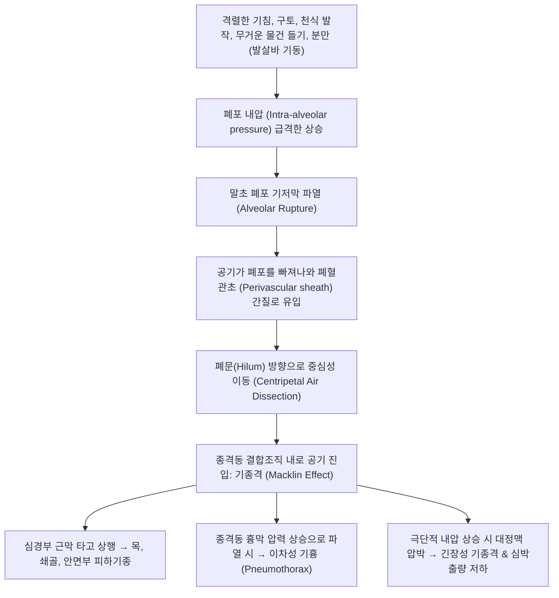

# 🩺 기종격 (Pneumomediastinum)

> **핵심 3줄 요약 (Key Summary)**:
> - 📍 병소 부위 & 해부·병태생리: 종격동(Mediastinum) 내강의 결합조직 내로 자유 공기(free air)가 비정상적으로 유입된 상태; 폐포 파열 후 기관지혈관초를 따라 공기가 이동하는 **매클린 효과(Macklin effect)** 에 의한 자발성 기종격(Hamman 증후군)이 대표적.
> - 🚩 전형적 임상 양상: 심한 기침, 구토, 발살바 기동 후 발생하는 흉골 후방의 흉통, 목으로의 방사통, 연하곤란, 경부/쇄골상와 피하기종(subcutaneous emphysema) 및 심장 박동과 동기화된 마찰음인 **하만 징후(Hamman's sign)**.
> - 🛠️ 핵심 검사 & 치료 전략: 흉부 단순촬영상 종격동 흉막 윤곽선을 따르는 공기 음영 및 흉부 CT로 확진; 자발성 기종격은 대개 안정, 산소 투여, 진통제를 통한 자가 흡수 보존 치료로 완치되나, 식도 파열(Boerhaave 증후군) 배제가 필수.
> - <font color="#fa7e7e">⚠️ 응급 의뢰 레드플래그: 심한 구토 후 발생한 극심한 흉통/발열(식도 파열에 의한 급성 종격동염), 긴장성 기종격(Tension pneumomediastinum)에 의한 상대정맥 압박 및 저혈압 쇼크 발견 즉시 흉부외과 응급 수술 전원.</font>

---

## 📌 목차
1. [질환 개요 & 해부학적 병태생리](#1-질환-개요--해부학적-병태생리)
2. [병태생리 메커니즘 & 매클린 효과 네트워크](#2-병태생리-메커니즘--매클린-효과-네트워크)
3. [임상 증상 & 이학적 검사 알고리즘](#3-임상-증상--이학적-검사-알고리즘)
4. [감별 진단 매트릭스 (Differential Diagnosis)](#4-감별-진단-매트릭스-differential-diagnosis)
5. [한의학적 변증 & 기체 순환 프로토콜](#5-한의학적-변증--기체-순환-프로토콜)
6. [양방 치료 & 외과적 응급 기준 (Conventional Treatment & Referral)](#6-양방-치료--외과적-응급-기준-conventional-treatment--referral)
7. [환자 관리 & 생활습관 티칭 가이드](#7-환자-관리--생활습관-티칭-가이드)
8. [💡 진료실 핵심 필기 & 임상 노하우 (Melt-In 심화 집약)](#8--진료실-핵심-필기--임상-노하우-melt-in-심화-집약)
9. [출처 및 학술 참고 문헌 (References)](#9-출처-및-학술-참고-문헌-references)

---

## 1. 질환 개요 & 해부학적 병태생리

### 1) 정의 및 임상적 분류
**기종격(Pneumomediastinum / Mediastinal Emphysema)** 은 심장, 대혈관, 기관, 식도를 둘러싸고 있는 흉곽 중앙의 종격동(Mediastinum) 결합조직 공간 내에 공기나 가스가 비정상적으로 존재하는 상태를 의미한다.

1. **자발성 기종격 (Spontaneous Pneumomediastinum, SPM / Hamman 증후군)**:
   * 외상이나 명백한 기저 폐질환 없이 흉강 내압의 급격한 상승(기침, 구토, 발살바 조작)으로 폐포가 파열되어 발생하는 양성 경과의 질환. 주로 젊고 마른 남성이나 임산부 분만 후 호발.
2. **속발성 기종격 (Secondary Pneumomediastinum)**:
   * 흉부 외상, 기계환기 압력 손상(Barotrauma), 식도 천공(Boerhaave 증후군), 기관/기관지 파열, 치과 발치 시 공기 주입 등에 의해 유발되는 치명적 질환.

### 2) 종격동의 해부학적 교통로
* 종격동은 위로는 **심경부 근막(Deep cervical fascia)** 공간을 통해 목과 안면부로 직접 연결되고, 아래로는 대동맥공 및 대정맥공을 통해 **후복막강(Retroperitoneum)** 과 연결된다.
* 따라서 종격동 내로 유입된 공기는 압력 구배를 따라 경부 피하조직으로 확산되어 **경부 피하기종(Cervical subcutaneous emphysema)** 을 흔히 동반한다.

---

## 2. 병태생리 메커니즘 & 매클린 효과 네트워크

자발성 기종격의 핵심 병태생리는 1939년 Charles Macklin이 규명한 **매클린 효과(Macklin Effect)** 로 설명된다.



### 1) 매클린 효과의 3단계 진행
1. **폐포 파열**: 높은 폐포 내압과 낮은 폐간질압 사이의 압력 구배로 인해 폐포벽이 찢어짐.
2. **혈관초 박리 (Perivascular tracking)**: 누출된 공기가 폐동정맥을 둘러싼 결합조직 초(Sheath)를 따라 폐문(Hilum)으로 이동.
3. **종격동 침투**: 폐문을 지나 종격동 지방조직으로 진입하여 종격동 장기들 사이를 박리함.

---

## 3. 임상 증상 & 이학적 검사 알고리즘

### 1) 전형적 임상 증상
* **흉통 (Chest pain, 80~90%)**: 흉골 후방(retrosternal)의 날카롭거나 쥐어짜는 듯한 통증으로, 목, 어깨, 등으로 방사되며 심호흡이나 기침 시 악화.
* **호흡곤란 (Dyspnea, 50%)**: 대개 경미하나 통증으로 인한 얕은 호흡 유발.
* **인후통 및 연하곤란 (Dysphagia)**: 공기가 인두 및 식도 주위 근막을 압박하여 삼킬 때 통증.
* **음성 변화 (Dysphonia)**: 목소리가 쉬거나 비음(콧소리) 발생.

### 2) 이학적 검사 소견
* **하만 징후 (Hamman's Sign / Hamman's Crunch)**:
  * 전흉부 청진 시 **심장 수축기(때로는 이완기)와 동기화되어 들리는 바스락거리거나 찌걱거리는 소리(crunching or clicking sound)**. 좌측 측와위에서 가장 뚜렷하게 청진됨.
* **피하기종 촉진**: 목, 쇄골상와, 흉벽 부위를 손으로 누를 때 눈 밟는 듯한 사각거리는 느낌(**Crepitus / 염발음**).

### 3) 영상 진단
* **흉부 X선**:
  * 심장 외곽을 따라 선상으로 관찰되는 투과성 공기 띠(**신경심막선, Pneumopericardium선**).
  * 횡격막 중앙부가 공기에 의해 하나로 이어져 보이는 **연속 횡격막 징후(Continuous diaphragm sign)**.
* **흉부 CT (진단 표준)**:
  * 미세한 종격동 공기 방울 및 기관지혈관초를 따라 이동하는 공기(Macklin effect)를 100% 검출하며, 식도 파열이나 폐 실질 병변 감별.

---

## 4. 감별 진단 매트릭스 (Differential Diagnosis)

| 감별 질환 | 원인 및 통증 양상 | 특징적 징후 | 결정적 감별 포인트 |
| :--- | :--- | :--- | :--- |
| **자발성 [[기종격]]** | 발살바/기침 후 흉골 후방 통증 | **하만 징후(Hamman sign), 경부 피하기종** | 흉부 CT상 종격동 내 공기, 전신 상태 양호, 자가 흡수 |
| **식도 파열 (Boerhaave 증후군)** | **음주 후 심한 구토 뒤 흉통** | 급성 고열, 패혈증, 흉수, 쇼크 | **수용성 식도 조영술상 조영제 누출**, 초응급 수술 필요 |
| **급성 [[기흉]] (Pneumothorax)** | 갑작스러운 편측성 흉막성 흉통 | 병변 측 호흡음 소실, 타진상 과공명음 | **흉막강 내 공기**, 폐 실질 허탈선 확인 |
| **급성 심근경색 (AMI)** | 짓누르는 흉골 하부 압박통, 방사통 | 심전도 ST절 변화, 심근효소 상승 | 심근효소(Troponin) 정상, 피하기종 유무 |
| **급성 심낭염 (Pericarditis)** | 상체 숙이면 호전되는 흉통 | 심낭마찰음(심박동 동기화되나 건성), ST 상승 | 심초음파상 심낭 삼출액, 공기 음영 없음 |

---

## 5. 한의학적 변증 & 기체 순환 프로토콜

> 🎯 **치료 접근 원칙**: 기종격은 한의학에서 심한 해수나 구토로 인해 폐기(肺氣)가 상역(上逆)하여 흉격(胸膈)의 맥락이 손상되고 기가 정상 경락을 벗어나 흉격과 경항부 피하로 일탈한 '기역(氣逆)', '흉통(胸痛)', '비기(痞氣)'의 범주로 파악한다. 서양의학적 보존 치료(안정 및 산소 흡입)와 병행하여 상역된 폐기를 내리고 흉격의 기체(氣滯)를 풀어 통증을 경감시키는 지지 치료를 적용한다.

### 1) 한의학적 변증 분류
* **폐기상역 및 흉격기체증 (肺氣上逆·胸膈氣滯證)**:
  * 주증: 흉골 후방의 결림과 통증, 기침 시 악화, 목 이물감 및 연하 곤란, 설태박백, 맥현.
  * 치법: 강기화담(降氣化痰), 관흉이지(寬胸理氣).
  * 대표 처방: [[소함흉탕]](小陷胸湯) 합 [[지각지실탕]](枳殼枳實湯) 가감 (지각, 길경, 과루인, 반하, 후박, 소엽).
* **기체어혈증 (氣滯瘀血證)**:
  * 주증: 흉부의 찌르는 듯한 고정된 통증, 어깨와 등으로의 방사통, 설암자, 맥현삽.
  * 치법: 행기활혈(行氣活血), 통락지통(通絡止痛).
  * 대표 처방: [[단삼음]](丹參飮) 합 [[시호소간산]](柴胡疏肝散).
* **폐비기허증 (肺脾氣虛證 / 회복기)**:
  * 주증: 가벼운 움직임에도 숨참, 피로, 마른기침, 설담태백, 맥세약.
  * 치법: 보폐건비(補肺健脾), 익기화중(益氣和中).
  * 대표 처방: [[보중익기탕]](補中益氣湯) 가감.

### 2) 침구 치료
* **혈위**: [[전중]](단중, CV17, 기회 - 흉격 기체 해소), [[내관]](PC6, 흉협 고통 완화), [[척택]](LU5), [[열결]](LU7), [[풍지]](GB20), [[족삼리]](ST36), [[합곡]](LI4).
* **주의**: 흉곽 상부 및 쇄골 상와 부위 자침은 피하기종 부위 감염이나 흉막 손상을 유발할 수 있으므로, 원위 취혈(내관, 공최, 합곡, 족삼리) 위주로 안전하게 자침한다.

---

## 6. 양방 치료 & 외과적 응급 기준 (Conventional Treatment & Referral)

### 1) 자발성 기종격의 보존 치료 (Conservative Management)
* **대다수 자발성 기종격은 양성 자가 치유 질환**이다:
  1. **절대 침상 안정 및 진통제 투여**: 흉강 내압 상승 행위(기침, 발살바, 무거운 물건 들기) 엄격 제한.
  2. **고농도 산소 요법 (High-flow Oxygen Therapy)**:
     * 산소 4~6 L/min 투여 시 혈중 질소 분압을 낮추어 종격동 조직 내 갇힌 공기(질소)의 모세혈관 재흡수를 촉진함("질소 세척 Nitrogen washout" 효과).
  3. **경과 관찰**: 2~5일 이내에 공기가 대부분 자연 흡수됨.

### 2) 외과적 개입이 필요한 경우
* **식도 파열(Boerhaave) 및 기관 파열**: 즉각적인 개흉술 또는 흉강경하 일차 봉합술 및 배액술.
* **긴장성 기종격 (Tension Pneumomediastinum)**: 종격동 공기가 대정맥을 압박하여 심장 충만이 방해될 경우, 검상돌기 하부 종격동 절개창 형성(Subxiphoid mediastinotomy) 또는 경부 종격동 감압술 시행.

### 3) 🚨 식도 천공 및 긴장성 기종격 레드플래그

```
[🚨 기종격 치명적 합병증 레드플래그 체크리스트]
1. 과음 후 격렬한 구토 직후에 찢어지는 듯한 극심한 흉통과 고열 발생 (Boerhaave 식도 파열)
2. 호흡곤란이 급격히 악화되며 수축기 혈압 < 90 mmHg, 경정맥 팽대 (긴장성 기종격)
3. 흉부 X선상 기종격과 함께 다량의 흉수(Pleural effusion) 또는 기흉이 동반 관찰됨
4. 패혈증 징후: 백혈구 급증, 체온 > 38.5도, 빠른 맥박 (급성 종격동염으로의 진행)

=> 상기 소견 관찰 시 즉시 상급종합병원 흉부외과로 응급 후송한다.
```

---

## 7. 환자 관리 & 생활습관 티칭 가이드

### 1) 발살바 조작 및 흉강 내압 상승 차단
* 완전 흡수될 때까지 최소 2주간 격렬한 유산소 운동, 웨이트 트레이닝, 관악기 연주, 풍선 불기 금지.
* 배변 시 과도하게 힘을 주지 않도록 완하제 복용 및 수분 섭취 권장.
* 기침이나 재채기가 나올 때는 입을 벌리고 기침하도록 교육하여 흉강 내압 급상승 방지.

### 2) 기압 변화 활동 엄격 금지
* 스쿠버 다이빙 및 고고도 비행은 재발 및 긴장성 기종격 촉발 위험으로 완치 확인 후 수개월간 금기.

---

## 8. 💡 진료실 핵심 필기 & 임상 노하우 (Melt-In 심화 집약)

### 1) 목에서 바스락거리는 소리가 만져질 때 (피하기종 확인법)
* 젊은 환자가 "어제 기침을 심하게 하거나 토한 뒤로 목이 아프고 가슴이 결린다"며 내원했을 때, 양손으로 쇄골 위쪽과 목둘레를 부드럽게 눌러보아야 한다.
* 손끝에서 마치 마른 비닐봉지를 구기거나 눈(snow)을 밟을 때처럼 **"사각- 사각-" 하는 염발음(Crepitus)** 이 느껴진다면 100% 기종격 또는 기흉에 속발한 피하기종이다.

### 2) 하만 징후(Hamman's Sign) 청진 팁
* 환자를 좌측으로 눕힌 상태(Left lateral decubitus)에서 청진기를 심장 부위(흉골 좌연 제3~4늑간)에 대면 심장 박동에 맞춰 공기 방울이 터지는 듯한 소리가 청진된다. 심근경색이나 협심증과 감별할 수 있는 결정적 신체 검진 소견이다.

---

## 9. 출처 및 학술 참고 문헌 (References)

1. When Asthma Leads to Air: Pneumomediastinum in a Child. (2026). *Children (Basel)*, 13(7):e. PMID: 42509984.

2. Spontaneous Pneumomediastinum: A Narrative Review Offering a New Perspective on Its Definition and Classification. (2025). *Cureus*, 17(4):e81822. PMID: 40196762.

3. Spontaneous Postpartum Pneumomediastinum (Hamman's Syndrome): A Case Report and Review of Chest Pain Management in the Immediate Postpartum Period. (2025). *Cureus*, 17(2):e79300. PMID: 40125135.

---

## 관련 노트

- [[기흉]]
- [[특발성 폐실질 탄력섬유증]]
- [[급성 호흡 곤란 증후군]]
- [[폐색전증]]
- [[늑막염]]
