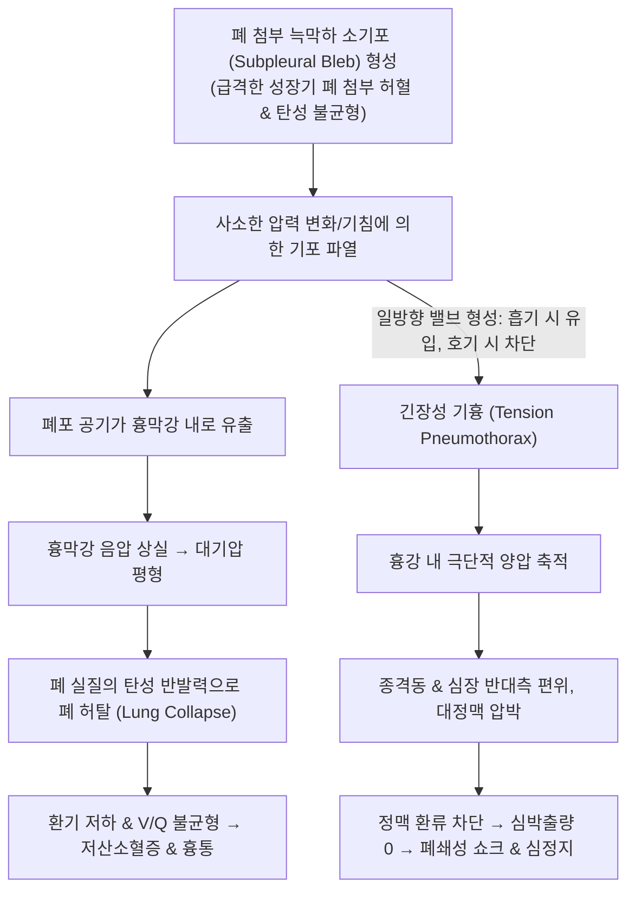

# 🩺 기흉 (Pneumothorax)

> **핵심 3줄 요약 (Key Summary)**:
> - 📍 병소 부위 & 해부·병태생리: 흉막강(Pleural space) 내로 공기가 유입되어 흉강 음영이 소실되고 폐 실질이 부분적 또는 완전 허탈(collapse)되는 질환; 장측 흉막의 늑막하 소기포(subpleural bleb) 파열 또는 외상/의원성 손상에 기인.
> - 🚩 전형적 임상 양상: 키가 크고 마른 청년층에서 갑작스러운 편측성 날카로운 흉통, 흡기 시 악화, 호흡곤란, 병변 측 호흡음 감소 및 타진상 북소리 같은 과공명음(hyperresonance).
> - 🛠️ 핵심 검사 & 치료 전략: 기립 흡기 및 호기 흉부 X선상 장측 흉막선(visceral pleural line) 및 외측 무폐혈관 구역 확인; 소량 안정 시 보존 산소요법, 대량/증상성 시 흉관 삽관술(Chest tube) 및 재발 방지를 위한 흉강경하 소기포 절제술(VATS) 및 흉막유착술.
> - <font color="#fa7e7e">⚠️ 응급 의뢰 레드플래그: 긴장성 기흉(Tension pneumothorax) 징후 — 극심한 호흡곤란, 청색증, 기관(Trachea)의 건측 편위, 혈압 급락(< 90 mmHg), 경정맥 확장 발견 즉시 방사선 촬영 없이 제2늑간 쇄골중간선 대구경 바늘 감압(Needle decompression) 및 119 응급실 직송.</font>

---

## 📌 목차
1. [질환 개요 & 해부학적 병태생리](#1-질환-개요--해부학적-병태생리)
2. [병태생리 메커니즘 & 원인별 분류](#2-병태생리-메커니즘--원인별-분류)
3. [임상 증상 & 이학적 검사 알고리즘](#3-임상-증상--이학적-검사-알고리즘)
4. [감별 진단 매트릭스 (Differential Diagnosis)](#4-감별-진단-매트릭스-differential-diagnosis)
5. [한의학적 변증 & 침 시술 안전 수칙](#5-한의학적-변증--침-시술-안전-수칙)
6. [양방 치료 & 흉관·수술 기준 (Conventional Treatment & Referral)](#6-양방-치료--흉관수술-기준-conventional-treatment--referral)
7. [환자 관리 & 생활습관 티칭 가이드](#7-환자-관리--생활습관-티칭-가이드)
8. [💡 진료실 핵심 필기 & 임상 노하우 (Melt-In 심화 집약)](#8--진료실-핵심-필기--임상-노하우-melt-in-심화-집약)
9. [출처 및 학술 참고 문헌 (References)](#9-출처-및-학술-참고-문헌-references)

---

## 1. 질환 개요 & 해부학적 병태생리

![[기흉_01_기흉X선.png|450]]
> [그림 1: 흉부 X선 — 허탈된 폐와 흉벽 사이로 흉막선이 보이고 그 바깥은 기체 음영이다 — 출처: Wikimedia Commons — File:Pneumothorax CXR.jpg (CC BY-SA 2.5)]


### 1) 정의 및 해부학적 구조
**기흉(Pneumothorax)** 은 벽측 흉막(Parietal pleura)과 장측 흉막(Visceral pleura) 사이의 잠재적 공간인 **흉막강(Pleural cavity)** 내에 공기가 차서 정상적인 음압($-3$ to $-5\text{ cmH}_2\text{O}$)이 소실되고 대기압과 같아지거나 양압으로 변하면서 폐가 탄성 수축력에 의해 찌그러지는(허탈) 질환이다.

### 2) 원인별 3대 분류
1. **자연 기흉 (Spontaneous Pneumothorax)**:
   * **원발성 자연 기흉 (Primary Spontaneous Pneumothorax, PSP)**: 기저 폐질환 없이 발생. 주로 10대 후반~20대, 키가 크고 마른 체형(Marfanoid habitus), 흡연자 남성에서 폐 첨부(Apex)의 늑막하 소기포(Bleb/Bulla) 파열로 유발.
   * **속발성 자연 기흉 (Secondary Spontaneous Pneumothorax, SSP)**: 기존 폐질환에 의해 폐 조직이 파괴되어 발생. COPD(폐기종), 폐결핵, [[특발성 폐섬유증]](IPF), [[특발성 폐실질 탄력섬유증]](PPFE), 폐암 등 고령층 호발.
2. **외상성 기흉 (Traumatic Pneumothorax)**: 늑골 골절, 관통상, 둔상.
3. **의원성 기흉 (Iatrogenic Pneumothorax)**: 중심정맥관 삽입, 흉강 천자, 폐 생검, 흉배부 침 시술(Acupuncture-related).

---

## 2. 병태생리 메커니즘 & 원인별 분류

![[기흉_02_긴장성기흉기전.png|450]]
> [그림 2: 긴장성 기흉의 기전 도해 — 일방향 밸브처럼 공기가 축적되며 종격 편위와 정맥환류 저하가 발생한다 — 출처: Wikimedia Commons — File:Tension-pneumothorax.png (CC0)]




### 1) 긴장성 기흉 (Tension Pneumothorax)의 치명적 기전
* 파열된 흉막 부위가 **일방 밸브(One-way valve / Check-valve)** 로 작용하여, 숨을 들이쉴 때는 공기가 흉막강으로 들어가지만 내쉴 때는 배출되지 못함.
* 흉막강 내압이 대기압을 초과하여 양압화되면서 허탈된 폐를 넘어 심장, 대혈관, 기관을 반대쪽 정상 폐로 밀어붙임.
* 상·하대정맥이 꺾여 심장으로의 정맥 환류(Venous return)가 급격히 차단되고, 심박출량이 붕괴하여 수분 내에 사망할 수 있는 최고 위험 응급 상황.

---

## 3. 임상 증상 & 이학적 검사 알고리즘

![[기흉_03_기흉CT.png|450]]
> [그림 3: 흉부 CT — 흉막강 내 기체와 허탈된 폐엽이 확인된다 — 출처: Wikimedia Commons — File:Pneumothorax CT.jpg (CC BY-SA 2.5)]


### 1) 전형적 임상 증상
* **흉통 (Chest pain, 90%)**:
  * 갑작스럽게 시작되는 날카롭고 찌르는 듯한 편측성 통증.
  * 숨을 깊이 들이쉬거나 기침할 때 심해짐(흉막성 통증). 24시간 이내에 둔한 통증으로 변하기도 함.
* **호흡곤란 (Dyspnea, 80%)**:
  * PSP에서는 폐 허탈이 20~30% 미만일 경우 경미할 수 있으나, 기존 폐기능이 나쁜 SSP 환자에서는 소량의 기흉으로도 극심한 호흡부전 초래.

### 2) 이학적 진찰 소견 (Classic Physical Signs)
* **시진**: 병변 측 흉곽 팽창 및 호흡 운동 제한.
* **청진**: 병변 측 **호흡음(Vesicular breath sounds)의 현저한 감소 또는 완전 소실**.
* **타진**: 병변 측 공기 축적으로 인한 북소리 같은 **과공명음 (Hyperresonance / Tympanitic sound)**.
* **촉진**: 촉각 진동감(Vocal fremitus) 감소, 경부 피하기종(Crepitus) 동반 가능.

### 3) 영상 진단 (Imaging Evaluation)
* **흉부 X선 (기립 흡기 및 호기 촬영)**:
  * 외측 흉벽과 폐 실질 경계부에 머리카락처럼 얇은 **장측 흉막선 (Visceral pleural line)** 관찰.
  * 흉막선 외측으로는 **폐 음영 및 혈관 음영이 전혀 보이지 않는 무혈관 구역(Devascularized radiolucent zone)**.
  * 호기(숨을 내쉰 상태) 시 촬영하면 폐 용적이 줄어 기흉 음영이 더욱 극명하게 드러남.
* **기흉 크기 계산 (Light Index / Rhea 법)**:
  * 흉벽과 폐 가장자리 사이 거리가 2 cm 이상이거나 반경 비를 통해 소량(< 20~30%)과 대량($\ge 20~30\%$) 감별.

---

## 4. 감별 진단 매트릭스 (Differential Diagnosis)

| 감별 질환 | 호흡음 및 타진 소견 | 흉부 X선 소견 | 결정적 감별 포인트 |
| :--- | :--- | :--- | :--- |
| **급성 [[기흉]]** | **호흡음 감소/소실, 과공명음** | **장측 흉막선 관찰, 폐혈관 음영 소실** | 흉막강 내 유리 공기, 기립 촬영으로 확진 |
| **긴장성 기흉** | 호흡음 완전 소실, 과공명음, **기관 편위** | **종격동이 건측으로 심하게 편위, 횡격막 하강** | **혈압 저하(< 90), 청색증**, X-ray 전 즉시 바늘 감압 |
| **거대 폐기낭 (Giant Bulla)** | 호흡음 감소, 과공명음 | 폐 실질 내부의 오목한 내벽 낭종선 | **장측 흉막선이 내측으로 오목함**, CT로 감별 필수 |
| [[기종격]] | 전흉부 하만 징후(바스락거림) | 심장 외곽을 따라 얇은 공기 띠 관찰 | 종격동 국소화, 폐 실질 허탈선 없음 |
| **폐색전증 ([[폐색전증]], PE)** | 호흡음 대개 정상 | 대개 정상 (Westermark 징후) | **D-dimer 상승, CTPA상 혈전 충만 결손** |

---

## 5. 한의학적 변증 & 침 시술 안전 수칙

> ⚠️ **한의원 내 임상 안전 원칙**: 기흉은 외과적 배액과 산소 흡입이 필요한 응급 질환이며, 한의원 1차 진료에서 가장 엄격히 경계해야 할 대표적인 **의원성 의료사고(Iatrogenic injury)** 유발 위험 질환이다. 안전한 자침 깊이 준수가 최우선이며, 완치 후 재발 방지 및 폐기능 회복 단계에서 보조 한약 치료를 적용한다.

### 1) 🚨 한의사 필수: 흉배부 자침 안전 수칙 (의원성 기흉 원천 차단)
* **고위험 혈위**:
  * [[견정]](GB21), [[결분]](ST12), [[운문]](LU2), [[중부]](LU1), [[천돌]](CV22).
  * 방광경 배수혈: [[폐수]](BL13), [[궐음수]](BL14), [[심수]](BL15), [[고황]](BL43).
* **안전 자침 원칙**:
  1. 마른 체형(저BMI) 환자는 피부에서 장측 흉막까지의 거리가 **1.5~2 cm에 불과**함을 명심.
  2. [[견정]]혈은 절대 직자하지 말고, **늑골 방향과 평행하게 전후 사자(0.5~0.8촌 이하)** 로 시술.
  3. 배수혈은 척추 극돌기 방향을 향해 **15~30도 사자(0.3~0.5촌)** 하며, 늑간극 깊숙이 직자 금기.
  4. 침 시술 도중 또는 직후 환자가 **"가슴이 뜨끔하고 숨쉴 때 결린다"** 고 호소하면 지체 없이 시술을 중단하고 즉시 흉부 X-ray 촬영 의뢰.

### 2) 회복기 한의학적 변증 분류
* **폐비기허증 (肺脾氣虛證 / 재발 방지기)**:
  * 원인: 기혈이 부족하여 폐 첨부 결합조직과 폐포벽이 약화됨.
  * 증상: 마른 체형, 잦은 피로, 기운 없음, 얕은 호흡, 설담태백, 맥세약.
  * 치법: 보폐익기(補肺益氣), 배토생금(培土生金).
  * 대표 처방: [[보중익기탕]](補中益氣湯) 합 [[생맥산]](生脈散) 또는 [[황기건중탕]](黃芪建中湯).
* **폐음휴손증 (肺陰虧損證)**:
  * 주증: 마른기침, 인후 건조, 오후 조열, 설홍소태, 맥세삭.
  * 치법: 자음윤폐(滋陰潤肺), 고표평천(固表平喘).
  * 대표 처방: [[백합고금탕]](百合固金湯) 가감.

---

## 6. 양방 치료 & 흉관·수술 기준 (Conventional Treatment & Referral)

![[기흉_06_흉관배액기.png|450]]
> [그림 4: 밀봉식 흉관 배액기 — 수주(water seal)와 흡인으로 흉막강 기체를 배출한다 — 출처: Wikimedia Commons — File:Drainage Sahara 01.jpg (CC BY-SA 4.0)]


### 1) 내과적 보존 치료
* **적응증**: 증상이 없고 안정적인 소량 기흉(폐 허탈 < 20% 또는 흉곽-폐 거리 < 2 cm).
* **치료**: 고유량 산소 투여(10 L/min 안면마스크) 하에 6~24시간 경과 관찰 후 X-ray 재촬영.
  * 산소 공급 시 혈중 질소 분압을 낮추어 흉막강 내 공기 흡수 속도를 **4배 이상 촉진**함 (하루 약 1.25% -> 4% 이상 재흡수).

### 2) 흉막강 감압 및 배액술 (Intervention)
* **단순 바늘 흡인술 (Needle Aspiration)**: 16~18G 카테터로 주사기를 이용해 공기 흡인(최대 2.5L) 후 제거.
* **흉관 삽관술 (Tube Thoracostomy / Chest Tube)**:
  * 증상이 있는 중등도~대량 기흉, SSP 환자.
  * 제4~5늑간 액와중간선에 소구경(10~14 Fr) 또는 표준 흉관 삽입 후 수봉식 밀봉 배액(Water-seal drainage) 연결.

### 3) 흉강경하 수술 (VATS) 및 흉막유착술 적응증
* **적응증**:
  1. 기흉의 2회 이상 재발(동측 재발률 50%, 2차 재발 후 3차 재발률 80%).
  2. 양측성 기흉, 첫 발병이라도 대량 혈흉 동반.
  3. 흉관 삽입 후 3~5일 이상 공기 누출(Air leak) 지속.
  4. 직업적 고위험군(항공기 조종사, 스쿠버 다이버).
* **수술법**: 흉강경하 쐐기절제술(Wedge resection)로 소기포 절제 + 기계적/화학적 흉막유착술(Pleurodesis).

### 4) 🚨 긴장성 기흉 초응급 대처 프로토콜

```
[🚨 긴장성 기흉(Tension Pneumothorax) 1분 대처]
- 의심 소견: 극심한 호흡곤란, 청색증, SpO2 급락, 혈압 < 90 mmHg, 
             병변측 호흡음 소실, 기관(Trachea)이 반대쪽으로 밀려남
- 행동 지침: 
  1. 방사선 X-ray 촬영을 위해 환자를 이동시키지 말 것 (촬영 도중 심정지 발생)
  2. 즉시 14~16G 대구경 혈관 카테터 바늘을 준비
  3. 제2늑간 쇄골중간선(2nd intercostal space, midclavicular line) 또는 
     제4~5늑간 액와전선에 바늘을 직각으로 찔러 공기를 빼내어 즉각 감압!
  4. 감압 직후 공기가 "쉬익-" 빠져나오며 혈압이 회복되는 것을 확인하고 119 응급실 이송
```

---

## 7. 환자 관리 & 생활습관 티칭 가이드

### 1) 재발 방지 핵심 생활 티칭
* **철저한 금연 (절대적 수칙)**: 흡연은 소기포 형성과 염증을 촉진하여 기흉 재발률을 **9배 이상 증가**시킴. 전자담배 포함 100% 금연.
* **스쿠버 다이빙 평생 금지**: 잠수 후 부상 시 보일의 법칙에 의해 흉막강 내 갇힌 미세 공기가 팽창하여 치명적 긴장성 기흉을 유발하므로 영구 금기.
* **항공기 탑승**: 기흉 완전 치유 확인 후 최소 2~4주 이후 탑승 권고.

---

## 8. 💡 진료실 핵심 필기 & 임상 노하우 (Melt-In 심화 집약)

### 1) 마른 체형의 청년이 "숨쉴 때 오른쪽 가슴이 찔리듯 아파요"
* 180cm/60kg 전후의 마른 체형 청년이 무거운 물건을 들거나 농구를 한 후, 혹은 가만히 앉아있다가 갑작스러운 편측성 흉통으로 내원하면 심장병이나 단순 근육통(담 결림)으로 넘기지 말고 청진기를 대보아야 한다.
* 아픈 쪽 폐에서 숨소리가 희미하고, 손가락으로 가슴을 두드렸을 때 북소리처럼 텅 빈 소리가 울린다면 기흉이다. 근육통 파스를 붙여 귀가시키면 밤사이에 긴장성 기흉으로 악화될 수 있다.

### 2) 흉벽 자침 시의 방어 진료
* 등과 어깨 결림 환자에게 견정, 폐수혈 등을 치료할 때는 환자의 호흡 주기(숨을 내쉴 때 자침)를 고려하고, 침체가 휘어지거나 환자가 기침하지 않도록 주의해야 한다. 만약 침 치료 후 귀가한 환자가 몇 시간 뒤 숨참을 호소하면 당황하지 말고 즉시 흉부 X-ray 촬영을 안내하여 신속한 조치를 취해야 의료 분쟁을 최소화할 수 있다.

---

## 9. 출처 및 학술 참고 문헌 (References)

1. Acupuncture-related pneumothorax: a 14-case single-center series and a review of the literature. (2026). *Gen Thorac Cardiovasc Surg*, epub. PMID: 42714775.

2. Comparative effectiveness of suction versus water seal following tube thoracostomy in traumatic pneumothorax and hemothorax: An updated systematic review and meta-analysis. (2026). *Am J Emerg Med*, 109:250-258. PMID: 42537523.

3. Contemporary Pleural Drainage in Adult Practice: Image-Guided Techniques, Procedural Safety, Training Standards, and Malignant Pleural Effusion Management. (2026). *J Clin Med*, 15(14):e. PMID: 42513499.

---

## 관련 노트

- [[기종격]]
- [[특발성 폐실질 탄력섬유증]]
- [[늑막염]]
- [[폐색전증]]
- [[급성 호흡 곤란 증후군]]
