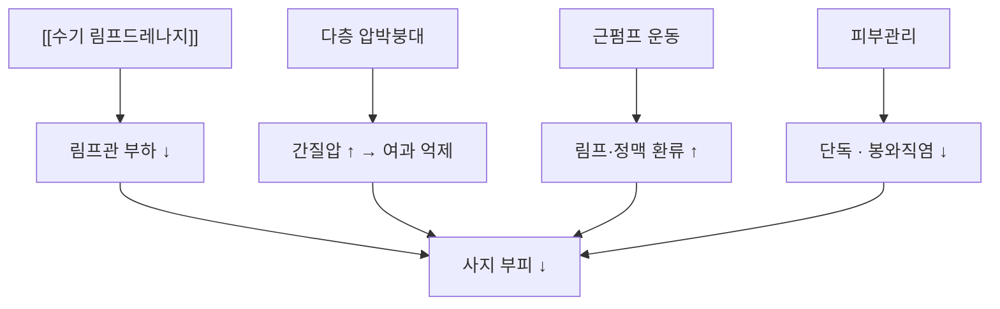

# 📍 [[복합 감압요법]] (Complete Decongestive Therapy, CDT)

> **핵심 3줄 요약 (Key Summary)**:
> - 🌿 **정의·구성**: [[림프부종]]의 표준 보존 치료. ① [[수기 림프드레나지]] ② 다층 압박붕대 ③ 치료적 운동 ④ 피부관리(+교육)의 4요소 결합.
> - 🎯 **적응**: ISL 1~3기 말초성 림프부종, 유방암·부인과 암 치료 후 속발성 림프부종.
> - 🔬 **기전**: 림프관 부하 감소 + 간질압 상승으로 여과 억제 + 근펌프 촉진 + 감염 예방.
> - ⚠️ **금기**: 활동성 감염, DVT·혈전정맥염, 심성 부종, 말초동맥질환, 경피증 등 피부질환.

---

## 1. 정의·기법 (Protocol)

* **1단계 집중기(Intensive Phase)**: 주 5회(평일) × 2~4주, 회당 약 60분. 순서는 [[수기 림프드레나지]] → 다층 압박붕대 → 치료적 운동.
* **2단계 유지기(Maintenance Phase)**: 압박 슬리브(CCL 2, 23~32 mmHg) 착용 + 자가 림프드레나지 + 운동.

| 요소 | 구체적 시행법 | 용량·강도 |
| :--- | :--- | :--- |
| ① 수기 림프드레나지 | 목·몸통 근위부 → 사지 원위부 순으로 가볍게 배액 | 회당 20~30분, 피부가 붉어지지 않는 압력 |
| ② 다층 압박붕대 | 패딩 → 단단한 붕대 순으로 원위부에서 근위부로 | 원위부가 근위부보다 높은 압력(구배압) |
| ③ 치료적 운동 | 붕대 적용 상태에서 관절 가동범위·근펌프 운동 | 1일 1회, 2세트 × 5~7회, 원위→근위 |
| ④ 피부관리 | 저자극 보습, 균열·상처 확인 및 치료 | 매일 |
| ⑤ 유산소 | 빠른 걷기 | 주 5회, 1주 30분 → 3주 45분 |

> ⚠️ **임상 시험에서 쓴 실제 프로토콜**: 3주 15회기(총 약 15시간), 시작 전 전문치료사가 1시간(자가군은 2시간 실습 포함) 교육. 유지기에는 CCL 2 슬리브 + 필요 시 자가 림프드레나지 반복(PMID 40329151).

---

## 2. 작용 기전

* **림프역학**: 압박은 림프관 벽을 지지해 수축 효율을 높이고, 정맥 환류를 도와 모세혈관 여과를 줄인다.
* **조직 재형성**: 만성 섬유화 조직에서도 압박·운동 병행 시 유연성이 일부 회복된다.
* **행동 효과**: 자가 관리군이 추적기에서 더 좋았던 것은 해부학적 우월성보다 자기효능감·순응도 효과로 해석된다(PMID 40329151).

---

## 3. 임상 적용

* **대상 선별**: 단측 부종 + 암 치료 병력 + Stemmer 양성. 양측성·함요부종이면 심장·신장·정맥 원인을 먼저 배제한다.
* **평가 지표**: 사지 둘레(5 cm 간격, 주 1회), 부피차(수분배제법·임피던스), 증상 NRS(강직·무거움·통증·저림·피로).
* **자가 시행 전환**: 비열등성 RCT에서 자가 시행이 치료사 시행과 동등했고 3개월 추적에서는 더 좋았다. 단, 사전 교육(실습 2시간 + 책자·영상)이 전제다.
* **보조 중재**: CDT에 운동·호흡·자가관리를 더한 조합의 효과를 비교한 메타분석이 있다(PMID 38737896).

| 상황 | 적용 |
| :--- | :--- |
| 초기 0~1기 | 집중기 2주 + 유지기 전환, 예후 좋음 |
| 2기 | 집중기 3~4주, 압박 등급 상향 검토 |
| 3기 섬유화 | 집중기 연장 + 전문 센터 의뢰, 수술 상담 |

---

## 4. 주의·금기

* **절대 금기**: 활동성 감염(단독·봉와직염), 심부정맥혈전증·혈전정맥염, 심성 부종(비대상성 심부전), 중증 말초동맥질환, 경피증 등 피부질환, 재료 알레르기.
* **상대 금기·주의**: 조절되지 않는 고혈압, 당뇨병성 신경병증(화상·압박 손상 인지 저하), 고령·와상 환자.
* **중단 기준**: 3회기 연속 결석 또는 전체 회기 80% 미만 참여(시험 프로토콜 기준). 통증 NRS 2점 이상 증가, 피부 손상 발생 시 중단.
* **말초동맥질환 선별**: 고령 당뇨 환자에서 ABI 확인 — 압박이 허혈을 악화시킬 수 있다.
* **부작용**: 압박부 통증·신경 압박, 피부 손상, 부종의 근위부 이동.

---

## 5. 한의 임상 연계

* **역할 구분**: CDT는 표준 치료다. 침·한약은 보조이며 대체가 아니다.
* **침 치료**: 환측 직접 자침·부항·사혈 금지(감염 위험). 건측·몸통·하지 중심 배혈.
* **한약**: 기허습체·비신양허 변증에서 보기이수, 어혈 경화에는 활혈거어. 이뇨제 병용 시 전해질 확인.
* **환자 교육**: 자가 시행 능력을 기르는 것이 한의원에서 가장 현실적인 기여 — 붕대 감기·운동 루틴을 진료실에서 한 번 더 점검한다.

---

## 6. 논문 연결

* [[림프부종]] — 질환 개요·병기·감별.
* [[수기 림프드레나지]] — CDT의 첫 요소.
* [[유방암]] — 국내 최다 원인.

### 📎 참고 자료
* 「Manual Lymphatic Drainage for Lymphedema & Swelling in BOTH Arms and Chest」 — Cancer Rehab PT (수기 림프드레나지 순서 시연): https://youtu.be/v7QYVxWqPI8
* 「NEW and updated Manual Lymphatic Drainage for ARM Lymphedema」 — OncoPelvic PT (환자 자가 시행 교육용): https://youtu.be/0VZKiLP43yw
* 국제림프학회(ISL) 2020 주변성 림프부종 진단·치료 합의문: [PMID 32521126](https://pubmed.ncbi.nlm.nih.gov/32521126/)

---

## 7. 출처 및 학술 참고 문헌 (References)

1. **Gultekin SC, et al. (2025)**. *Self-administered versus lymphedema therapist-administered complex decongestive therapy protocol in breast cancer-related lymphedema: a non-inferiority randomized controlled trial with three-month follow-up*. **Breast Cancer Res Treat**, 212(1):123-138. [PMID 40329151](https://pubmed.ncbi.nlm.nih.gov/40329151/)
   - **[연구 요약]**: 3주 15회기 CDT에서 자가 시행군의 부피 감소가 치료사군과 동등(−567.06 vs −568.24 cm³, p=0.988), 3개월 추적에서는 자가군이 추가 감소.
2. **Executive Committee of the International Society of Lymphology (2020)**. *The diagnosis and treatment of peripheral lymphedema: 2020 Consensus Document of the International Society of Lymphology*. **Lymphology**. [PMID 32521126](https://pubmed.ncbi.nlm.nih.gov/32521126/)
   - **[연구 요약]**: CDT 2단계 구조와 압박 등급, 금기 기준의 국제 표준.
3. **Deng C, et al. (2024)**. *Conservative medical intervention as a complement to CDT for BCRL therapy: a systematic review and meta-analysis of randomized controlled trials*. **Front Oncol**. [PMID 38737896](https://pubmed.ncbi.nlm.nih.gov/38737896/)
   - **[연구 요약]**: 유방암 관련 림프부종에서 CDT에 보존적 중재를 더했을 때의 추가 효과를 무작위시험으로 메타분석.
