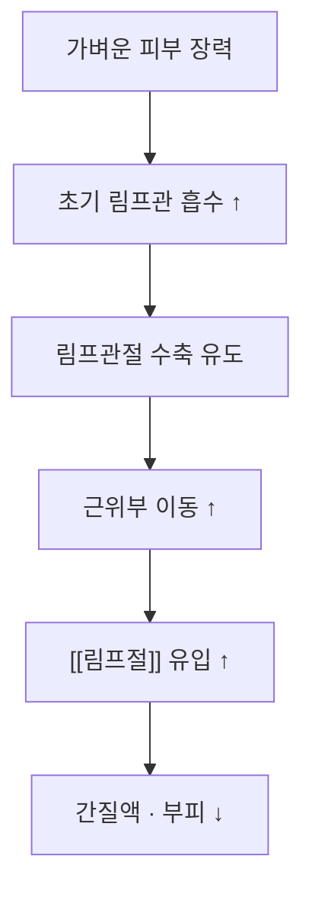

# 📍 [[수기 림프드레나지]] (Manual Lymphatic Drainage, MLD)

> **핵심 3줄 요약 (Key Summary)**:
> - 🌿 **정의·기법**: 피부에 아주 가벼운 장력(초기 림프관 흡수 유도)을 주어 림프를 근위부로 이동시키는 도수법. [[복합 감압요법]]의 첫 단계.
> - 🎯 **적응**: [[림프부종]], 수술 후 부종, 정맥성 부종의 보조.
> - 🔬 **기전**: 림프관절(lymphangion) 수축 유도 + 초기 림프관 흡수 증가 + 교통 림프관 경로 우회.
> - ⚠️ **금기**: 활동성 감염·DVT·비대상성 심부전·말초동맥질환. 암 병력자에서 종양 재발 부위 직접 시행 금지.

---

## 1. 정의·기법 (Protocol)

* **원칙**: 근위부(목·몸통) → 원위부(사지) 순서로 먼저 배출구를 열고, 이후 사지에서 중심으로 밀어 올린다. 압력은 "피부가 밀리되 붉어지지 않는" 정도(대략 20~30 mmHg 이하).
* **주요 수기**:
  * **고정 원(circle)**: 손가락·손바닥으로 피부를 원을 그리듯 이동 — 초기 림프관 흡수 자극.
  * **펌프(pump)**: 손바닥 전체로 압력 후 이완을 반복 — 림프관절 수축 유도.
  * **국지 배액(clearing)**: 림프절 방향으로 부드럽게 밀어냄.

| 단계 | 부위 | 시간 | 포인트 |
| :--- | :--- | :--- | :--- |
| 1 | 목·쇄골상·겨드랑이/서혜부 림프절 | 5~10분 | 배출구를 먼저 연다 |
| 2 | 몸통(흉부·복부) | 10분 | 반대측 림프절로의 교통로 활용 |
| 3 | 사지 근위부 → 원위부 | 15~20분 | 근위부에서 시작해 원위부로 |
| 4 | 원위부(손·발) 마무리 | 5분 | 손가락·발가락 끝에서 중심으로 |

> ⚠️ 회당 약 60분 코스에서 MLD는 20~30분을 차지한다. 시험 프로토콜은 MLD → 다층 압박붕대 → 치료적 운동 순으로 매 회기 시행했다(PMID 40329151).

---

## 2. 작용 기전

* **압력-반응**: 림프관은 표재에 위치해 과도한 압력은 오히려 림프관을 압박해 역효과다. 통증을 유발하는 압력은 기법 오류로 본다.
* **교통로**: 몸통 작업으로 폐쇄된 림프절을 우회하는 측부 경로를 활성화한다.
* **한계**: 단독으로는 부피 감소 효과가 작고, 압박붕대·운동과 결합해야 임상 효과가 확인된다.

---

## 3. 임상 적용

* **급성기·집중기**: CDT 1단계의 첫 요소로 매 회기 시행.
* **유지기**: 자가 림프드레나지로 전환 — 환자 교육이 핵심(실습 2시간 + 책자·영상).
* **적응 확장**: 수술 후 부종, 외상 후 부종, 만성 정맥부전의 보조. 다만 근거 수준은 림프부종보다 낮다.
* **평가**: 시행 전후 사지 둘레와 주관적 무거움 NRS를 기록해 반응을 확인한다.

---

## 4. 주의·금기

* **절대 금기**: 활동성 감염(단독·봉와직염), 심부정맥혈전증·혈전정맥염, 비대상성 심부전, 중증 말초동맥질환, 알려진 악성 종양 부위 직접 시행.
* **주의**: 항응고제 복용자(멍), 피부 취약·노인(표피 손상), 당뇨병성 신경병증(압력 인지 저하).
* **부작용**: 일시적 부종 증가, 멍, 피부 자극. 통증이 생기면 압력이 과한 것이다.
* **중단 기준**: 발열·발적·압통(감염 의심), 부종의 급격한 악화.

---

## 5. 한의 임상 연계

* **접점**: 한의원에서 시행하는 부드러운 도수·경락 마사지와 기법적으로 유사하나, 림프부종에서는 **방향(근위→원위)과 압력(극히 가벼움)** 이 다르다. 강한 압박·사혈은 금기다.
* **침 치료**: 환측 직접 자침 회피, 건측·몸통 중심.
* **한약**: 변증에 따라 이수·활혈. 이뇨제 병용 시 탈수 주의.
* **환자 교육**: "강하게 주무르는 마사지는 림프부종에 해롭습니다"를 명확히 설명 — 환자가 민간 요법으로 강한 마사지를 받는 경우가 흔하다.

---

## 6. 논문 연결

* [[복합 감압요법]] — MLD를 포함한 표준 치료 패키지.
* [[림프부종]] — 질환 개요·병기.
* [[유방암]] — 국내 최다 원인.

### 📎 참고 자료
* 「Manual Lymphatic Drainage for Lymphedema & Swelling in BOTH Arms and Chest」 — Cancer Rehab PT (수기 순서 시연): https://youtu.be/v7QYVxWqPI8
* 「NEW and updated Manual Lymphatic Drainage for ARM Lymphedema」 — OncoPelvic PT (자가 시행 교육): https://youtu.be/0VZKiLP43yw
* ICG 림프영상으로 배액 경로를 확인한 뒤 MLD 방향을 정하는 접근: [PMID 42332939](https://pubmed.ncbi.nlm.nih.gov/42332939/)

---

## 7. 출처 및 학술 참고 문헌 (References)

1. **Gultekin SC, et al. (2025)**. *Self-administered versus lymphedema therapist-administered complex decongestive therapy protocol in breast cancer-related lymphedema: a non-inferiority randomized controlled trial*. **Breast Cancer Res Treat**, 212(1):123-138. [PMID 40329151](https://pubmed.ncbi.nlm.nih.gov/40329151/)
   - **[연구 요약]**: MLD 포함 CDT를 자가로 시행해도 치료사 시행과 부피 감소가 동등했고, 3개월 추적에서 자가군이 추가 개선.
2. **Executive Committee of the International Society of Lymphology (2020)**. *The diagnosis and treatment of peripheral lymphedema: 2020 Consensus Document*. **Lymphology**. [PMID 32521126](https://pubmed.ncbi.nlm.nih.gov/32521126/)
   - **[연구 요약]**: MLD의 적응·금기와 CDT 내 위치를 규정한 국제 합의문.
3. **Suami H, et al. (2026)**. *Enhancing Diagnostic Precision and Treatment Effectiveness Using Indocyanine Green Lymphography in Lymphedema*. **Ann Rehabil Med**. [PMID 42332939](https://pubmed.ncbi.nlm.nih.gov/42332939/)
   - **[연구 요약]**: 림프 배액 경로 영상화로 도수 방향·치료 계획을 정밀화하는 접근.
