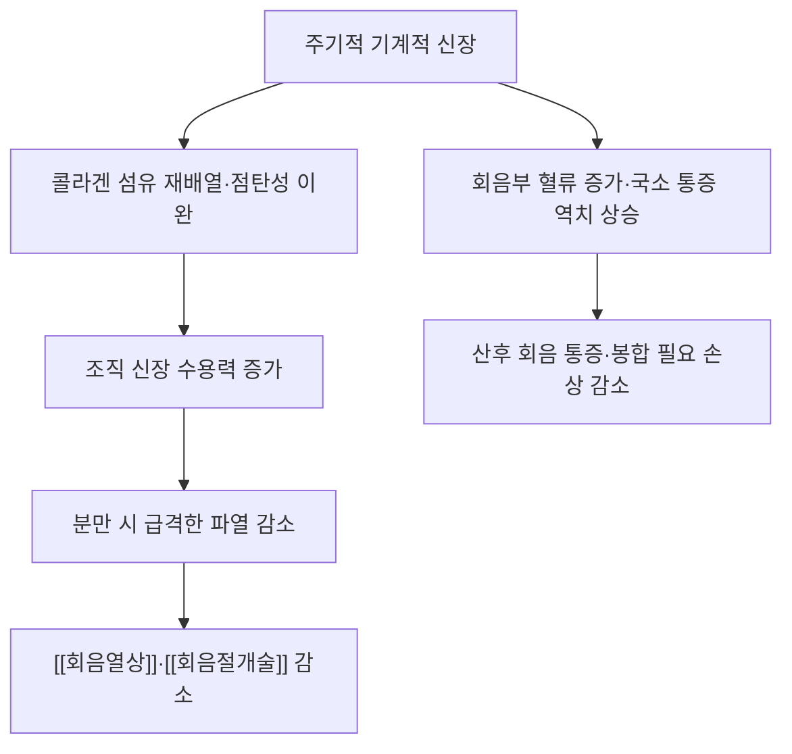

# 🛠️ 회음부 마사지 (Antenatal Perineal Massage)

> 🖼️ 이미지: 시행 실사 1장(CC0) 수록. 해부 구조는 [[회음부]] 노트 참조.

> **핵심 3줄 요약 (Key Summary)**:
> - 📍 **무엇을 하는 중재인가**: 임신 후기부터 [[회음부]] 연조직을 손가락으로 늘려 분만 시 신장 수용력을 높이는 자가·배우자 시행 중재.
> - 🚩 **목표**: [[회음열상]]·[[회음절개술]] 위험 감소, 산후 회음 통증·봉합 필요 손상 감소.
> - 🛠️ **프로토콜**: 34주경 시작, 윤활제 사용, 1분 하방 압박 + U자 2~3분, 주 3~4회 이상, 회당 5~10분.
> - ⚠️ **금기**: 전치태반·질 출혈·파수·조기진통·활동성 질 감염에서는 시행하지 않는다.

---

## 📌 목차
1. [정의·기법](#1-정의기법)
2. [시행 프로토콜 — 환자 지도용](#2-시행-프로토콜--환자-지도용)
3. [작용 기전](#3-작용-기전)
4. [임상 적용·근거](#4-임상-적용근거)
5. [주의·금기·중단 기준](#5-주의금기중단-기준)
6. [한의 임상 연계](#6-한의-임상-연계)
7. [논문 연결](#7-논문-연결)
8. [📎 참고 자료](#8--참고-자료)

---

## 1. 정의·기법

![[회음부마사지_01_시행실사.jpg|400]]
> [그림 1: 회음부 마사지 시행 자세 — 앙와위에서 무릎을 벌리고, 윤활한 엄지 또는 검지를 질구 안 2~3 cm에 넣어 후방(6시 방향)으로 부드럽게 압박·신장한다 — 출처: Wikimedia Commons (CC0, Public Domain)]

* **목적**: 분만 시 회음부가 견뎌야 하는 신장률을 미리 연습시켜 조직의 점탄성 적응을 유도한다.
* **시행자**: 산모 본인(엄지) 또는 배우자(검지). 자기 시행이 교육만으로도 충분히 가능하다.
* **시작 시점**: 임신 34주 이후. 조기 시작은 조기진통 유발 우려로 권고되지 않는다.

---

## 2. 시행 프로토콜 — 환자 지도용

| 항목 | 기준 |
| :--- | :--- |
| **준비** | 손 씻기, 손톱 정리, 윤활제(비타민 E 오일·올리브 오일·아몬드 오일 또는 수용성 젤) |
| **자세** | 앙와위에서 무릎을 굽혀 벌리거나, 한 발을 의자·변기에 올린 반좌위 |
| **삽입 깊이** | 질구 안 약 2~3 cm (약 두 마디) |
| **1단계** | 엄지(또는 검지)를 후방 6시 벽에 대고 아래·바깥 방향으로 1분간 압박 — 당기는 느낌이 올 때까지, 호흡은 유지 |
| **2단계** | 같은 손가락으로 질 하부를 U자 모양으로 2~3분간 천천히 마사지 |
| **반복** | 위 1~2단계를 회당 2~3회 반복, 총 5~10분 |
| **빈도** | 주 3~4회 이상, 가능하면 매일 |
| **강도** | 통증 10점 기준 3~4 이하(불편하지만 견딜 만한 정도). 저림·찌르는 통증이 오면 강도를 낮춘다 |
| **진행 규칙** | 주차가 올라가면 압박 시간을 30초씩 늘리고, 36주 이후에는 U자 마사지 시간을 3~4분으로 확장 |

* **배우자 시행 시**: 검지 끝을 2~3 cm 넣고 같은 방향으로 압박. 손톱·링 착용 금지, 시행 전 상호 확인.
* **기록**: 주간 시행 횟수와 통증 점수를 간단히 적게 하면 순응도가 올라간다.

---

## 3. 작용 기전

* **조직 수준**: [[콜라겐]] 섬유의 배열이 반복 신장에 적응하고, 근막의 점탄성 성질이 변해 같은 힘에도 변형이 커진다.
* **신경 수준**: 반복 자극으로 국소 통증 역치가 올라가고, 분만 시 회음부 감각 자극에 대한 반응이 안정된다.
* **주의**: 기전은 조직 적응이지 '늘어나서 안 찢어짐'이 아니다. 효과 크기는 중등도이며, 초산부에서 더 뚜렷하다.

---

## 4. 임상 적용·근거

* **대상**: 초산부, 이전 회음 열상·절개 병력자, 4 kg 이상 태아가 예상되는 임신, 회음부 조직이 뻣뻣하다고 느끼는 산모.
* **효과**: Cochrane 고찰(4시험 2,497명)에서 봉합이 필요한 회음 손상 RR 0.91(절대위험감소 약 7%, NNTB 15), 회음절개 RR 0.84(NNTB 21). 초산부에서 효과가 더 컸다.
* **추가 근거**: 2020년 메타분석에서 회음절개(RR 0.79)·회음 열상(RR 0.79) 감소, 2026년 우산고찰에서도 같은 방향.
* **한계**: 맹검이 불가능해 위약 효과가 섞인다. 시행군에서 국소 불편감·질 자극 호소가 있을 수 있다.

---

## 5. 주의·금기·중단 기준

* **금기**: 전치태반, 원인 불명 질 출혈, 조기 양막 파수, 조기진통, 자궁경부 무력증 병력, 활동성 질염·헤르페스 병변.
* **중단 기준**: 출혈, 규칙적 자궁수축, 통증 급증, 양막 파수 의심 시 즉시 중단하고 산과에 연락.
* **흔한 문제**: 손톱에 의한 점막 손상, 윤활 부족으로 인한 통증, 과도한 압박. 시행 전 교육으로 대부분 예방된다.
* **환자 교육**: "통증이 아니라 '당기는 느낌'까지만 하시면 됩니다. 출혈이 있거나 배가 규칙적으로 뭉치면 바로 멈추고 병원에 연락하세요."

---

## 6. 한의 임상 연계

* **변증**: 임신부의 회음부 긴장은 간울(肝鬱)·기체혈어(氣滯血瘀)로 보는 경우가 많다. 마사지 전후 온열·호흡 이완을 병행하면 시행 순응도가 올라간다.
* **경혈**: 삼음교(SP6)·태충(LR3)·회음(CV1)은 임신 중 자극에 주의가 필요하다. 임신 중에는 강한 자극·전침을 피하고, 산후에 회음부 통증·골반저 긴장에 활용한다.
* **병행 중재**: [[골반저근]] 수축-이완 훈련, [[바이오피드백]], 좌훈(창상 안정 후)을 함께 지도한다.

---

## 7. 논문 연결

* **PMID 32399905 (2020, Int Urogynecol J)** — 산전 회음부 마사지 SR/MA. 회음절개·회음 열상 감소.
* **PMID 23633325 (Cochrane 2013)** — 4시험 2,497명. 봉합 필요 손상 RR 0.91, 회음절개 RR 0.84.
* **PMID 42461280 (2026, Int Urogynecol J)** — 회음절개·OASIS 예방에 관한 우산고찰.

---

## 8. 📎 참고 자료

* **시연 영상**: [7 Minute PERINEAL MASSAGE for Pregnancy — Step by Step Guide by a Pelvic Floor Physical Therapist](https://www.youtube.com/watch?v=YWtUdRdDeG4) — Dr. Chris Pieton (Pelvic Floor PT). 링크 확인 완료(HTTP 200, oEmbed 제목·채널 대조).
* **환자용 도해**: [RCOG — Perineal tears during childbirth (patient information poster)](https://rcog.org.uk/for-the-public/browse-our-patient-information/perineal-tears-during-childbirth-patient-information-poster) — 윤활제 사용, 1분 압박, U자 2~3분, 2~3회 반복을 그림으로 안내.
