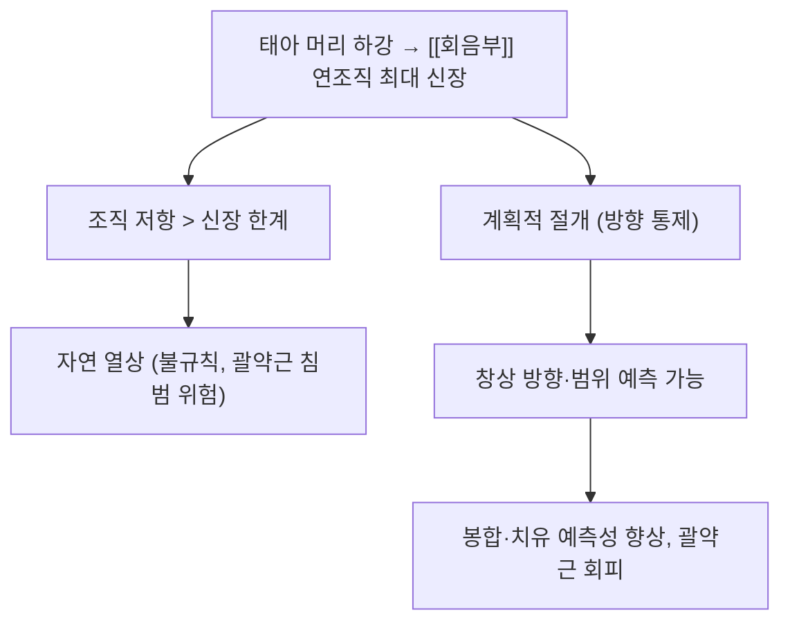

# 🛠️ 회음절개술 (Episiotomy)

> 🖼️ 이미지: 정중측방 절개 도해 1장(CC BY-SA 4.0) 수록. 해부 구조는 [[회음부]] 노트 참조.

> **핵심 3줄 요약 (Key Summary)**:
> - 📍 **무엇을 하는 술기인가**: 분만 2기 말 태아 머리가 내려올 때 [[회음부]] 후방을 인위적으로 절개해 출구를 넓히는 술기. 오늘날은 선택적(restrictive) 시행이 원칙이다.
> - 🚩 **언제 쓰나**: 기구분만, 태아 곤란, 견갑난산, 회음부가 얇아 자연 열상이 임박한 경우. 예방적 일괄 시행은 근거가 없다.
> - 🛠️ **핵심 포인트**: 정중측방 60도 절개가 [[회음열상]] 3·4도(OASIS) 위험을 낮춘다. 절개 자체가 통증·성교통·창상 감염의 원인이 되므로 적응증을 엄격히 판단한다.
> - ⚠️ **주의**: 항문괄약근 침범이 의심되면 절개 연장이 아니라 OASIS 봉합 절차로 전환해야 한다.

---

## 📌 목차
1. [정의·분류](#1-정의분류)
2. [시행 기법 — 단계별 프로토콜](#2-시행-기법--단계별-프로토콜)
3. [작용 기전](#3-작용-기전)
4. [임상 적용 — 적응증과 선택 기준](#4-임상-적용--적응증과-선택-기준)
5. [주의·금기·합병증](#5-주의금기합병증)
6. [한의 임상 연계](#6-한의-임상-연계)
7. [논문·가이드라인 연결](#7-논문가이드라인-연결)
8. [📎 참고 자료](#8--참고-자료)

---

## 1. 정의·분류

![[회음절개술_01_정중측방절개_도해.gif|330]]
> [그림 1: 정중측방 회음절개술 — 가위날을 질구 후방 6시에서 약 60도 측방으로 향하게 두고, 검지·중지로 태아 머리를 보호한 채 절개한다. 점선 호와 화살표는 절개 방향(정중선 대비 측방)을 나타낸다 — 출처: Wikimedia Commons, User:CFCF (CC BY-SA 4.0)]

| 분류 | 절개 방향 | 특징 |
| :--- | :--- | :--- |
| **정중절개 (median)** | 질구 후방 6시 정중선 | 해부학적으로 봉합이 쉽고 치유가 빠르나, 절개가 후방으로 연장되면 [[항문외괄약근]]·직장까지 이어져 OASIS 위험이 높다 |
| **정중측방절개 (mediolateral)** | 6시에서 45~60도 측방(보통 우측) | 연장 시 괄약근 회피 가능. 통증·출혈·봉합 난이도는 정중절개보다 높다. 현재 다수 지침의 선호 방식 |
| **측방절개 (lateral)** | 6시에서 90도 가까이 | 바르톨린샘·혈관 손상 위험으로 거의 쓰지 않는다 |

* **시행률 원칙**: 선택적 시행(restrictive)이 일괄 시행(routine)보다 OASIS를 줄인다. 예방 목적의 상시 시행은 권고되지 않는다.

---

## 2. 시행 기법 — 단계별 프로토콜

| 단계 | 내용 | 실무 포인트 |
| :--- | :--- | :--- |
| **1. 적응증 확인** | 기구분만, 태아 심박 이상, 견갑난산, 회음부 자연 열상 임박 | 산과 팀과 시행 여부를 먼저 합의한다 |
| **2. 마취** | 국소마취제(리도카인) 침윤 또는 기존 경막외 마취 확인 | 태아 하강 직전에 시행하면 효과가 떨어진다 |
| **3. 시점** | 태아 머리가 회음부를 팽창시켜 3~4 cm 보일 때(분만 2기 말) | 너무 이르면 출혈이 늘고, 늦으면 절개 의미가 없다 |
| **4. 보호·절개** | 검지·중지를 질 내에 넣어 태아 머리를 보호하고, 6시에서 60도 방향으로 한 번에 절개 | 여러 번 조금씩 자르면 창상이 거칠어진다 |
| **5. 지혈·분만** | 거즈 압박으로 지혈, 분만 후 태반 만출 확인 | 출혈량을 계량한다 |
| **6. 봉합** | 질 점막 → 회음체 근육 → 피부 순서로 층별 봉합, 연속 또는 단속 | 봉합 후 직장 수지검사로 괄약근·직장점막 손상 여부를 반드시 확인한다 |

* **강도·깊이 기준**: 피부·점막에서 시작해 회음체 근육층까지(2도 상당). 괄약근은 자르지 않는다.
* **중단·전환 기준**: 절개선이 후방으로 연장되어 괄약근이 손상되면 즉시 OASIS 봉합 프로토콜(수술실, 층별 봉합, 예방적 항생제)로 전환한다.

---

## 3. 작용 기전

* 절개의 이득은 '조직 손상을 없애는 것'이 아니라 '손상의 방향과 범위를 통제하는 것'이다. 절개도 외상이므로 이득-손실을 저울질해야 한다.
* 정중측방 절개는 절개선이 괄약근 복합체를 비껴가게 설계해, 연장되더라도 OASIS로 직행할 확률을 낮춘다. 반대로 정중절개는 해부학적 연속선이 항문 방향이라 연장 위험이 크다.

---

## 4. 임상 적용 — 적응증과 선택 기준

* **명확한 적응증**: 기구(겸자·흡입) 분만, 태아 심박 이상으로 분만을 서둘러야 할 때, 견갑난산에서 내회전·후두 만출 조작이 필요할 때, 회음부가 매우 얇고 열상이 임박한 초산부.
* **근거가 약한 적응**: "초산이니까", "찢어지느니 낫다"는 판단. 선택적 시행 연구들은 일괄 시행보다 OASIS·봉합 필요 손상이 적다고 보고한다.
* **산전 예방 축**: [[회음부 마사지]]를 임신 34주부터 시행하면 [[회음절개술]] 시행률과 OASIS 위험이 함께 낮아진다는 메타분석 결과가 있다.

---

## 5. 주의·금기·합병증

* **금기**: 산모가 절개 부위 감염·활동성 헤르페스 병변이 있을 때는 부위를 피하거나 대체 접근을 검토한다. 응고장애·심한 혈소판 감소에서는 출혈 위험을 먼저 평가한다.
* **합병증**: 창상 통증(가장 흔함), 성교통, 봉합부 벌어짐·감염, 출혈, 후방 연장에 의한 [[회음열상]] 3·4도, 드물게 혈종.
* **산후 관리**: 좌욕·국소 냉찜질, 변비 예방, 2주간 격한 앉기·자전거 회피. 통증이 6주 이상 지속되면 근막성·신경성 통증을 감별한다.
* **환자 교육**: "절개 부위는 2주 안에 대부분 붙지만, 통증이 남거나 대변이 새면 반드시 말씀하셔야 합니다."

---

## 6. 한의 임상 연계

* **변증**: 산후 어혈(瘀血)·기혈허손(氣血虛損)·습열(濕熱)로 나누어 접근한다.
* **침구**: 창상 치유 전에는 국소 자침을 피하고, 천추부 배수혈·차료(BL32)·중료(BL33)와 원위 삼음교(SP6)·태충(LR3)으로 순환·통증을 조절한다. [[전침]]은 저빈도로 한정한다.
* **한약·외치**: 산후 어혈 변증에 활혈·소종 처방, 창상 안정 후 좌훈·간접 온열을 고려한다. 감염 징후가 있으면 온열은 금기다.
* **협진**: 창상 벌어짐·발열·악취가 있으면 산과로 즉시 회송한다.

---

## 7. 논문·가이드라인 연결

* **RCOG GTG No. 29 (2015)** — OASIS 분류와 봉합 원칙의 표준. 절개 후 연장 시 등급을 높여 분류하도록 권고.
* **PMID 39871193 (2025, BMC Pregnancy Childbirth)** — 초산부에서 정중측방 회음절개와 OASIS의 연관을 성향점수매칭으로 분석.
* **PMID 42461280 (2026, Int Urogynecol J)** — 회음부 마사지가 회음절개·OASIS를 줄이는지 우산고찰로 정리.
* **PMID 23633325 (Cochrane 2013)** — 산전 회음부 마사지가 회음절개 RR 0.84로 감소.

---

## 8. 📎 참고 자료

* **가이드라인**: [RCOG Green-top Guideline No. 29 — Third- and Fourth-degree Perineal Tears, Management](https://rcog.org.uk/guidance/browse-all-guidance/green-top-guidelines/third-and-fourth-degree-perineal-tears-management-green-top-guideline-no-29) (링크 확인 완료, HTTP 200)
* **환자 설명 자료**: [RCOG — Perineal tears during childbirth (patient information)](https://rcog.org.uk/for-the-public/browse-our-patient-information/perineal-tears-during-childbirth-patient-information-poster) — 회음부 보호(hands-on)와 마사지 방법을 그림으로 설명.
* **시연 영상**: 술기 특성상 시술 장면 영상은 노트에 수록하지 않았다(환자 교육용 영상만 존재, 미확보 명시).
