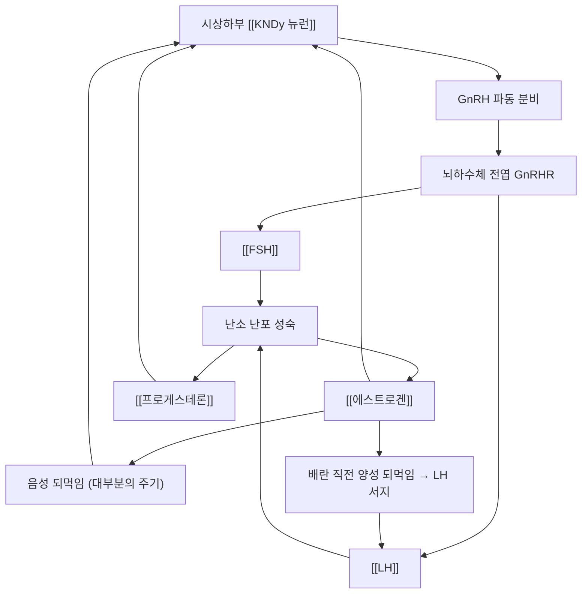

# 🧠 GnRH (Gonadotropin-releasing hormone, 성선자극호르몬방출호르몬)

> **핵심 3줄 요약 (Key Summary)**:
> 🩸 분비 기원 & 화학 계열: 시상하부 **궁상핵 KNDy 뉴런**에서 합성되는 **10개 아미노산 펩타이드 호르몬**이다(pGlu-His-Trp-Ser-Tyr-Gly-Leu-Arg-Pro-Gly-NH₂). 정맥·문맥을 통해 뇌하수체 전엽으로 전달된다.
> 🎯 표적 수용체 & 신호전달: 뇌하수체 전엽 생식샘자극세포의 **GnRHR(GPCR)** 에 결합해 Gq–인산지질가수분해–칼슘 경로로 [[FSH]]·[[LH]] 합성·분비를 조절한다 — **파동(pulsatile) 주파수가 선택성을 결정한다.**
> 🩺 주요 생리 활성 & 관련 질환: 파동 횟수가 많으면 [[LH]], 적으면 [[FSH]] 분비가 촉진된다. **연속·지속 자극은 오히려 생식호르몬 분비를 억제**하며, 이 성질을 이용한 것이 [[GnRH agonist]] 요법이다.
> ⚠️ 임상 연계: [[자궁내막증]]·[[자궁근종]]·중심성 성조숙증 등 에스트로겐 의존성 질환의 약물 축이고, 2026-10-11 리뷰 1번([[다낭성 난소 증후군]] 침·클로미펜 RCT)에서는 배란유도 기전 해석의 상위 고리로 등장한다.

---

## 📌 목차
1. [기본 생화학 정보 & 분자 구조식 (Biochemical Identity)](#1-기본-생화학-정보--분자-구조식-biochemical-identity)
2. [분비 기관 & 생합성 경로 (Biosynthesis & Secretion)](#2-분비-기관--생합성-경로-biosynthesis--secretion)
3. [수용체 & 세포 내 신호전달 경로 (Receptors & Signaling Pathways)](#3-수용체--세포-내-신호전달-경로-receptors--signaling-pathways)
4. [주요 생리 활성 & 표적 장기 효능 (Physiological Actions)](#4-주요-생리-활성--표적-장기-효능-physiological-actions)
5. [분비 조절 & 피드백 기전 (Regulation & Feedback Loop)](#5-분비-조절--피드백-기전-regulation--feedback-loop)
6. [관련 질환 & 병태생리 (Clinical Pathophysiology & Diseases)](#6-관련-질환--병태생리-clinical-pathophysiology--diseases)
7. [약물 치료 표적 & 관련 약물/본초 배오 (Pharmacological Targets & Herbs)](#7-약물-치료-표적--관련-약물본초-배오-pharmacological-targets--herbs)
8. [💡 사용자 진료실 핵심 필기 & 임상 응용 팁 (Melt-In & High-Yield)](#8--사용자-진료실-핵심-필기--임상-응용-팁-melt-in--high-yield)
9. [출처 및 학술 참고 문헌 (References)](#9-출처-및-학술-참고-문헌-references)

---

## 1. 기본 생화학 정보 & 분자 구조식 (Biochemical Identity)

> [!abstract]+ 🧪 3D 약리 분자 구조 (Interactive 3D Viewer)
> <iframe src="https://molecule-viewer-rho.vercel.app/?cid=16132914" style="width: 100%; height: 600px; border: none; border-radius: 12px; box-shadow: 0 4px 20px rgba(0,0,0,0.15);" allowfullscreen></iframe>

![[GnRH_01_구조식2D.png|340]]
> [그림 1: GnRH의 2D 화학 분자 구조식 — PubChem CID 16132914 (PubChem PNG 정본)]

| 항목 | 상세 정보 |
| :--- | :--- |
| **분자명 (Name)** | GnRH(한글: 성선자극호르몬방출호르몬) / Gonadotropin-releasing hormone · LHRH |
| **화학 분류 (Category)** | 호르몬 / 시상하부 신경펩타이드(decapeptide) |
| **분자식 / 분자량** | C60H73N15O13 / 1212.3 g/mol (PubChem CID 16132914) |
| **PubChem CID** | [16132914](https://pubchem.ncbi.nlm.nih.gov/compound/16132914) |
| **주요 분비 기관** | 시상하부 궁상핵 KNDy 뉴런 → 뇌하수체 문맥계 |
| **약물명(합성 유사체)** | gonadorelin — PubChem CID [638793](https://pubchem.ncbi.nlm.nih.gov/compound/638793) |

> 🔧 **식별자 정정 이력 (2026-10-11)**: 이 노트의 3D 뷰어 CID가 종전 **16132342**로 기재돼 있었으나, PubChem 조회 결과 16132342는 **peptide E (adrenal medulla)** (C147H207N41O34S2)였고 GnRH의 실제 CID는 **16132914** (C60H73N15O13)다. 정정한다. (2026-09-27 [[옥시토신]] CID 오기 정정과 동일한 유형의 오류 — 모델 기억으로 적은 식별자는 반드시 조회로 검증한다.)

---

## 2. 분비 기관 & 생합성 경로 (Biosynthesis & Secretion)

* **전구체 (Precursor)**: 92개 아미노산 전구단백질(prepro-GnRH)에서 신호펩타이드가 제거되고, 최종적으로 **10개 아미노산(Glu-His-Trp-Ser-Tyr-Gly-Leu-Arg-Pro-Gly)** 펩타이드가 된다.
* **생합성·소포 저장**: 시상하부 궁상핵 신경세포체에서 합성되어 축삭 말단 소포에 저장되고, **파동(pulse) 단위로** 뇌하수체 문맥혈로 분비된다.
* 파동성 분비(원문 필기 보존): [[GnRH]]는 반감기가 짧아 파동성 분비를 하며, 파동 횟수가 많으면 [[LH]], 적으면 [[FSH]] 분비를 촉진한다.([[GnRH]]를 연속적으로 분비하면 오히려 생식호르몬들이 분비되지 않았다.)
* 파동 발생기: 궁상핵 [[KNDy 뉴런]](키스펩틴·뉴로키닌 B·[[다이노르핀]] 공발현)이 파동 발생의 핵심 신경망으로 설명된다 → [[KNDy 뉴런]]

---

## 3. 수용체 & 세포 내 신호전달 경로 (Receptors & Signaling Pathways)

* **표적 수용체 (Target Receptors)**: 뇌하수체 전엽 생식샘자극세포(gonadotroph)의 **GnRHR** — Gq 결합 단백질 연결 수용체(GPCR).
* **세포 내 신호전달 (Intracellular Cascade)**: Gq → 인산지질가수분해효소 C(PLCβ) → IP₃/DAG → 세포 내 Ca²⁺ 상승 + PKC 활성 → [[FSH]]·[[LH]] 합성·분비.
* **파동 주파수 해독(frequency decoding)**: 저주파 파동은 [[FSH]] 합성 쪽으로, 고주파 파동은 [[LH]] 분비 쪽으로 유리하다는 설명이 표준이다.
* **지속 자극의 역설(desensitization)**: 수용체 하향 조절과 신호 탈감작으로 **연속 자극 시 오히려 생식호르몬이 억제**된다 — 원문 필기의 핵심 관찰이며, 약리학적으로 agonist 요법의 근거가 된다.

---

## 4. 주요 생리 활성 & 표적 장기 효능 (Physiological Actions)

* **생식축 상위 조절**: [[FSH]]·[[LH]] 분비를 조절해 난포 성숙·배란(여성)과 정자 생성·[[테스토스테론]] 합성(남성)을 이끈다 → [[시상하부-뇌하수체-난소축]]
* **난소·고환 기능**: 난포 성장, [[에스트로겐]]·[[프로게스테론]] 생성, 정자 형성.
* **성 분화·사춘기 개시**: 파동 발생기의 활성화가 사춘기 개시와 사춘기 진행을 결정한다.
* **대사·행동 조절**: GnRH 뉴런은 에너지 상태·스트레스 신호([[코르티솔]])·렙틴·키스펩틴의 영향을 받아, 저체중·과도한 운동·스트레스에서 생식 기능이 억제된다 → [[코르티솔]]

---

## 5. 분비 조절 & 피드백 기전 (Regulation & Feedback Loop)

* **음성 되먹임**: 난소 [[에스트로겐]]·[[프로게스테론]]이 시상하부·뇌하수체를 억제해 GnRH·[[LH]]를 낮춘다.
* **양성 되먹임(배란 유발)**: 후기 난포기 에스트로겐 상승이 일정 역치를 넘으면 [[LH]] 서지가 유발된다.
* 상위 조절(원문 필기 보존): [[GnRH]]는 [[도파민]], [[세로토닌]]에 의해 억제되며, [[노르에피네프린]]은 촉진된다.
* **에너지·스트레스 신호**: 저체중·과도한 운동·만성 스트레스·ㆍ갑상선 이상·[[코르티솔]] 상승은 GnRH 파동을 억제해 기능성 시상하부성 무월경을 만든다.
* **반감기**: 혈중 반감기가 매우 짧아(수 분 단위) 말초 혈중 농도 측정으로는 평가하지 않고, 파동 패턴이 임상적 의미를 갖는다 → [[LH]]

---

## 6. 관련 질환 & 병태생리 (Clinical Pathophysiology & Diseases)

| 구분 | 관련 질환·상태 | 기전 |
| :--- | :--- | :--- |
| **파동 이상(증가)** | [[다낭성 난소 증후군]], 중심성 성조숙증 | [[LH]] 파동 증가 → 고안드로겐·조기 사춘기 — [[KNDy 뉴런]] 과활성 |
| **파동 이상(감소)** | 기능성 시상하부성 무월경, [[불임]] | 저체중·과운동·스트레스로 파동 억제 → 무배란 |
| **맥락·구조 이상** | 칼만증후군(후각 이상 동반), 뇌하수체 병변 | GnRH 뉴런 이주·분비 장애 |
| **에스트로겐 의존성 질환 치료 표적** | [[자궁내막증]] · [[자궁근종]] · 자궁샘근종 · 자궁내막증식증 | agonist 지속 자극 → 생식호르몬 억제 → 병변 위축 |
| **폐경 관련** | 폐경 [[폐경전후증후군]] | 난소 기능 소실로 되먹임이 끊겨 [[FSH]]·[[LH]] 상승 |

* **진단적 의미**: [[LH]]/[[FSH]] 비와 파동 패턴은 배란 장애 감별의 주요 지표다 → [[다낭성 난소 증후군]]

---

## 7. 약물 치료 표적 & 관련 약물/본초 배오 (Pharmacological Targets & Herbs)

* **양약 표적 (Western Pharmacology)**
  * [[GnRH agonist]](leuprolide·goserelin 등): 초기 자극 후 지속 투여로 수용체 탈감작 → 생식호르몬 억제. **원문 필기 보존 — [[GnRH agonist]]는 [[GnRH]]를 연속적으로 분비하게 하여 생식호르몬 분비를 감소시키며, 이는 [[자궁내막증]] 수술 후에 월경을 중지시킬 때, [[에스트로겐]] 의존성 질환(월경 질환, [[자궁근종]], 성조숙증 등)에 활용한다. 이는 [[에스트로겐]]이 많이 분비되는 시기의 질환에 사용한다.** → [[자궁내막증]] · [[자궁샘근종]]
  * **add-back 요법**: GnRH agonist 장기 사용 시 저용량 [[에스트로겐]]·프로게스토젠을 추가해 폐경 유사 증상과 골소실을 완화한다.
  * **GnRH antagonist**: 수용체를 직접 차단해 초기 자극 없이 즉시 억제(보조생식술 조절 목적).
  * **경구 GnRH antagonist(NK3R 계열과 구분)**: 배란 조절 목적 제제가 있다.
  * **배란유도와의 관계**: [[클로미펜]]·[[레트로졸]]은 에스트로겐 되먹임을 차단해 파동을 늘리는 방식이고, GnRH agonist는 반대로 파동을 무력화한다 — **같은 축에 반대 방향으로 작용**한다 → [[클로미펜]]
* **한방 본초 & 방제 연계 (K-Medicine Connection)**
  * 보신(補腎)·익정(益精)·소간(疏肝) 방향의 처방이 생식축 기능 회복을 목표로 쓰여 왔다. 대표적으로 [[계지복령환]](혈어·어혈 축), [[소요산]]·[[가미소요산]](간울 축), [[온경탕]](한응 축) 계열이 교과서적으로 언급된다.
  * ⚠️ 이들 처방이 GnRH 파동 자체를 조절한다는 인체 근거는 제한적이다 — **변증 단위의 임상 접근**으로 위치시키고, 배란유도 약물을 대체한다고 말하지 않는다.

---

## 8. 💡 사용자 진료실 핵심 필기 & 임상 응용 팁 (Melt-In & High-Yield)

* **원문 필기 전문 보존**
  * [[GnRH]]는 반감기가 짧아 파동성 분비를 하며, 파동 횟수가 많으면 [[LH]], 적으면 [[FSH]] 분비를 촉진한다. ([[GnRH]]를 연속적으로 분비하면 오히려 생식호르몬들이 분비되지 않았다.)
  * **→ [[GnRH agonist]]는 [[GnRH]]를 연속적으로 분비하게 하여 생식호르몬 분비를 감소시키며, 이는 [[자궁내막증]] 수술 후에 월경을 중지시킬 때, [[에스트로겐]] 의존성 질환(월경 질환, [[자궁근종]], 성조숙증 등)에 활용한다. 이는 [[에스트로겐]]이 많이 분비되는 시기의 질환에 사용한다.**
  * [[GnRH]]는 [[도파민]], [[세로토닌]]에 의해 억제되며, [[노르에피네프린]]은 촉진된다.
* **임상 진단·수치 해석 체크 포인트**
  * 무월경 환자에서 [[LH]]/[[FSH]] 비 상승 + 고안드로겐 → [[다낭성 난소 증후군]] 방향.
  * [[FSH]] 상승 + [[에스트로겐]] 저하 + 안면홍조 → 조기난소부전·폐경 방향.
  * 저체중·과운동·스트레스 + 무월경 + [[FSH]]·[[LH]] 모두 낮음 → 기능성 시상하부성 무월경.
  * 프로락틴·[[TSH]]은 무월경 감별의 필수 항목이다.
* **환자 설명 하이필드 팁**
  * "뇌에서 나오는 신호가 하루에도 여러 번 박자처럼 나뉘어야 난소가 반응합니다. 그런데 이 신호가 끊기지 않고 계속 나가면 난소는 오히려 반응을 멈춥니다. 자궁내막증 치료에 쓰는 주사가 바로 이 원리를 이용하는 것입니다."
  * GnRH agonist를 쓰는 환자에게는 **폐경 유사 증상(홍조·발한·기분 변화)·골소실**과 add-back 필요성을 미리 설명한다.
* **한의 병용 판단**
  * GnRH agonist 치료 중에는 저에스트로겐 상태로 골밀도가 떨어지므로, [[칼슘]]·[[비타민 D]]·[[저항운동]]을 함께 지도한다 → [[골다공증]] · [[골밀도]]
  * 호르몬 억제 상태에서는 온열·보신 처방의 적응증이 달라질 수 있으므로 변증을 다시 본다.
* **상부에 담지 못한 고유 필기**
  * 원문 필기의 임상 핵심은 **"에스트로겐이 많이 분비되는 시기의 질환에 agonist를 쓴다"** 는 한 줄이다. 진료실에서는 이 문장을 치료 선택의 기준으로 먼저 확인한다.

---

## 9. 출처 및 학술 참고 문헌 (References)

1. **Legro RS 등 (2017)**. *Effect of Acupuncture and Clomiphene in Chinese Women With Polycystic Ovary Syndrome: A Randomized Clinical Trial*. **JAMA**, 317(24):2502-2514. [PMID 28655015](https://pubmed.ncbi.nlm.nih.gov/28655015/) · [DOI 10.1001/jama.2017.7217](https://doi.org/10.1001/jama.2017.7217)
   - [연구 요약] PCOS 무배란 여성 1,000명 RCT — 배란유도는 약물 축(클로미펜)이 담당하고 침은 추가 이득을 주지 못했다. GnRH–FSH/LH 축이 배란유도의 상위 고리임을 확인하는 맥락 근거다.
2. **Zhang GS 등 (2025)**. *Acupuncture for polycystic ovary syndrome*. **Cochrane Database Syst Rev**, 10(10):CD007689. [PMID 41147529](https://pubmed.ncbi.nlm.nih.gov/41147529/)
   - [연구 요약] 침 vs 샴침에서 출산·배란 차이가 없었다 — 배란 조절의 약물 축 위치를 재확인한다.
3. **PubChem Compound Summary — GnRH (CID 16132914)**. [링크](https://pubchem.ncbi.nlm.nih.gov/compound/16132914) · **Gonadorelin (CID 638793)**. [링크](https://pubchem.ncbi.nlm.nih.gov/compound/638793)
   - [연구 요약] 분자식 C60H73N15O13·분자량 1212.3 g/mol·2D 구조식(그림 1)을 확인했고, 합성 유사체 gonadorelin의 CID를 별도로 확인했다.
4. **Becker CM 등 (2022)**. *ESHRE guideline: endometriosis*. **Hum Reprod Open**, 2022(2):hoac009. [링크](https://www.eshre.eu/Guidelines-and-Legal/Guidelines/Endometriosis-Guideline)
   - [연구 요약] GnRH agonist(+add-back)의 자궁내막증 통증 치료 위치와 골소실 감시 필요성을 정리한 국제 지침.
5. **Boron & Boulpaep**. *Medical Physiology* — 시상하부-뇌하수체-생식축과 GnRH 파동 발생기(KNDy 뉴런) 표준 생리 기술.

## 함께 보기
- [[KNDy 뉴런]] · [[시상하부-뇌하수체-난소축]] · [[LH]] · [[FSH]] · [[에스트로겐]] · [[프로게스테론]] · [[테스토스테론]] · [[다이노르핀]] · [[노르에피네프린]] · [[세로토닌]] · [[도파민]] · [[코르티솔]] · [[GnRH agonist]] · [[클로미펜]] · [[레트로졸]] · [[아로마타제]] · [[자궁내막증]] · [[자궁샘근종]] · [[다낭성 난소 증후군]] · [[불임]] · [[폐경전후증후군]] · [[조기 폐경]] · [[골다공증]] · [[골밀도]] · [[칼슘]] · [[비타민 D]] · [[저항운동]] · [[계지복령환]] · [[소요산]] · [[가미소요산]] · [[온경탕]]
- [[2026-10-11_부인과소아과_심층리뷰]] 1번 · [[2026-10-11_부인과소아과_개념학습]]
