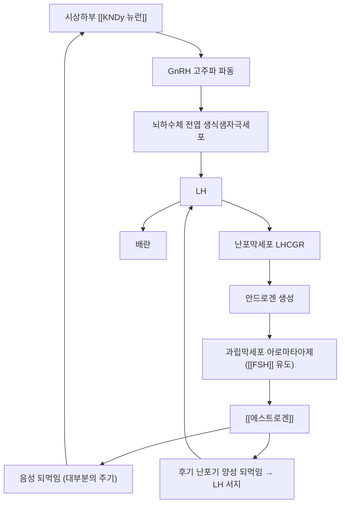

# 🧪 [[LH]] (Luteinizing Hormone, 황체형성호르몬)

> **핵심 3줄 요약 (Key Summary)**:
> - 🌿 분비 기원 & 분자 분류: [[GnRH]]의 **고주파 파동** 자극을 받아 뇌하수체 전엽 생식샘자극세포에서 분비되는 **이종이합체 당단백질 호르몬**([[FSH]]·[[TSH]]·hCG와 공통 α-서브유닛 공유, 특이 β-서브유닛은 *LHB*).
> - 🎯 핵심 분자 표적 & 조절 경로: 여성은 난소 **난포막세포(Theca cell)**, 남성은 고환 **라이디히세포(Leydig cell)**의 LHR(LHCGR, Gs-결합 GPCR)에 결합 → cAMP/PKA 경로로 안드로겐(테스토스테론) 생합성을 촉진. 배란 직전 **LH 서지(surge)**가 배란을 유발한다.
> - 🩺 주요 약리 활성 & 질환 치료 기전: 후기 난포기 고농도 [[에스트로겐]]의 **양성 되먹임**이 LH 서지를 유발해 배란을 일으키며, [[GnRH]] 고주파 파동 증가는 **LH 과다·LH/FSH 비 역전**으로 [[다낭성 난소 증후군]]의 핵심 기전이 된다(PMID 17587857).
> - ⚠️ 식별자 오류 수정: 기존 노트의 PubChem CID 16132366은 조회 결과 LH와 무관한 합성 고리형 펩타이드(C₈₃H₁₃₅N₂₉O₃₀S₂)로 확인되어 삭제하였다. LH는 [[FSH]]·[[TSH]]·[[ACTH]]·[[CRH]]와 같은 당단백질/펩타이드 호르몬이라 단일 소분자 PubChem CID가 존재하지 않는다.

---

## 📌 목차
1. [기본 생화학 정보 & 분자 구조식 (Biochemical Identity)](#1-기본-생화학-정보--분자-구조식-biochemical-identity)
2. [분비 기관 & 생합성 경로 (Biosynthesis & Secretion)](#2-분비-기관--생합성-경로-biosynthesis--secretion)
3. [수용체 & 세포 내 신호전달 경로 (Receptors & Signaling Pathways)](#3-수용체--세포-내-신호전달-경로-receptors--signaling-pathways)
4. [주요 생리 활성 & 표적 장기 효능 (Physiological Actions)](#4-주요-생리-활성--표적-장기-효능-physiological-actions)
5. [분비 조절 & 피드백 기전 (Regulation & Feedback Loop)](#5-분비-조절--피드백-기전-regulation--feedback-loop)
6. [관련 질환 & 병태생리 (Clinical Pathophysiology & Diseases)](#6-관련-질환--병태생리-clinical-pathophysiology--diseases)
7. [약물 치료 표적 & 관련 약물/본초 배오 (Pharmacological Targets & Herbs)](#7-약물-치료-표적--관련-약물본초-배오-pharmacological-targets--herbs)
8. [💡 사용자 진료실 핵심 필기 & 임상 응용 팁 (Melt-In & High-Yield)](#8--사용자-진료실-핵심-필기--임상-응용-팁-melt-in--high-yield)
9. [출처 및 학술 참고 문헌 (References)](#9-출처-및-학술-참고-문헌-references)

---

## 1. 기본 생화학 정보 & 분자 구조식 (Biochemical Identity)

| 항목 | 상세 내용 |
| :--- | :--- |
| **분자 유형** | 이종이합체(heterodimer) 당단백질 호르몬 — PubChem 소분자 CID **없음**(기존 기재 CID 16132366은 무관한 합성 펩타이드로 확인돼 삭제) |
| **공통 α-서브유닛 유전자** | *CGA* (92개 아미노산, [[FSH]]·[[TSH]]·hCG와 동일 서열 공유) |
| **특이 β-서브유닛 유전자** | *LHB* (121개 아미노산, LHR과의 특이적 결합 및 생물학적 활성 결정) |
| **수용체** | LHCGR (난소 난포막세포·황체세포, 고환 라이디히세포 표면 Gs-결합 GPCR) |
| **반감기** | 혈중 반감기 약 20~30분(FSH보다 짧음 — 당쇄화 차이에 기인) |

---

## 2. 분비 기관 & 생합성 경로 (Biosynthesis & Secretion)

* **분비 기관**: 뇌하수체 전엽 생식샘자극세포(gonadotroph)에서 [[FSH]]와 함께 합성·저장되며, [[GnRH]] 박동에 반응해 분비된다.
* **파동 주파수 의존성**: 시상하부 궁상핵 [[KNDy 뉴런]]이 만드는 **고주파(60~90분당 1회) GnRH 파동**이 LH 전사·분비를 우선적으로 촉진한다(저주파 파동은 [[FSH]] 우위) — [[GnRH]] §2~3 참고.
* **당쇄화(glycosylation)**: α/β 서브유닛 모두 N-결합 당쇄가 붙어 수용체 결합력·반감기를 조절하며, [[FSH]]보다 당쇄가 적어 반감기가 짧다.

---

## 3. 수용체 & 세포 내 신호전달 경로 (Receptors & Signaling Pathways)

* **여성 (난소 표적)**:
  * **난포막세포(Theca cell)**: LHCGR 자극 → cAMP/PKA → 콜레스테롤의 안드로겐(안드로스텐디온·테스토스테론) 전환 촉진. 이 안드로겐이 과립막세포로 이동해 [[FSH]] 유도 아로마타아제(CYP19A1)에 의해 [[에스트로겐]]으로 전환된다("Two-cell, two-gonadotropin" 모델).
  * **배란 후 황체세포**: LH가 황체(corpus luteum) 유지와 [[프로게스테론]] 분비를 지속시킨다.
* **남성 (고환 표적)**:
  * **라이디히세포(Leydig cell)**: LHCGR 자극 → cAMP/PKA → StAR 단백질 발현 증가 → 콜레스테롤의 미토콘드리아 내 이동 촉진 → [[테스토스테론]] 생합성.
* **배란 유발 기전(LH surge)**: 후기 난포기 고농도 [[에스트로겐]](>200 pg/mL, 48시간 이상 지속)이 시상하부·뇌하수체에 대한 **양성 되먹임**으로 전환되어 LH가 수십 배 폭발적으로 분비되며, 이 서지가 배란(난포 파열)을 직접 유발한다.

---

## 4. 주요 생리 활성 & 표적 장기 효능 (Physiological Actions)

* **배란 유발**: LH 서지가 난포 파열과 1차 난모세포의 2차 감수분열 재개를 유도한다.
* **황체 유지**: 배란 후 LH(및 초기 임신의 hCG)가 황체를 지지해 [[프로게스테론]] 분비를 유지, 자궁내막 착상 환경을 조성한다.
* **남성 생식샘 자극**: 라이디히세포의 테스토스테론 생합성을 자극해 정자 형성(세르톨리세포는 [[FSH]]가 자극)과 이차성징을 유지한다.
* **"Two-cell, two-gonadotropin" 모델**: LH(난포막세포 안드로겐)와 FSH(과립막세포 아로마타아제)가 협동해야 정상적인 에스트로겐 합성이 완성된다 → [[FSH]]

---

## 5. 분비 조절 & 피드백 기전 (Regulation & Feedback Loop)

* **음성 되먹임**: 대부분의 주기 동안 [[에스트로겐]]·[[프로게스테론]]이 시상하부·뇌하수체를 억제해 LH를 낮춘다.
* **양성 되먹임(배란기)**: 후기 난포기 지속적 고농도 에스트로겐이 역치를 넘으면 음성→양성 되먹임으로 전환되어 LH 서지가 발생한다.
* **파동 주파수 해독**: [[GnRH]] 파동이 빠를수록 LH 분비가, 느릴수록 FSH 분비가 우위에 선다 — 궁상핵 [[KNDy 뉴런]]의 키스펩틴이 이 주파수를 조절한다.

---

## 6. 관련 질환 & 병태생리 (Clinical Pathophysiology & Diseases)

| 구분 | 관련 질환·상태 | 기전 |
| :--- | :--- | :--- |
| **LH 과다·비율 역전** | [[다낭성 난소 증후군]] | GnRH 고주파 파동 가속 → LH 과다분비, [[FSH]]는 상대적으로 억제 → **LH/FSH 비 2~3 이상 역전**, 난포막세포 안드로겐 과잉 생성(고안드로겐혈증)(PMID 17587857) |
| **LH 결핍** | 저성선자극호르몬성 성선저하증, 칼만증후군 | [[GnRH]] 분비 저하·결손으로 LH·FSH 모두 저하 → 무월경·불임 |
| **LH 서지 이상** | 황체화 미파열난포 증후군(LUF) | LH 서지는 있으나 난포 파열이 일어나지 않아 배란 없이 황체화만 진행 |
| **폐경 관련** | 폐경·조기 난소 부전 | 난소 되먹임 소실로 LH·[[FSH]] 모두 상승(단 FSH 상승이 더 현저) |

* **진단적 의미**: LH/[[FSH]] 비율은 PCOS 배란 장애 감별의 보조 지표이며, 소변·혈중 LH 급증 검출은 가정용 배란테스트기의 원리다.

---

## 7. 약물 치료 표적 & 관련 약물/본초 배오 (Pharmacological Targets & Herbs)

* **양약 표적 (Western Pharmacology)**
  * **hCG(human chorionic gonadotropin) 투여**: LH와 동일한 LHCGR에 결합하며 반감기가 길어, 보조생식술에서 **배란 유발 트리거**로 사용한다(LH 서지를 모방).
  * **GnRH agonist/antagonist**: 장기 투여 시 뇌하수체 탈감작·직접 차단으로 LH·[[FSH]] 분비를 억제 → [[GnRH]] §7 참고.
  * **클로미펜·레트로졸**: 에스트로겐 되먹임을 차단해 GnRH/LH 파동을 늘려 배란을 유도 → [[클로미펜]]
* **한방 본초 & 방제 연계 (K-Medicine Connection)**
  * 보신(補腎)·조경(調經) 방향의 처방([[육미지황탕]], [[조경종옥탕]] 등)이 HPO축 균형 회복을 목표로 쓰여왔다.
  * ⚠️ 이들 처방이 LH 분비를 직접 조절한다는 인체 근거는 제한적이며, 변증 단위의 보조적 접근으로 위치시킨다.

---

## 8. 💡 사용자 진료실 핵심 필기 & 임상 응용 팁 (Melt-In & High-Yield)

* **사용자 원문 필기**: (별도 수기 필기 원문 없음 — 추후 원장님 필기 입력 시 본 위치에 100% 보존)
* **임상 수치 해석 체크 포인트**:
  * LH/[[FSH]] 비 2~3 이상 + 고안드로겐 → [[다낭성 난소 증후군]] 방향.
  * LH·[[FSH]] 모두 낮음 + 무월경 → 저성선자극호르몬성 성선저하증(시상하부·뇌하수체 원인).
  * 배란테스트기의 LH 급증 검출은 배란 1~2일 전을 알려주는 실용적 지표다.
* **환자 설명 팁**: "배란테스트기가 양성이 되는 것은 뇌에서 LH가 갑자기 쏟아져 나오는 순간을 포착한 것으로, 이 LH 급증이 난자를 터뜨리는 신호입니다."

---

## 9. 출처 및 학술 참고 문헌 (References)

1. Skorupskaite K, George JT, Anderson RA (2014). The kisspeptin-GnRH pathway in human reproductive health and disease. *Human Reproduction Update*, 20(4):485-500. PMID: [24615662](https://pubmed.ncbi.nlm.nih.gov/24615662/)
   - `[연구 요약]` 키스펩틴-GnRH 경로가 GnRH 파동 발생기를 조절해 LH·FSH 분비를 결정하는 기전과 PCOS·시상하부성 무월경 등 생식 질환과의 연관성을 정리한 종설.
2. Escobar ME, Ropelato MG, Ballerini MG, Gryngarten MG, Rudaz MC, Veldhuis JD, Barontini M (2007). Acceleration of luteinizing hormone pulse frequency in adolescent girls with a history of central precocious puberty with versus without hyperandrogenism. *Hormone Research*, 68(6):278-85. PMID: [17587857](https://pubmed.ncbi.nlm.nih.gov/17587857/)
   - `[연구 요약]` 중심성 성조숙증 병력이 있는 청소년에서 LH 파동 주파수 가속과 고안드로겐혈증의 연관성을 분석 — PCOS의 GnRH/LH 과활성 기전에 대한 임상 근거.
3. Boron & Boulpaep. *Medical Physiology* — 시상하부-뇌하수체-생식축, LH 서지 및 "two-cell, two-gonadotropin" 모델의 표준 생리 기술. (교과서, PMID 해당 없음)

> ⚠️ 내용 검토 필요 (2026-10-12 클로드): 기존 1섹션 스텁(PubChem CID 16132366 — 조회 결과 무관한 합성 펩타이드)을 9섹션 표준 템플릿으로 전면 재작성. CID는 삭제(LH는 펩타이드 호르몬이라 소분자 CID 없음). PMID 2건 모두 esummary로 제목·저자·서지 전부 확인 완료.
