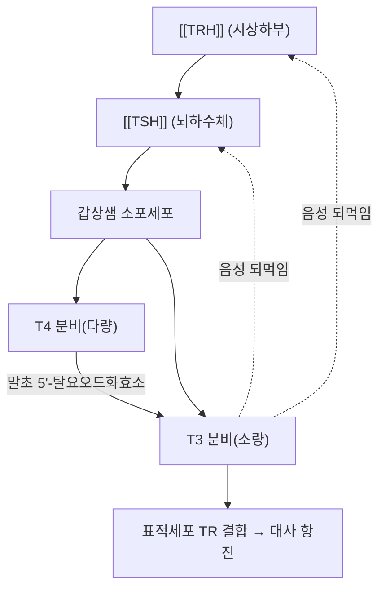

# 🧪 [[갑상샘 호르몬]] (Thyroid Hormone, T3/T4)

> **핵심 3줄 요약 (Key Summary)**:
> - 🌿 분비 기원 & 분자 분류: 갑상샘 소포세포에서 요오드화 티로신 잔기를 결합해 합성되는 **요오드화 아미노산 호르몬**. 티록신(T4)과 트리요오드타이로닌(T3) 두 형태가 있으며, 혈중 순환량은 T4가 압도적으로 많으나 생리활성은 T3가 훨씨 크다(원문 필기).
> - 🎯 핵심 분자 표적 & 조절 경로: 표적세포 핵 내 갑상샘호르몬 수용체(TR)에 결합해 유전자 발현을 조절하며, 교감신경 활성화를 통해 에너지 대사·단백질 합성을 촉진한다(원문 필기).
> - 🩺 주요 생리 활성: 발육·뼈 형성·생식 기능을 조절하며 전신 조직의 에너지 대사를 항진시킨다(원문 필기). 중증 환자의 혈중 T3 저하(저T3증후군)는 예후 지표로 연구된다.
> - ⚠️ 식별자 확인: PubChem CID 5819(T4/thyroxine)는 재확인 결과 정확함(C₁₅H₁₁I₄NO₄, 776.87 g/mol).

> **사용자 원문 필기 (보존)**:
- 싸이톡신(T4)와 트라이아이오도싸이로닌(T3)이 있으며, 생리활성은 3이 크지만 혈액 속을 순환하는 대부분의 갑상샘 호르몬은 4이다.
- 교감신경 활성화하여 에너지 대사와 단백질 합성 등과 같은 대사를 촉진
- 발육, 뼈 형성, 생식 등의 생리적 기능을 조절하며 모든 조직에서 에너지 대사를 항진시킨다.

---

## 📌 목차
1. [기본 생화학 정보 & 분자 구조식 (Biochemical Identity)](#1-기본-생화학-정보--분자-구조식-biochemical-identity)
2. [분비 기관 & 생합성 경로 (Biosynthesis & Secretion)](#2-분비-기관--생합성-경로-biosynthesis--secretion)
3. [수용체 & 세포 내 신호전달 경로 (Receptors & Signaling Pathways)](#3-수용체--세포-내-신호전달-경로-receptors--signaling-pathways)
4. [주요 생리 활성 & 표적 장기 효능 (Physiological Actions)](#4-주요-생리-활성--표적-장기-효능-physiological-actions)
5. [분비 조절 & 피드백 기전 (Regulation & Feedback Loop)](#5-분비-조절--피드백-기전-regulation--feedback-loop)
6. [관련 질환 & 병태생리 (Clinical Pathophysiology & Diseases)](#6-관련-질환--병태생리-clinical-pathophysiology--diseases)
7. [약물 치료 표적 & 한의학적 연계 (Pharmacological Targets & Herbs)](#7-약물-치료-표적--한의학적-연계-pharmacological-targets--herbs)
8. [💡 사용자 진료실 핵심 필기 & 임상 응용 팁 (Melt-In & High-Yield)](#8--사용자-진료실-핵심-필기--임상-응용-팁-melt-in--high-yield)
9. [출처 및 학술 참고 문헌 (References)](#9-출처-및-학술-참고-문헌-references)

---

## 1. 기본 생화학 정보 & 분자 구조식 (Biochemical Identity)

> [!abstract]+ 🧪 3D 약리 분자 구조 (Interactive 3D Viewer, T4)
> <iframe src="https://molecule-viewer-rho.vercel.app/?cid=5819" style="width: 100%; height: 600px; border: none; border-radius: 12px; box-shadow: 0 4px 20px rgba(0,0,0,0.15);" allowfullscreen></iframe>

| 항목 | T4 (Thyroxine) | T3 (Triiodothyronine) |
| :--- | :--- | :--- |
| **분자식 / 분자량** | C₁₅H₁₁I₄NO₄ / 776.87 g/mol | C₁₅H₁₂I₃NO₄ / 650.97 g/mol |
| **PubChem CID** | [5819](https://pubchem.ncbi.nlm.nih.gov/compound/5819) | [5920](https://pubchem.ncbi.nlm.nih.gov/compound/5920) |
| **요오드 치환 개수** | 4개 | 3개 |
| **혈중 상대 비중** | 약 90% (순환량 우세) | 약 10% (활성 우세) |
| **생리활성 상대 강도** | 1 (기준) | 약 3~4배 강함 |

---

## 2. 분비 기관 & 생합성 경로 (Biosynthesis & Secretion)

* **분비 기관**: 갑상샘 소포세포(follicular cell)에서 티로글로불린(thyroglobulin)에 결합된 티로신 잔기가 갑상샘 과산화효소(TPO)에 의해 요오드화되어 T4·T3가 합성된다.
* **분비 조절**: [[TSH]]의 자극을 받아 소포세포에서 티로글로불린의 단백질 가수분해를 통해 T4·T3가 혈중으로 분비된다 → [[TSH]]
* **말초 전환**: 분비된 T4의 상당량이 간·신장 등 말초 조직에서 **5′-탈요오드화효소(5′-deiodinase)**에 의해 활성이 더 강한 T3로 전환된다. 중증 질환 상태에서는 이 전환이 억제되어 저T3증후군(low T3 syndrome)이 나타날 수 있다.

---

## 3. 수용체 & 세포 내 신호전달 경로 (Receptors & Signaling Pathways)

* **핵 수용체 결합**: T3가 세포 내로 들어가 핵 내 갑상샘호르몬 수용체(TRα, TRβ)에 결합 → 표적 유전자의 전사를 직접 조절(유전체적 작용).
* **교감신경 상호작용**: T3/T4는 베타-아드레날린성 수용체 발현을 상향 조절해 교감신경 반응성을 증대시키며, 이것이 원문 필기의 "교감신경 활성화" 서술의 분자적 배경이다.
* **비유전체적 작용**: 세포막·미토콘드리아에 대한 급속 작용도 보고되나, 주된 기전은 핵 수용체를 통한 유전자 발현 조절이다.

---

## 4. 주요 생리 활성 & 표적 장기 효능 (Physiological Actions)

* **기초대사율(BMR) 조절**: 전신 조직의 산소 소비와 열 생성을 증가시켜 기초대사율을 항진시킨다(원문 필기).
* **성장·발육**: 소아기 골성장판의 정상 성숙과 중추신경계 발달에 필수적이다(원문 필기 "발육, 뼈 형성").
* **생식 기능**: 정상적인 월경주기·배란·정자 형성 유지에 관여한다(원문 필기 "생식").
* **단백질·지질·탄수화물 대사**: 단백질 합성을 촉진하고(원문 필기), 지질 대사·포도당 이용을 항진시킨다.
* **심혈관계**: 심박수·심박출량을 증가시키고 전신혈관저항을 낮춘다.

---

## 5. 분비 조절 & 피드백 기전 (Regulation & Feedback Loop)

* **음성 되먹임**: T3/T4가 시상하부([[TRH]])와 뇌하수체([[TSH]])를 억제해 과다 분비를 방지한다(HPT 축 항상성, PMID 26635726) → [[TRH]] · [[TSH]]
* **말초 전환 조절**: 중증 질환·기아 상태에서는 5′-탈요오드화효소 활성이 떨어지고 역T3(rT3, 비활성) 생성이 늘어 대사를 낮추는 적응 반응이 나타난다.

---

## 6. 관련 질환 & 병태생리 (Clinical Pathophysiology & Diseases)

| 구분 | 관련 질환·상태 | 기전 |
| :--- | :--- | :--- |
| **과다** | 그레이브스병, 중독성 결절성 갑상샘종 | T3/T4 과다 분비 → 대사 항진, 빈맥, 체중감소, 안구돌출(그레이브스병) |
| **부족** | 하시모토 갑상샘염, 원발성 갑상샘기능저하증 | T3/T4 합성 저하 → 대사 저하, 체중증가, 부종, 서맥 |
| **중추성 이상** | 중추성 갑상샘기능저하증 | [[TRH]]·[[TSH]] 분비 결함 → 2차적 T3/T4 저하 → [[TRH]] |
| **중증 질환 적응** | 저T3증후군(low T3 syndrome, non-thyroidal illness syndrome) | 중증 질환에서 말초 전환 억제·rT3 증가, 예후 지표로 연구됨 |
| **치료 관련** | 레보티록신(T4) 치료 후 반응 지연 | 외부 투여 T4의 말초 T3 전환에 시간이 걸려 임상 반응이 지연될 수 있음(PMID 31321670) |

---

## 7. 약물 치료 표적 & 한의학적 연계 (Pharmacological Targets & Herbs)

* **양약 표적 (Western Pharmacology)**
  * **레보티록신(Levothyroxine, 합성 T4)**: 갑상샘기능저하증의 표준 치료제로, 70년 이상 사용되어 온 약물이다(PMID 31321670).
  * **항갑상샘제(Methimazole, PTU)**: 갑상샘과산화효소(TPO)를 억제해 T3/T4 합성을 차단, 그레이브스병 등 갑상샘기능항진증 치료에 사용.
  * **베타차단제**: 갑상샘기능항진증의 교감신경 항진 증상(빈맥·진전) 대증 치료.
* **한방 본초 & 방제 연계 (K-Medicine Connection)**
  * 갑상샘기능 이상의 한의학적 변증은 기허(氣虛)·간울(肝鬱)·담음(痰飮) 등 다양한 변증 범주로 접근되어 왔으나, 특정 본초·처방이 T3/T4 분비를 직접 조절한다는 인체 근거는 제한적이다.
  * ⚠️ 갑상샘기능 이상 환자의 한의학적 접근은 양약 치료를 대체하지 않는 보조적 변증 단위로 위치시킨다.

---

## 8. 💡 사용자 진료실 핵심 필기 & 임상 응용 팁 (Melt-In & High-Yield)

* **사용자 원문 필기**: 위 핵심 요약 바로 아래에 100% 보존.
* **임상 수치 해석 체크 포인트**:
  * [[TSH]] 상승 + T4 저하 → 원발성 갑상샘기능저하증.
  * [[TSH]] 저하 + T4 상승 → 원발성 갑상샘기능항진증.
  * 중증 입원 환자의 T3 저하 + TSH 정상/경도저하 → 저T3증후군(치료 대상이 아닌 적응 반응일 수 있음) 가능성을 먼저 고려한다.
* **환자 설명 팁**: "갑상샘에서는 T4를 훨씨 많이 만들지만, 실제로 몸을 움직이는 활성 호르몬은 T3입니다. T4는 몸 곳곳에서 필요할 때 T3로 바뀌는 저장형 호르몬이라고 생각하면 됩니다."

---

## 9. 출처 및 학술 참고 문헌 (References)

1. Chakera AJ, Pearce SH, Vaidya B (2019). Thyroxine and treatment of hypothyroidism: seven decades of experience. *Endocrine*, 66(1):45-52. PMID: [31321670](https://pubmed.ncbi.nlm.nih.gov/31321670/)
   - `[연구 요약]` 레보티록신(합성 T4) 치료의 70년 임상 경험을 정리한 종설. T4의 말초 T3 전환과 치료 반응의 시간적 지연을 다룬다.
2. Fliers E, Bianco AC, Langouche L, Boelen A (2015). Homeostatic Control of the Thyroid-Pituitary Axis: Perspectives for Diagnosis and Treatment. *Frontiers in Endocrinology*, 6:1-11. PMID: [26635726](https://pubmed.ncbi.nlm.nih.gov/26635726/)
   - `[연구 요약]` HPT 축의 음성 되먹임 기전과 중증 질환에서의 말초 T4→T3 전환 저하(저T3증후군) 적응 반응을 정리한 종설.

> ⚠️ 내용 검토 필요 (2026-10-12 클로드): 원문 필기(3줄) 100% 보존하고 9섹션 표준 템플릿을 신규 추가. PubChem CID 5819(T4)는 재확인 결과 정확함. 실제 PMID 2건 신규 확보.
