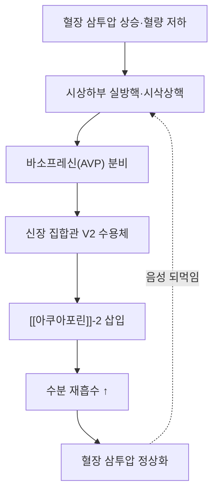

# 🧪 [[바소프레신]] (Arginine Vasopressin, AVP / 항이뇨호르몬, ADH)

> **핵심 3줄 요약 (Key Summary)**:
> - 🌿 분비 기원 & 분자 분류: 시상하부 **실방핵·시삭상핵**에서 합성되는 **9개 아미노산 고리형 펩타이드**(Cys-Tyr-Phe-Gln-Asn-Cys-Pro-Arg-Gly-NH₂, 이황화결합으로 고리 형성). 뇌하수체 후엽으로 축삭 수송되어 저장·분비된다.
> - 🎯 핵심 분자 표적 & 조절 경로: 신장 집합관 **V2 수용체**(Gs-결합) 자극 → cAMP/PKA → **아쿠아포린-2(AQP2)** 삽입 촉진 → 수분 재흡수(항이뇨 작용). 혈관 평활근 **V1 수용체**(Gq-결합)는 혈관수축 작용을 매개한다.
> - 🩺 주요 생리 활성 & 질환 치료 기전: 혈장 삼투압 상승·혈량 저하가 분비를 자극하며, 결핍 시 **중추성 요붕증**(다량의 희박뇨), 과다·부적절 분비 시 **SIADH**(저나트륨혈증)가 나타난다(PMID 16843083).
> - ⚠️ 식별자 오류 수정: 기존 노트의 PubChem CID 5284352는 조회 결과 바소프레신과 무관한 브로모인돌 알칼로이드(C₃₃H₄₄BrN₅O₈S)로 확인되어 정정하였다. 바소프레신의 실제 CID는 **644077**이다.

---

## 📌 목차
1. [기본 생화학 정보 & 분자 구조식 (Biochemical Identity)](#1-기본-생화학-정보--분자-구조식-biochemical-identity)
2. [분비 기관 & 생합성 경로 (Biosynthesis & Secretion)](#2-분비-기관--생합성-경로-biosynthesis--secretion)
3. [수용체 & 세포 내 신호전달 경로 (Receptors & Signaling Pathways)](#3-수용체--세포-내-신호전달-경로-receptors--signaling-pathways)
4. [주요 생리 활성 & 표적 장기 효능 (Physiological Actions)](#4-주요-생리-활성--표적-장기-효능-physiological-actions)
5. [분비 조절 & 피드백 기전 (Regulation & Feedback Loop)](#5-분비-조절--피드백-기전-regulation--feedback-loop)
6. [관련 질환 & 병태생리 (Clinical Pathophysiology & Diseases)](#6-관련-질환--병태생리-clinical-pathophysiology--diseases)
7. [약물 치료 표적 & 한의학적 연계 (Pharmacological Targets & Herbs)](#7-약물-치료-표적--한의학적-연계-pharmacological-targets--herbs)
8. [💡 사용자 진료실 핵심 필기 & 임상 응용 팁 (Melt-In & High-Yield)](#8--사용자-진료실-핵심-필기--임상-응용-팁-melt-in--high-yield)
9. [출처 및 학술 참고 문헌 (References)](#9-출처-및-학술-참고-문헌-references)

---

## 1. 기본 생화학 정보 & 분자 구조식 (Biochemical Identity)

> [!abstract]+ 🧪 3D 약리 분자 구조 (Interactive 3D Viewer)
> <iframe src="https://molecule-viewer-rho.vercel.app/?cid=644077" style="width: 100%; height: 600px; border: none; border-radius: 12px; box-shadow: 0 4px 20px rgba(0,0,0,0.15);" allowfullscreen></iframe>

| 항목 | 상세 내용 |
| :--- | :--- |
| **분자식 / 분자량** | C₄₆H₆₅N₁₅O₁₂S₂ / 1084.2 g/mol (PubChem CID 644077 조회 확인) |
| **PubChem CID** | [644077](https://pubchem.ncbi.nlm.nih.gov/compound/644077) |
| **구조** | 9개 아미노산 고리형 펩타이드, 1-6번 Cys 간 이황화결합으로 6원 고리 형성 — [[옥시토신]]과 2개 아미노산만 다른 상동 펩타이드 |
| **주요 분비 기관** | 시상하부 실방핵(PVN)·시삭상핵(SON) 신경분비세포 → 뇌하수체 후엽 |

> 🔧 **식별자 정정 이력 (2026-10-12)**: 기존 CID 5284352는 PubChem 조회 결과 브로모인돌 알칼로이드(이황화결합 없는 전혀 다른 분자)로 확인되어 실제 바소프레신 CID 644077로 정정한다.

---

## 2. 분비 기관 & 생합성 경로 (Biosynthesis & Secretion)

* **전구체**: prepro-AVP가 신경분비세포에서 합성되어 분비과립 안에서 가공되며, 뇌하수체 후엽까지 축삭 수송되어 저장된다(옥시토신과 같은 뇌하수체 후엽 경로, 서로 다른 신경세포에서 생산).
* **분비 자극**: 혈장 삼투압 상승(1~2% 변화에도 민감하게 반응), 혈량 감소·저혈압, 오심, 통증, 스트레스.
* **노화와의 관계**: 나이가 들면 항이뇨호르몬 반응성·분비가 저하되는 경향이 있어 고령자의 야간뇨·탈수 위험이 증가한다(원문 필기 — [[뇌하수체 호르몬]] 참고).

---

## 3. 수용체 & 세포 내 신호전달 경로 (Receptors & Signaling Pathways)

* **V2 수용체(신장 집합관 주세포)**: Gs 결합 → adenylate cyclase 활성화 → cAMP ↑ → PKA → [[아쿠아포린]]-2(AQP2) 소포의 관내막 삽입 촉진 → 수분 재흡수 증가(항이뇨 작용).
* **V1a 수용체(혈관 평활근)**: Gq 결합 → PLC-IP₃/DAG-Ca²⁺ 경로 → 혈관 평활근 수축(혈관수축 작용, 고용량에서 두드러짐).
* **V1b 수용체(뇌하수체 전엽)**: [[ACTH]] 분비를 보조적으로 촉진(스트레스 반응의 [[CRH]]-ACTH 축 보조 인자).

---

## 4. 주요 생리 활성 & 표적 장기 효능 (Physiological Actions)

* **수분 재흡수(항이뇨)**: 신장 집합관에서 자유수분 재흡수를 늘려 소변을 농축시키고 혈장 삼투압을 정상화한다.
* **혈관 긴장도 유지**: 고용량에서 혈관수축을 통해 혈압을 보조적으로 유지한다(중증 저혈압·패혈성 쇽크에서 승압제로 활용).
* **혈액량·삼투압 조절**: 혈액량, 삼투압을 조절하며 혈관수축작용, 항이뇨작용을 한다(원문 필기).

---

## 5. 분비 조절 & 피드백 기전 (Regulation & Feedback Loop)

* **음성 되먹임**: 수분 재흡수로 혈장 삼투압이 정상화되면 AVP 분비가 감소한다.
* **노화에 따른 변화**: 나이가 들면 항이뇨호르몬 분비·신장 반응성이 저하되는 경향이 있다(원문 필기).

---

## 6. 관련 질환 & 병태생리 (Clinical Pathophysiology & Diseases)

| 구분 | 관련 질환·상태 | 기전 |
| :--- | :--- | :--- |
| **결핍/수용체 이상** | 중추성 요붕증 / 신성 요붕증 | AVP 분비 저하(중추성) 또는 V2 수용체·AQP2 반응성 소실(신성) → 다량의 희박뇨, 심한 갈증 |
| **과다·부적절 분비** | SIADH(부적절 항이뇨호르몬 분비 증후군) | 혈량·삼투압 신호와 무관하게 AVP 과다 분비 → 수분 과잉 저류 → 저나트륨혈증(PMID 16843083) |
| **정신과 연관** | 조현병 환자의 다음증·저나트륨혈증 | 정신병적 악화기에 AVP 분비가 증가해 수분중독 위험이 보고됨 |

---

## 7. 약물 치료 표적 & 한의학적 연계 (Pharmacological Targets & Herbs)

* **양약 표적 (Western Pharmacology)**
  * **데스모프레신(desmopressin, V2 선택적 합성 유사체)**: 중추성 요붕증·야뇨증·일부 출혈성 질환(von Willebrand병) 치료에 사용.
  * **바소프레신 제제**: 패혈성 쇽크 등 중증 저혈압에서 승압제 보조로 사용(V1a 매개 혈관수축).
  * **바소프레신 수용체 차단제(톨밥탄 등, V2 차단)**: SIADH·저나트륨혈증 치료에 사용.
* **한방 본초 & 방제 연계 (K-Medicine Connection)**
  * 다음·다뇨·야뇨 증상의 한의학적 변증(신허·소갈 범주)과 연계될 수 있으나, 특정 본초·처방이 AVP 분비를 직접 조절한다는 인체 근거는 확인되지 않았다 ⚠️.

---

## 8. 💡 사용자 진료실 핵심 필기 & 임상 응용 팁 (Melt-In & High-Yield)

* **사용자 원문 필기**: [[바소프레신]]은 혈액량, 삼투압을 조절하며 혈관수축작용, 항이뇨작용을 한다(나이가 먹으면 [[항이뇨호르몬]] 적어짐). — [[뇌하수체 호르몬]] 노트에서 이관.
* **임상 체크 포인트**: 고령 환자의 야간뇨·탈수 경향은 AVP 반응성 저하와 연관될 수 있어 수분 섭취 타이밍 지도가 실용적이다.
* **감별 포인트**: 다음·다뇨 환자에서 저나트륨혈증이면 SIADH, 고나트륨혈증·희박뇨면 요붕증 방향으로 접근한다.

---

## 9. 출처 및 학술 참고 문헌 (References)

1. Robertson GL (2006). Regulation of arginine vasopressin in the syndrome of inappropriate antidiuresis. *The American Journal of Medicine*, 119(7 Suppl 1):S36-42. PMID: [16843083](https://pubmed.ncbi.nlm.nih.gov/16843083/)
   - `[연구 요약]` SIADH에서 혈량·삼투압 신호와 무관하게 AVP가 부적절하게 분비되는 기전과 임상적 분류를 정리한 종설.

> ⚠️ 내용 검토 필요 (2026-10-12 클로드): 기존 1섹션 스텁(PubChem CID 5284352 — 조회 결과 무관한 브로모인돌 알칼로이드)을 9섹션 표준 템플릿으로 전면 재작성. CID를 644077로 정정. [[뇌하수체 호르몬]] 노트의 바소프레신 관련 원문 필기 1줄을 이 노트로 Melt-In하여 보존.
