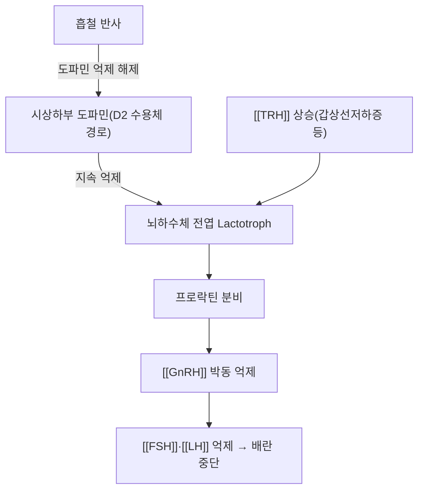

# 🧪 [[프로락틴]] (Prolactin, PRL)

> **핵심 3줄 요약 (Key Summary)**:
> - 🌿 분비 기원 & 분자 분류: 뇌하수체 전엽 젖샘자극세포(Lactotroph)에서 분비되는 **198개 아미노산 단일쇄 폴리펩타이드**. 다른 전엽 호르몬과 달리 시상하부 **도파민의 지속적 억제(tonic inhibition)**를 받는다는 점이 특이하다.
> - 🎯 핵심 분자 표적 & 조절 경로: 프로락틴 수용체(PRLR, 사이토카인 수용체계) → **JAK2-STAT5** 경로 → 유선포 상피세포 증식·유단백질 합성효소 발현 유도(PMID 11015620).
> - 🩺 주요 생리 활성 & 질환 치료 기전: 유즙 생성(lactogenesis)과 수유기 생식축 억제(배란 중단)를 담당하며, 고프로락틴혈증은 무월경·불임·유루증의 주요 원인이다. 한의학에서는 맥아(麥芽) 유래 알칼로이드가 도파민 D2 수용체 경로를 통해 프로락틴을 억제한다는 근거가 있다(PMID 33711439).
> - ⚠️ 식별자 오류 수정: 기존 노트의 PubChem CID 16132352는 분자량 4,255 Da(약 40잔기)로, 198개 아미노산·약 23kDa인 실제 프로락틴과 전혀 다른 분자로 확인되어 삭제하였다(FSH·LH·TSH·GH와 동일 패턴).

---

## 📌 목차
1. [기본 생화학 정보 & 분자 구조식 (Biochemical Identity)](#1-기본-생화학-정보--분자-구조식-biochemical-identity)
2. [분비 기관 & 생합성 경로 (Biosynthesis & Secretion)](#2-분비-기관--생합성-경로-biosynthesis--secretion)
3. [수용체 & 세포 내 신호전달 경로 (Receptors & Signaling Pathways)](#3-수용체--세포-내-신호전달-경로-receptors--signaling-pathways)
4. [주요 생리 활성 & 표적 장기 효능 (Physiological Actions)](#4-주요-생리-활성--표적-장기-효능-physiological-actions)
5. [분비 조절 & 피드백 기전 (Regulation & Feedback Loop)](#5-분비-조절--피드백-기전-regulation--feedback-loop)
6. [관련 질환 & 병태생리 (Clinical Pathophysiology & Diseases)](#6-관련-질환--병태생리-clinical-pathophysiology--diseases)
7. [약물 치료 표적 & 한의학적 연계 (Pharmacological Targets & Herbs)](#7-약물-치료-표적--한의학적-연계-pharmacological-targets--herbs)
8. [💡 사용자 진료실 핵심 필기 & 임상 응용 팁 (Melt-In & High-Yield)](#8--사용자-진료실-핵심-필기--임상-응용-팁-melt-in--high-yield)
9. [출처 및 학술 참고 문헌 (References)](#9-출처-및-학술-참고-문헌-references)

---

## 1. 기본 생화학 정보 & 분자 구조식 (Biochemical Identity)

| 항목 | 상세 내용 |
| :--- | :--- |
| **분자 유형** | 단일쇄 폴리펩타이드 호르몬 — PubChem 소분자 CID **없음**(기존 기재 CID 16132352는 무관한 소형 펩타이드로 확인돼 삭제) |
| **분자량** | 약 23 kDa (198개 아미노산) |
| **분비 세포 및 기원** | 뇌하수체 전엽 젖샘자극세포(Lactotroph) |
| **특이 조절 방식** | 대다수 뇌하수체 전엽 호르몬과 달리 **도파민의 지속적 억제(tonic inhibition)**를 받는다 — 억제가 풀리면 분비가 증가한다. |

---

## 2. 분비 기관 & 생합성 경로 (Biosynthesis & Secretion)

* **토닉 억제 기전(Tonic Dopaminergic Inhibition)**: 시상하부-뇌하수체 문맥계의 도파민이 젖샘자극세포의 D2 수용체를 활성화 → 세포 내 cAMP 감소 → 프로락틴 합성·분비 억제(PMID 11015620).
* **분비 촉진 인자**:
  * **흡철 반사(Suckling reflex)**: 젖꼭지 자극 구심성 신경 → 시상하부 도파민 분비 억제 → 프로락틴 분비 급증.
  * **임신**: 고농도 에스트로겐이 젖샘자극세포 증식·프로락틴 합성을 촉진하나, 임신 중 고농도 에스트로겐/프로게스테론이 유방 조직의 프로락틴 수용체를 길항해 분만 전 실제 수유는 차단된다.
  * **[[TRH]]**: 원발성 갑상선기능저하증 환자에서 TRH 상승 시 프로락틴도 동반 상승한다 → [[TRH]]
  * 스트레스, 수면, 운동, 식사, 저혈당도 분비를 촉진한다.

---

## 3. 수용체 & 세포 내 신호전달 경로 (Receptors & Signaling Pathways)

* **PRLR(사이토카인 수용체계)**: 리간드 결합 → 수용체 이량체화 → **JAK2 인산화 → STAT5 활성화** → 유단백질(카제인·락트알부민)·젖당·지질 합성 효소의 유전자 발현 유도(PMID 11015620).
* **생식축 억제**: 중추적으로는 시상하부 [[GnRH]] 박동성 분비를 억제 → [[LH]]·[[FSH]] 분비 억제 → 배란 중단·무월경 유도.
* **면역 조절**: T림프구·B림프구·대식세포 증식 및 사이토카인 분비 조절에 관여하는 신경내분비-면역 매개체로도 작용한다.

---

## 4. 주요 생리 활성 & 표적 장기 효능 (Physiological Actions)

* **유선 조직 발달 및 유즙 생성(Lactogenesis)**: 유선포(Alveoli) 상피세포 증식 촉진, 유단백질·젖당·지질 합성 효소 발현 유도.
* **생식 기능 억제(수유기 피임 효과)**: GnRH 박동 억제를 통한 배란 중단·무월경 유도.
* **면역계 조절**: 신경내분비-면역 매개체 역할.
* **구별 포인트**: 유방의 "유즙 생성"은 프로락틴이 담당하지만, 유방의 "성장(발육)"은 [[에스트로겐]]이 주도한다 → [[뇌하수체 호르몬]] §4

---

## 5. 분비 조절 & 피드백 기전 (Regulation & Feedback Loop)

* **도파민 작용제**: 카버골린·브로모크립틴이 D2 수용체를 자극해 프로락틴 분비를 억제 → §7 참고.
* **도파민 길항 약물**: 항정신병약·메토클로프라미드·항우울제·H2 차단제 등이 도파민 작용을 억제해 프로락틴 분비를 증가시킬 수 있다 → §6 참고.

---

## 6. 관련 질환 & 병태생리 (Clinical Pathophysiology & Diseases)

| 구분 | 관련 질환·상태 | 기전 |
| :--- | :--- | :--- |
| **고프로락틴혈증 — 종양성** | 프로락틴분비선종(Prolactinoma) | 뇌하수체에서 가장 흔한 양성 선종, 종양 크기 증가 시 시신경교차 압박으로 양이측 반맹 |
| **고프로락틴혈증 — 약인성** | 항정신병약·메토클로프라미드·항우울제·H2 차단제 복용 | 도파민 D2 수용체 차단 → 억제 해제 → 프로락틴 상승 |
| **고프로락틴혈증 — 이차성** | 갑상선기능저하증(TRH 상승), 만성 신부전(배설 감소), 간경변 | 각 기전으로 프로락틴 상승 |
| **증상(여성)** | 무월경·희발월경·불임·유루증·성욕 감퇴·골감소증 | [[GnRH]] 억제를 통한 저에스트로겐 상태 |
| **증상(남성)** | 성욕 저하·발기부전·여성형 유방·불임 | 성선축 억제 |

---

## 7. 약물 치료 표적 & 한의학적 연계 (Pharmacological Targets & Herbs)

* **양약 표적 (Western Pharmacology)**
  * **도파민 작용제(카버골린·브로모크립틴)**: 프로락틴종·고프로락틴혈증의 1차 치료제.
  * **원인 약물 중단/대체**: 약인성 고프로락틴혈증은 원인 약물(항정신병약·메토클로프라미드 등) 재검토가 우선된다.
* **한방 본초 & 방제 연계 (K-Medicine Connection)**
  * **변증 분류**: 간울기체(肝鬱氣滯), 간신음허(肝腎陰虛), 비허담습(脾虛痰濕).
  * **맥아(麥芽, 특히 炒麥芽)**: 보리 발아 알칼로이드(barley maiya alkaloids, 호르데닌 포함)가 도파민 D2 수용체에 작용하고 단백질 키나아제 A(PKA) 경로를 통해 프로락틴 분비를 억제함이 동물실험으로 확인되었다(PMID 33711439). 항정신병약 유발 고프로락틴혈증을 완화하고 D2 수용체 발현을 후성유전학적으로 조절한다는 추가 연구도 있다(PMID 35865960).
  * **적응증**: 산후 단유(斷乳), 수유기 이후 지속되는 유루증, 고프로락틴혈증에 의한 속발성 무월경.
  * **대표 처방**: 가미소요산, [[조경종옥탕]], 보허탕 합 초맥아.

---

## 8. 💡 사용자 진료실 핵심 필기 & 임상 응용 팁 (Melt-In & High-Yield)

* **사용자 원문 필기**: (별도 수기 필기 원문 없음 — 추후 원장님 필기 입력 시 본 위치에 100% 보존)
* **임상 체크 포인트**: 임신하지 않은 여성의 유루증을 볼 때는 반드시 항우울제·항정신병약·메토클로프라미드·H2 차단제 복용력을 확인한다 → [[뇌하수체 호르몬]] §8
* **한의 처방 선택 팁**: 산후 단유·유루증에 초맥아 고용량(전탕)을 쓰는 것은 "도파민 경로 자극을 통한 프로락틴 억제"라는 분자기전 근거가 있다(PMID 33711439) — 변증과 병행해 설명하면 설득력이 높아진다.

---

## 9. 출처 및 학술 참고 문헌 (References)

1. Freeman ME, Kanyicska B, Lerant A, Nagy G (2000). Prolactin: structure, function, and regulation of secretion. *Physiological Reviews*, 80(4):1523-1631. PMID: [11015620](https://pubmed.ncbi.nlm.nih.gov/11015620/)
   - `[연구 요약]` 프로락틴의 구조, 도파민 억제성 조절 경로, PRLR-JAK2-STAT5 신호전달체계, 유선 발달·생식계 조절을 정리한 고전적 종합 종설.
2. Li X 등 (2021). Total barley maiya alkaloids inhibit prolactin secretion by acting on dopamine D2 receptor and protein kinase A targets. *Journal of Ethnopharmacology*. PMID: [33711439](https://pubmed.ncbi.nlm.nih.gov/33711439/)
   - `[연구 요약]` 맥아(보리 발아) 총알칼로이드가 도파민 D2 수용체·PKA 경로를 통해 프로락틴 분비를 억제함을 입증한 연구 — 한의학적 초맥아 단유 요법의 분자기전 근거.
3. (2022). Total Barley Maiya Alkaloids Prevent Increased Prolactin Levels Caused by Antipsychotic Drugs and Reduce Dopamine Receptor D2 via Epigenetic Mechanisms. *Frontiers in Pharmacology*. PMID: [35865960](https://pubmed.ncbi.nlm.nih.gov/35865960/)
   - `[연구 요약]` 맥아 알칼로이드가 항정신병약 유발 고프로락틴혈증을 완화하고 D2 수용체 발현을 후성유전학적으로 조절함을 보고.

> ⚠️ 내용 검토 필요 (2026-10-13 클로드): 5섹션 비표준 노트를 9섹션 표준 템플릿으로 재구성. CID 16132352(무관한 소형 펩타이드) 삭제. 기존 PMID 없는 Freeman·Melmed 인용에 실제 PMID 확보(11015620), 맥아-프로락틴 주장에 실제 PMID 2건(33711439·35865960) 신규 확보. 본문 중 끊어진 문장("대다수 뇌하수체 전엽 호르몬과 달리, 프로락틴은 에 의해 상시 억제" 등 — 도파민 단어 누락 추정)을 정상 문장으로 정정.
