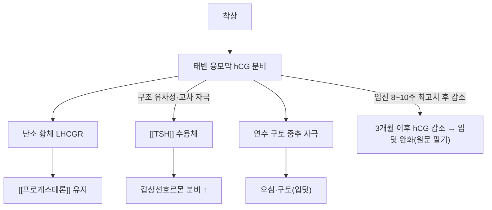

# 🧪 [[hCG]] (Human Chorionic Gonadotropin, 인간 융모성 생식선 자극 호르몬)

> **핵심 3줄 요약 (Key Summary)**:
> - 🌿 분비 기원 & 분자 분류: 태반 융모막세포에서 분비되는 **이종이합체 당단백질 호르몬**. [[LH]]와 구조적으로 유사하기에 황체를 계속 자극하고 유지하게 하여 [[프로게스테론]]을 분비할 수 있도록 한다(10주까지, 원문 필기).
> - 🎯 핵심 분자 표적 & 조절 경로: LH 수용체(LHCGR)에 결합해 황체를 구제(rescue)하며, 구조적 유사성으로 [[TSH]] 수용체에도 교차 자극 작용을 한다(PMID 15073140).
> - 🩺 주요 생리 활성 & 질환 치료 기전: 임신 진단의 핵심 지표이며(원문 필기), 연수 구토 중추 자극을 통한 입덧·임신오조의 기전으로 제시된다(원문 필기).
> - ⚠️ 식별자 오류 수정: 기존 노트의 PubChem CID 16132368은 조회 결과 hCG와 무관한 염소 함유 소분자(C₆₄H₅₄Cl₃N₇O₂₃)로 확인되어 삭제하였다. hCG는 당단백질 호르몬이라 PubChem 소분자 CID가 존재하지 않는다(FSH·LH·TSH와 동일 패턴).

> **사용자 원문 필기 (보존)**:
-  가임기 여성을 진료하는데 있어서 임신 여부를 확실하게 아는 것이 중요하며, 이를 위해서는 [[hCG]] 검사나 LMP 확인을 통해 알 수 있다.
- [[LH]]와 구조적으로 유사하기에 황체를 계속 자극하고 유지하게 하여 [[프로게스테론]]을 분비할 수 있도록 한다.(10주까지)
# 임신 과정
- 전치태반: 착상이 너무 아래 부위인 자궁 경부에서 진행됨. 하혈(출혈)이 자주 나타나고 유산으로 이어지는 확률이 높아짐.(태반의 위치가 중요)
![[Pasted image 20240228172142.png]]
- [[자궁내막증]]: 나팔관에서 자궁내막이 형성되어 여기서 착상되면서 불임이 나타날 수 있음(자궁외 임신)
![[Pasted image 20240228172154.png]]
- [[LH]]가 분비되어 [[에스트로겐]]이 분비되면서 자궁 벽을 두껍게 만들며, [[FSH]]가 분비되면서 [[프로게스테론]]이 분비되면서 두터운 자궁내막을 유지한다.
![[Pasted image 20240228172213.png]]
![[Pasted image 20240228172223.png]]
- 태아(태반)가 엄마에게 [[hCG]](인간 융모성 생식선 자극 호르몬)을 분비한다. 
- [[hCG]]는 [[TSH]](갑상선 자극 호르몬)과 비슷한 작용(갑상선 호르몬 형성)을 한다. (갑상선 호르몬은 열 발생, 뇌와 뼈의 성장 발육 촉진)
- 산모의 [[TSH]]는 산모 상태에 큰 영향을 받기 때문에 이 역할을 대신 하는 [[hCG]]를 태아가 분비하는 것임.
![[Pasted image 20240228172233.png]]
![[Pasted image 20240228172240.png]]
![[Pasted image 20240228172247.png]]
- [[hCG]]는 연수로 가서 구토 중추를 자극하여 오심구토를 유발하게 됨
- 3개월 지나면 [[hCG]]는 다시 적어지기에 임신 초기 3개월 동안 입덧이 심하다.
-> 장이 편하고 소화가 잘되는 하얀 쌀밥을 먹는 것이 좋다. 
- 임신오조: 심한 오심과 구토, 체중감소 및 전해질 불균형을 동반하는 임신 합병증
- [[hCG]] 자극과 합쳐지는 위장관에서 올라오는 유해 정보를 차단하고 호흡과 통증 관리(속과 장이 편안해야함)
-> 떡볶이, 치킨, 빵, 유제품, 과일 등등 섭취를 주의할 것
![[Pasted image 20240228172300.png]]

---

## 📌 목차
1. [기본 생화학 정보 & 분자 구조식 (Biochemical Identity)](#1-기본-생화학-정보--분자-구조식-biochemical-identity)
2. [분비 기관 & 생합성 경로 (Biosynthesis & Secretion)](#2-분비-기관--생합성-경로-biosynthesis--secretion)
3. [수용체 & 세포 내 신호전달 경로 (Receptors & Signaling Pathways)](#3-수용체--세포-내-신호전달-경로-receptors--signaling-pathways)
4. [주요 생리 활성 & 표적 장기 효능 (Physiological Actions)](#4-주요-생리-활성--표적-장기-효능-physiological-actions)
5. [분비 조절 & 피드백 기전 (Regulation & Feedback Loop)](#5-분비-조절--피드백-기전-regulation--feedback-loop)
6. [관련 질환 & 병태생리 (Clinical Pathophysiology & Diseases)](#6-관련-질환--병태생리-clinical-pathophysiology--diseases)
7. [약물 치료 표적 & 한의학적 연계 (Pharmacological Targets & Herbs)](#7-약물-치료-표적--한의학적-연계-pharmacological-targets--herbs)
8. [💡 사용자 진료실 핵심 필기 & 임상 응용 팁 (Melt-In & High-Yield)](#8--사용자-진료실-핵심-필기--임상-응용-팁-melt-in--high-yield)
9. [출처 및 학술 참고 문헌 (References)](#9-출처-및-학술-참고-문헌-references)

---

## 1. 기본 생화학 정보 & 분자 구조식 (Biochemical Identity)

| 항목 | 상세 내용 |
| :--- | :--- |
| **분자 유형** | 이종이합체(heterodimer) 당단백질 호르몬 — PubChem 소분자 CID **없음**(기존 기재 CID 16132368은 무관한 염소 함유 소분자로 확인돼 삭제) |
| **공통 α-서브유닛** | [[FSH]]·[[LH]]·[[TSH]]와 동일 서열 공유 |
| **특이 β-서브유닛** | hCGβ — [[LH]]β와 매우 유사하나 C-말단 펩타이드가 추가로 존재해 반감기가 훨씬 길다 |
| **수용체** | LHCGR(주 표적), [[TSH]] 수용체(교차 반응, 고농도에서) |

---

## 2. 분비 기관 & 생합성 경로 (Biosynthesis & Secretion)

* **분비 기관**: 태반 융모막 합포체영양막세포(syncytiotrophoblast)에서 착상 직후부터 분비된다.
* **분비 동역학**: 착상 후 급격히 증가해 임신 8~10주경 최고치에 도달한 뒤 감소한다(원문 필기 "3개월 지나면 hCG는 다시 적어지기에").
* **진단적 의미**: 가임기 여성을 진료하는 데 있어서 임신 여부를 확실하게 아는 것이 중요하며, hCG 검사나 LMP(최종 월경일) 확인을 통해 알 수 있다(원문 필기).

---

## 3. 수용체 & 세포 내 신호전달 경로 (Receptors & Signaling Pathways)

* **LHCGR 결합**: [[LH]]와 구조적으로 유사하기에 난소 황체의 LHCGR을 자극해 황체를 계속 자극·유지시켜 [[프로게스테론]]을 분비할 수 있도록 한다(10주까지, 원문 필기) — "황체 구제(corpus luteum rescue)".
* **TSH 수용체 교차 자극**: hCG는 [[TSH]](갑상선 자극 호르몬)과 비슷한 작용(갑상선 호르몬 형성)을 한다(원문 필기). 구조적 유사성으로 고농도 hCG가 TSH 수용체를 교차 자극해 갑상선 호르몬 분비를 촉진할 수 있다(PMID 15073140).
* **구토 중추 자극**: hCG는 연수로 가서 구토 중추를 자극하여 오심구토를 유발하게 된다(원문 필기).

---

## 4. 주요 생리 활성 & 표적 장기 효능 (Physiological Actions)

* **황체 유지**: 임신 초기 황체의 [[프로게스테론]] 분비를 유지시켜 자궁내막을 보존한다(원문 필기).
* **태아측 갑상선 기능 보조**: 갑상선 호르몬은 열 발생, 뇌와 뼈의 성장 발육을 촉진한다(원문 필기). 산모의 [[TSH]]는 산모 상태에 큰 영향을 받기 때문에, 이 역할을 대신하는 hCG를 태아(태반)가 분비하는 것이다(원문 필기).
* **입덧 유발**: hCG의 구토 중추 자극이 임신 초기 입덧의 기전으로 제시된다(원문 필기).
* **기타 extragonadal 작용**: 생식샘 외 조직(면역계·혈관·자궁내막)에도 작용한다는 연구가 축적되어 있다(PMID 21845366).

---

## 5. 분비 조절 & 피드백 기전 (Regulation & Feedback Loop)

* **시간 경과**: 임신 8~10주경 최고치 도달 후 감소하며, 이에 따라 입덧 증상도 호전되는 경향이 있다(원문 필기).

---

## 6. 관련 질환 & 병태생리 (Clinical Pathophysiology & Diseases)

| 구분 | 관련 질환·상태 | 기전 |
| :--- | :--- | :--- |
| **착상 위치 이상** | 전치태반 | 착상이 너무 아래 부위인 자궁 경부에서 진행됨. 하혈(출혈)이 자주 나타나고 유산으로 이어지는 확률이 높아짐(원문 필기) |
| **착상 위치 이상** | 자궁외 임신 | 나팔관에서 자궁내막이 형성되어 여기서 착상되면서 불임이 나타날 수 있음(원문 필기) |
| **임신 중 갑상선 기능 이상** | 임신성 일시적 갑상선중독증 | hCG의 TSH 수용체 교차 자극으로 임신 초기 일시적 갑상선기능항진 소견이 나타날 수 있음(PMID 15073140) |
| **중증 입덧** | 임신오조(Hyperemesis gravidarum) | 심한 오심과 구토, 체중감소 및 전해질 불균형을 동반하는 임신 합병증(원문 필기), hCG 수치와의 연관성이 임상적으로 논의됨 |

---

## 7. 약물 치료 표적 & 한의학적 연계 (Pharmacological Targets & Herbs)

* **양약 표적 (Western Pharmacology)**
  * **hCG 제제(배란 트리거)**: LH와 동일한 수용체에 결합하며 반감기가 길어, 보조생식술에서 배란 유발 트리거로 사용한다 → [[LH]]
  * **임신오조 관리**: hCG 자극과 합쳐지는 위장관에서 올라오는 유해 정보를 차단하고 호흡과 통증 관리가 핵심이다(속과 장이 편안해야 함, 원문 필기).
* **한방 본초 & 식이 연계 (K-Medicine Connection)**
  * **식이 관리**: 장이 편하고 소화가 잘되는 하얀 쌀밥을 먹는 것이 좋다(원문 필기). 떡볶이·치킨·빵·유제품·과일 등등 섭취를 주의할 것(원문 필기).
  * 입덧·임신오조의 한의학적 변증 접근은 비위기허(脾胃氣虛)·간기범위(肝氣犯胃) 범주로 논의되나, 특정 처방이 hCG 분비를 직접 조절한다는 인체 근거는 확인되지 않았다 ⚠️.

---

## 8. 💡 사용자 진료실 핵심 필기 & 임상 응용 팁 (Melt-In & High-Yield)

* **사용자 원문 필기**: 위 핵심 요약 바로 아래 "임신 과정" 블록에 100% 보존.
* **임상 체크 포인트**: 전치태반·자궁외 임신은 착상 위치 이상으로 인한 하혈·불임 위험 질환이므로, 임신 초기 하혈 환자에서 반드시 감별한다(원문 필기).
* **환자 설명 팁**: "hCG는 임신 초기 3개월간 황체를 유지시켜 임신을 지켜주는 호르몬이면서, 동시에 입덧을 유발하는 호르몬이기도 합니다. 3개월이 지나면 hCG가 줄면서 입덧도 대개 호전됩니다."

---

## 9. 출처 및 학술 참고 문헌 (References)

1. Rodien P, Jordan N, Lefèvre A, Royer J, Vasseur C, Savagner F, Bourdelot A, Rohmer V (2004). Abnormal stimulation of the thyrotrophin receptor during gestation. *Human Reproduction Update*, 10(2):95-105. PMID: [15073140](https://pubmed.ncbi.nlm.nih.gov/15073140/)
   - `[연구 요약]` 임신 중 hCG가 TSH 수용체를 교차 자극해 일시적 갑상선기능항진을 유발하는 기전을 정리한 종설 — 원문 필기의 "hCG는 TSH와 비슷한 작용을 한다" 서술의 학술적 근거.
2. Banerjee P, Fazleabas AT (2011). Extragonadal actions of chorionic gonadotropin. *Reviews in Endocrine and Metabolic Disorders*, 12(4):323-332. PMID: [21845366](https://pubmed.ncbi.nlm.nih.gov/21845366/)
   - `[연구 요약]` hCG의 생식샘 외(extragonadal) 작용(면역·혈관·자궁내막 등)을 정리한 종설.

> ⚠️ 내용 검토 필요 (2026-10-13 클로드): 원문 필기(임신 과정 전체, 이미지 6장) 100% 보존, 1섹션 스텁을 9섹션 표준 템플릿으로 전면 재작성. CID 16132368(무관한 염소 함유 소분자) 삭제 — hCG는 당단백질 호르몬이라 CID 미적용. 실제 PMID 2건 신규 확보.
