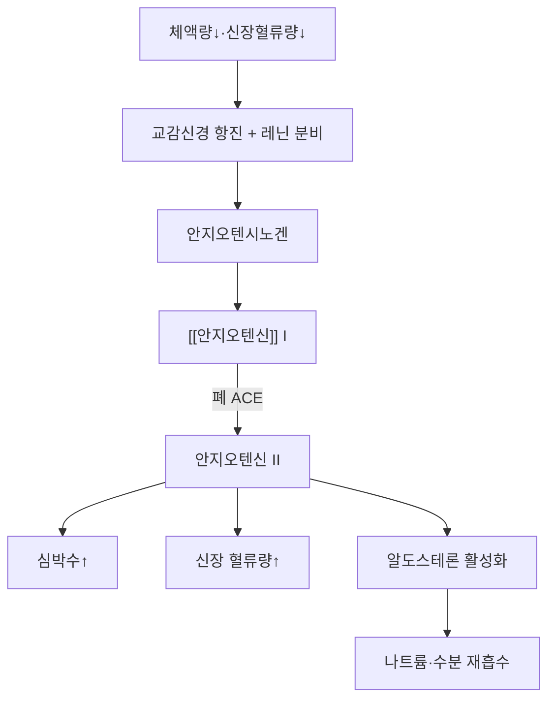

# 🧪 [[알도스테론]] (Aldosterone)

> **핵심 3줄 요약 (Key Summary)**:
> - 🌿 분비 기원 & 분자 분류: 부신 피질 **사구대(zona glomerulosa)**에서 분비되는 **미네랄코르티코이드**(C21 스테로이드).
> - 🎯 핵심 분자 표적 & 조절 경로: 원위세뇨관·집합관 주세포의 **미네랄코르티코이드 수용체(MR)**에 결합 → **ENaC·Na⁺/K⁺-ATPase** 발현 증가 → 나트륨 재흡수·칼륨 배설 촉진(PMID 42272278).
> - 🩺 주요 생리 활성 & 질환 치료 기전: [[RAAS]]의 최종 실행 호르몬으로 체액량·혈압을 조절한다. 나트륨 저류 시 부종·고혈압, 칼륨 배설 과다 시 저칼륨혈증(근력약화·부정맥)이 나타난다. [[감초]]([[글리시리진]])는 11β-HSD2를 억제해 가성알도스테론증을 유발한다(PMID 39753286).
> - ⚠️ 식별자 확인: PubChem CID 5839는 재확인 결과 정확함(C₂₁H₂₈O₅, 360.4 g/mol).

---

## 📌 목차
1. [기본 생화학 정보 & 분자 구조식 (Biochemical Identity)](#1-기본-생화학-정보--분자-구조식-biochemical-identity)
2. [분비 기관 & 생합성 경로 (Biosynthesis & Secretion)](#2-분비-기관--생합성-경로-biosynthesis--secretion)
3. [수용체 & 세포 내 신호전달 경로 (Receptors & Signaling Pathways)](#3-수용체--세포-내-신호전달-경로-receptors--signaling-pathways)
4. [주요 생리 활성 & 표적 장기 효능 (Physiological Actions)](#4-주요-생리-활성--표적-장기-효능-physiological-actions)
5. [분비 조절 & 피드백 기전 — RAAS (Regulation & Feedback Loop)](#5-분비-조절--피드백-기전--raas-regulation--feedback-loop)
6. [관련 질환 & 병태생리 (Clinical Pathophysiology & Diseases)](#6-관련-질환--병태생리-clinical-pathophysiology--diseases)
7. [약물 치료 표적 & 한의학적 연계 (Pharmacological Targets & Herbs)](#7-약물-치료-표적--한의학적-연계-pharmacological-targets--herbs)
8. [💡 사용자 진료실 핵심 필기 & 임상 응용 팁 (Melt-In & High-Yield)](#8--사용자-진료실-핵심-필기--임상-응용-팁-melt-in--high-yield)
9. [출처 및 학술 참고 문헌 (References)](#9-출처-및-학술-참고-문헌-references)

---

## 1. 기본 생화학 정보 & 분자 구조식 (Biochemical Identity)

> [!abstract]+ 🧪 3D 약리 분자 구조 (Interactive 3D Viewer)
> <iframe src="https://molecule-viewer-rho.vercel.app/?cid=5839" style="width: 100%; height: 600px; border: none; border-radius: 12px; box-shadow: 0 4px 20px rgba(0,0,0,0.15);" allowfullscreen></iframe>

| 항목 | 상세 내용 |
| :--- | :--- |
| **분자식 / 분자량** | C₂₁H₂₈O₅ / 360.4 g/mol (PubChem CID 5839 조회 확인) |
| **PubChem CID** | [5839](https://pubchem.ncbi.nlm.nih.gov/compound/5839) |
| **화학 분류** | 미네랄코르티코이드(C21 스테로이드) |
| **분비 세포** | 부신 피질 사구대(zona glomerulosa) |

---

## 2. 분비 기관 & 생합성 경로 (Biosynthesis & Secretion)

* **분비 자극**: ACTH가 아니라 세포외액 **칼륨(K⁺) 상승**과 **[[안지오텐신]] II 상승**이 주 분비 자극이다(나트륨 증가는 미약하게 억제).
* **조절 축**: 경동맥·신장·심방의 혈압(용적) 조절기에 의해 조절된다 — 즉 RAAS·K⁺가 축이다.
* **사상의학 연결**: 소양인 패턴에서 땀을 많이 흘리고 상열하한된 상태에서 신장 혈류량이 줄어 알도스테론↑·혈압↑로 이어질 수 있다(상하망동).

---

## 3. 수용체 & 세포 내 신호전달 경로 (Receptors & Signaling Pathways)

* **작용 기전**: 원위세뇨관·집합관 주세포에서 **ENaC(나트륨 채널)·Na⁺/K⁺-ATPase** 발현을 증가시켜 나트륨 재흡수(물 동반)를 촉진 → 혈압 상승(PMID 42272278).
* **칼륨 배설**: 나트륨 흡수와 교환으로 칼륨 배설이 증가 → 저칼륨혈증(근력약화, 근육경련, 감각이상, 피로, 변비, 장운동 마비, 부정맥, 심정지).
* **알도스테론 vs [[코르티솔]]**: 코르티솔이 1000배 많이 분비되지만 미네랄코르티코이드 활성은 알도스테론이 훨씬 강하다(알도스테론: 글루코 ≈30·미네랄 100 / 코르티솔: 글루코 100·미네랄 0.03).
* **수용체 보호 기전**: 미네랄코르티코이드 수용체(MR)는 코르티솔과 알도스테론을 구별하지 못하므로, 원위세뇨관은 **11β-HSD2** 효소로 코르티솔을 비활성형 코르티손으로 전환해 MR을 보호한다(간에서는 다시 활성화).

---

## 4. 주요 생리 활성 & 표적 장기 효능 (Physiological Actions)

* **체액량·혈압 조절**: 나트륨 재흡수·칼륨 배설을 촉진해 체액량·혈압을 조절한다.
* **악영향(과다)**: 나트륨 저류 → 부종·고혈압, 칼륨 배설 → 저칼륨혈증(근력약화·부정맥).
* **전신 조직 작용**: 신장 외에도 심장·혈관·뇌 등 비전형 조직에서도 미네랄코르티코이드 수용체를 매개한 작용이 보고된다(PMID 42272278).

---

## 5. 분비 조절 & 피드백 기전 — RAAS (Regulation & Feedback Loop)

* **RAAS 경로**: 체액량↓·신장혈류량↓ → 교감신경 항진 + 레닌 분비 → 안지오텐시노겐 → [[안지오텐신]]1 → (폐 ACE) 안지오텐신2 → 심박수↑, 신장 혈류량↑, **알도스테론 활성화** → 나트륨·수분 재흡수.
* **한의 연결**: 신장 혈류량 감소 = 전신 혈액량 감소 → 혈압↑·안면 홍조·소변불리 → [[교감신경]] 항진 완화 방향. 소음인은 [[감초]]로 수분 저류·[[육계]]로 신장 혈류량 증가, 소양인은 [[복령]]·[[택사]]로 신장 혈류량 증가.
* 소변자리는 [[부교감신경]] 항진 완화 / 소음인은 혈당 문제, 소양인은 혈압 문제가 많다.

---

## 6. 관련 질환 & 병태생리 (Clinical Pathophysiology & Diseases)

| 구분 | 관련 질환·상태 | 기전 |
| :--- | :--- | :--- |
| **원발성 알도스테론증** | Conn 증후군 등 | 알도스테론 자체가 과다 분비 — 알도스테론↑·레닌↓·ARR↑ (PMID 42350437) |
| **가성알도스테론증(감초 유발)** | 감초 함유 처방 장기 복용 | 알도스테론 자체는 낮은데 MR 과활성으로 고혈압·저칼륨·대사성 알칼리증·부종 — [[감초]]의 [[글리시리진]] → 글리시레티닉산(GA) → **11β-HSD2 억제** → [[코르티솔]]이 코르티손으로 비활성화되지 못하고 MR을 자극(PMID 39753286) |
| **감별** | 원발성 알도스테론증 vs 가성알도스테론증 | 원발성은 알도스테론·ARR↑, 가성은 **알도스테론·레닌 모두 낮음** — 문진에서 감초·한약 복용력이 결정적 |

> 감초 함유 처방([[육군자탕]]·[[작약감초탕]]·[[자감초탕]] 등) 장기 복용, 고령·이뇨제·ACEi/ARB 병용 시 가성알도스테론증 위험이 높다. 저칼륨(근력약화·부정맥)·고혈압·부종·대사성 알칼리증을 감시하고 K⁺·혈압을 모니터링한다.

---

## 7. 약물 치료 표적 & 한의학적 연계 (Pharmacological Targets & Herbs)

* **양약 표적 (Western Pharmacology)**
  * **MR 길항제(스피로놀락톤·에플레레논)**: 원발성 알도스테론증·심부전·저항성 고혈압 치료.
  * **ACEi/ARB**: RAAS 상류를 차단해 알도스테론 생성을 간접 억제.
* **한방 본초 & 방제 연계 (K-Medicine Connection)**
  * **가성알도스테론증 예방**: 감초 함유 처방([[육군자탕]]·[[작약감초탕]]·[[자감초탕]] 등)을 장기 처방할 때는 K⁺·혈압을 정기적으로 확인한다.
  * **사상의학 체질별 접근**: 소음인은 [[감초]](수분 저류)·[[육계]](신장 혈류량 증가), 소양인은 [[복령]]·[[택사]](신장 혈류량 증가)로 RAAS 축에 다르게 접근한다는 체질 이론이 있다(인체 RAAS 수치 변화에 대한 직접 근거는 제한적 ⚠️).

---

## 8. 💡 사용자 진료실 핵심 필기 & 임상 응용 팁 (Melt-In & High-Yield)

* **사용자 원문 필기**: 위 내용(RAAS 경로·사상의학 연결·가성알도스테론증) 전체가 원장님 진료 필기에서 유래했으며 100% 보존되었다.
* **임상 체크 포인트**: 원인 불명의 저칼륨혈증·고혈압 환자에서는 감초 함유 한약 복용력(육군자탕·작약감초탕·자감초탕 등)을 반드시 확인한다 — 원발성 알도스테론증과 감별할 결정적 단서다.
* **환자 설명 팁**: "감초를 오래 많이 먹으면 몸이 마치 알도스테론이 많아진 것처럼 착각하게 되어, 실제로는 알도스테론 수치가 낮은데도 혈압이 오르고 칼륨이 빠져나갈 수 있습니다."

---

## 9. 출처 및 학술 참고 문헌 (References)

1. (2026). Aldosterone, not only an adrenal mineralocorticoid: An updated review of its functions, mechanisms, biosynthesis, hormone system and regulation in multiple organs and tissues. *Journal of Physiology and Pharmacology*. PMID: [42272278](https://pubmed.ncbi.nlm.nih.gov/42272278/)
   - `[연구 요약]` 알도스테론의 기능·기전·생합성·전신 조직 작용을 종합한 최신 종설.
2. (2025). Liquorice-induced pseudohyperaldosteronism: a rare cause for severe hypertension. *BMJ Case Reports*. PMID: [39753286](https://pubmed.ncbi.nlm.nih.gov/39753286/)
   - `[연구 요약]` 감초(liquorice) 장기 복용으로 인한 가성알도스테론증·중증 고혈압 사례 보고 — 11β-HSD2 억제 기전의 임상례.
3. (2026). Primary aldosteronism. *Nature Reviews Disease Primers*. PMID: [42350437](https://pubmed.ncbi.nlm.nih.gov/42350437/)
   - `[연구 요약]` 원발성 알도스테론증의 병태생리·진단(ARR)·치료를 정리한 종설 — 가성알도스테론증과의 감별 기준 참고.

> ⚠️ 내용 검토 필요 (2026-10-13 클로드): 원문 필기(RAAS·사상의학 연계·가성알도스테론증) 전체를 1~8섹션에 Melt-In하여 100% 보존. 비표준(0섹션, 헤딩 번호 없음) 구조를 9섹션 표준 템플릿으로 재구성. CID 5839 재확인 결과 정확. 인용 없던 본문에 실제 PMID 3건 신규 확보.
