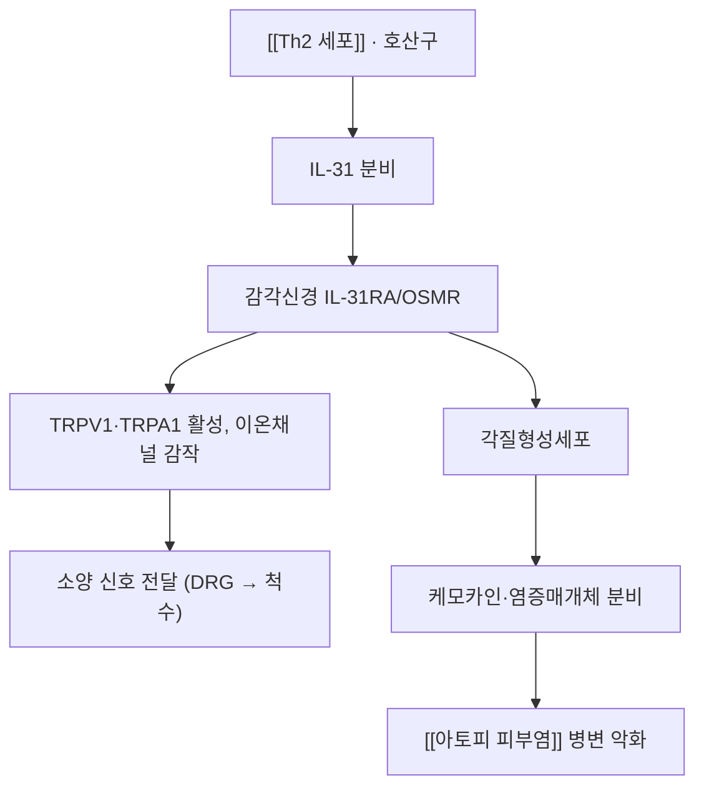

# 🧬 IL-31 (Interleukin-31)

> **핵심 요약 (Key Summary)**:
> - 🧬 **정체**: IL-6 계열 사이토카인. 주로 [[Th2 세포]]와 호산구·대식세포에서 분비된다.
> - 🎯 **핵심 기능**: 감각신경의 IL-31RA/OSMR 복합수용체를 통해 **소양(pruritus)**을 유발한다. 아토피·결절성 양진의 핵심 매개체.
> - 🛠️ **임상 의의**: nemolizumab(IL-31RA 차단) 같은 표적 치료의 근거. 소양 조절 실패 환자에서 새 표적이 된다.

---

## 📌 목차
1. [정의·구조·합성](#1-정의구조합성)
2. [기능·기전](#2-기능기전)
3. [임상 의의·치료 연계](#3-임상-의의치료-연계)
4. [논문 연결](#4-논문-연결)
5. [함께 보기](#5-함께-보기)

---

## 1. 정의·구조·합성

| 항목 | 내용 |
| :--- | :--- |
| **계열** | IL-6 사이토카인 패밀리(4-helix bundle) |
| **분비 세포** | [[Th2 세포]], 호산구, 비만세포, 대식세포, 각질형성세포 |
| **수용체** | IL-31RA + OSMRβ 이종이합체 |
| **발현 부위** | 감각 신경절(DRG) 뉴런, 각질형성세포, 호산구 |
| **주요 유전자** | 12q24.31 영역 |

* **특징**: 다른 IL-6 계열과 달리 면역세포 증식보다 **신경-피부 상호작용**에 치우친 기능을 가진다.
* **유도 인자**: [[IL-4]]·[[IL-13]] 자극이 각질형성세포·Th2 세포의 IL-31 발현을 증가시킨다.

---

## 2. 기능·기전

* **소양-긁기 악순환**: IL-31은 히스타민 비의존성 소양을 유발한다. 항히스타민이 듣지 않는 아토피 소양의 주요 원인이다.
* **신경 성장**: 반복 자극은 감각신경 말단의 신경돌기 성장을 촉진해 병변부 과감작을 만든다.
* **피부장벽 연계**: 소양으로 인한 찰상이 [[필라그린]]·세라마이드 손실을 심화시켜 항원 침투를 늘린다.

---

## 3. 임상 의의·치료 연계

* **질환 연관**: [[아토피 피부염]], 결절성 양진, 만성 두드러기, 호산구성 식도염, 건선 일부.
* **표적 치료**: IL-31RA 차단 항체(nemolizumab)가 결절성 양진·아토피 소양에 사용된다. dupilumab은 상류에서 [[IL-4]]/[[IL-13]]을 막아 IL-31 생성을 간접 감소시킨다.
* **바이오마커**: 혈청 IL-31은 소양 중증도와 대체로 상관하나, 임상 결정을 단독으로 좌우할 수준은 아니다.
* **한의 접근**: 소양은 한의학에서 풍(風)·습열(濕熱)·혈허(血虛) 변증으로 나뉜다. IL-31 경로는 '풍조(風燥)' 개념과 기전적으로 겹치는 부분이 있어, 청열거풍·양혈윤조 처방의 연구 대상이 된다.

---

## 4. 논문 연결

* **Paller AS, et al. (2022)**. Dupilumab in children aged 6 months to younger than 6 years with uncontrolled atopic dermatitis. *Lancet*, 400(10356), 908-919. [PMID 36116481](https://pubmed.ncbi.nlm.nih.gov/36116481/)
  * [연구 요약] 소아 아토피에서 IL-4Rα 차단이 소양·EASI를 개선해, 상류 Th2 신호가 소양 매개체를 조절함을 뒷받침했다.
* **Dillon SR, et al. (2004)**. Interleukin 31, a cytokine produced by activated T cells, induces dermatitis in mice. *Nat Immunol*, 5(7), 752-760. [PMID 15184896](https://pubmed.ncbi.nlm.nih.gov/15184896/)
  * [연구 요약] IL-31의 발견과 피부염·소양 유발을 보인 기초 연구.

---

## 5. 함께 보기

* 상위 신호: [[IL-4]] · [[IL-13]] · [[Th2 세포]]
* 임상: [[아토피 피부염]] · [[IgE]] · [[필라그린]]
* 약물: [[dupilumab]]
