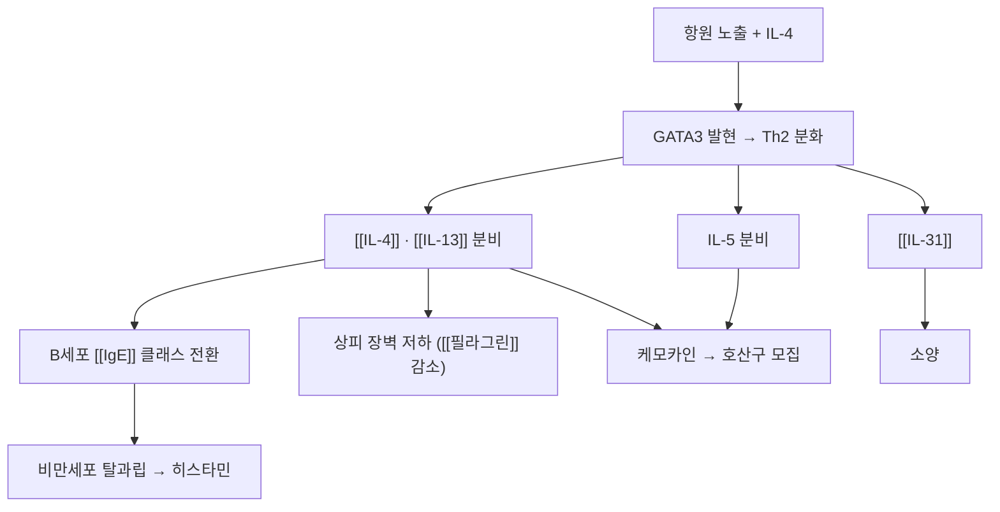

# 🧬 Th2 세포 (Type 2 Helper T Cell)

> **핵심 요약 (Key Summary)**:
> - 🧬 **정체**: CD4+ 보조 T 세포의 아형으로, 전사인자 GATA3를 발현하며 [[IL-4]]·[[IL-5]]·[[IL-13]]를 분비한다.
> - 🎯 **핵심 기능**: [[IgE]] 클래스 전환, 호산구 모집·활성, 점막 점액 분비, 소양 매개([[IL-31]])를 총괄하는 2형 염증의 지휘자.
> - 🛠️ **임상 의의**: [[아토피 피부염]]·[[천식]]·알레르기성 비염·호산구성 식도염의 공통 축. dupilumab·JAK 억제제의 표적 상류.

---

## 📌 목차
1. [정의·분화](#1-정의분화)
2. [기능·기전](#2-기능기전)
3. [임상 의의·치료 연계](#3-임상-의의치료-연계)
4. [논문 연결](#4-논문-연결)
5. [함께 보기](#5-함께-보기)

---

## 1. 정의·분화

| 항목 | 내용 |
| :--- | :--- |
| **표현형** | CD4+, GATA3+, CRTH2+ (일부) |
| **핵심 전사인자** | GATA3 |
| **대표 사이토카인** | [[IL-4]], IL-5, [[IL-13]], [[IL-31]] |
| **분화 유도** | IL-4 신호(STAT6) + 항원 제시 + 공동자극 |
| **길항 관계** | Th1(IFN-γ)·Th17(IL-17)와 상호 억제 |

* **분화 경로**: 수지상세포가 항원을 제시하고 IL-4가 작용하면 naive CD4+ T 세포가 GATA3를 발현하며 Th2로 분화한다.
* **기억 Th2**: 병변 재노출 시 빠르게 사이토카인을 분비해 재발 염증을 매개한다.
* **조직 상주**: 피부·점막에 상주하는 Th2 세포가 만성 병변의 재발을 주도한다.

---

## 2. 기능·기전

* **IgE 축**: IL-4/IL-13이 B세포의 ε 전환을 유도하고, IgE가 비만세포를 감작해 즉시형 반응을 준비한다.
* **장벽 축**: IL-4/IL-13은 각질형성세포의 필라그린·로리크린 발현을 낮춰 피부 장벽을 무너뜨린다. 장벽 손상은 다시 항원 침투를 늘리는 악순환을 만든다.
* **호산구 축**: IL-5는 호산구 생존·탈과립을 촉진한다. 혈중 호산구 상승은 2형 염증의 대표 지표다.

---

## 3. 임상 의의·치료 연계

* **질환**: [[아토피 피부염]], [[천식]](2형 표현형), 알레르기성 비염, 만성 부비동염·비용종, 호산구성 식도염, 결절성 양진.
* **아토픽 마치(atopic march)**: 영아기 습진 → 소아 천식 → 비염으로 이어지는 진행의 공통 축이 Th2 염증이다.
* **치료 표적**:
  * **상류 차단** — [[dupilumab]](IL-4Rα).
  * **하류 차단** — 항 IL-5(메폴리주맙·벤랄리주맙), 항 [[IgE]](오말리주맙), 항 IL-31RA(nemolizumab).
  * **경구 소분자** — JAK 억제제가 STAT6 하류 신호를 억제.
* **한의 접근**: 알레르기 체질은 肺脾虛·濕熱로 변증되는 경우가 많다. 보기건비·청열거습 처방이 2형 염증 사이토카인에 미치는 영향은 소규모 연구가 축적된 단계로, 임상에서는 변증 우선 원칙을 유지한다.

---

## 4. 논문 연결

* **Paller AS, et al. (2022)**. *Lancet*, 400(10356), 908-919. [PMID 36116481](https://pubmed.ncbi.nlm.nih.gov/36116481/)
  * [연구 요약] IL-4Rα 차단이 소아 아토피에서 임상 개선을 보여, Th2 상류 신호 차단의 유효성을 뒷받침했다.
* **Simpson EL, et al. (2016)**. *N Engl J Med*, 375, 2335-2348. [PMID 27690741](https://pubmed.ncbi.nlm.nih.gov/27690741/)
  * [연구 요약] 성인 중등도-중증 아토피에서 dupilumab 3상 결과. Th2 경로 차단의 임상 효과를 확립했다.

---

## 5. 함께 보기

* 사이토카인: [[IL-4]] · [[IL-13]] · [[IL-31]] · IgE
* 분자·장벽: [[필라그린]]
* 질환: [[아토피 피부염]] · [[천식]]
* 약물: [[dupilumab]]
